---
## Author
author:
  name: Мацюк Константин Владимирович
  degrees: BSc
  orcid: 0000-0002-0877-7063
  email: 1032253640@rudn.ru
  affiliation:
    - name: Российский университет дружбы народов
      country: Российская Федерация
      postal-code: 117198
      city: Москва
      address: ул. Миклухо-Маклая, д. 6

## Title
title: "Лабораторная работа №2. Управление пользователями и группами"
subtitle: "Дисциплина: Основы администрирования операционных систем"
license: "CC BY"

## Fonts
mainfont: IBM Plex Serif
romanfont: IBM Plex Serif
sansfont: IBM Plex Sans
monofont: DejaVu Sans Mono
mathfont: STIX Two Math
mainfontoptions: Ligatures=Common,Ligatures=TeX,Scale=0.94
romanfontoptions: Ligatures=Common,Ligatures=TeX,Scale=0.94
sansfontoptions: Ligatures=Common,Ligatures=TeX,Scale=MatchLowercase,Scale=0.94
monofontoptions: Scale=MatchLowercase,Scale=0.94
---

# Цель работы

Получить представление о работе с учётными записями пользователей и группами пользователей в операционной системе типа Linux.

# Задание

1. Прочитать справочное описание `man` по командам: `ls`, `whoami`, `id`, `groups`, `su`, `sudo`, `passwd`, `vi`, `visudo`, `useradd`, `usermod`, `groupadd`, `groupdel`.
2. Выполнить действия по переключению между учётными записями пользователей, по управлению учётными записями пользователей (раздел 2.4.1).
3. Выполнить действия по созданию пользователей и управлению их учётными записями (раздел 2.4.2).
4. Выполнить действия по работе с группами пользователей (раздел 2.4.3).

# Теоретическое введение

В операционных системах типа Linux применяется дискреционное управление доступом: субъектами выступают пользователи и группы, объектами — файлы, каталоги и устройства. Особый субъект — суперпользователь `root`, имеющий право устанавливать права владения для всех остальных. Доступ к ресурсу делится на чтение, запись и выполнение; права отображаются строкой вида `-rwxrwxrwx`, где первый символ — тип ресурса, далее три группы по три символа — права владельца, группы-владельца и всех остальных.

Информация о пользователях хранится в файлах `/etc/passwd`, `/etc/shadow` и `/etc/group`, а параметры создания новых учётных записей задаются в `/etc/login.defs`, `/etc/default/useradd` и шаблоном `/etc/skel/`. В [табл. @tbl-std-files] приведено краткое описание основных файлов, используемых при управлении пользователями и группами.

| Файл                    | Описание                                                                                          |
|-------------------------|---------------------------------------------------------------------------------------------------|
| `/etc/passwd`           | Список пользователей: имя, UID, GID, комментарий, домашний каталог, оболочка                      |
| `/etc/shadow`           | Зашифрованные пароли и параметры их действия (срок, предупреждение, блокировка)                   |
| `/etc/group`            | Список групп и их участников                                                                      |
| `/etc/sudoers`          | Правила выполнения команд через `sudo`; редактируется только через `visudo`                       |
| `/etc/login.defs`       | Параметры по умолчанию для новых пользователей: диапазон UID, срок действия пароля, `CREATE_HOME` |
| `/etc/default/useradd`  | Значения по умолчанию для команды `useradd`: группа, оболочка, скелет                             |
| `/etc/skel/`            | Шаблон домашнего каталога нового пользователя                                                     |

: Основные файлы управления пользователями и группами {#tbl-std-files}

# Выполнение лабораторной работы

## Переключение учётных записей пользователей

Вошёл в систему как обычный пользователь и открыл терминал. Определил, какая учётная запись используется, командой `id` ([рис. @fig-001]).

{#fig-001 width=70%}

С помощью команды `su -` переключился на учётную запись `root`, ввёл пароль. Команда `id` подтвердила, что UID стал равен 0 ([рис. @fig-002]).

{#fig-002 width=70%}

Вернулся к учётной записи обычного пользователя командой `exit`.

Открыл файл `/etc/sudoers` через `visudo` ([рис. @fig-003]).

{#fig-003 width=70%}

Убедился, что в файле присутствует строка `%wheel ALL=(ALL) ALL`. Это означает, что все пользователи группы `wheel` могут выполнять любые команды от имени любого пользователя, в том числе root.

Создал пользователя `alice`, входящего в группу `wheel` ([рис. @fig-004]):

```bash
sudo useradd -G wheel alice
```

{#fig-004 width=70%}

Убедился, что `alice` добавлена в группу `wheel`, командой `id alice` ([рис. @fig-005]).

{#fig-005 width=70%}

Задал пароль для `alice` ([рис. @fig-006]):

```bash
sudo passwd alice
```

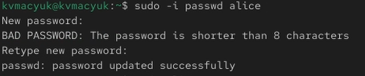{#fig-006 width=70%}

Переключился на учётную запись `alice` командой `su - alice` ([рис. @fig-007]).

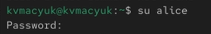{#fig-007 width=70%}

Создал пользователя `bob` ([рис. @fig-008]) и задал ему пароль ([рис. @fig-009]).

{#fig-008 width=70%}

{#fig-009 width=70%}

Проверил, в какие группы входит `bob` ([рис. @fig-010]).

{#fig-010 width=70%}

## Создание учётных записей пользователей

Переключился на учётную запись `root`. Открыл файл `/etc/login.defs` и убедился, что параметр `CREATE_HOME` установлен в `yes`, а `USERGROUPS_ENAB` — в `no` ([рис. @fig-011]).

{#fig-011 width=70%}

Перешёл в каталог `/etc/skel` и создал каталоги `Pictures` и `Documents` ([рис. @fig-012]):

```bash
cd /etc/skel
mkdir Pictures
mkdir Documents
```

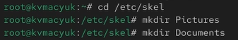{#fig-012 width=70%}

В файл `.bashrc` добавил строку:

```bash
export EDITOR=/usr/bin/nano
```

Это означает, что редактор `nano` будет установлен по умолчанию для инструментов, изменяющих текстовые файлы ([рис. @fig-013]).

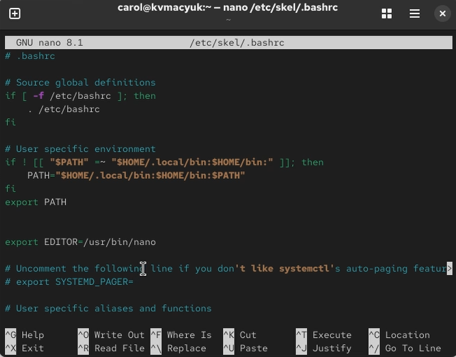{#fig-013 width=70%}

Переключился на `alice` и создал пользователя `carol` ([рис. @fig-014]):

```bash
sudo useradd carol
sudo passwd carol
```

{#fig-014 width=70%}

Проверил, что `carol` входит в свою первичную группу и что в её домашнем каталоге появились `Pictures` и `Documents` ([рис. @fig-015]).

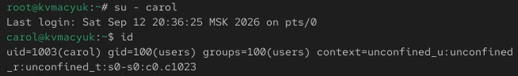{#fig-015 width=70%}

Просмотрел строку с записью о пароле `carol` в файле `/etc/shadow` ([рис. @fig-016]).

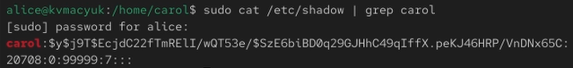{#fig-016 width=70%}

Изменил свойства пароля `carol` ([рис. @fig-017]):

```bash
sudo passwd -n 30 -w 3 -x 90 carol
```

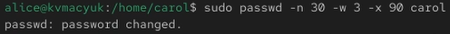{#fig-017 width=70%}

Проверил, что изменения применились ([рис. @fig-018]).

{#fig-018 width=70%}

Убедился, что `alice` присутствует во всех трёх файлах: `/etc/passwd`, `/etc/shadow`, `/etc/group` ([рис. @fig-019]).

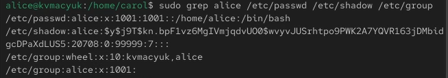{#fig-019 width=70%}

Аналогично проверил `carol` ([рис. @fig-020]).

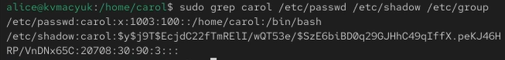{#fig-020 width=70%}

## Работа с группами

Создал группы `main` и `third` ([рис. @fig-021]):

```bash
sudo groupadd main
sudo groupadd third
```

{#fig-021 width=70%}

Добавил пользователей в группы ([рис. @fig-022]):

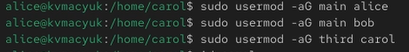{#fig-022 width=70%}

Убедился, что `carol` правильно добавлена в группу `third` ([рис. @fig-023]).

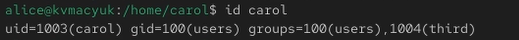{#fig-023 width=70%}

Определил, участниками каких групп являются остальные пользователи ([рис. @fig-024]).

{#fig-024 width=70%}

# Ответы на контрольные вопросы

**1. При помощи каких команд можно получить информацию о номере (идентификаторе), назначенном пользователю Linux, о группах, в которые включён пользователь?**

Используются команды `id`, `id имя_пользователя`, `groups`, `groups имя_пользователя`, `whoami`, а также просмотр файлов `/etc/passwd` и `/etc/group` через `grep`. Например, `id alice` выводит UID, GID и все группы пользователя.

**2. Какой UID имеет пользователь root? При помощи какой команды можно узнать UID пользователя?**

UID пользователя root равен 0. Узнать UID можно командами `id -u root`, `id -u имя_пользователя` или `grep имя /etc/passwd`.

**3. В чём состоит различие между командами su и sudo?**

`su` переключает на другого пользователя и требует пароль этого пользователя. `sudo` выполняет одну команду от имени другого пользователя и требует пароль текущего пользователя, а права определяются в `/etc/sudoers`.

**4. В каком конфигурационном файле определяются параметры sudo?**

В файле `/etc/sudoers`, а также в подключаемых файлах из каталога `/etc/sudoers.d/`.

**5. Какую команду следует использовать для безопасного изменения конфигурации sudo?**

`visudo` — желательно через `sudo visudo`. Она проверяет синтаксис и не даёт сохранить файл с ошибкой.

**6. Если вы хотите предоставить пользователю доступ ко всем командам администрирования системы через sudo, членом какой группы он должен быть?**

В RHEL/CentOS/Fedora — группы `wheel`, в Debian/Ubuntu — группы `sudo`. Соответствующая строка в `/etc/sudoers`: `%wheel ALL=(ALL) ALL`.

**7. Какие файлы/каталоги можно использовать для определения параметров, которые будут использоваться при создании учётных записей пользователей?**

`/etc/login.defs`, `/etc/default/useradd`, `/etc/skel/`. Например, в `/etc/login.defs` задаются `CREATE_HOME`, `USERGROUPS_ENAB`, `UID_MIN`, `PASS_MAX_DAYS`; в `/etc/skel/` хранятся шаблоны файлов и каталогов для новых пользователей.

**8. Где хранится информация о первичной и дополнительных группах пользователей ОС типа Linux?**

Первичная группа хранится в `/etc/passwd` (поле GID). Дополнительные группы — в `/etc/group`. Например, для `alice`: в `/etc/passwd` — `alice:x:1001:1001::/home/alice:/bin/bash`, в `/etc/group` — `main:x:1004:alice` и `wheel:x:10:alice`.

**9. Какие команды вы можете использовать для изменения информации о пароле пользователя?**

`passwd`, `passwd -n 30 -w 3 -x 90 carol`, `chage -l carol`, `chage -M 90 -m 30 -W 3 carol`, `chage -d 0 carol`, `usermod -e 2026-12-31 carol`.

**10. Какую команду следует использовать для прямого изменения информации в файле /etc/group и почему?**

Прямое редактирование `/etc/group` не рекомендуется. Используются `groupadd`, `groupdel`, `groupmod`, `usermod -aG`, `gpasswd`. Это безопаснее, так как исключает нарушение синтаксиса и случайное удаление системных групп.

# Выводы

В ходе лабораторной работы были получены практические навыки управления учётными записями пользователей и группами в операционной системе типа Linux. Освоены команды `useradd`, `usermod`, `groupadd`, `passwd`, `su`, `sudo`, `visudo`, а также работа с файлами `/etc/passwd`, `/etc/shadow`, `/etc/group`, `/etc/login.defs`, `/etc/skel`.

# Список литературы{.unnumbered}

::: {#refs}
:::
