---
## Author

author:
  name: Мацюк Константин Владимирович
  degrees: BSc
  orcid: 0000-0002-0877-7063
  email: 1032253640@rudn.ru
  affiliation:
    - name: Российский университет дружбы народов
      country: Российская Федерация
      postal-code: 117198
      city: Москва
      address: ул. Миклухо-Маклая, д. 6

## Title

title: "Лабораторная работа №3. Настройка прав доступа"
subtitle: "Дисциплина: Основы администрирования операционных систем"
license: "CC BY"

## Fonts

mainfont: IBM Plex Serif
romanfont: IBM Plex Serif
sansfont: IBM Plex Sans
monofont: DejaVu Sans Mono
mathfont: STIX Two Math
mainfontoptions: Ligatures=Common,Ligatures=TeX,Scale=0.94
romanfontoptions: Ligatures=Common,Ligatures=TeX,Scale=0.94
sansfontoptions: Ligatures=Common,Ligatures=TeX,Scale=MatchLowercase,Scale=0.94
monofontoptions: Scale=MatchLowercase,Scale=0.94
incremental: false
slide-level: 2
lang: ru-RU

## Slides
## Формат вывода и тема наследуются из проекта Quarto.
## Заголовки ## начинают слайды, заголовки # разделяют разделы.
## Используются 28 предоставленных скриншотов.
## Их нумерация совпадает с обновлённым отчётом.
## Изображения 18 и 19 повторяются в исходных материалах.
## Папка image должна находиться рядом с файлом презентации.
---

# Цель работы

- Получение навыков настройки базовых и специальных прав доступа для групп пользователей в операционной системе типа Linux

# Задание

- Прочитать справку `man` по командам `chgrp`, `chmod`, `getfacl`, `setfacl`
- Настроить базовые разрешения для групп пользователей, раздел 3.3.1
- Настроить специальные разрешения, раздел 3.3.2
- Настроить расширенные разрешения с использованием ACL, раздел 3.3.3

# Теоретическое введение

## Пользователи, группы и права файлов

- Файл имеет пользователя-владельца и группу-владельца
- Категории доступа: владелец `u`, группа `g`, остальные `o`
- `r` разрешает чтение содержимого файла
- `w` разрешает изменение содержимого
- `x` разрешает выполнение файла

## Права доступа к каталогам

- `r` позволяет получить список имён в каталоге
- `x` позволяет проходить через каталог и обращаться к его объектам
- `w` вместе с `x` позволяет создавать и удалять записи
- Удаление файла определяется правами на содержащий его каталог

## Восьмеричная запись прав

- Чтение: `4`, запись: `2`, выполнение: `1`
- `7 = 4 + 2 + 1`, то есть `rwx`
- Режим `770`: владелец и группа получают `rwx`, остальные не получают прав
- `chgrp` изменяет группу-владельца
- `chmod` изменяет разрешения

```text
drwxrwx---
```

## Специальные разрешения

- SGID на каталоге обеспечивает наследование его группы новыми объектами
- Sticky bit ограничивает удаление и переименование чужих файлов
- При необходимых правах на каталог пользователь может удалить свой файл или файл в своём каталоге
- Привилегированный пользователь может обходить ограничение sticky bit

## Списки доступа ACL

- ACL задаёт разрешения дополнительным пользователям и группам
- ACL доступа действует на сам объект
- ACL по умолчанию наследуют новые объекты каталога
- `mask::` ограничивает эффективные права группы-владельца и именованных записей
- `getfacl` просматривает ACL, `setfacl` изменяет ACL

# Выполнение лабораторной работы

## Рабочая среда и исходные условия

- Операционная система: Rocky Linux
- Пользователи и группы созданы в предыдущей работе
- `alice` и `bob` входят в группу `main`
- `carol` входит в группу `third`
- Для проверок `bob` не входит в `third`, а `carol` не входит в `main`

## Результаты и подтверждения

- Команды и результаты приведены по скриншотам Rocky Linux
- Нумерация 28 рисунков совпадает с отчётом
- Пользователи и группы повторно не создавались
- Фактические права файлов проверены по выводу терминала

## Справочное описание команд

```bash
man chgrp
man chmod
man getfacl
man setfacl
```

- `chgrp` меняет группу объекта, `chmod` задаёт разрешения
- `getfacl` и `setfacl` входят в пакет `acl`

## Базовые разрешения: создание каталогов

- Пункты 1–2 раздела 3.3.1
- В первом терминале открыл сеанс `root`

```bash
su -
mkdir -p /data/main
mkdir -p /data/third
ls -Al /data
```

- Подготовил каталоги; исходные владелец и группа — `root`
- Уже при первой проверке оба каталога имели режим `770`

## Открытие сеанса root командой su -

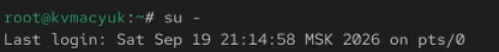{#fig-001 width=85%}

## Подготовка каталогов /data/main и /data/third

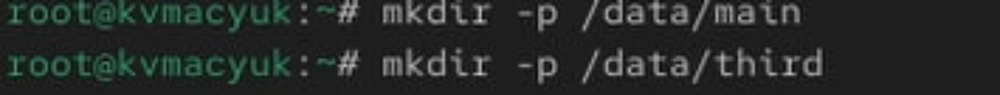{#fig-002 width=85%}

## Исходные владельцы и права каталогов

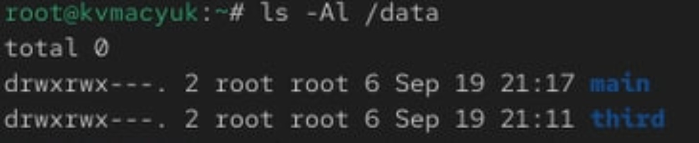{#fig-003 width=85%}

## Базовые разрешения: изменение групп

- Пункт 3 раздела 3.3.1, терминал `root`

```bash
chgrp main /data/main
chgrp third /data/third
ls -Al /data
```

- Группа `/data/main` становится `main`
- Группа `/data/third` становится `third`
- Пользователь-владелец обоих каталогов остаётся `root`

## Изменение групп-владельцев каталогов

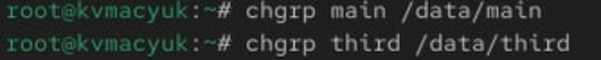{#fig-004 width=85%}

## Проверка групп main и third после chgrp

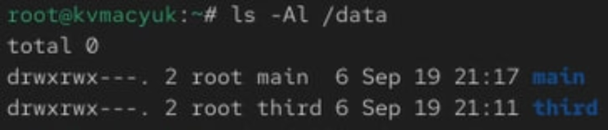{#fig-005 width=85%}

## Базовые разрешения: режим 770

- Пункт 4 раздела 3.3.1, терминал `root`

```bash
chmod 770 /data/main
chmod 770 /data/third
ls -ld /data/main /data/third
```

| Каталог | Владелец | Группа | Права |
|---|---|---|---|
| `/data/main` | `root` | `main` | `drwxrwx---` |
| `/data/third` | `root` | `third` | `drwxrwx---` |

## Значение режима 770

- Владелец и соответствующая группа могут просматривать каталог и входить в него
- Права `w` и `x` позволяют создавать и удалять записи
- Остальные пользователи не получают доступа
- В Rocky Linux после строки прав может стоять символ контекста безопасности, например точка
- Этот символ не изменяет базовый режим `770`

## Установка и проверка режима 770

{#fig-006 width=85%}

## Пользователь bob: доступ к /data/main

- Пункты 5–6 раздела 3.3.1, второй терминал

```bash
su - bob
cd /data/main
touch emptyfile
ls -l
```

- Файл успешно создан: `bob` входит в `main`
- Владелец и группа файла: `bob`; права: `0644`
- Режим каталога в файл не копируется

## Переключение на пользователя bob

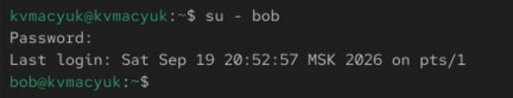{#fig-007 width=85%}

## Создание emptyfile пользователем bob

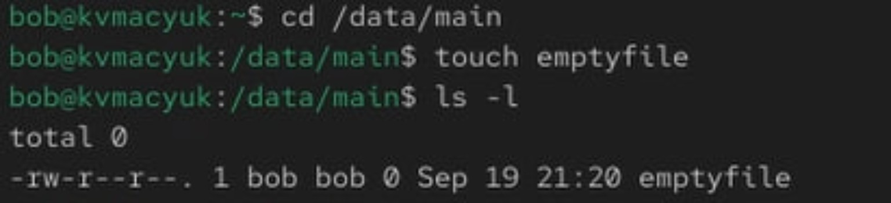{#fig-008 width=85%}

## Пользователь bob: доступ к /data/third

- Пункт 7 раздела 3.3.1, терминал `bob`

```bash
cd /data/third
```

- Переход завершился сообщением `Permission denied`
- `bob` не входит в `third`, для остальных установлено `---`
- Текущим каталогом остался `/data/main`
- Попытка создания файла в `/data/third` на скриншоте не показана

## Отказ bob в переходе в /data/third

{#fig-009 width=85%}

## Специальные разрешения: файлы alice

- Пункты 1–2 раздела 3.3.2, новый терминал

```bash
su - alice
cd /data/main
touch alice1 alice2
```

- Создание разрешено, поскольку `alice` входит в `main`
- Владелец и группа файлов `alice1` и `alice2`: `alice`

## Переключение на пользователя alice

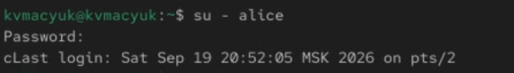{#fig-010 width=85%}

## Создание файлов alice1 и alice2

{#fig-011 width=85%}

## Удаление файлов до установки sticky bit

- Пункты 3–4 раздела 3.3.2, отдельный терминал `bob`

```bash
ls -l
rm -f alice*
ls
```

- Файлы `alice1` и `alice2` удалились; остался `emptyfile`
- Пользователю `bob` достаточно прав `w` и `x` на каталог

## Владельцы файлов до установки специальных битов

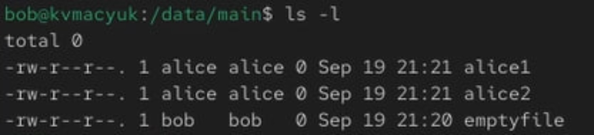{#fig-012 width=85%}

## Удаление файлов alice1 и alice2 пользователем bob

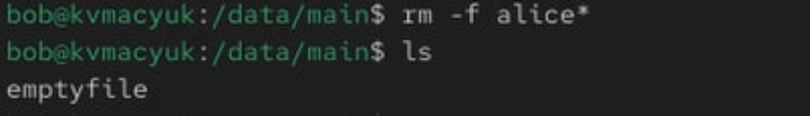{#fig-013 width=85%}

## Создание файлов bob

- Пункт 5 раздела 3.3.2, тот же терминал `bob`

```bash
touch bob1 bob2
ls -l
```

- Владелец и группа обоих файлов: `bob`; права: `0644`
- Право записи в содержимое файла не требуется для удаления его записи из каталога
- Следующий шаг добавляет ограничение на удаление чужих файлов

## Создание и проверка файлов bob1 и bob2

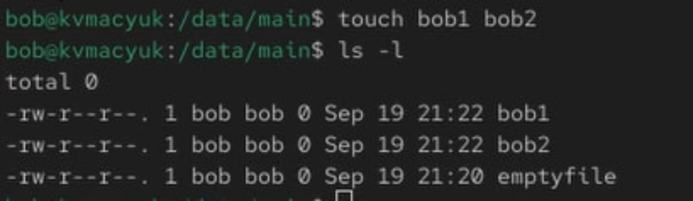{#fig-014 width=85%}

## Установка SGID и sticky bit

- Пункт 6 раздела 3.3.2, терминал `root`

```bash
chmod g+s,o+t /data/main
```

- Установленным битам соответствует режим `3770`
- Символьная запись: `drwxrws--T`
- SGID задаёт наследование группы, sticky bit ограничивает удаление

## Значение специальных битов

- `s` означает SGID при наличии группового права `x`
- `T` означает sticky bit при отсутствии `x` у остальных
- `o+t` не предоставляет остальным пользователям доступ
- Группы уже существующих файлов `bob1` и `bob2` не меняются

## Установка SGID и sticky bit на /data/main

{#fig-015 width=85%}

## Проверка наследования группы

- Пункт 7 раздела 3.3.2
- Терминал `alice`, текущий каталог `/data/main`

```bash
touch alice3 alice4
ls -l
```

- У новых файлов владелец `alice`, группа `main`
- Группу задаёт SGID родительского каталога
- Права файлов: `0644`; прежние файлы сохранили группу `bob`

## Наследование группы main файлами alice3 и alice4

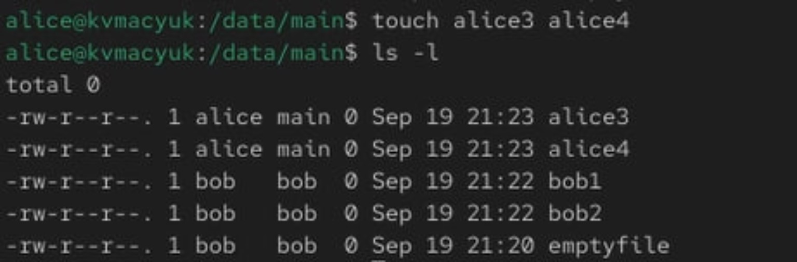{#fig-016 width=85%}

## Проверка sticky bit

- Пункт 8 раздела 3.3.2, терминал `alice`

```bash
rm -rf bob*
```

- Удалить `bob1` и `bob2` не удалось
- Оба файла остались в каталоге
- Выведено сообщение `Operation not permitted`
- Параметр `-f` не обходит проверку прав

## Sticky bit и владелец каталога

- Файлы `bob1` и `bob2` принадлежат `bob`
- Каталог `/data/main` принадлежит `root`
- `alice` не владеет ни этими файлами, ни каталогом
- Свои файлы `alice` может удалять при имеющихся правах на каталог
- Пояснение методички о владении каталогом пользователем `alice` не соответствует её командам

## Отказ alice в удалении файлов bob1 и bob2

{#fig-017 width=85%}

## ACL: назначение прав каталогам

- Пункты 1–3 раздела 3.3.3, терминал `root`
- Назначил дополнительные права группам и проверил ACL

```bash
setfacl -m g:third:rx /data/main
setfacl -m g:main:rx /data/third
getfacl /data/main
getfacl /data/third
```

- Дополнительные группы получают чтение и проход через каталог
- Создание и удаление записей для них остаётся запрещённым

## ACL каталога /data/main

```text
user::rwx
group::rwx
group:third:r-x
mask::rwx
other::---
```

- `group::rwx` относится к группе-владельцу `main`
- Запись `group:third:r-x` задаёт права группы `third`
- SGID и sticky bit сохраняются

## ACL каталога /data/third

```text
user::rwx
group::rwx
group:main:r-x
mask::rwx
other::---
```

- `group::rwx` относится к группе-владельцу `third`
- Запись `group:main:r-x` задаёт права группы `main`

## Назначение ACL и исправление пути /data/thir

{#fig-018 width=85%}

- Опечатка `/data/thir` исправлена на `/data/third`

## Назначение ACL: повтор скриншота 18

{#fig-019 width=85%}

- В исходных материалах повторяется тот же скриншот

## Проверка ACL каталогов /data/main и /data/third

{#fig-020 height=68%}

## Файлы newfile1 до настройки наследования

- Пункт 4 раздела 3.3.3, терминал `root`

```bash
touch /data/main/newfile1
getfacl /data/main/newfile1
touch /data/third/newfile1
getfacl /data/third/newfile1
```

- ACL доступа каталога сама по себе не наследуется
- У файлов не появляются именованные записи для дополнительных групп

## Владельцы и группы файлов newfile1

| Файл | Владелец | Группа |
|---|---|---|
| `/data/main/newfile1` | `root` | `main` |
| `/data/third/newfile1` | `root` | `root` |

- В `/data/main` группу задаёт установленный SGID
- В `/data/third` SGID отсутствует
- Владельцы и группы подтверждены выводом `getfacl`

## Права файлов newfile1

- Оба файла получили фактический режим `0644`

```text
user::rw-
group::r--
other::r--
```

- `touch` запрашивает режим `0666`
- Без ACL по умолчанию применяется `0666 & ~umask`
- Режим `0644` соответствует, в частности, маске `0022`
- Право выполнения у обычного нового файла не появляется

## ACL файла /data/main/newfile1

{#fig-021 width=85%}

## ACL файла /data/third/newfile1

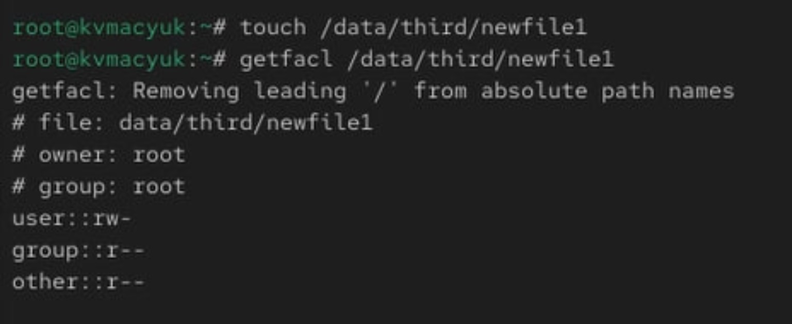{#fig-022 width=85%}

## Настройка ACL по умолчанию

- Пункты 5–6 раздела 3.3.3, терминал `root`

```bash
setfacl -m d:g:third:rwx /data/main
setfacl -m d:g:main:rwx /data/third
```

- Префикс `d:` обозначает ACL по умолчанию
- `setfacl` дополняет недостающие базовые записи

## Состав ACL по умолчанию для /data/main

```text
default:user::rwx
default:group::rwx
default:group:third:rwx
default:mask::rwx
default:other::---
```

- Показана конфигурация, заданная выполненной командой
- Новые объекты наследуют запись для группы `third`
- ACL доступа самого каталога сохраняется

## Состав ACL по умолчанию для /data/third

```text
default:user::rwx
default:group::rwx
default:group:main:rwx
default:mask::rwx
default:other::---
```

- Показана конфигурация, заданная выполненной командой
- Новые объекты наследуют запись для группы `main`
- Ранее созданные файлы `newfile1` не изменяются

## ACL по умолчанию для /data/main

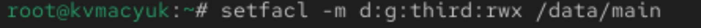{#fig-023 width=85%}

## ACL по умолчанию для /data/third

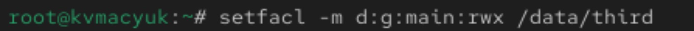{#fig-024 width=85%}

## Создание файлов newfile2

- Пункт 7 раздела 3.3.3, терминал `root`

```bash
touch /data/main/newfile2
getfacl /data/main/newfile2
touch /data/third/newfile2
getfacl /data/third/newfile2
```

- Новые файлы наследуют ACL по умолчанию
- Эффективные права ограничиваются режимом создания файла

## ACL /data/main/newfile2

```text
user::rw-
group::rwx        #effective:rw-
group:third:rwx   #effective:rw-
mask::rw-
other::---
```

- Владелец: `root`, группа: `main`
- Группа `third` получает эффективные права `rw-`

## ACL /data/third/newfile2

```text
user::rw-
group::rwx       #effective:rw-
group:main:rwx   #effective:rw-
mask::rw-
other::---
```

- По выводу `getfacl` владелец и группа: `root`
- Группа `main` получает `rw-` через именованную запись ACL
- Группа-владелец файла при этом не меняется

## Маска ACL и режим создания файла

- `touch` запрашивает режим `0666`, без права выполнения
- Поэтому маска нового файла равна `rw-`
- Запись `rwx` ограничивается маской до эффективных `rw-`
- Этим ACL соответствует режим `0660`: `-rw-rw----+`
- Знак `+` указывает на расширенную ACL

## ACL по умолчанию и umask

- При наличии ACL по умолчанию новый объект наследует её
- Унаследованные права ограничиваются режимом, который запросило приложение
- Правило `0666 & ~umask` относится к случаю без ACL по умолчанию
- Поэтому права `newfile1` и `newfile2` формируются по разным правилам

## Наследованная ACL файла /data/main/newfile2

{#fig-025 width=85%}

## Наследованная ACL файла /data/third/newfile2

{#fig-026 width=85%}

## Проверка доступа пользователя carol

- Пункт 8 раздела 3.3.3, новый терминал
- Проверки относятся к `/data/main`, как в командах методички

```bash
su - carol
rm /data/main/newfile1
rm /data/main/newfile2
echo "Hello, world" >> /data/main/newfile1
echo "Hello, world" >> /data/main/newfile2
```

## Результаты проверок carol

- У `newfile1` фактические права `0644`, у `newfile2` — ACL для `third`
- Оба файла находятся в `/data/main`

| Действие | `newfile1` | `newfile2` |
|---|---|---|
| Удаление | Отказ | Отказ |
| Добавление строки | Отказ | Успех |

## Причина отказа в удалении

- У группы `third` на каталог `/data/main` есть только `r-x`
- Для удаления записи файла нужны `w` и `x` на каталог
- Права записи в сам файл для удаления недостаточно
- Sticky bit также защищает файлы `root` от удаления пользователем `carol`
- `carol` не владеет ни файлами, ни каталогом

## Причина различий при записи

- У `newfile1` нет именованной ACL для `third`
- При режиме `0644` запись разрешена только владельцу `root`
- У `newfile2` запись `group:third:rwx` и маска `rw-`
- Для изменения содержимого нужны проход по пути и право `w` на файл
- Право `w` на родительский каталог при этом не требуется

## Подтверждение успешной записи

```bash
cat /data/main/newfile2
```

```text
Hello, world
```

- Добавление строки в `newfile1` завершилось отказом
- В `newfile2` строка успешно записана и прочитана

## Отказ carol в удалении newfile1 и newfile2

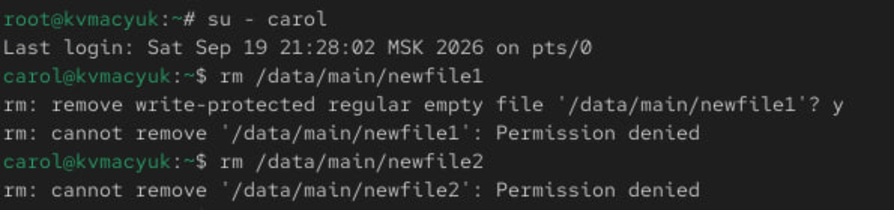{#fig-027 width=85%}

## Проверка записи в файлы от имени carol

{#fig-028 width=85%}

# Ответы на контрольные вопросы

## Вопрос 1

**Как следует использовать команду chown, чтобы установить владельца группы для файла? Приведите пример.**

```bash
chown :main /data/main/emptyfile
```

- Перед именем группы ставится двоеточие
- Пользователь-владелец не меняется
- Пример выполняется от имени `root`

## Вопрос 2

**С помощью какой команды можно найти все файлы, принадлежащие конкретному пользователю? Приведите пример.**

```bash
find / -type f -user alice -print
```

- `-user alice` выбирает владельца, `-type f` выбирает обычные файлы
- Для обхода закрытых каталогов используется `root`
- Для поиска объектов всех типов условие `-type f` убирают

## Вопрос 3

**Как применить разрешения на чтение, запись и выполнение для всех файлов в каталоге /data для пользователей и владельцев групп, не устанавливая никаких прав для других? Приведите пример.**

```bash
chmod -R ug=rwx,o= /data
```

- `-R` применяет изменение рекурсивно
- Владелец и группа получают `rwx`, остальные не получают прав

## Вопрос 3: пояснение для ACL

- Без расширенных ACL базовым правам соответствует `770`
- При расширенной ACL групповые биты соответствуют её маске
- `chmod` не удаляет именованные записи ACL

## Вопрос 4

**Какая команда позволяет добавить разрешение на выполнение для файла, который необходимо сделать исполняемым?**

```bash
chmod u+x script.sh
```

- Команда добавляет выполнение владельцу файла
- Остальные права сохраняются
- Для всех трёх категорий применяется `chmod a+x script.sh`

## Вопрос 5

**Какая команда позволяет убедиться, что групповые разрешения для всех новых файлов, создаваемых в каталоге, будут присвоены владельцу группы этого каталога? Приведите пример.**

```bash
chmod g+s /data/main
```

- SGID обеспечивает наследование группы `main`
- Конкретные права определяют режим создания, `umask` или ACL по умолчанию

## Вопрос 6

**Необходимо, чтобы пользователи могли удалять только те файлы, владельцами которых они являются, или которые находятся в каталоге, владельцами которого они являются. С помощью какой команды можно это сделать? Приведите пример.**

```bash
chmod +t /data/main
```

- Sticky bit ограничивает удаление и переименование чужих файлов

## Вопрос 6: условия действия sticky bit

- Для удаления нужны необходимые права на каталог
- Обычный пользователь может удалить свой файл или файл в принадлежащем ему каталоге
- Привилегированный пользователь может обходить это ограничение

## Вопрос 7

**Какая команда добавляет ACL, который предоставляет членам группы права доступа на чтение для всех существующих файлов в текущем каталоге?**

```bash
find . -maxdepth 1 -type f \
  -exec setfacl -m g:third:r -- {} +
```

- Команда учитывает скрытые обычные файлы
- `setfacl` без `-n` пересчитывает маску
- Для доступа к файлам нужен проход через каталог

## Вопрос 8

**Что нужно сделать для гарантии того, что члены группы получат разрешения на чтение для всех файлов в текущем каталоге и во всех его подкаталогах, а также для всех файлов, которые будут созданы в этом каталоге в будущем? Приведите пример.**

- Назначить ACL существующим объектам
- Настроить ACL по умолчанию для всех существующих каталогов

## Вопрос 8: команды

```bash
setfacl -R -m g:third:rX .
find . -type d \
  -exec setfacl -m d:g:third:rx -- {} +
```

- Первая команда разрешает чтение существующих объектов
- `X` добавляет проход каталогам и выполнение уже исполняемым файлам
- Вторая команда задаёт наследование новым объектам
- Новые подкаталоги тоже наследуют ACL по умолчанию

## Вопрос 8: границы наследования

- Для обычного файла с режимом создания `0666` группа получает чтение
- Для каталога с режимом создания `0777` группа получает `r-x`
- Явно ограничительный режим, например `0600`, может урезать права
- Владелец может впоследствии изменить ACL
- Для доступа нужен проход по пути до текущего каталога

## Вопрос 9

**Какое значение umask нужно установить, чтобы «другие» пользователи не получали какие-либо разрешения на новые файлы? Приведите пример.**

```bash
umask 0007
```

- Без ACL по умолчанию обычный файл получает `0660`, каталог получает `0770`
- Последняя цифра `7` запрещает все права категории «остальные»
- При ACL по умолчанию нужна запись `default:other::---`

## Вопрос 10

**Какая команда гарантирует, что никто не сможет удалить файл myfile случайно?**

```bash
chattr +i myfile
```

- Команда выполняется от имени `root`
- Нужна поддержка атрибута неизменяемости файловой системой
- Атрибут `i` запрещает удаление, переименование и изменение файла
- Привилегированный процесс может снять его: `chattr -i myfile`

# Выводы

- Режим `770` разделяет доступ групп `main` и `third`
- SGID обеспечивает наследование группы новыми объектами
- Sticky bit ограничивает удаление чужих файлов
- ACL задаёт права дополнительных групп и наследование разрешений

## Выводы: проверка результата

- Право изменять содержимое файла отличается от права удалить его запись из каталога
- После настройки ACL `carol` успешно дописала строку в `/data/main/newfile2`
- Удаление этого файла для `carol` остаётся запрещённым
- Фактические результаты подтверждаются скриншотами Rocky Linux

# Список литературы{.unnumbered}

::: {#refs}
:::

