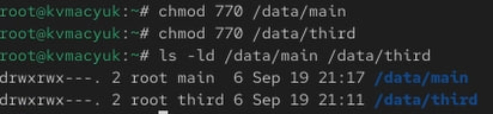
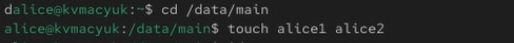
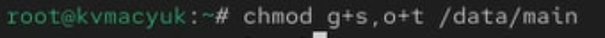
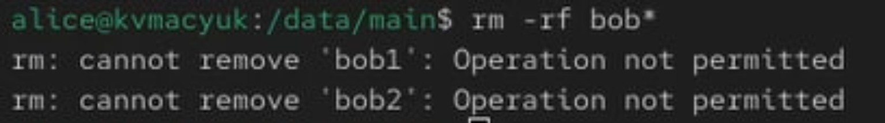
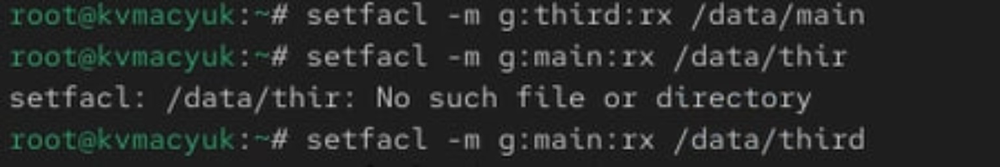
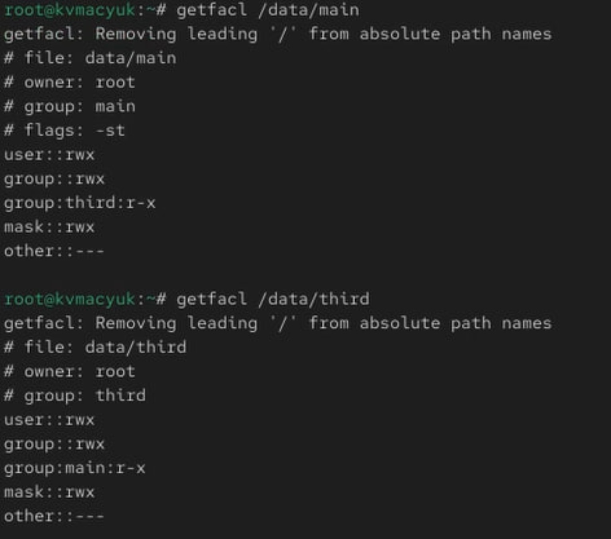
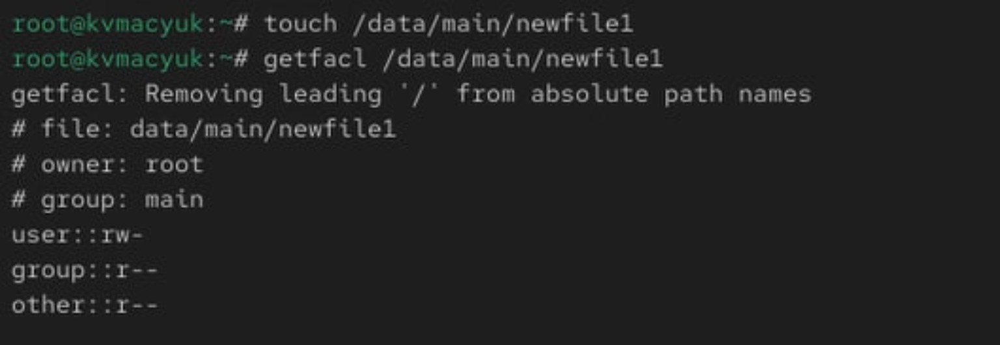
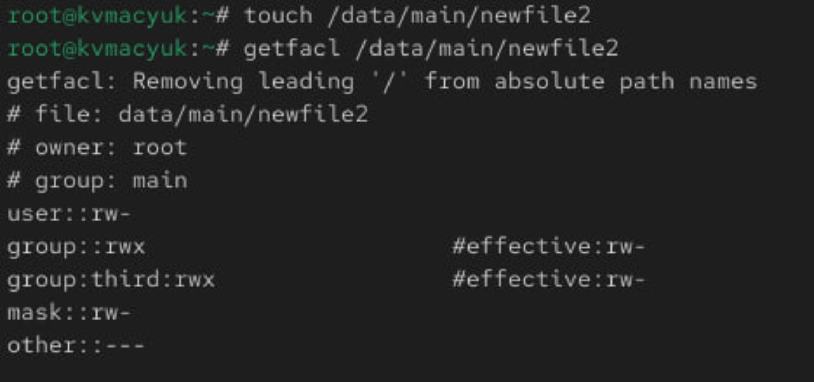
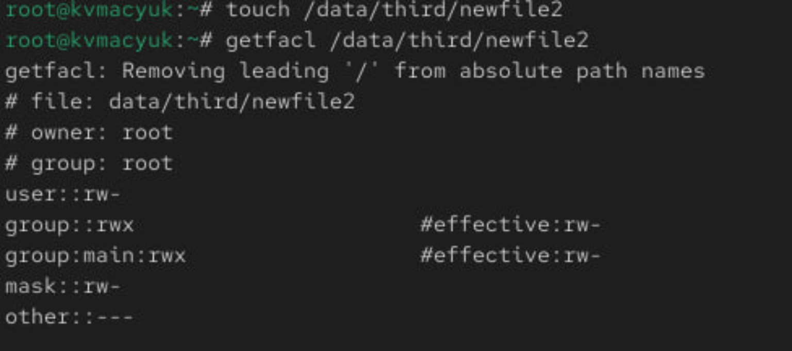
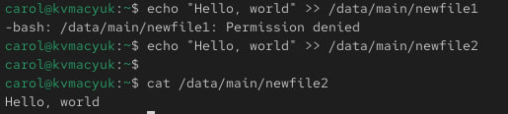

---
## Author

author:
  name: Мацюк Константин Владимирович
  degrees: BSc
  orcid: 0000-0002-0877-7063
  email: 1032253640@rudn.ru
  affiliation:
    - name: Российский университет дружбы народов
      country: Российская Федерация
      postal-code: 117198
      city: Москва
      address: ул. Миклухо-Маклая, д. 6

## Title

title: "Лабораторная работа №3. Настройка прав доступа"
subtitle: "Дисциплина: Основы администрирования операционных систем"
license: "CC BY"

## Fonts

mainfont: IBM Plex Serif
romanfont: IBM Plex Serif
sansfont: IBM Plex Sans
monofont: DejaVu Sans Mono
mathfont: STIX Two Math
mainfontoptions: Ligatures=Common,Ligatures=TeX,Scale=0.94
romanfontoptions: Ligatures=Common,Ligatures=TeX,Scale=0.94
sansfontoptions: Ligatures=Common,Ligatures=TeX,Scale=MatchLowercase,Scale=0.94
monofontoptions: Scale=MatchLowercase,Scale=0.94
lang: ru-RU
papersize: a4
---

# Цель работы

Получение навыков настройки базовых и специальных прав доступа для групп пользователей в операционной системе типа Linux.

# Задание

1. Прочитать справочное описание `man` по командам `chgrp`, `chmod`, `getfacl`, `setfacl`.
2. Выполнить действия по управлению базовыми разрешениями для групп пользователей (раздел 3.3.1 методических указаний).
3. Выполнить действия по управлению специальными разрешениями для групп пользователей (раздел 3.3.2).
4. Выполнить действия по управлению расширенными разрешениями с использованием списков ACL для групп пользователей (раздел 3.3.3).

# Теоретическое введение

В Linux файл и каталог имеют пользователя-владельца и группу-владельца. Базовые права задаются отдельно для владельца (`u`), группы (`g`) и остальных пользователей (`o`). Для обычного файла право `r` означает чтение содержимого, `w` — изменение, `x` — выполнение. Для каталога `r` позволяет получить список имён, `w` вместе с `x` — создавать и удалять записи, а `x` — проходить через каталог и обращаться к его объектам.

В восьмеричной записи чтению соответствует число 4, записи — 2, выполнению — 1. Режим `770` предоставляет владельцу и группе права `rwx`, а остальным — никаких прав. Команда `chgrp` изменяет группу-владельца, `chmod` — разрешения.

Для совместной работы применяются специальные биты. SGID на каталоге обеспечивает наследование его группы новыми файлами и подкаталогами. Sticky bit ограничивает удаление и переименование: при наличии необходимых прав на каталог обычный пользователь может удалить свой файл либо файл в принадлежащем ему каталоге. Привилегированный пользователь может обходить это ограничение. [Справка chmod(1)](https://man7.org/linux/man-pages/man1/chmod.1.html).

ACL позволяют назначить разрешения дополнительным пользователям и группам. ACL доступа действует на сам объект, ACL по умолчанию — на создаваемые в каталоге объекты. Запись `mask::` ограничивает эффективные права группы-владельца и именованных пользователей и групп. ACL просматривается командой `getfacl`, изменяется командой `setfacl`. [Справка acl(5)](https://man7.org/linux/man-pages/man5/acl.5.html).

# Выполнение лабораторной работы

Рабочая среда — Rocky Linux. Используются созданные в предыдущей лабораторной работе пользователи: `alice` и `bob` входят в группу `main`, `carol` — в группу `third`. Повторное создание пользователей и групп не требуется. Результаты выполненных действий приведены на скриншотах.

Для ознакомления со справкой используются команды:

```bash
man chgrp
man chmod
man getfacl
man setfacl
```

`chgrp` меняет группу объекта; `chmod` задаёт базовые и специальные разрешения; `getfacl` выводит ACL; `setfacl` изменяет ACL. Команды `getfacl` и `setfacl` входят в пакет `acl`.

## Управление базовыми разрешениями

**Пункты 1–2. Подготовка каталогов.** В первом терминале выполнил команду `su -` для открытия сеанса `root` (@fig-001), затем подготовил каталоги (@fig-002) и просмотрел их владельцев и права (@fig-003):

```bash
su -
mkdir -p /data/main
mkdir -p /data/third
ls -Al /data
```

Пользователем-владельцем и группой-владельцем обоих каталогов были `root`. Уже на первом выводе `ls -Al /data` каталоги имели права `drwxrwx---.`, соответствующие режиму `770`.

{#fig-001 width=90%}

{#fig-002 width=90%}

{#fig-003 width=90%}

**Пункт 3. Изменение групп-владельцев.** В терминале `root` выполнил команды (@fig-004) и проверил результат (@fig-005):

```bash
chgrp main /data/main
chgrp third /data/third
ls -Al /data
```

У каталога `/data/main` группой-владельцем стала `main`, у `/data/third` — `third`. Пользователь-владелец обоих каталогов остался `root`: команда `chgrp` меняет только группу.

{#fig-004 width=90%}

{#fig-005 width=90%}

**Пункт 4. Установка базовых разрешений.** В том же терминале задал режим `770` и проверил результат (@fig-006):

```bash
chmod 770 /data/main
chmod 770 /data/third
ls -ld /data/main /data/third
```

| Каталог | Пользователь-владелец | Группа-владелец | Базовые права |
|---|---|---|---|
| `/data/main` | `root` | `main` | `drwxrwx---` |
| `/data/third` | `root` | `third` | `drwxrwx---` |

Владелец и члены соответствующей группы могут читать список имён, входить в каталог, создавать и удалять его записи. Остальные пользователи не получают доступа. Точка после строки прав в выводе Rocky Linux обозначает наличие контекста безопасности и не меняет значение `770`.

{#fig-006 width=90%}

**Пункты 5–6. Проверка доступа пользователя bob к /data/main.** Во втором терминале переключился на `bob` (@fig-007), перешёл в каталог и создал файл (@fig-008):

```bash
su - bob
cd /data/main
touch emptyfile
ls -l
```

Переход и создание файла `emptyfile` завершились успешно. Пользователь `bob` входит в `main`, а у этой группы есть права `rwx` на каталог. Владелец и группа файла — `bob`, права — `-rw-r--r--` (`0644`). Режим `770` каталога не копируется в создаваемый файл.

{#fig-007 width=90%}

{#fig-008 width=90%}

**Пункт 7. Проверка доступа пользователя bob к /data/third.** В терминале `bob` попытался перейти в каталог:

```bash
cd /data/third
```

Получил сообщение `Permission denied` (@fig-009). Пользователь `bob` не входит в `third`, а для остальных пользователей установлено `---`. После неудачного `cd` текущим каталогом остался `/data/main`.

Предусмотренная методичкой попытка создания файла в `/data/third` на предоставленном скриншоте не показана. При этих разрешениях она также должна завершаться отказом, но фактический запуск команды `touch` здесь не подтверждён.

{#fig-009 width=90%}

## Управление специальными разрешениями

**Пункты 1–2. Создание файлов пользователя alice.** В новом терминале открыл сеанс `alice` (@fig-010) и создал два файла (@fig-011):

```bash
su - alice
cd /data/main
touch alice1 alice2
```

Создание разрешено, поскольку `alice` входит в группу `main`. Владельцем и группой файлов `alice1` и `alice2` стали `alice`.

{#fig-010 width=90%}

{#fig-011 width=90%}

**Пункты 3–4. Удаление чужих файлов до установки sticky bit.** В терминале `bob`, находящемся в `/data/main`, просмотрел файлы (@fig-012), удалил `alice1` и `alice2` и проверил содержимое каталога (@fig-013):

```bash
ls -l
rm -f alice*
ls
```

Файлы `alice1` и `alice2` удалились; в каталоге остался `emptyfile`. До установки sticky bit пользователю `bob` достаточно прав `w` и `x` на содержащий их каталог. Для удаления записи файла не требуется право записи в сам файл.

{#fig-012 width=90%}

{#fig-013 width=90%}

**Пункт 5. Создание файлов пользователя bob.** В том же терминале создал файлы и проверил их владельцев (@fig-014):

```bash
touch bob1 bob2
ls -l
```

Владелец и группа обоих файлов — `bob`, права — `0644`.

{#fig-014 width=90%}

**Пункт 6. Установка SGID и sticky bit.** В терминале `root` выполнил команду (@fig-015):

```bash
chmod g+s,o+t /data/main
```

Установленные биты вместе с базовыми правами `770` соответствуют режиму `3770` и символьной записи `drwxrws--T`. Буква `s` обозначает SGID при установленном групповом `x`. Заглавная `T` означает, что sticky bit установлен, а право `x` для остальных отсутствует. Параметр `o+t` не предоставляет остальным пользователям доступ.

SGID задаёт наследование группы `main` для новых объектов. Sticky bit ограничивает удаление чужих файлов. Группы уже существующих файлов `bob1` и `bob2` от установки SGID не меняются. Наличие обоих специальных битов позднее подтверждает строка `# flags: -st` в выводе `getfacl` (@fig-020).

{#fig-015 width=90%}

**Пункт 7. Проверка наследования группы.** В терминале `alice`, находящемся в `/data/main`, выполнил команды (@fig-016):

```bash
touch alice3 alice4
ls -l
```

У `alice3` и `alice4` пользователь-владелец — `alice`, группа-владелец — `main`. Это следствие SGID на родительском каталоге; сами права `rwx` каталога в обычные файлы не копируются. Новые файлы имеют права `0644`. У ранее созданных файлов `bob1`, `bob2` и `emptyfile` сохранилась группа `bob`.

{#fig-016 width=90%}

**Пункт 8. Проверка sticky bit.** В том же терминале `alice` попытался удалить файлы пользователя `bob`:

```bash
rm -rf bob*
```

Получил `Operation not permitted` для `bob1` и `bob2` (@fig-017). Параметр `-f` не обходит проверку прав.

Пользователь `alice` не является владельцем ни файлов `bob1` и `bob2`, ни каталога `/data/main`. Владельцем каталога остаётся `root`. Свои файлы `alice` может удалять, поскольку владеет ими и имеет необходимые права на каталог. Указание в пояснении методички, что `alice` является владельцем каталога, не соответствует приведённым там командам.

{#fig-017 width=90%}

## Управление расширенными разрешениями с использованием списков ACL

**Пункты 1–3. Назначение ACL доступа каталогов.** В терминале `root` назначил дополнительные права группам:

```bash
setfacl -m g:third:rx /data/main
setfacl -m g:main:rx /data/third
```

При вводе второй команды сначала допустил опечатку `/data/thir`, получив `No such file or directory`. После исправления пути на `/data/third` команда завершилась без ошибки (@fig-018). Скриншот 19 повторяет скриншот 18 и показывает ту же последовательность команд (@fig-019).

{#fig-018 width=90%}

{#fig-019 width=90%}

Затем проверил ACL обоих каталогов (@fig-020):

```bash
getfacl /data/main
getfacl /data/third
```

В ACL `/data/main` появилась запись `group:third:r-x`, в ACL `/data/third` — `group:main:r-x`.

Для `/data/main`:

```text
user::rwx
group::rwx
group:third:r-x
mask::rwx
other::---
```

Для `/data/third`:

```text
user::rwx
group::rwx
group:main:r-x
mask::rwx
other::---
```

Строка `group::rwx` относится к группе-владельцу конкретного каталога. Дополнительная группа получает чтение списка имён и проход через каталог, но не создание и удаление его записей. SGID и sticky bit у `/data/main` сохраняются, что видно по строке `# flags: -st`.

{#fig-020 width=70%}

**Пункт 4. Создание newfile1 до установки ACL по умолчанию.** От имени `root` создал файлы в обоих каталогах и просмотрел их ACL (@fig-021, @fig-022):

```bash
touch /data/main/newfile1
getfacl /data/main/newfile1
touch /data/third/newfile1
getfacl /data/third/newfile1
```

Владельцем обоих файлов стал `root`. Группа файла `/data/main/newfile1` — `main`, поскольку у каталога установлен SGID. У `/data/third` SGID не устанавливался, поэтому группа файла `/data/third/newfile1` — `root`.

ACL доступа родительского каталога сама по себе не наследуется. У этих файлов отсутствуют именованные записи для `third` и `main`. Фактические права обоих файлов — `0644`:

```text
user::rw-
group::r--
other::r--
```

Новый обычный файл создаётся командой `touch` с запрашиваемым режимом `0666`; при отсутствии ACL по умолчанию применяется правило `0666 & ~umask`. Наблюдаемый режим `0644` соответствует, в частности, обычной маске `0022`; отдельный вывод команды `umask` на скриншотах не приведён. Право `x` у обычного нового файла не появляется.

{#fig-021 width=90%}

{#fig-022 width=90%}

**Пункты 5–6. Настройка ACL по умолчанию.** От имени `root` выполнил команды (@fig-023, @fig-024):

```bash
setfacl -m d:g:third:rwx /data/main
setfacl -m d:g:main:rwx /data/third
```

Префикс `d:` означает ACL по умолчанию. Эти команды задают наследование записи для `third` в `/data/main` и для `main` в `/data/third`. При создании ACL по умолчанию `setfacl` дополняет недостающие базовые записи. Существующие записи ACL доступа каталогов не заменяются; ранее созданные файлы `newfile1` также не изменяются. [Справка setfacl(1)](https://man7.org/linux/man-pages/man1/setfacl.1.html).

Для `/data/main` формируется следующая ACL по умолчанию:

```text
default:user::rwx
default:group::rwx
default:group:third:rwx
default:mask::rwx
default:other::---
```

Для `/data/third`:

```text
default:user::rwx
default:group::rwx
default:group:main:rwx
default:mask::rwx
default:other::---
```

Здесь показана конфигурация, соответствующая выполненным командам; её наследование проверено на следующих скриншотах новых файлов.

{#fig-023 width=90%}

{#fig-024 width=90%}

**Пункт 7. Проверка наследования ACL файлами newfile2.** В терминале `root` создал новые файлы и просмотрел их ACL (@fig-025, @fig-026):

```bash
touch /data/main/newfile2
getfacl /data/main/newfile2
touch /data/third/newfile2
getfacl /data/third/newfile2
```

Для `/data/main/newfile2` получил записи:

```text
user::rw-
group::rwx                  #effective:rw-
group:third:rwx             #effective:rw-
mask::rw-
other::---
```

Для `/data/third/newfile2`:

```text
user::rw-
group::rwx                  #effective:rw-
group:main:rwx              #effective:rw-
mask::rw-
other::---
```

Файлы унаследовали ACL по умолчанию родительских каталогов. Маска `rw-` ограничивает эффективные групповые права: команда `touch` запрашивает `0666`, поэтому выполнение не разрешается, несмотря на `rwx` в наследуемой записи. Этим ACL соответствует режим `0660`; его символьное представление с признаком расширенной ACL — `-rw-rw----+`.

Пользователь-владелец обоих файлов — `root`; группа `/data/main/newfile2` — `main`, группа `/data/third/newfile2` — `root`. Для файла в `/data/third` доступ группы `main` задаётся именованной записью ACL, а не сменой группы-владельца.

При наличии ACL по умолчанию права нового объекта формируются из неё с ограничением режимом, запрошенным приложением; обычное правило применения `umask` для случая без такой ACL здесь не используется. [Справка acl(5)](https://man7.org/linux/man-pages/man5/acl.5.html).

{#fig-025 width=90%}

{#fig-026 width=90%}

**Пункт 8. Проверка доступа пользователя carol.** Переключился на `carol` и выполнил проверки в `/data/main`, как указано в методичке (@fig-027, @fig-028):

```bash
su - carol
rm /data/main/newfile1
rm /data/main/newfile2
echo "Hello, world" >> /data/main/newfile1
echo "Hello, world" >> /data/main/newfile2
cat /data/main/newfile2
```

| Действие пользователя `carol` | Результат | Объяснение |
|---|---|---|
| Удаление `/data/main/newfile1` | Отказ | У группы `third` нет `w` на каталог; файл и каталог принадлежат `root` |
| Удаление `/data/main/newfile2` | Отказ | Право записи в файл не даёт права удалить запись из каталога |
| Запись в `/data/main/newfile1` | Отказ | У файла нет именованной ACL для `third`; при `0644` запись разрешена только владельцу |
| Запись в `/data/main/newfile2` | Успех | Наследованная запись `group:third:rwx` с маской `rw-` разрешает запись |

При попытке удаления `newfile1` подтвердил запрос `rm` ответом `y`, однако получил `Permission denied`. Подтверждение не отменяет проверку прав. Удаление `newfile2` также завершилось отказом.

ACL доступа каталога `/data/main` предоставляет `third` только `r-x`. Этого достаточно для обращения к файлу, но недостаточно для удаления. Кроме того, sticky bit не позволил бы `carol` удалить принадлежащие `root` файлы даже при наличии права записи на каталог, поскольку `carol` не владеет ни файлами, ни каталогом.

Добавление строки в `newfile1` завершилось сообщением `Permission denied`. Запись в `newfile2` прошла успешно; команда `cat` вывела `Hello, world`. Изменение содержимого уже существующего файла требует прохода по пути и права `w` на файл, но не требует права `w` на родительский каталог.

{#fig-027 width=90%}

{#fig-028 width=90%}

# Ответы на контрольные вопросы

**1. Как следует использовать команду chown, чтобы установить владельца группы для файла? Приведите пример.**

Нужно указать имя группы после двоеточия, оставив имя пользователя пустым:

```bash
chown :main /data/main/emptyfile
```

Команда меняет только группу-владельца файла на `main`. Пользователь-владелец сохраняется. Пример выполняется от имени `root`. [Справка chown(1)](https://man7.org/linux/man-pages/man1/chown.1.html).

**2. С помощью какой команды можно найти все файлы, принадлежащие конкретному пользователю? Приведите пример.**

Используется `find` с условием `-user`. Пример поиска обычных файлов пользователя `alice` от корня файловой системы:

```bash
find / -type f -user alice -print
```

Для обхода закрытых каталогов команду выполняют от имени `root`. Если нужны также каталоги и объекты других типов, условие `-type f` не указывают. [Справка find(1)](https://man7.org/linux/man-pages/man1/find.1.html).

**3. Как применить разрешения на чтение, запись и выполнение для всех файлов в каталоге /data для пользователей и владельцев групп, не устанавливая никаких прав для других? Приведите пример.**

Для владельца и группы-владельца задаются `rwx`, для остальных — отсутствие прав:

```bash
chmod -R ug=rwx,o= /data
```

Ключ `-R` применяет изменение к каталогу и его содержимому рекурсивно. Для объектов без расширенных ACL базовым правам соответствует `770`. При наличии расширенной ACL групповые биты соответствуют её маске; сама команда `chmod` не удаляет именованные записи ACL.

**4. Какая команда позволяет добавить разрешение на выполнение для файла, который необходимо сделать исполняемым?**

Например, разрешить выполнение владельцу файла можно командой:

```bash
chmod u+x script.sh
```

Остальные права сохраняются. Если выполнение нужно разрешить всем трём категориям, используется `chmod a+x script.sh`.

**5. Какая команда позволяет убедиться, что групповые разрешения для всех новых файлов, создаваемых в каталоге, будут присвоены владельцу группы этого каталога? Приведите пример.**

Для наследования группы-владельца устанавливается SGID на каталог:

```bash
chmod g+s /data/main
```

Новые файлы получают группу-владельца `main`. SGID наследует именно принадлежность к группе; конкретные разрешения `rwx` определяются режимом создания, `umask` либо ACL по умолчанию.

**6. Необходимо, чтобы пользователи могли удалять только те файлы, владельцами которых они являются, или которые находятся в каталоге, владельцами которого они являются. С помощью какой команды можно это сделать? Приведите пример.**

На каталог устанавливается sticky bit:

```bash
chmod +t /data/main
```

Он ограничивает удаление и переименование чужих файлов обычными пользователями. Право удалить свой файл или файл в своём каталоге сохраняется при наличии необходимых разрешений на каталог; привилегированный пользователь может обходить ограничение.

**7. Какая команда добавляет ACL, который предоставляет членам группы права доступа на чтение для всех существующих файлов в текущем каталоге?**

Для группы `third` можно выбрать все обычные файлы непосредственно в текущем каталоге и добавить запись ACL:

```bash
find . -maxdepth 1 -type f -exec setfacl -m g:third:r -- {} +
```

Команда учитывает и скрытые файлы. `setfacl` без `-n` пересчитывает маску, включая предоставляемое чтение. Для обращения к файлам группе также требуется право прохода через каталог.

**8. Что нужно сделать для гарантии того, что члены группы получат разрешения на чтение для всех файлов в текущем каталоге и во всех его подкаталогах, а также для всех файлов, которые будут созданы в этом каталоге в будущем? Приведите пример.**

Нужно назначить ACL существующим объектам и ACL по умолчанию всем существующим каталогам. Пример для группы `third`:

```bash
setfacl -R -m g:third:rX .
find . -type d -exec setfacl -m d:g:third:rx -- {} +
```

Первая команда разрешает чтение существующих объектов и проход по каталогам. Заглавная `X` даёт выполнение каталогам и уже исполняемым файлам. Вторая задаёт наследование для новых объектов; новые подкаталоги также наследуют ACL по умолчанию.

Для обычных новых файлов с запрашиваемым режимом `0666` эффективным правом группы будет чтение; для каталогов с режимом `0777` — `r-x`. Такое наследование не является безусловной гарантией против явно ограничительного режима создания, например `0600`, или последующего изменения ACL владельцем. Требуется также доступ по пути до текущего каталога.

**9. Какое значение umask нужно установить, чтобы «другие» пользователи не получали какие-либо разрешения на новые файлы? Приведите пример.**

Подходит значение `0007`:

```bash
umask 0007
```

При отсутствии ACL по умолчанию обычные новые файлы, создаваемые с режимом `0666`, получают `0660`, а каталоги с исходным режимом `0777` — `0770`. Последняя цифра `7` запрещает категории «остальные» все три права. Если используется ACL по умолчанию, для этой категории нужно обеспечить запись `default:other::---`.

**10. Какая команда гарантирует, что никто не сможет удалить файл myfile случайно?**

На файловой системе с поддержкой атрибута неизменяемости от имени `root` выполняется:

```bash
chattr +i myfile
```

Атрибут `i` запрещает удаление, переименование и изменение файла, пока он установлен. Уполномоченный привилегированный процесс может снять его командой `chattr -i myfile`; абсолютной защиты от администратора этот атрибут не даёт. [Справка chattr(1)](https://man7.org/linux/man-pages/man1/chattr.1.html).

# Выводы

Выполнена настройка базовых, специальных и расширенных разрешений в Rocky Linux в соответствии с методическими указаниями. Режим `770` разделяет доступ групп `main` и `third` к их каталогам. SGID обеспечивает наследование группы, sticky bit ограничивает удаление чужих файлов, а ACL позволяет назначать разрешения дополнительным группам и наследовать их новыми объектами.

Проверки по методичке показывают различие между правом изменения содержимого файла и правом удаления его записи из каталога: после настройки ACL пользователь `carol` успешно дописал строку в `/data/main/newfile2`, сохранив запрет на удаление этого файла. Скриншоты подтверждают наследование группы и ACL, действие sticky bit и различие прав на файл и содержащий его каталог.

# Список литературы {.unnumbered}

::: {#refs}
1. Кулябов Д. С., Королькова А. В. Основы администрирования операционных систем. Лабораторная работа № 3 «Настройка прав доступа». Предоставленные методические указания, файл `004-permissions.pdf`, с. 27–31.
2. Справочные страницы Linux: `chgrp(1)`, [chmod(1)](https://man7.org/linux/man-pages/man1/chmod.1.html), [getfacl(1)](https://man7.org/linux/man-pages/man1/getfacl.1.html), [setfacl(1)](https://man7.org/linux/man-pages/man1/setfacl.1.html), [acl(5)](https://man7.org/linux/man-pages/man5/acl.5.html).
3. Справочные страницы к контрольным вопросам: [chown(1)](https://man7.org/linux/man-pages/man1/chown.1.html), [find(1)](https://man7.org/linux/man-pages/man1/find.1.html), [chattr(1)](https://man7.org/linux/man-pages/man1/chattr.1.html).
:::
