---
## Author
author:
  name: Мацюк Константин Владимирович
  degrees: BSc
  orcid: 0000-0002-0877-7063
  email: 1032253640@rudn.ru
  affiliation:
    - name: Российский университет дружбы народов
      country: Российская Федерация
      postal-code: 117198
      city: Москва
      address: ул. Миклухо-Маклая, д. 6

## Title
title: "Лабораторная работа №4. Работа с программными пакетами"
subtitle: "Дисциплина: Основы администрирования операционных систем"
license: "CC BY"

## Fonts
mainfont: IBM Plex Serif
romanfont: IBM Plex Serif
sansfont: IBM Plex Sans
monofont: DejaVu Sans Mono
mathfont: STIX Two Math
mainfontoptions: Ligatures=Common,Ligatures=TeX,Scale=0.94
romanfontoptions: Ligatures=Common,Ligatures=TeX,Scale=0.94
sansfontoptions: Ligatures=Common,Ligatures=TeX,Scale=MatchLowercase,Scale=0.94
monofontoptions: Scale=MatchLowercase,Scale=0.94
---

# Вводная часть

## Актуальность, объект и предмет

- Работа с программными пакетами — базовая задача администрирования Linux
- Репозитории и менеджеры пакетов определяют установку и обновление ПО
- Необходимо уверенно работать с `dnf` и `rpm`
- Важна безопасная установка/удаление пакетов и анализ их содержимого
- **Объект:** репозитории и программные пакеты в ОС типа Linux
- **Предмет:** менеджеры пакетов `dnf`, `rpm`; конфигурационные файлы `/etc/dnf/dnf.conf`, `/etc/dnf/`, `/etc/yum.repos.d/`, `/var/cache/dnf/`, `/var/log/dnf.log`

## Цели, задачи, материалы и методы

- **Цель:** получить навыки работы с репозиториями и менеджерами пакетов
- **Задачи:**
  - Изучить, как и в каких файлах подключаются репозитории
  - Изучить основные возможности `dnf` (поиск, установка, обновление, удаление, история)
  - Повторить установку/удаление пакета через `dnf`
  - Повторить установку/удаление пакета через `rpm`
- **Материалы и методы:** ОС Linux (RHEL/CentOS/Fedora); команды `dnf`, `rpm`, `find`, `which`, `man`; пакеты `nmap`, `lynx`, `dnsmasq`

# Теоретическое введение

## Пакетный менеджер dnf и его конфигурация

- `dnf` используется в популярных Linux-дистрибутивах для установки, удаления и других действий с пакетами
- Основные команды `dnf` — раздел 4.2.1; опции — 4.2.2; `yum-utils` — 4.2.3
- Конфигурационные файлы — 4.2.4; опции `dnf.conf` — 4.2.5; плагины — 4.2.6; прокси — 4.2.7

| Файл/каталог                | Описание                                                                                     |
|-----------------------------|----------------------------------------------------------------------------------------------|
| `/etc/dnf/dnf.conf`         | Основной конфигурационный файл `dnf`                                                         |
| `/etc/dnf/`                 | Директория с конфигурациями (например, dnf-плагины)                                          |
| `/etc/yum.repos.d/`         | Директория с информацией о репозиториях                                                      |
| `/var/cache/dnf/`           | Директория, где `dnf` хранит кэш и файлы базы (по умолчанию)                                 |
| `/var/log/dnf.log`          | Лог-файл выполнения транзакций (по умолчанию)                                                |

: Основные конфигурационные файлы и каталоги dnf {#tbl-dnf-files}

# Выполнение лабораторной работы

## Работа с репозиториями

- В консоли перешёл в режим работы суперпользователя, выполнив команду `su -` ([рис. @fig-001])
- Перешёл в каталог `/etc/yum.repos.d` и изучил содержание каталога и файлов репозиториев ([рис. @fig-002])
- Вывел на экран список репозиториев командой `dnf repolist` ([рис. @fig-003])
- Полученная информация показывает подключённые репозитории: appstream, baseos, epel, extras, yarn

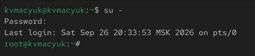{#fig-001 width=32%}

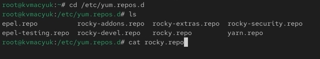{#fig-002 width=32%}

## Просмотр списка активных репозиториев

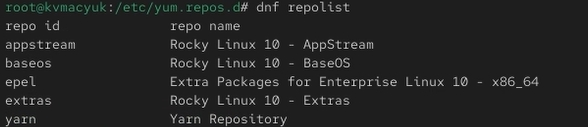{#fig-003 width=32%}

## Поиск пакета user

- Вывел на экран список пакетов, в названии или описании которых есть слово `user`, командой `dnf search user` ([рис. @fig-004], [рис. @fig-005])

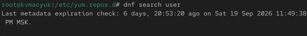{#fig-004 width=45%}

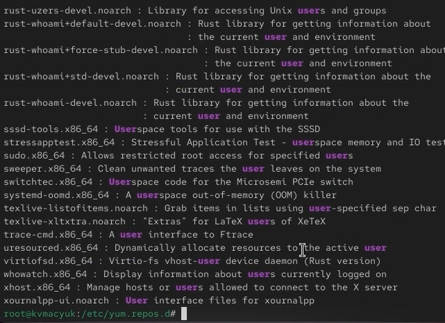{#fig-005 width=45%}

## Установка nmap: поиск и информация

- Установил `nmap`, предварительно изучив информацию по имеющимся пакетам ([рис. @fig-006]—[рис. @fig-008])

```bash
dnf search nmap
dnf info nmap
dnf install nmap
dnf install nmap\*
```

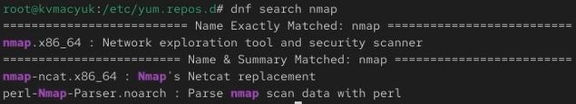{#fig-006 width=32%}

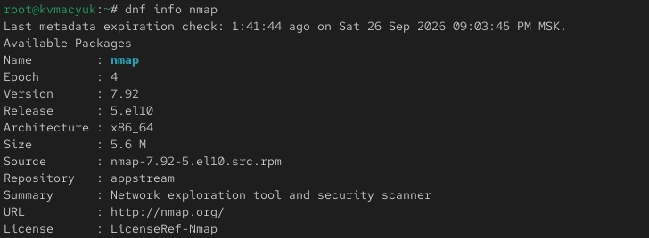{#fig-007 width=32%}

## Информация о пакете nmap (продолжение)

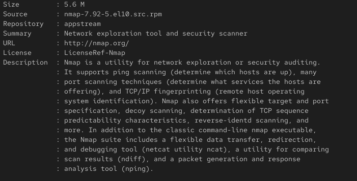{#fig-008 width=32%}

## Установка nmap

- Разница между `dnf install nmap` и `dnf install nmap*`: первая команда устанавливает только пакет `nmap`, вторая — все пакеты, имя которых начинается с `nmap` (например, `nmap-ncat`). В моем случае все пакеты, имя которых начинается с `nmap` уже установлены ([рис. @fig-009], [рис. @fig-010])

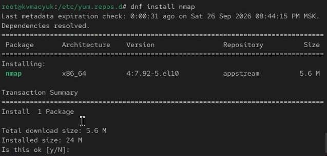{#fig-009 width=32%}

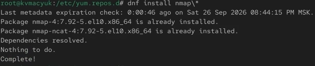{#fig-010 width=32%}

## Удаление nmap

- Удалил `nmap` ([рис. @fig-011], [рис. @fig-012])

```bash
dnf remove nmap
dnf remove nmap\*
```

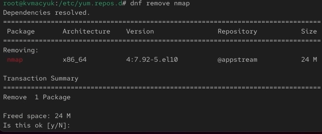{#fig-011 width=32%}

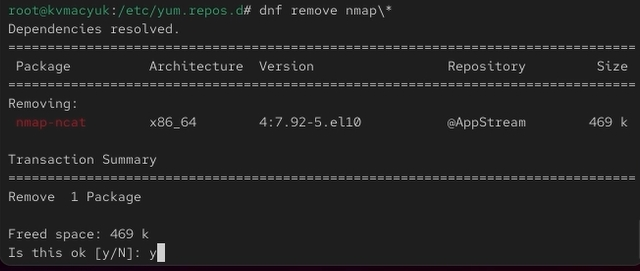{#fig-012 width=45%}

## Работа с группами пакетов: список и информация

- Получил список имеющихся групп пакетов, затем установил группу пакетов RPM Development Tools ([рис. @fig-013]—[рис. @fig-015])

```bash
dnf groups list
LANG=C dnf groups list
dnf groups info "RPM Development Tools"
dnf groupinstall "RPM Development Tools"
```

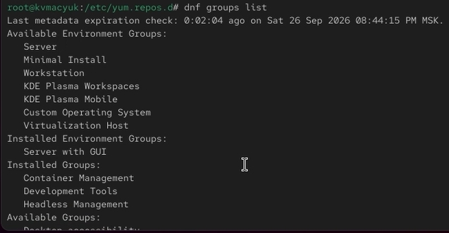{#fig-013 width=32%}

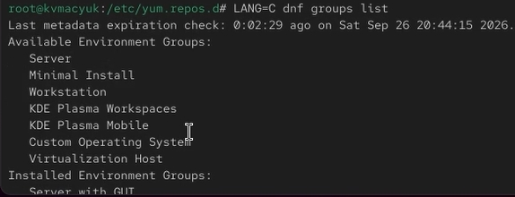{#fig-014 width=32%}

## Информация о группе RPM Development Tools

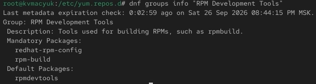{#fig-015 width=32%}

## Установка группы RPM Development Tools

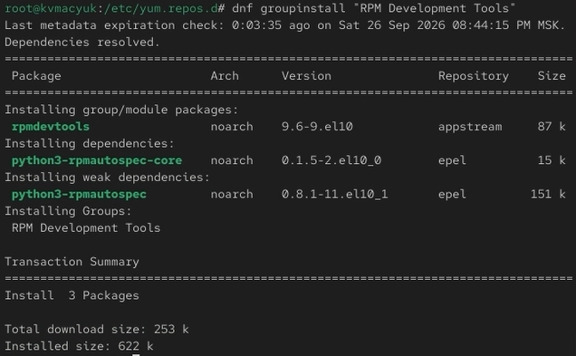{#fig-016 width=32%}

## Удаление группы пакетов и история dnf

- Для удаления группы пакетов RPM Development Tools воспользовался командой `dnf groupremove "RPM Development Tools"` ([рис. @fig-017])
- Посмотрел историю использования команды `dnf` и отменил последнее действие ([рис. @fig-018], [рис. @fig-019])

```bash
dnf history
dnf history undo 13
```

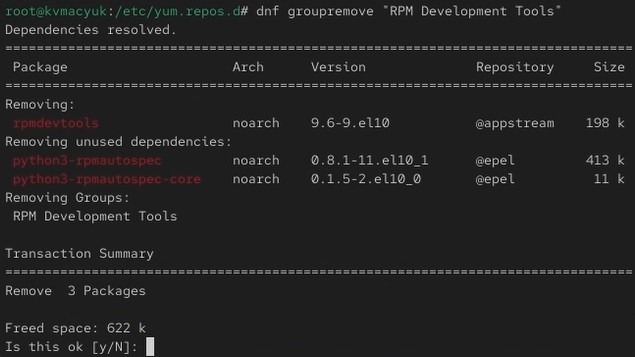{#fig-017 width=32%}

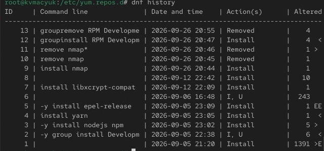{#fig-018 width=32%}

## Отмена транзакции (undo)

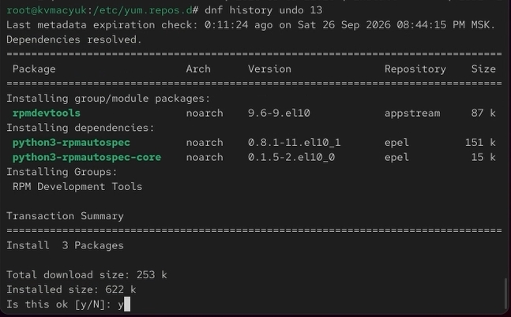{#fig-019 width=45%}

## Использование rpm: установка lynx

- Предположим, что требуется установить текстовый браузер `lynx` из rpm-пакета
- Скачал rpm-пакет `lynx` ([рис. @fig-020], [рис. @fig-021])

```bash
dnf list lynx
dnf install lynx --downloadonly
```

- Нашёл каталог, в который был помещён пакет после загрузки ([рис. @fig-022])

```bash
find /var/cache/dnf/ -name lynx*
```

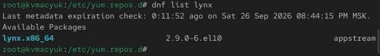{#fig-020 width=32%}

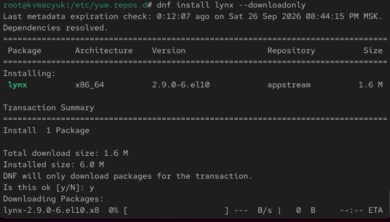{#fig-021 width=32%}

## Поиск скачанного файла

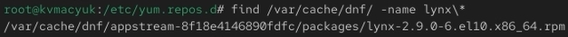{#fig-022 width=32%}

## Ручная установка lynx через rpm

- Перешёл в этот каталог и затем установил rpm-пакет ([рис. @fig-023])

```bash
rpm -Uhv lynx-<версия>.rpm
```

- Определил расположение исполняемого файла ([рис. @fig-024])

```bash
which lynx
```

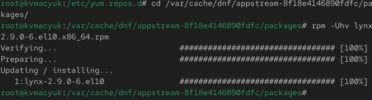{#fig-023 width=45%}

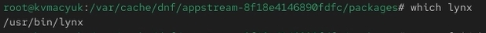{#fig-024 width=45%}

## Использование rpm: информация о lynx

- Используя `rpm`, определил по имени файла, к какому пакету принадлежит `lynx`, и получил дополнительную информацию о содержимом пакета ([рис. @fig-025], [рис. @fig-026])

```bash
rpm -qf $(which lynx)
rpm -qi lynx
```

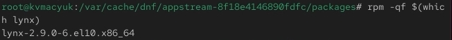{#fig-025 width=32%}

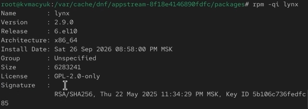{#fig-026 width=32%}

## Использование rpm: файлы пакета lynx

- Получил список всех файлов в пакете ([рис. @fig-027], [рис. @fig-028])

```bash
rpm -ql lynx
```

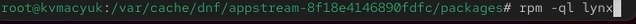{#fig-027 width=32%}

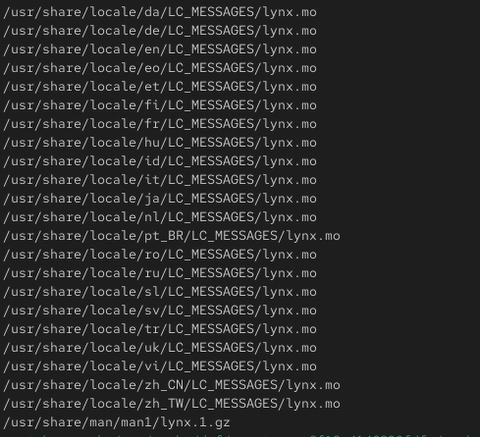{#fig-028 width=32%}

## Документация lynx

- Вывел перечень файлов с документацией пакета ([рис. @fig-029], [рис. @fig-030])
- Посмотрел файлы документации, применив команду `man lynx` ([рис. @fig-031])

```bash
rpm -qd lynx
man lynx
```

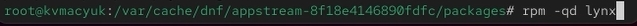{#fig-029 width=32%}

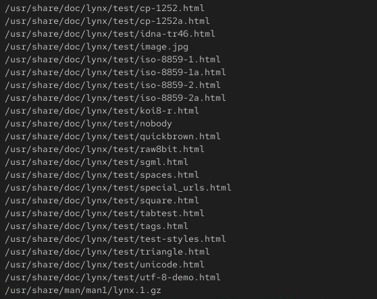{#fig-030 width=32%}

## Просмотр справки man

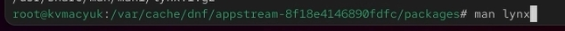{#fig-031 width=32%}

## Конфигурационные файлы и скрипты lynx

- Вывел на экран перечень и месторасположение конфигурационных файлов пакета ([рис. @fig-032])

```bash
rpm -qc lynx
```

- Вывел на экран расположение и содержание скриптов, выполняемых при установке пакета ([рис. @fig-033])

```bash
rpm -q --scripts lynx
```

- Вывод пуст, что означает отсутствие скриптов установки/удаления для пакета `lynx`

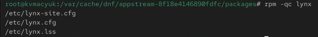{#fig-032 width=32%}

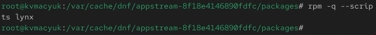{#fig-033 width=32%}

## Проверка и удаление lynx

- В отдельном терминале под своей учётной записью запустил текстовый браузер `lynx`, чтобы проверить корректность установки пакета ([рис. @fig-034], [рис. @fig-035])
- Вернулся в терминал с учётной записью root и удалил пакет ([рис. @fig-036])

```bash
rpm -e lynx
ls
```

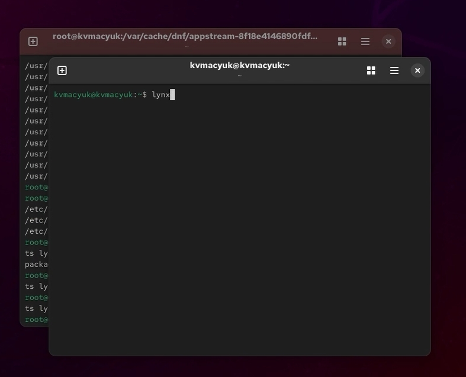{#fig-034 width=32%}

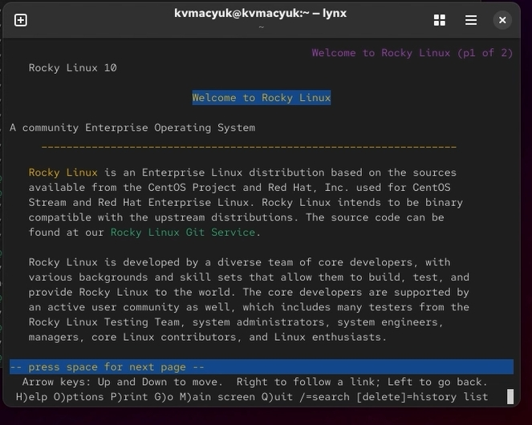{#fig-035 width=32%}

## Удаление пакета через rpm

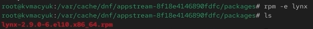{#fig-036 width=32%}

## Установка dnsmasq

- Предположим, что требуется из rpm-пакетов установить `dnsmasq` (DNS-, DHCP- и TFTP-сервер)
- Установил пакет `dnsmasq` и определил расположение исполняемого файла ([рис. @fig-037]—[рис. @fig-039])

```bash
dnf list dnsmasq
dnf install dnsmasq
which dnsmasq
```

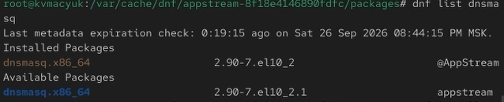{#fig-037 width=32%}

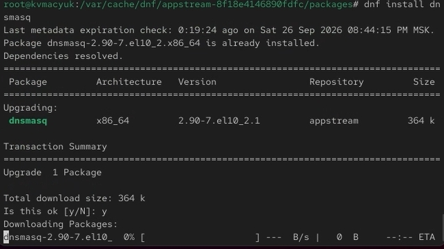{#fig-038 width=32%}

## Определение пути dnsmasq

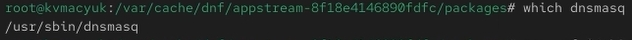{#fig-039 width=32%}

## Информация о dnsmasq

- Определил по имени файла, к какому пакету принадлежит `dnsmasq`, и получил дополнительную информацию о содержимом пакета ([рис. @fig-040]—[рис. @fig-043])

```bash
rpm -qf $(which dnsmasq)
rpm -qi dnsmasq
```

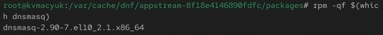{#fig-040 width=32%}

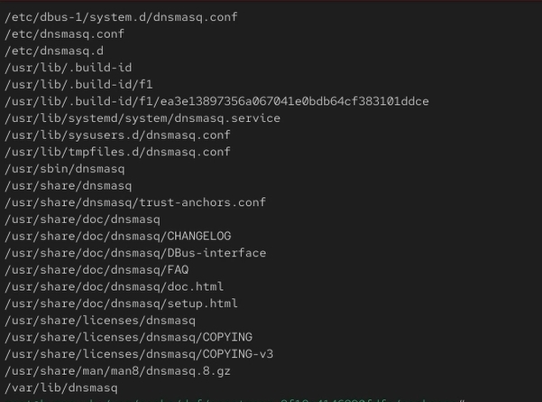{#fig-041 width=32%}

## Запрос детальной информации

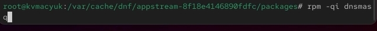{#fig-042 width=32%}

## Детальная информация о dnsmasq

{#fig-043 width=45%}

## Документация и конфигурация dnsmasq

- Получил список всех файлов в пакете, а также вывел перечень файлов с документацией пакета ([рис. @fig-044]—[рис. @fig-046]). Посмотрел файлы документации, применив команду `man dnsmasq`

```bash
rpm -ql dnsmasq
rpm -qd dnsmasq
man dnsmasq
```

- Вывел на экран перечень и месторасположение конфигурационных файлов пакета ([рис. @fig-048])

```bash
rpm -qc dnsmasq
```

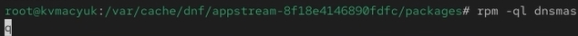{#fig-044 width=32%}

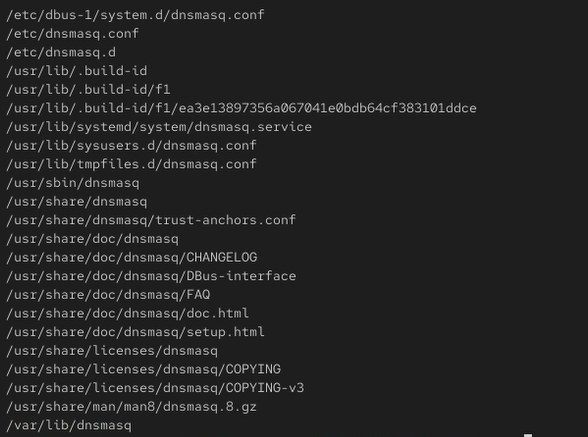{#fig-045 width=32%}

## Список документации dnsmasq

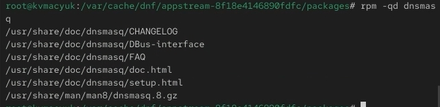{#fig-046 width=32%}

## Скрипты и удаление dnsmasq

- Вывел на экран расположение и содержание скриптов, выполняемых при установке пакета ([рис. @fig-049])

```bash
rpm -q --scripts dnsmasq
```

- Скрипты предназначены для создания пользователя `dnsmasq` и настройки systemd-сервиса при установке, а также для его остановки и удаления пользователя при удалении пакета
- Вернулся в терминал с учётной записью root и удалил пакет ([рис. @fig-050], [рис. @fig-051])

```bash
rpm -e dnsmasq
ls
```

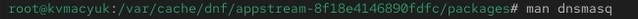{#fig-047 width=32%}

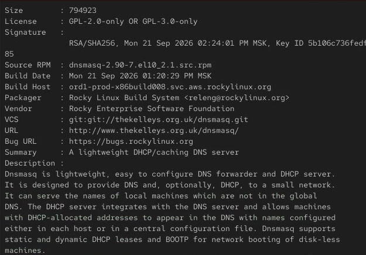{#fig-048 width=32%}

## Просмотр скриптов установки

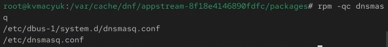{#fig-049 width=32%}

## Удаление dnsmasq

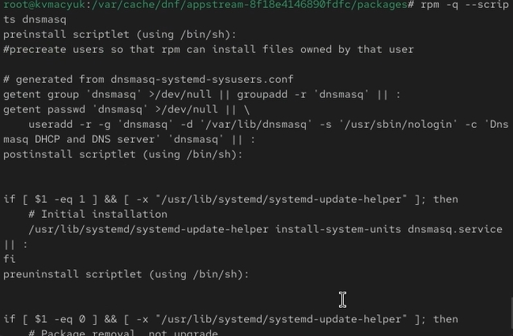{#fig-050 width=45%}

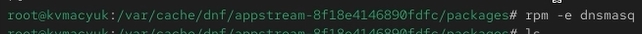{#fig-051 width=45%}

# Ответы на контрольные вопросы

## Вопросы 1–3

**1. Какая команда позволяет вам искать пакет rpm, содержащий файл useradd?**

Для поиска пакета, содержащего файл `useradd`, используется команда `dnf provides */useradd` или `dnf provides "*bin/useradd"`. Также можно использовать `rpm -qf $(which useradd)`, если файл уже установлен в системе.

**2. Какие команды вам нужно использовать, чтобы показать имя группы dnf, которая содержит инструменты безопасности и показывает, что находится в этой группе?**

Для отображения списка групп пакетов используется команда `dnf grouplist`. Для получения информации о конкретной группе, содержащей инструменты безопасности (например, «Security Tools»), используется команда `dnf groupinfo "Security Tools"`.

**3. Какая команда позволяет вам установить rpm, который вы загрузили из Интернета и который не находится в репозиториях?**

Для установки локального rpm-пакета используется команда `rpm -Uhv имя_пакета.rpm` или `dnf install имя_пакета.rpm`. Также можно использовать `dnf install http://server/repo/имя_пакета.rpm` для установки из сети.

## Вопросы 4–6

**4. Вы хотите убедиться, что пакет rpm, который вы загрузили, не содержит никакого опасного кода сценария. Какая команда позволяет это сделать?**

Для просмотра скриптов, выполняемых при установке/удалении пакета, используется команда `rpm -q --scripts имя_пакета`. Она выводит содержимое скриптов, что позволяет проверить их на наличие опасных действий.

**5. Какая команда показывает всю документацию в rpm?**

Для отображения списка файлов документации, входящих в пакет, используется команда `rpm -qd имя_пакета`. Для просмотра всей документации можно также использовать `rpm -ql имя_пакета | grep -E 'man|doc|html'`.

**6. Какая команда показывает, какому пакету rpm принадлежит файл?**

Для определения принадлежности файла к пакету используется команда `rpm -qf путь_к_файлу`. Например, `rpm -qf $(which lynx)`.

# Результаты и выводы

## Полученные навыки

- Получены навыки работы с репозиториями и менеджерами пакетов
- Изучены основные команды `dnf` для поиска, установки, обновления, удаления пакетов и работы с историей действий
- Освоены команды `rpm` для получения информации о пакетах, их файлах, документации, конфигурационных файлах и скриптах установки
- Изучено расположение конфигурационных файлов `dnf` и репозиториев

# Список литературы{.unnumbered}

::: {#refs}
:::
