---
## Author

author:
  name: Мацюк Константин Владимирович
  degrees: BSc
  orcid: 0000-0002-0877-7063
  email: 1032253640@rudn.ru
  affiliation:
    - name: Российский университет дружбы народов
      country: Российская Федерация
      postal-code: 117198
      city: Москва
      address: ул. Миклухо-Маклая, д. 6

## Title

title: "Лабораторная работа №5. Управление системными службами"
subtitle: "Дисциплина: Основы администрирования операционных систем"
license: "CC BY"

## Fonts

mainfont: IBM Plex Serif
romanfont: IBM Plex Serif
sansfont: IBM Plex Sans
monofont: DejaVu Sans Mono
mathfont: STIX Two Math
mainfontoptions: Ligatures=Common,Ligatures=TeX,Scale=0.94
romanfontoptions: Ligatures=Common,Ligatures=TeX,Scale=0.94
sansfontoptions: Ligatures=Common,Ligatures=TeX,Scale=MatchLowercase,Scale=0.94
monofontoptions: Scale=MatchLowercase,Scale=0.94
incremental: false
slide-level: 2
lang: ru-RU

---

# Цель работы

## Цель работы

- Получить навыки управления системными службами операционной системы посредством systemd

# Задание

## Задание

- Выполнить основные операции по запуску (останову), определению статуса, добавлению (удалению) в автозапуск и пр. службы Very Secure FTP
- Продемонстрировать навыки по разрешению конфликтов юнитов для служб firewalld и iptables
- Продемонстрировать навыки работы с изолированными целями

# Теоретическое введение

## Systemd и юниты

- Systemd — система инициализации служб операционной системы
- Под системой инициализации понимается набор скриптов, выполняемых на этапе загрузки ОС
- Для выполнения операций над службами используются юниты — файлы конфигурации с определённым синтаксисом
- Посмотреть типы юнитов: `systemctl -t help`

## Типы юнитов

- `.service` — службы
- `.socket` — сокеты
- `.device` — устройства
- `.mount` — монтирование
- `.automount` — автомонтирование
- `.target` — логическая группировка юнитов, аналог уровней запуска
- `.snapshot` — снимки
- `.timer` — расписание, аналог cron
- `.swap` — файлы подкачки
- `.path` — уведомления о событиях файловой системы

## Каталоги расположения юнитов

- `/usr/lib/systemd/system/` — автоматически созданные при установке пакетов юниты
- `/run/systemd/system/` — юниты, созданные во время выполнения какой-либо службы
- `/etc/systemd/system/` — юниты, созданные системным администратором

## Структура файла юнита

- Файлы юнитов содержат разделы с набором параметров и их значений, разделённых знаком «=»

```text
[Название секции]
имя_переменной = значение
```

- Зависимости запуска служб описываются конструкциями `Requires=B` (или `Wants=B`) и `After=B` в секции `[Unit]`
- Тип запуска службы определяется параметром `Type=` в секции `[Service]`

## Основные команды работы с юнитами

- запустить юнит: `systemctl start название_юнита`
- остановить юнит: `systemctl stop название_юнита`
- перезапустить юнит: `systemctl restart название_юнита`
- перезагрузить настройки юнита: `systemctl reload название_юнита`
- посмотреть статус юнита: `systemctl status название_юнита`
- проверить, включён ли юнит в автозапуск: `systemctl is-enabled название_юнита`
- добавить юнит в автозапуск: `systemctl enable название_юнита`
- удалить юнит из автозапуска: `systemctl disable название_юнита`
- маскировать юнит: `systemctl mask название_юнита`
- снять маску юнита: `systemctl unmask название_юнита`

# Выполнение лабораторной работы

## Управление сервисами

- В консоли перешёл в режим работы суперпользователя командой `su -`

{#fig-001 width=85%}

## Проверка статуса vsftpd до установки

- Проверил статус службы Very Secure FTP командой `systemctl status vsftpd`
- Вывод показал, что юнит не найден — служба ещё не установлена

{#fig-002 width=85%}

## Установка службы Very Secure FTP

- Установил службу командой `dnf -y install vsftpd`

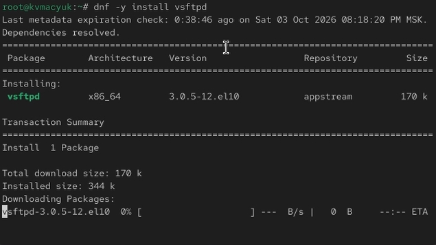{#fig-003 width=55%}

## Запуск и статус vsftpd

- Запустил службу командой `systemctl start vsftpd` и проверил её статус
- Служба в состоянии `active (running)`, но со статусом `disabled`

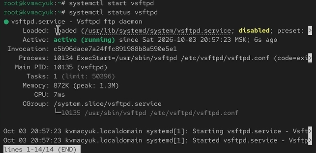{#fig-004 width=55%}

## Добавление vsftpd в автозапуск

- Добавил службу в автозапуск командой `systemctl enable vsftpd` и проверил статус
- Параметр `Loaded` изменился с `disabled` на `enabled`

{#fig-005 width=55%}

## Удаление vsftpd из автозапуска

- Удалил службу из автозапуска командой `systemctl disable vsftpd` и снова проверил её статус

{#fig-006 width=55%}

## Символические ссылки до добавления vsftpd

- Вывел на экран символические ссылки, ответственные за запуск сервисов: `ls /etc/systemd/system/multi-user.target.wants`
- Ссылки на `vsftpd.service` в списке нет

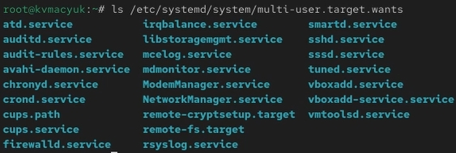{#fig-007 width=85%}

## Повторное добавление vsftpd в автозапуск

- Снова добавил службу в автозапуск командой `systemctl enable vsftpd`

{#fig-008 width=85%}

## Символические ссылки после добавления vsftpd

- Вывел список символических ссылок
- Теперь в каталоге появилась ссылка на `vsftpd.service`

{#fig-009 width=85%}

## Статус vsftpd после добавления в автозапуск

- Проверил статус службы
- Состояние юнита — `enabled`, служба работает

{#fig-010 width=85%}

## Список зависимостей vsftpd

- Вывел список зависимостей юнита командой `systemctl list-dependencies vsftpd`

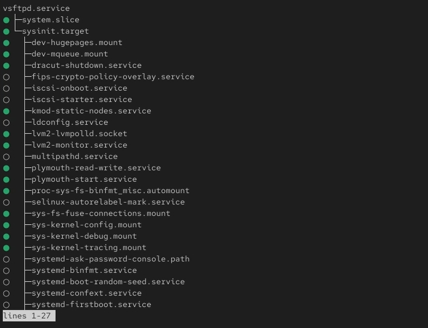{#fig-011 width=40%}

## Юниты, зависящие от vsftpd

- Вывел список юнитов, которые зависят от данного: `systemctl list-dependencies vsftpd --reverse`
- От `vsftpd` зависят `multi-user.target` и `graphical.target`

{#fig-012 width=85%}

## Конфликты юнитов

- Установил iptables командой `dnf -y install iptables*`

{#fig-013 width=55%}

## Статус firewalld

- Проверил статусы firewalld и iptables
- Firewalld активен, iptables — disabled

{#fig-014 width=85%}

## Статус iptables до запуска

- Проверил статус iptables

{#fig-015 width=85%}

## Запуск firewalld и iptables

- Попробовал запустить обе службы командами `systemctl start firewalld` и `systemctl start iptables`

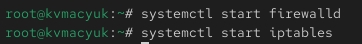{#fig-016 width=85%}

## Статус firewalld после конфликта

- Проверил статус firewalld — он стал `inactive (dead)`
- Проверил статус iptables — стал `active (exited)`
- Это демонстрация конфликта юнитов

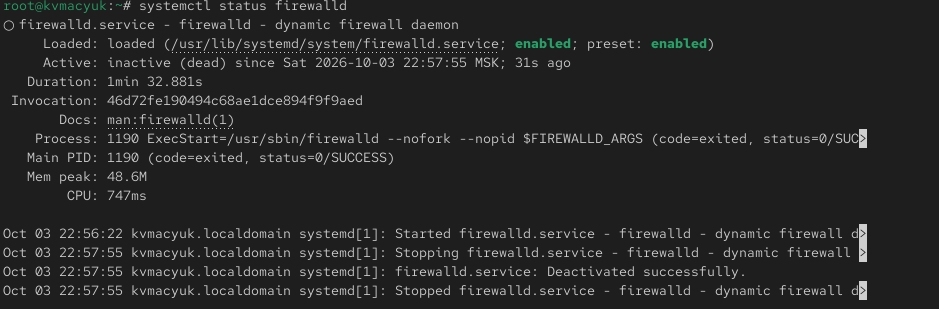{#fig-017 width=85%}

## Статус iptables после конфликта

- Проверил статус iptables после конфликта

{#fig-018 width=85%}

## Содержимое firewalld.service

- Изучил содержимое юнита firewalld командой `cat /usr/lib/systemd/system/firewalld.service`

{#fig-019 width=55%}

## Содержимое iptables.service

- Посмотрел содержимое файла `iptables.service`
- В нём параметр `Conflicts` отсутствует — конфликт задаётся только со стороны firewalld

{#fig-020 width=55%}

## Остановка iptables

- Остановил iptables командой `systemctl stop iptables`

{#fig-021 width=85%}

## Запуск firewalld

- Заново запустил firewalld командой `systemctl start firewalld`

{#fig-022 width=85%}

## Маскировка iptables

- Заблокировал запуск iptables командой `systemctl mask iptables`
- Создана символическая ссылка `/etc/systemd/system/iptables.service -> /dev/null`

{#fig-023 width=85%}

## Символическая ссылка на /dev/null

- Проверил, что ссылка действительно указывает на `/dev/null`, командой `ls -l`
- Теперь файл юнита в `/etc` имеет приоритет над файлом в `/usr/lib`, поэтому запуск невозможен

{#fig-024 width=85%}

## Попытка запуска iptables

- Попробовал запустить iptables — ошибка `Unit iptables.service is masked`
- Попробовал добавить его в автозапуск — тоже ошибка

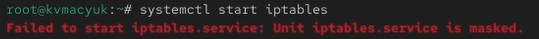{#fig-025 width=85%}

## Попытка добавить iptables в автозапуск

- Попытка добавления в автозапуск также завершилась ошибкой

{#fig-026 width=85%}

## Изолируемые цели

- Перешёл в каталог systemd и нашёл список изолируемых целей командой `grep Isolate *.target`

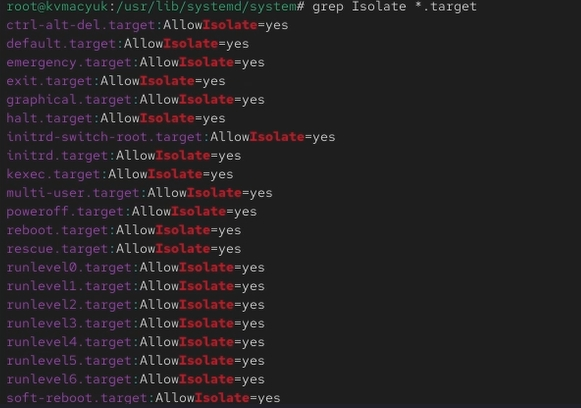{#fig-027 width=40%}

## Режим восстановления

- Переключил систему в режим восстановления командой `systemctl isolate rescue.target`
- Система вывела приглашение ко вводу пароля root для входа в rescue mode
- Ввёл `systemctl isolate reboot.target` для перезагрузки системы

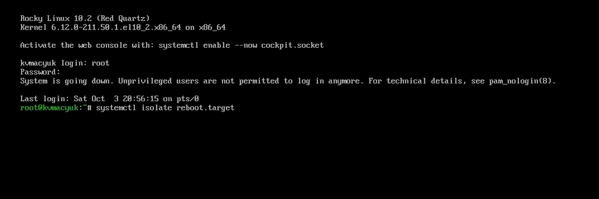{#fig-028 width=85%}

## Текущая цель по умолчанию

- Вывел цель, установленную по умолчанию: `systemctl get-default`
- Сейчас это `graphical.target`

{#fig-029 width=85%}

## Установка multi-user.target по умолчанию

- Сменил цель по умолчанию на текстовый режим командой `systemctl set-default multi-user.target`

{#fig-030 width=85%}

## Система в текстовом режиме

- Перезагрузил систему, и она загрузилась в текстовом режиме

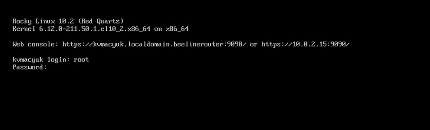{#fig-031 width=85%}

## Возврат к graphical.target и перезагрузка

- Ввёл логин и пароль, получил полномочия root
- Сменил цель по умолчанию обратно на графический режим командой `systemctl set-default graphical.target` и перезагрузил систему

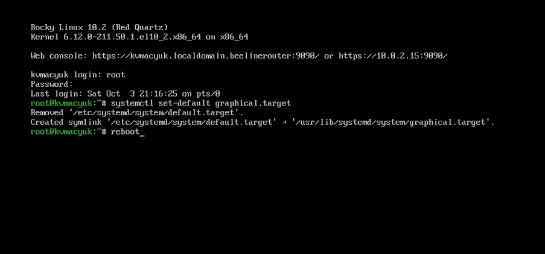{#fig-032 width=55%}

## Система в графическом режиме

- Система загрузилась в графическом режиме

{#fig-033 width=55%}

# Ответы на контрольные вопросы

## Вопрос 1

**Что такое юнит (unit)? Приведите примеры.**

- Юнит — это абстрактное представление ресурса или сервиса в systemd, описанное в конфигурационном файле
- Примеры: `httpd.service` (сервис), `multi-user.target` (цель), `mnt-data.mount` (точка монтирования)

## Вопрос 2

**Какая команда позволяет вам убедиться, что цель больше не входит в список автоматического запуска при загрузке системы?**

- `systemctl is-enabled имя_юнита`

## Вопрос 3

**Какую команду вы должны использовать для отображения всех сервисных юнитов, которые в настоящее время загружены?**

- `systemctl list-units --type=service`

## Вопрос 4

**Как создать потребность (wants) в сервисе?**

- Указать в секции `[Unit]` файла юнита параметр `Wants=имя_юнита`

## Вопрос 5

**Как переключить текущее состояние на цель восстановления (rescue target)?**

- `systemctl isolate rescue.target`

## Вопрос 6

**Поясните причину получения сообщения о том, что цель не может быть изолирована.**

- Цель нельзя изолировать, если в её файле отсутствует параметр `AllowIsolate=yes`
- По умолчанию изолируемыми являются только специальные цели (rescue, multi-user, graphical, reboot, poweroff и др.)

## Вопрос 7

**Вы хотите отключить службу systemd, но, прежде чем сделать это, вы хотите узнать, какие другие юниты зависят от этой службы. Какую команду вы бы использовали?**

- `systemctl list-dependencies имя_юнита --reverse`

# Выводы

## Выводы

- В ходе выполнения лабораторной работы я получил навыки управления системными службами операционной системы посредством systemd
- Научился запускать, останавливать, добавлять и удалять из автозапуска службы (`systemctl start/stop/enable/disable`), смотреть их статус и зависимости (`systemctl status` и `list-dependencies`)
- Разобрался с конфликтами юнитов на примере firewalld и iptables, а также с механизмом маскировки служб (`systemctl mask`), который полностью блокирует запуск
- Освоил работу с изолированными целями (`systemctl isolate`) и сменой цели по умолчанию (`systemctl set-default`), переключаясь между текстовым и графическим режимами работы системы
- Все поставленные задачи выполнены

# Список литературы{.unnumbered}

::: {#refs}
:::
