---
## Author
author:
  name: Мацюк Константин Владимирович
  degrees: BSc
  orcid: 0000-0002-0877-7063
  email: 1032253640@rudn.ru
  affiliation:
    - name: Российский университет дружбы народов
      country: Российская Федерация
      postal-code: 117198
      city: Москва
      address: ул. Миклухо-Маклая, д. 6

## Title
title: "Лабораторная работа №5. Управление системными службами"
subtitle: "Дисциплина: Основы администрирования операционных систем"
license: "CC BY"

## Fonts
mainfont: IBM Plex Serif
romanfont: IBM Plex Serif
sansfont: IBM Plex Sans
monofont: DejaVu Sans Mono
mathfont: STIX Two Math
mainfontoptions: Ligatures=Common,Ligatures=TeX,Scale=0.94
romanfontoptions: Ligatures=Common,Ligatures=TeX,Scale=0.94
sansfontoptions: Ligatures=Common,Ligatures=TeX,Scale=MatchLowercase,Scale=0.94
monofontoptions: Scale=MatchLowercase,Scale=0.94
---

# Цель работы

Получить навыки управления системными службами операционной системы посредством systemd.

# Задание

1. Выполнить основные операции по запуску (останову), определению статуса, добавлению (удалению) в автозапуск и пр. службы Very Secure FTP.
2. Продемонстрировать навыки по разрешению конфликтов юнитов для служб firewalld и iptables.
3. Продемонстрировать навыки работы с изолированными целями.

# Теоретическое введение

Systemd (system daemon) — система инициализации служб операционной системы. Под системой инициализации понимается набор скриптов, выполняемых на этапе загрузки операционной системы. Для выполнения операций над системными службами в systemd используются юниты (units) — файлы конфигурации с определённым синтаксисом.

Посмотреть, какие типы юнитов используются в системе, можно при помощи команды `systemctl -t help`. Выделяют следующие типы юнитов: `.service` (службы), `.socket` (сокеты), `.device` (устройства), `.mount` (монтирование), `.automount` (автомонтирование), `.target` (логическая группировка юнитов, аналог уровней запуска), `.snapshot` (снимки), `.timer` (расписание, аналог cron), `.swap` (файлы подкачки), `.path` (уведомления о событиях файловой системы).

Каталоги расположения юнитов:
- `/usr/lib/systemd/system/` — автоматически созданные при установке пакетов юниты;
- `/run/systemd/system/` — юниты, созданные во время выполнения какой-либо службы;
- `/etc/systemd/system/` — юниты, созданные системным администратором.

Файлы юнитов содержат разделы с набором параметров и их значений, разделённых знаком «=»:
```
[Название секции]
имя_переменной = значение
```
Обработка зависимостей запуска служб может быть описана с помощью конструкций `Requires=B` (или `Wants=B`) и `After=B` в секции `[Unit]`. Тип запуска службы определяется параметром `Type=` в секции `[Service]`.

Основные команды работы с юнитами systemd:
- запустить юнит: `systemctl start название_юнита`
- остановить юнит: `systemctl stop название_юнита`
- перезапустить юнит: `systemctl restart название_юнита`
- перезагрузить настройки юнита: `systemctl reload название_юнита`
- посмотреть статус юнита: `systemctl status название_юнита`
- проверить, включён ли юнит в автозапуск: `systemctl is-enabled название_юнита`
- добавить юнит в автозапуск: `systemctl enable название_юнита`
- удалить юнит из автозапуска: `systemctl disable название_юнита`
- маскировать юнит: `systemctl mask название_юнита`
- снять маску юнита: `systemctl unmask название_юнита`

# Выполнение лабораторной работы

## Управление сервисами

В консоли перешёл в режим работы суперпользователя командой `su -` ([рис. @fig-001]).

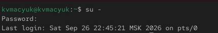{#fig-001 width=70%}

Проверил статус службы Very Secure FTP командой `systemctl status vsftpd` ([рис. @fig-002]). Вывод показал, что юнит не найден — служба ещё не установлена.

{#fig-002 width=70%}

Установил службу командой `dnf -y install vsftpd` ([рис. @fig-003]).

{#fig-003 width=70%}

Запустил службу командой `systemctl start vsftpd` и проверил её статус ([рис. @fig-004]). Служба в состоянии `active (running)`, но со статусом `disabled`.

{#fig-004 width=70%}

Добавил службу в автозапуск командой `systemctl enable vsftpd` и проверил статус ([рис. @fig-005]). Параметр `Loaded` изменился с `disabled` на `enabled`.

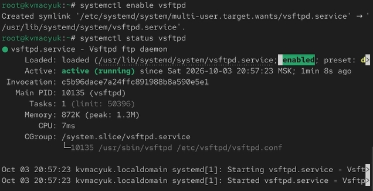{#fig-005 width=70%}

Удалил службу из автозапуска командой `systemctl disable vsftpd` и снова проверил её статус ([рис. @fig-006]).

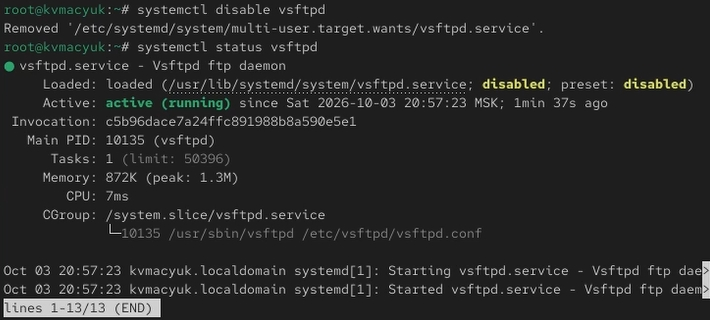{#fig-006 width=70%}

Вывел на экран символические ссылки, ответственные за запуск сервисов: `ls /etc/systemd/system/multi-user.target.wants` ([рис. @fig-007]). Ссылки на `vsftpd.service` в списке нет.

{#fig-007 width=70%}

Снова добавил службу в автозапуск командой `systemctl enable vsftpd` ([рис. @fig-008]) и вывел список символических ссылок ([рис. @fig-009]). Теперь в каталоге появилась ссылка на `vsftpd.service`.

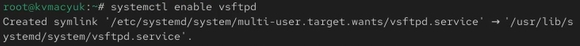{#fig-008 width=70%}

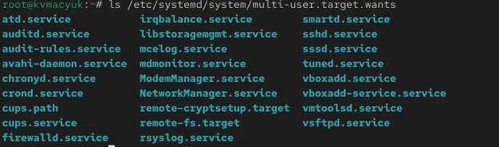{#fig-009 width=70%}

Проверил статус службы ([рис. @fig-010]). Состояние юнита — `enabled`, служба работает.

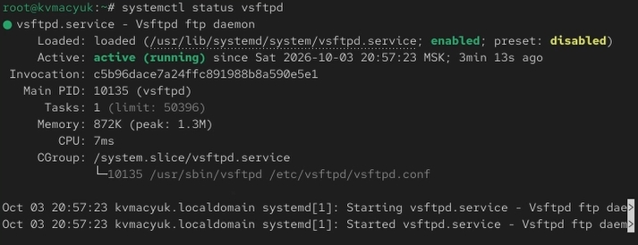{#fig-010 width=70%}

Вывел список зависимостей юнита командой `systemctl list-dependencies vsftpd` ([рис. @fig-011]).

{#fig-011 width=70%}

Вывел список юнитов, которые зависят от данного: `systemctl list-dependencies vsftpd --reverse` ([рис. @fig-012]). От `vsftpd` зависят `multi-user.target` и `graphical.target`.

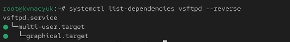{#fig-012 width=70%}

## Конфликты юнитов

Установил iptables командой `dnf -y install iptables*` ([рис. @fig-013]).

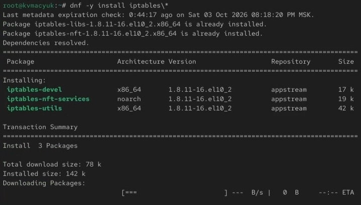{#fig-013 width=70%}

Проверил статусы firewalld и iptables ([рис. @fig-014]–[рис. @fig-015]). Firewalld активен, iptables — disabled.

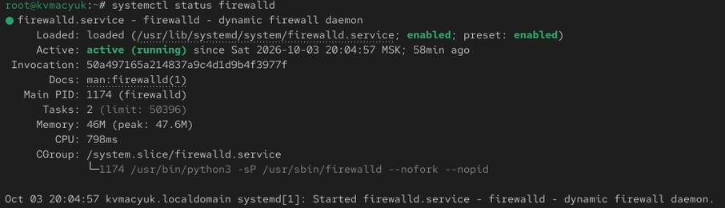{#fig-014 width=70%}

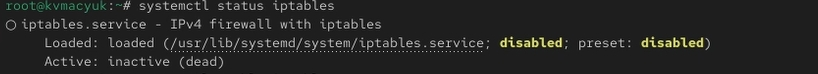{#fig-015 width=70%}

Попробовал запустить обе службы командами `systemctl start firewalld` и `systemctl start iptables` ([рис. @fig-016]).

{#fig-016 width=70%}

Проверил статус firewalld ([рис. @fig-017]) — он стал `inactive (dead)`. Проверил статус iptables ([рис. @fig-018]) — стал `active (exited)`. Это демонстрация конфликта юнитов.

{#fig-017 width=70%}

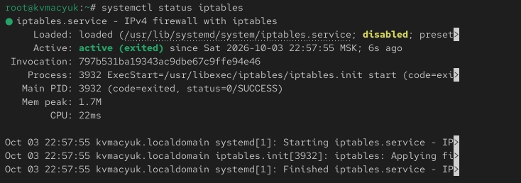{#fig-018 width=70%}

Изучил содержимое юнита firewalld командой `cat /usr/lib/systemd/system/firewalld.service` ([рис. @fig-019]).

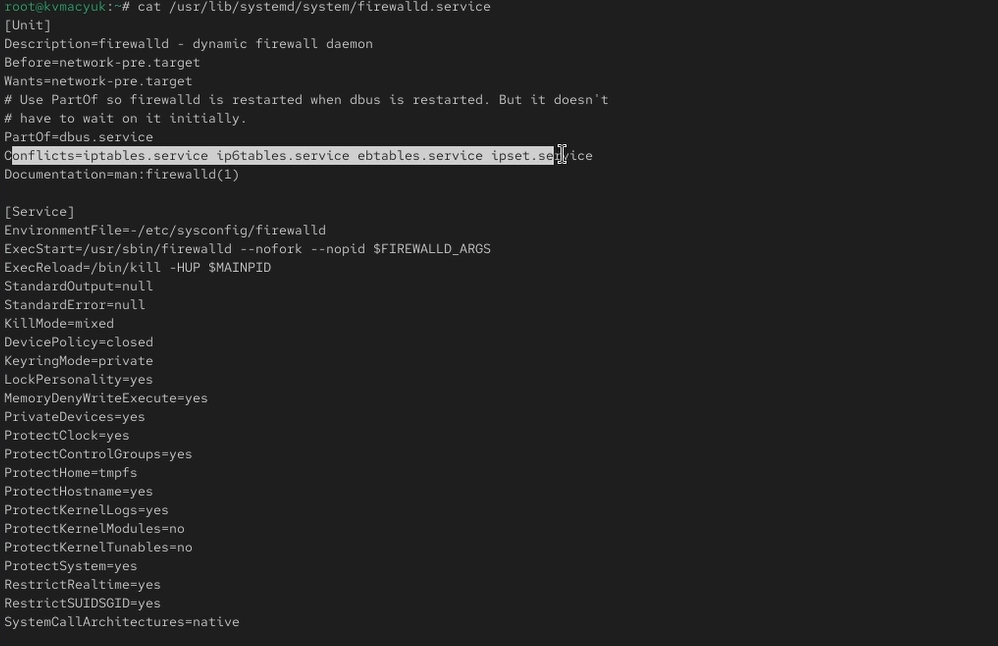{#fig-019 width=70%}

Посмотрел содержимое файла `iptables.service` ([рис. @fig-020]). В нём параметр `Conflicts` отсутствует — конфликт задаётся только со стороны firewalld.

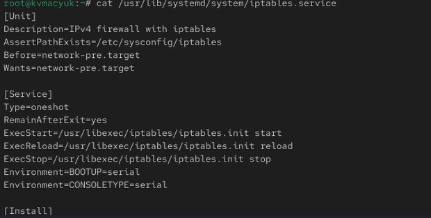{#fig-020 width=70%}

Остановил iptables командой `systemctl stop iptables` ([рис. @fig-021]).

{#fig-021 width=70%}

Заново запустил firewalld командой `systemctl start firewalld` ([рис. @fig-022]).

{#fig-022 width=70%}

Заблокировал запуск iptables командой `systemctl mask iptables` ([рис. @fig-023]). Создана символическая ссылка `/etc/systemd/system/iptables.service -> /dev/null`.

{#fig-023 width=70%}

Проверил, что ссылка действительно указывает на `/dev/null`, командой `ls -l` ([рис. @fig-024]). Теперь файл юнита в `/etc` имеет приоритет над файлом в `/usr/lib`, поэтому запуск невозможен.

{#fig-024 width=70%}

Попробовал запустить iptables — ошибка `Unit iptables.service is masked` ([рис. @fig-025]). Попробовал добавить его в автозапуск – тоже ошибка ([рис. @fig-026]).

{#fig-025 width=70%}

{#fig-026 width=70%}

## Изолируемые цели

Перешёл в каталог systemd и нашёл список изолируемых целей командой `grep Isolate *.target` ([рис. @fig-027]).

{#fig-027 width=70%}

Переключил систему в режим восстановления командой `systemctl isolate rescue.target`. Система вывела приглашение ко вводу пароля root для входа в rescue mode. Ввёл `systemctl isolate reboot.target` для перезагрузки системы ([рис. @fig-028]).

{#fig-028 width=70%}

## Цель по умолчанию

Вывел цель, установленную по умолчанию: `systemctl get-default` ([рис. @fig-029]). Сейчас это `graphical.target`.

{#fig-029 width=70%}

Сменил цель по умолчанию на текстовый режим командой `systemctl set-default multi-user.target` ([рис. @fig-030]).

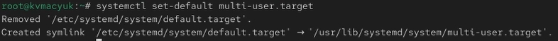{#fig-030 width=70%}

Перезагрузил систему, и она загрузилась в текстовом режиме ([рис. @fig-031]).

{#fig-031 width=70%}

Ввёл логин и пароль, получил полномочия root. Сменил цель по умолчанию обратно на графический режим командой `systemctl set-default graphical.target` и перезагрузил систему ([рис. @fig-032]).

{#fig-032 width=70%}

Система загрузилась в графическом режиме ([рис. @fig-033]).

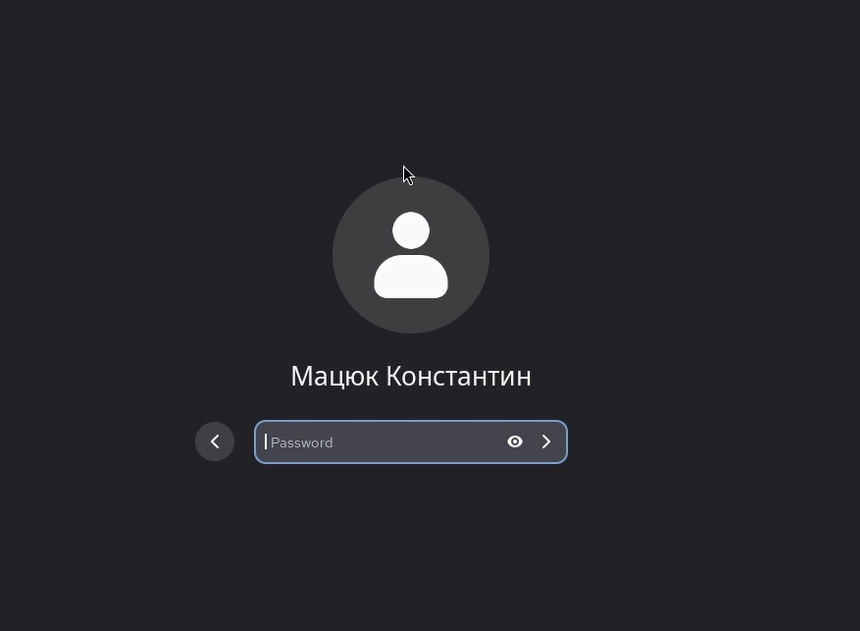{#fig-033 width=70%}

# Ответы на контрольные вопросы

**1. Что такое юнит (unit)? Приведите примеры.**

Юнит — это абстрактное представление ресурса или сервиса в systemd, описанное в конфигурационном файле. Примеры: `httpd.service` (сервис), `multi-user.target` (цель), `mnt-data.mount` (точка монтирования).

**2. Какая команда позволяет вам убедиться, что цель больше не входит в список автоматического запуска при загрузке системы?**

`systemctl is-enabled имя_юнита`.

**3. Какую команду вы должны использовать для отображения всех сервисных юнитов, которые в настоящее время загружены?**

`systemctl list-units --type=service`.

**4. Как создать потребность (wants) в сервисе?**

Указать в секции `[Unit]` файла юнита параметр `Wants=имя_юнита`.

**5. Как переключить текущее состояние на цель восстановления (rescue target)?**

`systemctl isolate rescue.target`.

**6. Поясните причину получения сообщения о том, что цель не может быть изолирована.**

Цель нельзя изолировать, если в её файле отсутствует параметр `AllowIsolate=yes`. По умолчанию изолируемыми являются только специальные цели (rescue, multi-user, graphical, reboot, poweroff и др.).

**7. Вы хотите отключить службу systemd, но, прежде чем сделать это, вы хотите узнать, какие другие юниты зависят от этой службы. Какую команду вы бы использовали?**

`systemctl list-dependencies имя_юнита --reverse`.

# Выводы

В ходе выполнения лабораторной работы я получил навыки управления системными службами операционной системы посредством systemd. Научился запускать, останавливать, добавлять и удалять из автозапуска службы (systemctl start/stop/enable/disable), смотреть их статус и зависимости (systemctl status и list-dependencies). Разобрался с конфликтами юнитов на примере firewalld и iptables, а также с механизмом маскировки служб (systemctl mask), который полностью блокирует запуск. Освоил работу с изолированными целями (systemctl isolate) и сменой цели по умолчанию (systemctl set-default), переключаясь между текстовым и графическим режимами работы системы. Все поставленные задачи выполнены.

# Список литературы{.unnumbered}

::: {#refs}
:::
