---
## Author
author:
  name: Мацюк Константин Владимирович
  degrees: BSc
  orcid: 0000-0002-0877-7063
  email: 1032253640@rudn.ru
  affiliation:
    - name: Российский университет дружбы народов
      country: Российская Федерация
      postal-code: 117198
      city: Москва
      address: ул. Миклухо-Маклая, д. 6

## Title
title: "Лабораторная работа №6. Управление процессами"
subtitle: "Дисциплина: Основы администрирования операционных систем"
license: "CC BY"

## Fonts
mainfont: IBM Plex Serif
romanfont: IBM Plex Serif
sansfont: IBM Plex Sans
monofont: DejaVu Sans Mono
mathfont: STIX Two Math
mainfontoptions: Ligatures=Common,Ligatures=TeX,Scale=0.94
romanfontoptions: Ligatures=Common,Ligatures=TeX,Scale=0.94
sansfontoptions: Ligatures=Common,Ligatures=TeX,Scale=MatchLowercase,Scale=0.94
monofontoptions: Scale=MatchLowercase,Scale=0.94
---

# Цель работы

Получить навыки управления заданиями и процессами операционной системы.

# Задание

1. Продемонстрировать навыки управления заданиями операционной системы.
2. Продемонстрировать навыки управления процессами операционной системы.
3. Выполнить задания для самостоятельной работы: изменить приоритеты процессов и изучить управление программой yes с помощью сигналов и команд оболочки.

# Теоретическое введение

Процесс — это выполняющийся экземпляр программы, которому операционная система выделяет ресурсы. Каждый процесс имеет идентификатор `PID`, владельца, состояние и параметры планирования. Поле `PPID` содержит идентификатор родительского процесса и позволяет проследить отношения между процессами.

Для просмотра процессов используются команды `ps` и `top`. Команда `ps aux` выводит сведения о процессах разных пользователей, включая загрузку процессора, использование памяти и команду запуска. Команда `ps fax` представляет процессы в виде дерева. Утилита `top` обновляет информацию во время работы и позволяет отправлять процессам сигналы.

Основные состояния процессов:
- `R` — процесс выполняется или готов к выполнению;
- `S` — процесс находится в прерываемом ожидании события;
- `D` — процесс находится в непрерываемом ожидании, обычно связанном с вводом-выводом;
- `T` — выполнение процесса приостановлено;
- `Z` — процесс завершился, но родитель ещё не получил его статус завершения.

Задание оболочки объединяет один или несколько процессов, запущенных из текущей оболочки. Номер задания используется внутри этой оболочки и отличается от системного PID. Символ `&` в конце команды запускает задание в фоне. Такой запуск возвращает приглашение оболочки, но сам по себе не защищает процесс от завершения при закрытии терминала.

Основные команды управления заданиями:
- вывести список заданий: `jobs`;
- вывести задания вместе с PID: `jobs -l`;
- продолжить задание в фоне: `bg %1`;
- перевести задание на передний план: `fg %1`;
- приостановить задание переднего плана: `Ctrl+Z`;
- прервать задание переднего плана: `Ctrl+C`.

Сочетание `Ctrl+Z` обычно посылает группе процессов переднего плана сигнал `SIGTSTP`, а `Ctrl+C` — сигнал `SIGINT`. Команда `kill` отправляет сигнал по PID или идентификатору задания; по умолчанию используется `SIGTERM`. Сигнал `SIGKILL` принудительно завершает процесс и не может быть обработан программой.

Значение nice в Linux находится в диапазоне от `-20` до `19`. Меньшее значение соответствует более высокому приоритету при обычной политике планирования. Команда `nice` задаёт поправку к унаследованному значению nice при запуске, а `renice` изменяет nice уже работающего процесса. Обычно уменьшение nice требует полномочий суперпользователя. Повышение приоритета влияет на распределение процессорного времени при конкуренции, но не гарантирует фиксированной доли загрузки CPU.

Команда `nohup` запускает программу с игнорированием сигнала `SIGHUP`. Для фонового запуска дополнительно используется `&`. В GNU/Linux утилита `nohup` не изменяет nice; приоритет настраивается отдельно. Это поведение описано в [руководстве GNU Coreutils](https://www.gnu.org/software/coreutils/manual/html_node/nohup-invocation.html).

# Выполнение лабораторной работы

## Управление заданиями

В терминале перешёл к работе от имени суперпользователя с помощью команды `su -` ([рис. @fig-001]).

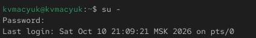{#fig-001 width=70%}

Последовательно выполнил команды `sleep 3600 &`, `dd if=/dev/zero of=/dev/null &` и `sleep 7200`. Первые две команды запустил в фоновом режиме, а последнюю — на переднем плане. Команда `dd` выполняла чтение из `/dev/zero` с перенаправлением данных в `/dev/null` ([рис. @fig-002]).

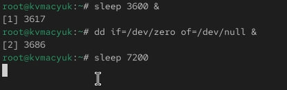{#fig-002 width=70%}

Приостановил задание `sleep 7200` сочетанием `Ctrl+Z`, чтобы вернуть управление оболочке без завершения процесса ([рис. @fig-003]).

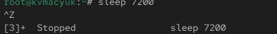{#fig-003 width=70%}

Вывел список заданий командой `jobs`. Первые два задания находились в состоянии `Running`, а третье, приостановленное сочетанием `Ctrl+Z`, — в состоянии `Stopped` ([рис. @fig-004]).

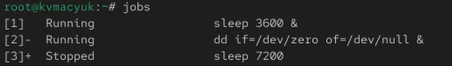{#fig-004 width=70%}

Возобновил третье задание в фоновом режиме командой `bg 3`. Повторно выполнил `jobs` и проверил изменение его состояния на `Running` ([рис. @fig-005]).

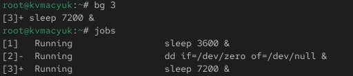{#fig-005 width=70%}

Перевёл первый процесс `sleep` на передний план командой `fg 1`. Оболочка перешла к ожиданию завершения этого задания ([рис. @fig-006]).

{#fig-006 width=70%}

Прервал первое задание сочетанием `Ctrl+C`, затем выполнил `jobs` для проверки оставшихся заданий ([рис. @fig-007]).

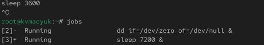{#fig-007 width=70%}

Поочерёдно перевёл оставшиеся задания на передний план командами `fg 2` и `fg 3`, прерывая каждое сочетанием `Ctrl+C`. Проверил список командой `jobs` ([рис. @fig-008]).

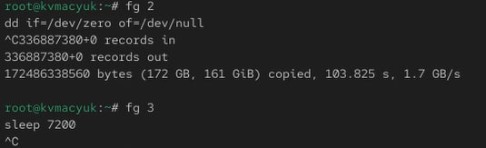{#fig-008 width=70%}

Открыл второй терминал и под своей учётной записью выполнил `dd if=/dev/zero of=/dev/null &`. Запустил отдельный фоновый процесс `dd` ([рис. @fig-009]).

{#fig-009 width=70%}

Завершил работу во второй оболочке и вернулся к первому терминалу:

```bash
exit
```

Запустил `top` и нашёл процесс `dd` с PID `4149`. В списке он находился в состоянии `R` и занимал `97,7%` процессорного времени ([рис. @fig-010]).

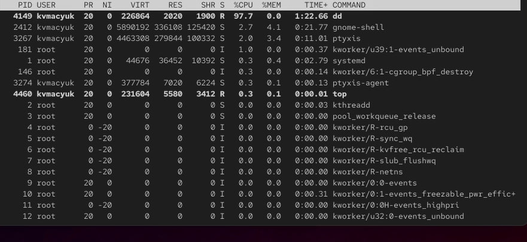{#fig-010 width=70%}

Для завершения процесса в `top` нажал `k` и указал PID `4149`. После завершения `dd` его строка исчезла из отображаемой части списка, а доля свободного процессорного времени составила `99,0%`. Вышел из утилиты клавишей `q` ([рис. @fig-011]).

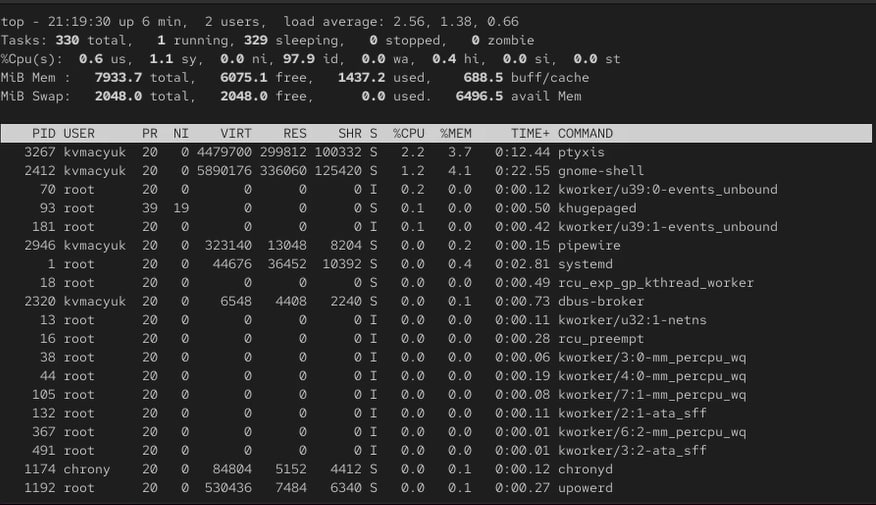{#fig-011 width=70%}

## Управление процессами

В оболочке суперпользователя трижды выполнил `dd if=/dev/zero of=/dev/null &`. Запущенным процессам были присвоены PID `4849`, `4850` и `4851` ([рис. @fig-012]).

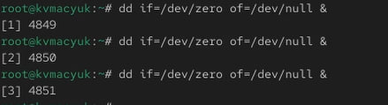{#fig-012 width=70%}

Вывел сведения о процессах командой `ps aux | grep dd`. В списке нашёл три запущенных экземпляра `dd` с указанными PID. Каждый из них находился в состоянии `R` и активно использовал процессор ([рис. @fig-013]).

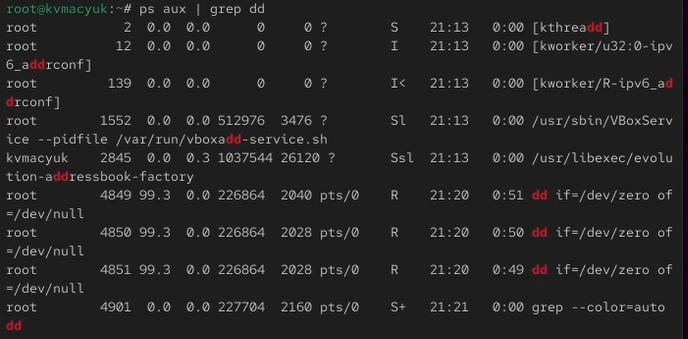{#fig-013 width=70%}

Изменил nice процесса `4849` командой `renice -n 5 4849`. В выводе команды исходное значение `0` сменилось на `5`, что соответствует снижению приоритета процесса ([рис. @fig-014]).

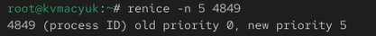{#fig-014 width=70%}

Изучил дерево процессов с помощью `ps fax | grep -B5 dd`. Родительской для трёх экземпляров `dd` являлась оболочка `bash` с PID `3508`. У процесса `4849` появился признак `N`, обозначающий пониженный приоритет ([рис. @fig-015]).

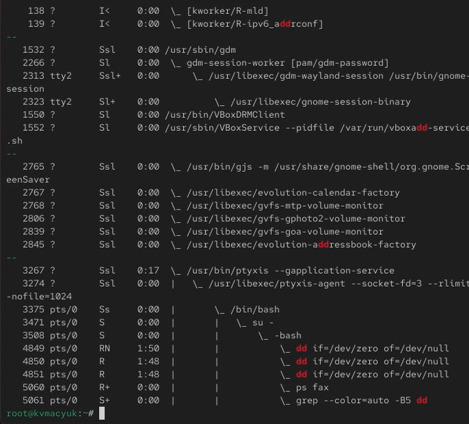{#fig-015 width=70%}

Завершил родительскую оболочку командой `kill -9 3508`. В терминале появилось сообщение `Killed` ([рис. @fig-016]).

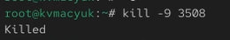{#fig-016 width=70%}

После завершения родительской оболочки отдельно просмотрел состояние процессов `dd` и их родительские идентификаторы:

```bash
ps -C dd -o pid,ppid,stat,cmd
```

## Самостоятельная работа

### Задание 1

Под своей учётной записью трижды запустил `dd if=/dev/zero of=/dev/null bs=4M &`. Параметром `bs=4M` задал размер блока чтения и записи. Получил три фоновых процесса с PID `3807`, `3907` и `3919` ([рис. @fig-017]).

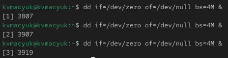{#fig-017 width=70%}

С полномочиями суперпользователя повысил приоритет процесса `3919` командой `renice -n -5 -p 3919`. Значение nice изменилось с `0` на `-5` ([рис. @fig-018]).

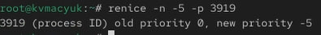{#fig-018 width=70%}

Повторно изменил приоритет того же процесса командой `renice -n -15 -p 3919`. Значение nice сменилось с `-5` на `-15`. Уменьшение nice повышает приоритет и увеличивает вес процесса при распределении процессорного времени между конкурирующими задачами ([рис. @fig-019]).

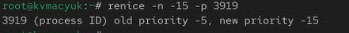{#fig-019 width=70%}

Завершил три запущенных процесса по их PID и проверил их состояние командой `ps`:

```bash
kill 3807 3907 3919
ps -p 3807,3907,3919 -o pid,stat,cmd
```

### Задание 2

Запустил `yes` в фоновом режиме с перенаправлением стандартного вывода в `/dev/null`. Оболочка присвоила заданию номер `1` и вывела PID `3743` ([рис. @fig-020]).

```bash
yes > /dev/null &
```

{#fig-020 width=70%}

Запустил второй экземпляр `yes` на переднем плане с подавлением вывода и приостановил его сочетанием `Ctrl+Z`. Команда `jobs` показала первое задание в состоянии `Running`, а второе — `Stopped`. Возобновил второе задание командой `fg 2` и завершил его сочетанием `Ctrl+C` ([рис. @fig-021]).

```bash
yes > /dev/null
```

Приостановил выполнение сочетанием `Ctrl+Z`, вывел список заданий и вернул второе задание на передний план:

```bash
jobs
fg 2
```

Прервал возобновлённое задание сочетанием `Ctrl+C`. Затем ещё раз запустил `yes` с тем же перенаправлением вывода:

```bash
yes > /dev/null
```

Завершил программу сочетанием `Ctrl+C`.

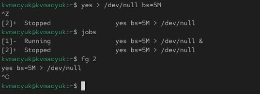{#fig-021 width=70%}

Запустил `yes` без перенаправления вывода. В окне терминала начался непрерывный вывод строк `y` ([рис. @fig-022]).

```bash
yes
```

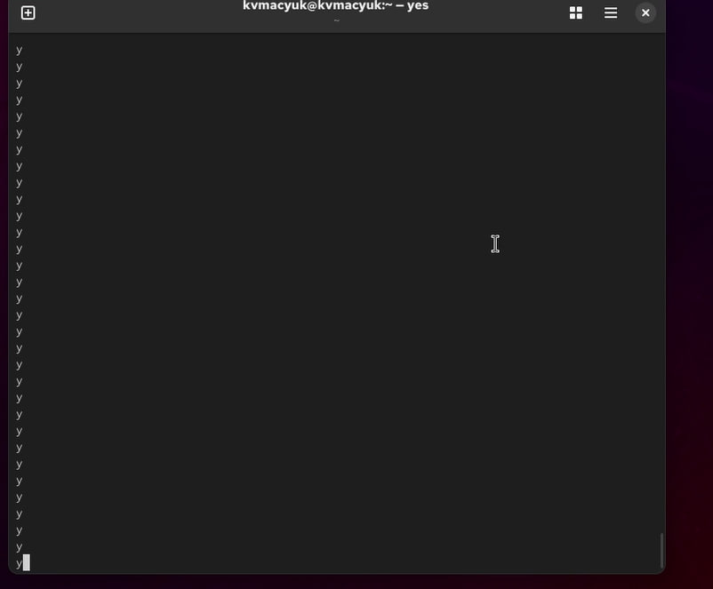{#fig-022 width=70%}

Приостановил программу сочетанием `Ctrl+Z`. Повторно ввёл команду `yes`, после чего прервал новый экземпляр сочетанием `Ctrl+C`.

Вывел список оставшихся заданий и их PID командой `jobs -l`:

```bash
jobs -l
```

Перевёл первое фоновое задание на передний план:

```bash
fg %1
```

Приостановил задание сочетанием `Ctrl+Z`, затем возобновил его в фоне и повторно проверил список заданий:

```bash
bg %1
jobs -l
```

С помощью `bg` продолжил выполнение задания с подавлением вывода. Командой `jobs -l` проверил его переход в состояние `Running`.

Запустил `yes` в фоне через `nohup`, чтобы процесс игнорировал сигнал `SIGHUP`. Сохранил его PID в файл для последующей проверки из новой оболочки:

```bash
nohup yes > /dev/null 2>&1 < /dev/null &
echo $! > "$HOME/lab06-yes.pid"
```

Перенаправил стандартный ввод, вывод и поток ошибок в `/dev/null`, а PID последнего фонового процесса получил из `$!`. Закрыл терминал, открыл новую консоль и проверил процесс по сохранённому идентификатору:

```bash
nohup_pid=$(cat "$HOME/lab06-yes.pid")
ps -p "$nohup_pid" -o pid,ppid,ni,stat,cmd
```

Запустил `top` и просмотрел загрузку процессора, состояния и приоритеты процессов:

```bash
top
```

Вышел из `top` клавишей `q`.

Запустил ещё три экземпляра `yes` в фоновом режиме с подавлением вывода. Сохранил PID каждого процесса и вывел список заданий:

```bash
yes > /dev/null &
yes_pid1=$!
yes > /dev/null &
yes_pid2=$!
yes > /dev/null &
yes_pid3=$!
jobs -l
```

Завершил первый процесс по сохранённому PID, а второй — по номеру задания `%2`. Номер второго задания определил по выводу `jobs -l` в новой оболочке:

```bash
kill "$yes_pid1"
kill %2
jobs -l
```

Отправил сигнал `SIGHUP` процессу, запущенному через `nohup`, и третьему обычному экземпляру `yes`. Затем проверил состояние обоих процессов:

```bash
kill -1 "$nohup_pid"
kill -1 "$yes_pid3"
ps -p "$nohup_pid" -o pid,stat,cmd
ps -p "$yes_pid3" -o pid,stat,cmd
```

Сопоставил обработку `SIGHUP` у обычного процесса и процесса с `nohup`. Рассмотрел различие между игнорированием `SIGHUP` и завершением по сигналу `SIGTERM`.

Запустил ещё несколько экземпляров `yes` в фоне и завершил их одновременно командой `killall`. После этого проверил список процессов:

```bash
yes > /dev/null &
yes > /dev/null &
yes > /dev/null &
killall yes
ps -C yes -o pid,stat,cmd
```

Командой `killall yes` отправил сигнал `SIGTERM` процессам с именем `yes`, включая экземпляр, запущенный через `nohup`.

Получил полномочия суперпользователя и запустил два процесса `yes` с подавлением вывода. Первый запустил с обычным приоритетом, а второй — через `nice` с поправкой `-5`. Вывел значения `NI` и `PRI` для сравнения:

```bash
su -
yes > /dev/null &
normal_pid=$!
nice -n -5 yes > /dev/null &
high_pid=$!
ps -p "$normal_pid,$high_pid" -o pid,ni,pri,pcpu,cmd
```

Сравнил относительные и абсолютные приоритеты двух процессов по полям `NI` и `PRI`. Для второго процесса задал nice на пять единиц меньше значения родительской оболочки, тем самым повысив его приоритет.

Изменил nice первого процесса на `-5` с помощью `renice`, чтобы выровнять приоритеты двух экземпляров `yes`. Повторно вывел сведения о процессах:

```bash
renice -n -5 -p "$normal_pid"
ps -p "$normal_pid,$high_pid" -o pid,ni,pri,pcpu,cmd
```

Проверил значения приоритетов после изменения. Завершил оба экземпляра `yes`, вышел из оболочки администратора и удалил файл с сохранённым PID:

```bash
kill "$normal_pid" "$high_pid"
exit
rm -f "$HOME/lab06-yes.pid"
```

# Ответы на контрольные вопросы

**1. Какая команда даёт обзор всех текущих заданий оболочки?**

Команда `jobs`. Вариант `jobs -l` дополнительно выводит PID. Список относится только к текущему экземпляру оболочки.

**2. Как остановить текущее задание оболочки, чтобы продолжить его выполнение в фоновом режиме?**

Нажать `Ctrl+Z`, затем выполнить `bg`. Для конкретного задания указывается его номер, например `bg %1`.

**3. Какую комбинацию клавиш можно использовать для отмены текущего задания оболочки?**

`Ctrl+C`. Это сочетание обычно отправляет сигнал `SIGINT` группе процессов переднего плана.

**4. Необходимо отменить одно из начатых заданий. Доступ к оболочке, в которой в данный момент работает пользователь, невозможен. Что можно сделать, чтобы отменить задание?**

Открыть другой терминал, определить PID процесса через `ps` или `top` и выполнить `kill <PID>`. Если процесс не реагирует на `SIGTERM`, можно применить `kill -9 <PID>`. Номер задания из прежней оболочки в новом терминале использовать нельзя.

**5. Какая команда используется для отображения отношений между родительскими и дочерними процессами?**

`ps fax`. Она показывает дерево процессов. Другой вариант — `pstree -p`, который дополнительно отображает PID.

**6. Какая команда позволит изменить приоритет процесса с идентификатором 1234 на более высокий?**

Например, `renice -n -5 -p 1234`, выполненная с достаточными полномочиями. Она повышает приоритет, если исходное nice было больше `-5`, например `0`. Сначала значение можно проверить командой `ps -p 1234 -o pid,ni,cmd`.

**7. В системе в настоящее время запущено 20 процессов dd. Как проще всего остановить их все сразу?**

Для завершения всех процессов с этим именем используется `killall dd`. Если речь именно о временной приостановке с возможностью продолжить выполнение, нужна команда `killall -STOP dd`, а для возобновления — `killall -CONT dd`.

**8. Какая команда позволяет остановить команду с именем mycommand?**

`killall mycommand` завершает доступные пользователю процессы с таким именем. Для временной приостановки используется `killall -STOP mycommand`.

**9. Какая команда используется в top, чтобы убить процесс?**

Клавиша `k`. После неё указываются PID процесса и сигнал. Обычно сначала выбирается `15` (`SIGTERM`), а при необходимости принудительного завершения — `9` (`SIGKILL`).

**10. Как запустить команду с достаточно высоким приоритетом, не рискуя, что не хватит ресурсов для других процессов?**

Использовать обычную политику планирования с умеренным повышением приоритета, например `nice -n -5 команда` при nice оболочки, равном нулю. Для этого обычно нужны полномочия администратора. Планировщик продолжает распределять процессорное время между обычными задачами, но nice не ограничивает расход памяти и ввода-вывода и не гарантирует достаточность всех ресурсов. Поэтому выбирать максимальный или реального времени приоритет для такого опыта не требуется.

# Выводы

В ходе выполнения лабораторной работы я получил навыки управления заданиями и процессами операционной системы. Научился запускать команды на переднем плане и в фоне, приостанавливать и возобновлять задания с помощью `jobs`, `fg` и `bg`. Освоил просмотр процессов и их иерархии средствами `ps` и `top`, завершение процессов по PID, номеру задания и имени. В самостоятельной работе изменил приоритет процесса `dd` с помощью `renice`, сравнил значения nice `-5` и `-15`, выполнил запуск, приостановку и возобновление программы `yes`. Рассмотрел команды запуска через `nohup`, отправки сигнала `SIGHUP` и выравнивания приоритетов процессов. Закрепил различия между приостановкой и завершением процесса, а также между обычным фоновым запуском и запуском с игнорированием `SIGHUP`.

# Список литературы{.unnumbered}

::: {#refs}
:::
