---
## Author

author:
  name: Мацюк Константин Владимирович
  degrees: BSc
  orcid: 0000-0002-0877-7063
  email: 1032253640@rudn.ru
  affiliation:
    - name: Российский университет дружбы народов
      country: Российская Федерация
      postal-code: 117198
      city: Москва
      address: ул. Миклухо-Маклая, д. 6

## Title

title: "Лабораторная работа №7. Управление журналами событий в системе"
subtitle: "Дисциплина: Основы администрирования операционных систем"
license: "CC BY"

## Fonts

mainfont: IBM Plex Serif
romanfont: IBM Plex Serif
sansfont: IBM Plex Sans
monofont: DejaVu Sans Mono
mathfont: STIX Two Math
mainfontoptions: Ligatures=Common,Ligatures=TeX,Scale=0.94
romanfontoptions: Ligatures=Common,Ligatures=TeX,Scale=0.94
sansfontoptions: Ligatures=Common,Ligatures=TeX,Scale=MatchLowercase,Scale=0.94
monofontoptions: Scale=MatchLowercase,Scale=0.94
incremental: false
slide-level: 2
lang: ru-RU

---

# Цель работы

## Цель работы

- Получить навыки работы с журналами мониторинга различных событий в системе.

# Задание

## Задание

- Продемонстрировать навыки работы с журналом мониторинга событий в реальном времени.

- Создать и настроить отдельные файлы конфигурации для регистрации событий веб-службы и отладочных сообщений.

- Продемонстрировать навыки просмотра и фильтрации записей с помощью journalctl.

- Настроить постоянное хранение журнала journald.

# Теоретическое введение

## Журналы событий

Журналы событий содержат сообщения о работе операционной системы, запуске служб, ошибках и действиях пользователей. Их анализ помогает определить причины сбоев и проверить изменения настроек. В Linux для регистрации событий применяются rsyslog и systemd-journald.

## Настройка rsyslog

Служба rsyslog обрабатывает сообщения и направляет их в соответствии с заданными правилами. Основной файл конфигурации — `/etc/rsyslog.conf`, дополнительные правила размещаются в `/etc/rsyslog.d/`. В рассматриваемой системе текстовые журналы находятся в каталоге `/var/log`:

## Основные файлы журналов

- `/var/log/messages` — общие системные сообщения;

- `/var/log/secure` — сообщения аутентификации и проверки полномочий;

- `/var/log/dmesg` — сохранённые сообщения ядра при загрузке, если их запись настроена;

- `/var/log/boot.log` — сообщения загрузки системы;

## Основные файлы журналов (2)

- `/var/log/audit/audit.log` — события подсистемы аудита, включая сообщения SELinux;

- `/var/log/maillog` — сообщения почтовой службы;

- `/var/log/samba/`, `/var/log/sssd/` и `/var/log/cups/` — журналы соответствующих служб;

- `/var/log/httpd/` — журналы веб-сервера Apache.

## Категории сообщений

Сообщение syslog характеризуется категорией и приоритетом.

Категория определяет источник: `auth` и `authpriv` относятся к аутентификации, `cron` — к планировщику, `daemon` — к системным службам, `kern` — к ядру, `mail` — к почте, `lpr` — к печати, `syslog` — к самой подсистеме журналирования, `user` — к пользовательским программам.

Также предусмотрены категории `news`, `uucp` и локальные категории `local0`–`local7` для настройки журналирования приложений.

## Приоритеты сообщений

Приоритеты сообщений перечислены от наиболее важного к наименее важному:

## Уровни важности

- `emerg` (`0`) — система непригодна для использования;

- `alert` (`1`) — требуется немедленное вмешательство;

- `crit` (`2`) — критическое состояние;

- `err` (`3`) — ошибка;

- `warning` (`4`) — предупреждение;

- `notice` (`5`) — нормальное, но значимое событие;

## Уровни важности (2)

- `info` (`6`) — информационное сообщение;

- `debug` (`7`) — отладочное сообщение.

## Правило rsyslog

Правило rsyslog состоит из селектора и действия:

## Синтаксис правила

категория.приоритет путь_к_файлу

## Селекторы сообщений

Символ `*` обозначает все категории или приоритеты. Селектор `*.info` включает уровень `info` и более важные сообщения, а `*.=info` выбирает только `info`. Поэтому правило `*.debug` охватывает все уровни, включая отладочные. Синтаксис селекторов приведён в [документации rsyslog](https://docs.rsyslog.com/doc/configuration/filters.html).

## Служба journald

Служба systemd-journald собирает сообщения ядра, служб и приложений в структурированный журнал.

Команда `journalctl` позволяет просматривать записи и фильтровать их по времени, приоритету, пользователю, процессу и юниту systemd.

Временное хранилище расположено в `/run/log/journal`, постоянное — в `/var/log/journal`.

## Служба journald (2)

При `Storage=auto` наличие каталога `/var/log/journal` включает постоянное хранение; `Storage=persistent` задаёт его явно.

Параметры хранения описаны в [руководстве journald.conf](https://www.freedesktop.org/software/systemd/man/252/journald.conf.html).

## Ротация журналов

Для ограничения объёма текстовых журналов применяется logrotate. Периодичность ротации определяется файлом `/etc/logrotate.conf` и правилами отдельных служб в `/etc/logrotate.d/`.

# Выполнение лабораторной работы

## Получение полномочий администратора в трёх вкладках

Открыл три вкладки терминала и в каждой получил полномочия суперпользователя командой `su -`.

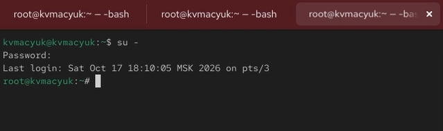{#fig-001 width=60%}

## Мониторинг системных событий в реальном времени

Во второй вкладке запустил мониторинг системных событий командой `tail -f /var/log/messages`. Просмотрел поступающие записи журнала.

## Мониторинг системных событий в реальном времени — снимок экрана

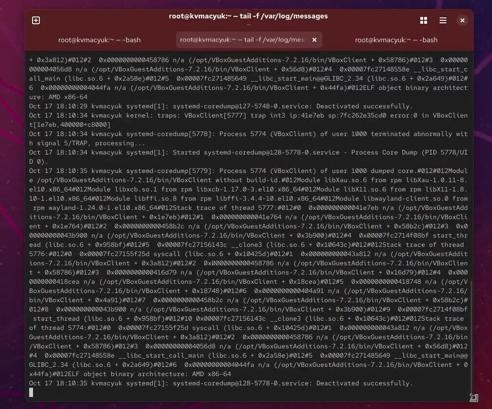{#fig-002 width=37%}

## Неудачная попытка получить полномочия root

В третьей вкладке вернулся к своей учётной записи и повторно выполнил `su -`, указав неправильный пароль. Получил сообщение `su: Authentication failure`.

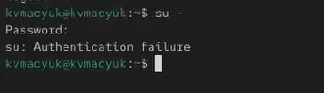{#fig-003 width=62%}

## Запись о неудачной попытке входа

Перешёл во вторую вкладку и нашёл запись `FAILED SU (to root) kvmacyuk on pts/1`. Проверил регистрацию неудачной попытки входа в системном журнале.

## Запись о неудачной попытке входа — снимок экрана

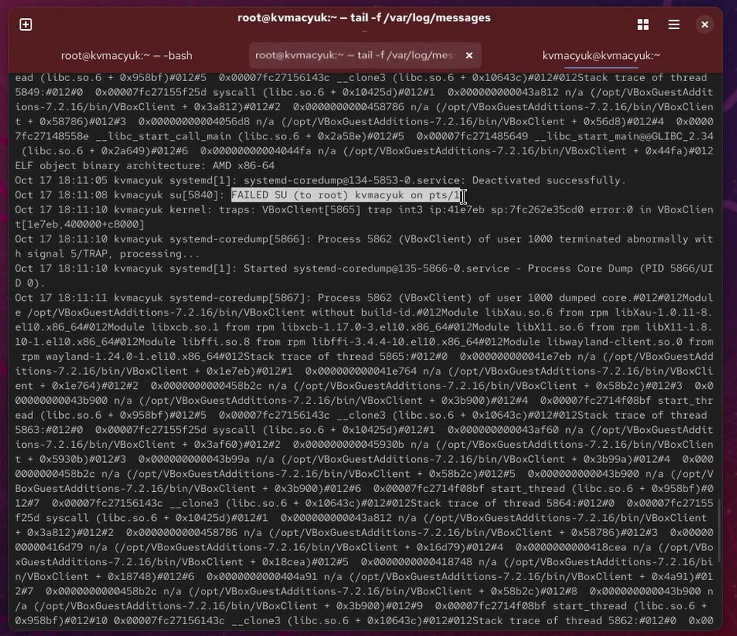{#fig-004 width=35%}

## Отправка тестового сообщения hello

В третьей вкладке отправил тестовое сообщение в журнал командой `logger hello` от имени своего пользователя.

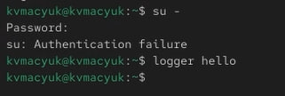{#fig-005 width=53%}

## Сообщение hello в системном журнале

Во второй вкладке нашёл запись `kvmacyuk[5925]: hello` и сопоставил её с отправленным сообщением.

## Сообщение hello в системном журнале — снимок экрана

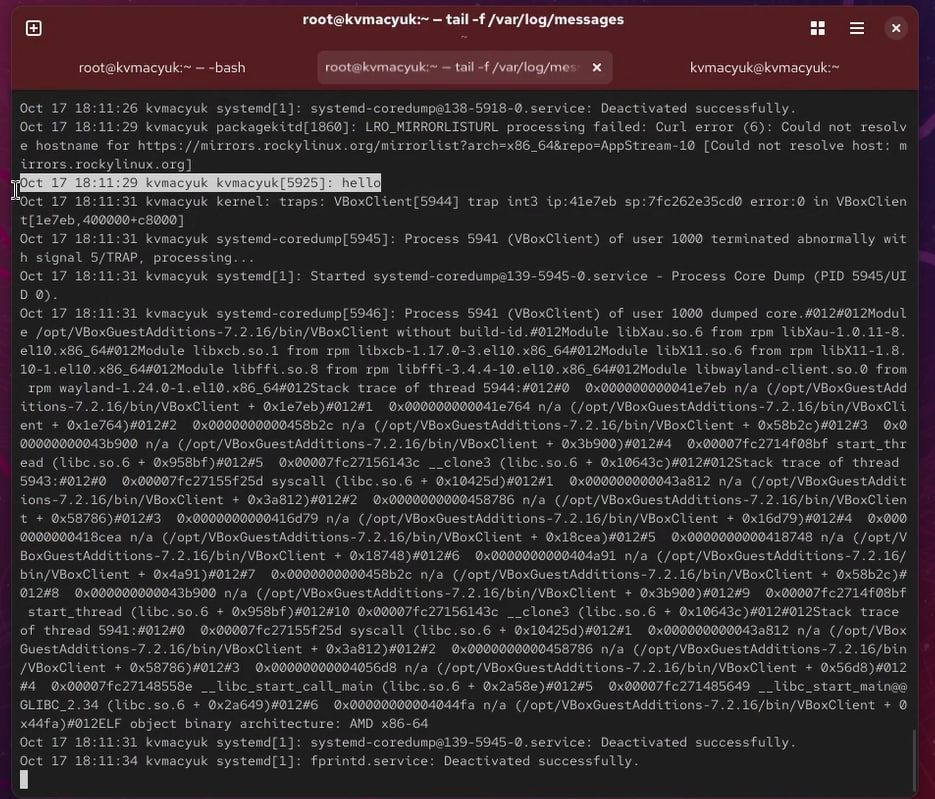{#fig-006 width=36%}

## Просмотр сообщений аутентификации

Остановил просмотр `/var/log/messages` сочетанием `Ctrl+C` и запустил `tail -f /var/log/secure`. В журнале безопасности нашёл сообщения `password check failed for user (root)` и `authentication failure`, относящиеся к неудачному входу.

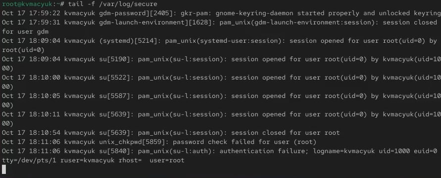{#fig-007 width=44%}

## Мониторинг журнала системных событий в реальном времени

Для просмотра последних 20 строк журнала выполнил команду из задания:

```bash
tail -n 20 /var/log/secure
```

## Установка Apache и зависимостей

В первой вкладке получил полномочия администратора и выполнил `dnf -y install httpd`. Просмотрел список устанавливаемых пакетов Apache и зависимостей.

## Установка Apache и зависимостей — снимок экрана

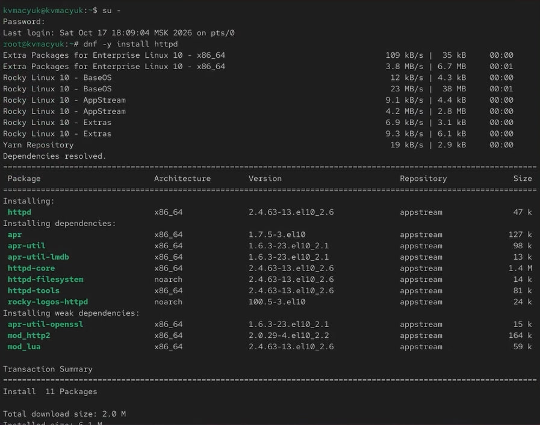{#fig-008 width=39%}

## Запуск и включение автозапуска Apache

Запустил веб-службу командой `systemctl start httpd` и включил её автозапуск командой `systemctl enable httpd`. При включении автозапуска была создана ссылка на `httpd.service` в каталоге `multi-user.target.wants`.

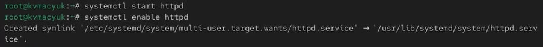{#fig-009 width=85%}

## Просмотр журнала ошибок Apache

Открыл журнал ошибок веб-службы командой `tail -f /var/log/httpd/error_log`. Просмотрел сообщения о запуске Apache, включённой политике SELinux и параметрах сервера. Завершил просмотр сочетанием `Ctrl+C`.

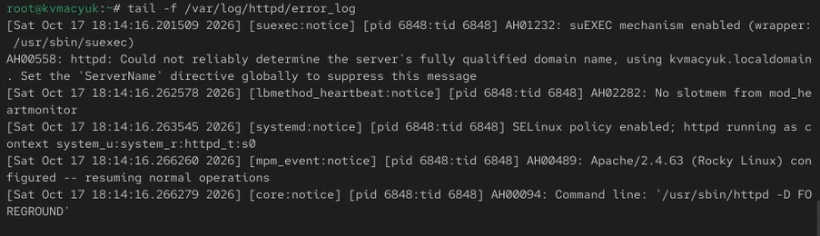{#fig-010 width=62%}

## Открытие конфигурационного файла Apache

В третьей вкладке перешёл в оболочку суперпользователя и открыл конфигурацию Apache командой `nano /etc/httpd/conf/httpd.conf`.

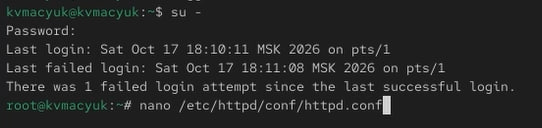{#fig-011 width=76%}

## Настройка передачи ошибок Apache в syslog

В конец файла `/etc/httpd/conf/httpd.conf` добавил директиву `ErrorLog syslog:local1` и сохранил изменения. Настроил передачу сообщений журнала ошибок Apache в syslog с категорией `local1`.

```text
ErrorLog syslog:local1
```

## Настройка передачи ошибок Apache в syslog — снимок экрана

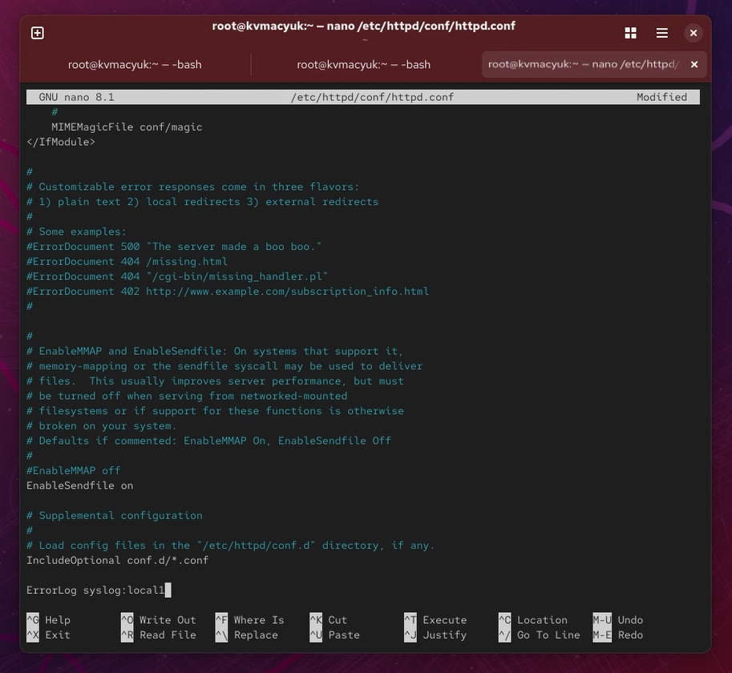{#fig-012 width=33%}

## Создание отдельного файла правил rsyslog

Перешёл в `/etc/rsyslog.d`, создал файл `httpd.conf` и открыл его в редакторе nano.

```bash
cd /etc/rsyslog.d
touch httpd.conf
nano httpd.conf
```

## Создание отдельного файла правил rsyslog — снимок экрана

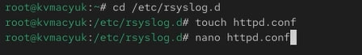{#fig-013 width=75%}

## Правило записи сообщений Apache в отдельный файл

Записал в созданный файл правило для сообщений категории `local1`. Полное содержимое `/etc/rsyslog.d/httpd.conf` приведено ниже.

```text
local1.* -/var/log/httpd-error.log
```

## Правило записи сообщений Apache в отдельный файл — снимок экрана

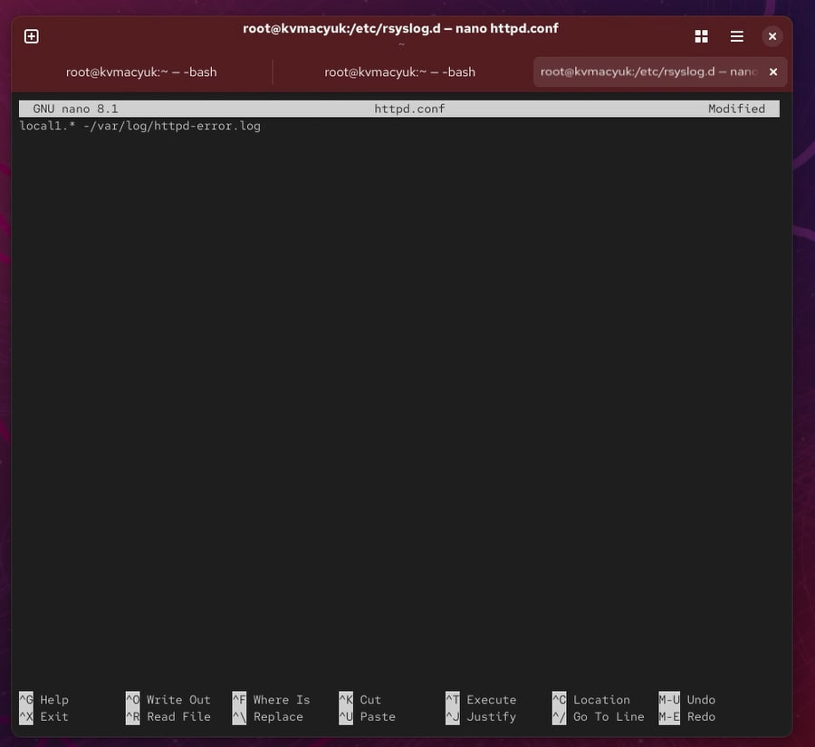{#fig-014 width=33%}

## Перезапуск rsyslog и Apache

Применил изменения: перезапустил службу rsyslog, затем веб-службу Apache.

```bash
systemctl restart rsyslog.service
systemctl restart httpd
```

## Перезапуск rsyslog и Apache — снимок экрана

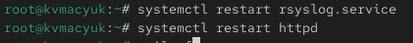{#fig-015 width=75%}

## Создание файла debug.conf

Создал файл `debug.conf` и записал в него правило для журнала `/var/log/messages-debug`.

```bash
touch debug.conf
echo "*.debug /var/log/messages-debug" > /etc/rsyslog.d/debug.conf
```

## Создание файла debug.conf — снимок экрана

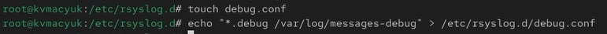{#fig-016 width=75%}

## Применение настроек отладочного журнала

Полное содержимое `/etc/rsyslog.d/debug.conf`:

```text
*.debug /var/log/messages-debug
```

Правилом `*.debug` включил запись отладочных сообщений и сообщений более важных уровней.

Повторно перезапустил rsyslog командой `systemctl restart rsyslog.service`, чтобы применить правило из `debug.conf`.

## Применение настроек отладочного журнала — снимок экрана

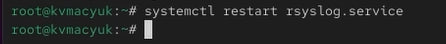{#fig-017 width=75%}

## Мониторинг журнала messages-debug

Во второй вкладке запустил `tail -f /var/log/messages-debug` и просмотрел записи отдельного журнала.

## Мониторинг журнала messages-debug — снимок экрана

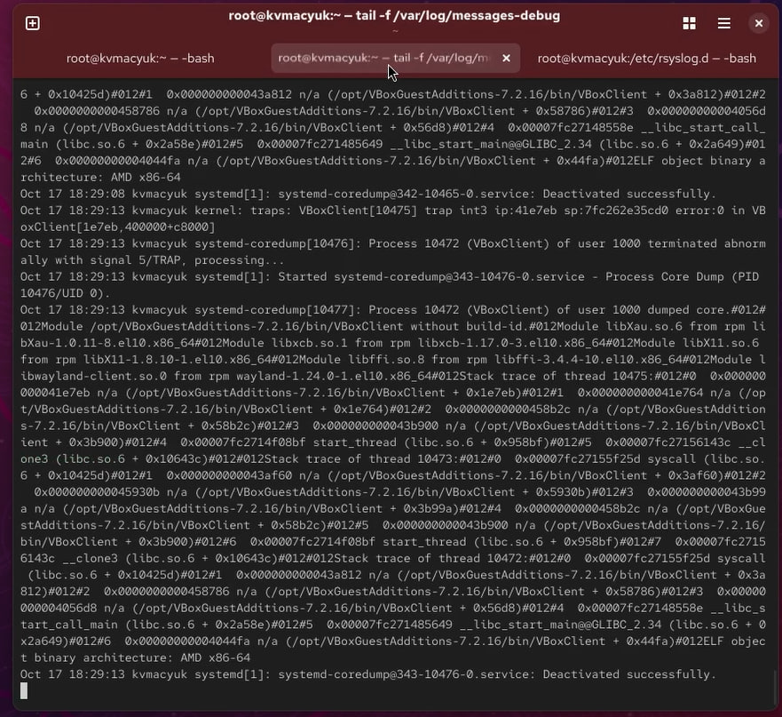{#fig-018 width=33%}

## Создание отладочного сообщения

В третьей вкладке отправил сообщение категории `daemon` с приоритетом `debug`.

```bash
logger -p daemon.debug "Daemon Debug Message"
```

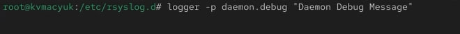{#fig-019 width=85%}

## Тестовое сообщение в отладочном журнале

В окне мониторинга нашёл запись `root[10567]: Daemon Debug Message`. Проверил поступление тестового сообщения в `/var/log/messages-debug` и остановил просмотр сочетанием `Ctrl+C`.

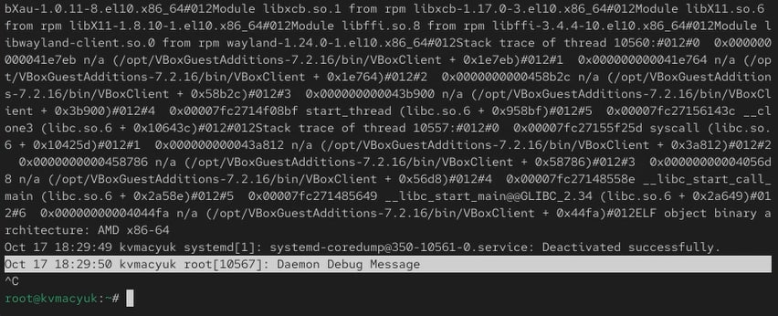{#fig-020 width=44%}

## Просмотр системного журнала journalctl

Открыл журнал командой `journalctl`. Просмотрел начальные записи о запуске ядра и загрузке системы. Для перемещения использовал `Enter` и пробел, затем вышел клавишей `q`.

## Просмотр системного журнала journalctl — снимок экрана

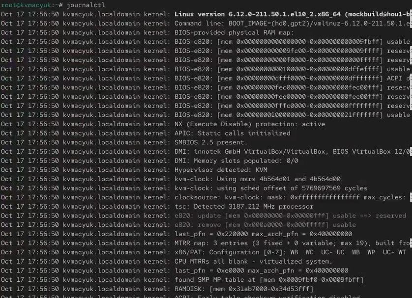{#fig-021 width=42%}

## Вывод журнала без пейджера

Вывел содержимое журнала непосредственно в терминал командой `journalctl --no-pager`. После завершения вывода вернулся к приглашению оболочки.

## Вывод журнала без пейджера — снимок экрана

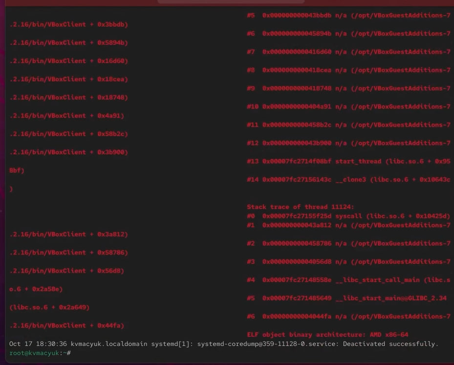{#fig-022 width=38%}

## Просмотр journalctl в реальном времени

Включил просмотр новых записей командой `journalctl -f`. После просмотра остановил вывод сочетанием `Ctrl+C`.

## Просмотр journalctl в реальном времени — снимок экрана

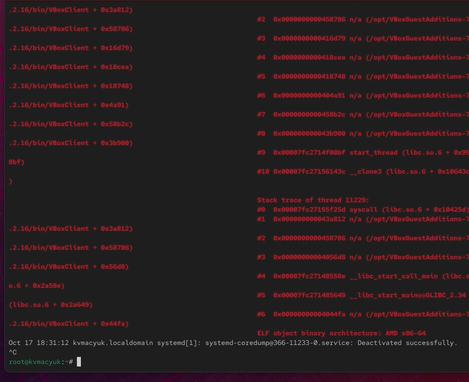{#fig-023 width=37%}

## Автодополнение полей журнала

Ввёл `journalctl` с пробелом и дважды нажал `Tab`. Просмотрел список доступных полей фильтрации, включая `_UID`, `_PID`, `PRIORITY` и `_SYSTEMD_UNIT`.

## Автодополнение полей журнала — снимок экрана

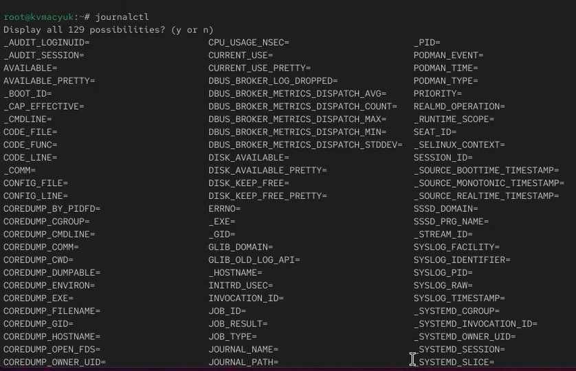{#fig-024 width=48%}

## Фильтрация журнала по UID 0

Выполнил `journalctl _UID=0` и просмотрел записи процессов, работавших от имени root.

## Фильтрация журнала по UID 0 — снимок экрана

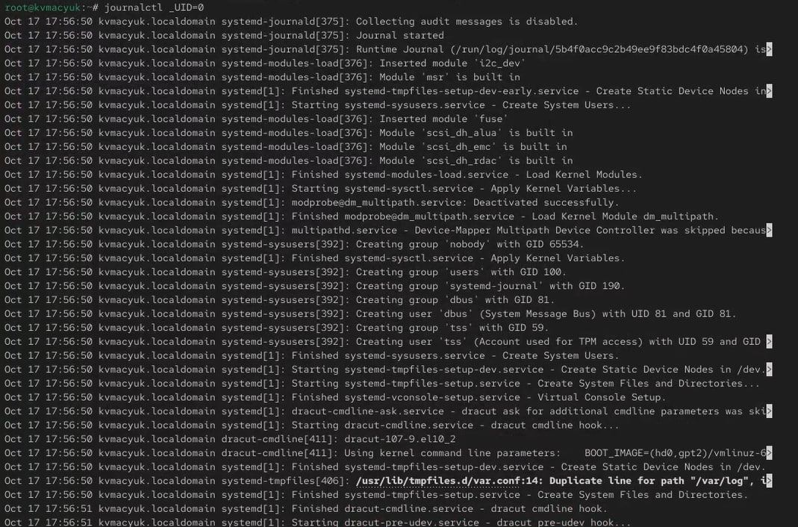{#fig-025 width=46%}

## Последние 20 записей журнала

Вывел последние 20 записей журнала командой `journalctl -n 20`.

## Последние 20 записей журнала — снимок экрана

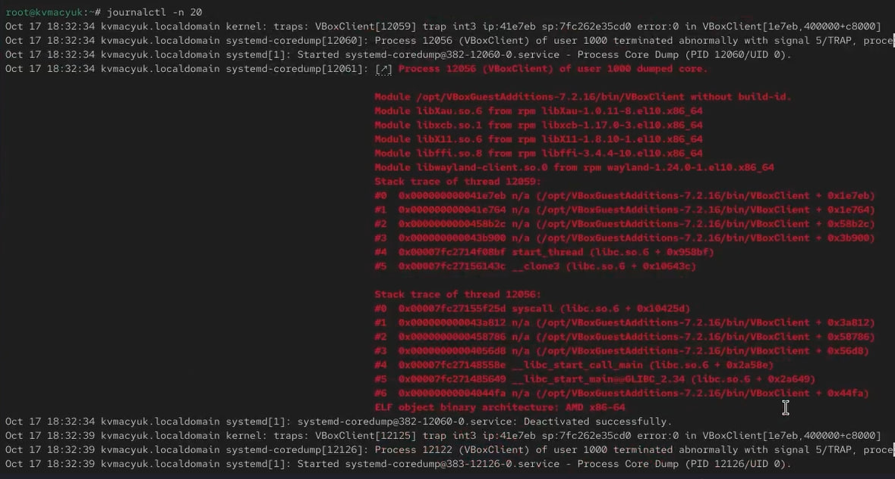{#fig-026 width=57%}

## Фильтрация сообщений по приоритету

Выполнил `journalctl -p err` и просмотрел сообщения уровня `err` и более важных уровней.

## Фильтрация сообщений по приоритету — снимок экрана

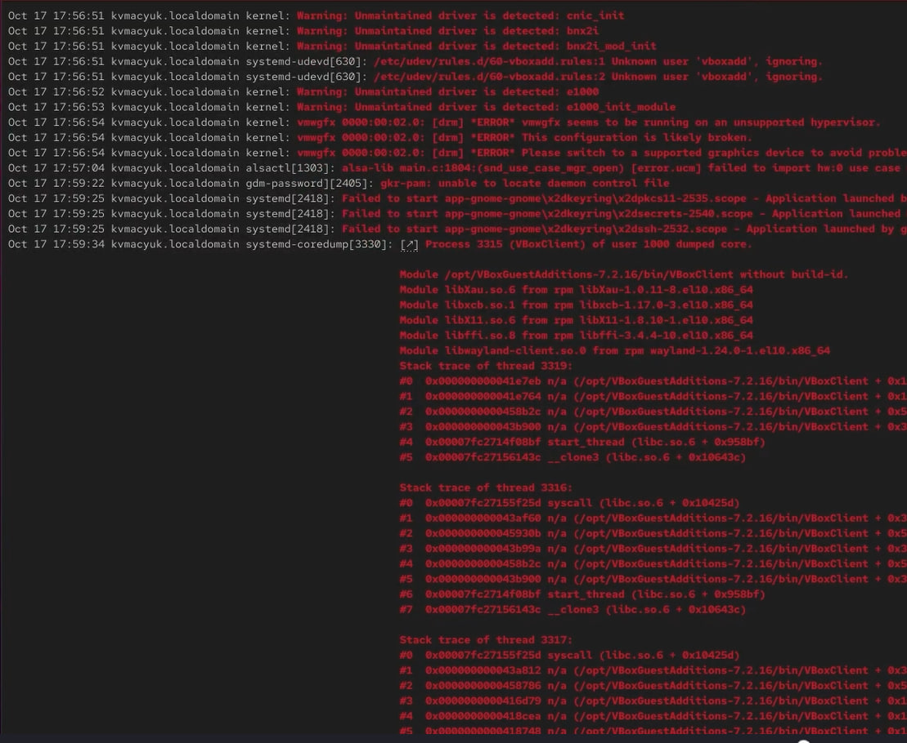{#fig-027 width=37%}

## Просмотр сообщений со вчерашнего дня

Просмотрел записи начиная с полуночи предыдущего дня командой `journalctl --since yesterday`.

## Просмотр сообщений со вчерашнего дня — снимок экрана

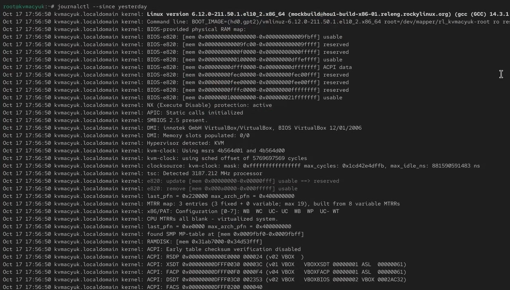{#fig-028 width=54%}

## Фильтрация журнала по времени и приоритету

Объединил фильтры времени и приоритета командой `journalctl --since yesterday -p err`. Вывел ошибки и более важные сообщения за выбранный период.

## Фильтрация журнала по времени и приоритету — снимок экрана

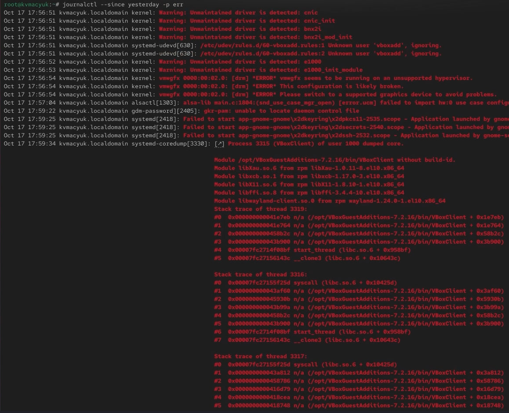{#fig-029 width=38%}

## Подробное представление записей журнала

Открыл подробное представление журнала командой `journalctl -o verbose`. Изучил поля `MESSAGE`, `PRIORITY`, `_TRANSPORT`, `_BOOT_ID`, `_MACHINE_ID` и `_HOSTNAME`.

## Подробное представление записей журнала — снимок экрана

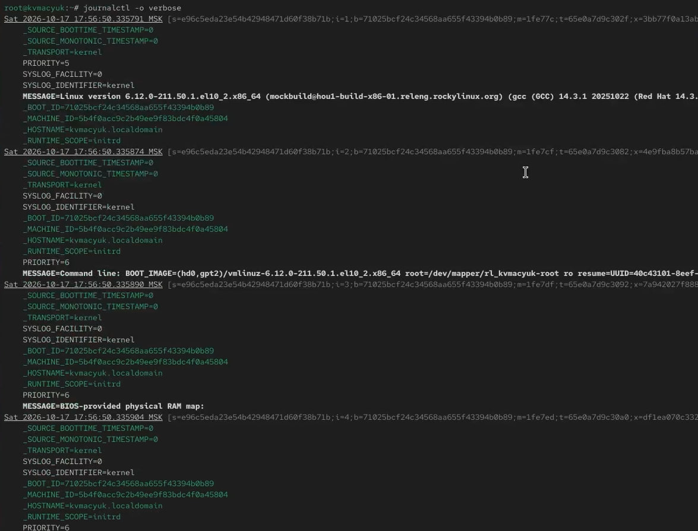{#fig-030 width=40%}

## Записи службы sshd

Отфильтровал записи службы SSH командой `journalctl _SYSTEMD_UNIT=sshd.service`. В выводе нашёл сообщения о прослушивании порта `22` на адресах `0.0.0.0` и `::`.

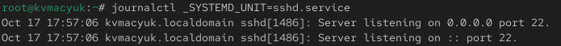{#fig-031 width=85%}

## Подготовка каталога постоянного журнала

В оболочке суперпользователя создал каталог `/var/log/journal`, назначил владельца `root`, группу `systemd-journal` и права `2755`.

```bash
mkdir -p /var/log/journal
chown root:systemd-journal /var/log/journal
chmod 2755 /var/log/journal
```

## Подготовка каталога постоянного журнала — снимок экрана

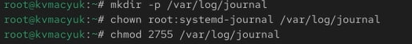{#fig-032 width=75%}

## Отправка сигнала SIGUSR1 службе journald

Выполнил команду `killall -USR1 systemd-journald`, чтобы передать службе сигнал переноса записей из временного хранилища в постоянное.

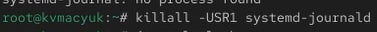{#fig-033 width=85%}

## Просмотр журнала текущей загрузки

Просмотрел журнал текущей загрузки командой `journalctl -b`. В начале вывода изучил сообщения ядра и сведения о запуске системы.

## Просмотр журнала текущей загрузки — снимок экрана

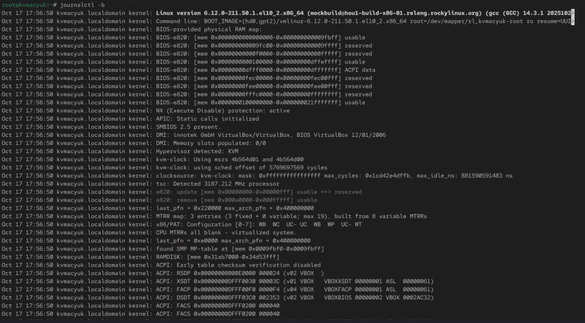{#fig-034 width=56%}

# Ответы на контрольные вопросы

## Вопрос 1

**Какой файл используется для настройки rsyslogd?**

Основной файл — `/etc/rsyslog.conf`. Дополнительные правила размещаются в файлах `/etc/rsyslog.d/*.conf`, подключаемых основной конфигурацией.

## Вопрос 2

**В каком файле журнала rsyslogd содержатся сообщения, связанные с аутентификацией?**

В рассматриваемой системе сообщения аутентификации записываются в `/var/log/secure`. При выполнении работы я просмотрел этот файл командой `tail -f /var/log/secure`. Для вывода последних 20 строк применяется `tail -n 20 /var/log/secure`.

## Вопрос 3

**Если вы ничего не настроите, то сколько времени потребуется для ротации файлов журналов?**

В типовой конфигурации, рассматриваемой в работе, ротация выполняется раз в неделю по директиве `weekly` в `/etc/logrotate.conf`. Правила конкретных журналов в `/etc/logrotate.d/` могут задавать другую периодичность или ротацию по размеру. Настройки проверяются просмотром этих файлов.

## Вопрос 4

**Какую строку следует добавить в конфигурацию для записи всех сообщений с приоритетом info в файл /var/log/messages.info?**

Для записи сообщений уровня `info` и более важных уровней:

```text
*.info /var/log/messages.info
```

Если требуется записывать только сообщения уровня `info`, без более важных уровней:

## Вопрос 4 (2)

```text
*.=info /var/log/messages.info
```

Слева от точки задаётся категория, справа — приоритет. Поэтому `info.*` не является правильной записью такого фильтра.

## Вопрос 5

**Какая команда позволяет вам видеть сообщения журнала в режиме реального времени?**

Для текстового системного журнала — `tail -f /var/log/messages`, для журнала systemd — `journalctl -f`. Обе команды применил при выполнении работы.

## Вопрос 6

**Какая команда позволяет вам видеть все сообщения журнала, которые были написаны для PID 1 между 9:00 и 15:00?**

Для указанного интервала текущего дня:

```bash
journalctl _PID=1 --since "09:00:00" --until "15:00:00"
```

## Вопрос 6 (2)

Поле `_PID=1` ограничивает выборку процессом с идентификатором `1`. Для другого дня в обеих границах дополнительно указывается дата в формате `YYYY-MM-DD`. Фильтры времени и поля записей описаны в [руководстве journalctl](https://www.freedesktop.org/software/systemd/man/255/journalctl.html).

## Вопрос 7

**Какая команда позволяет вам видеть сообщения journald после последней перезагрузки системы?**

`journalctl -b` или `journalctl -b 0`. Команда выводит сообщения текущей загрузки; её применил в заключительной части работы.

## Вопрос 8

**Какая процедура позволяет сделать журнал journald постоянным?**

При `Storage=auto` нужно создать каталог постоянного журнала, настроить его владельца и права, затем перенести записи из временного хранилища:

```bash
mkdir -p /var/log/journal
chown root:systemd-journal /var/log/journal
chmod 2755 /var/log/journal
journalctl --flush
```

## Вопрос 8 (2)

В работе для переноса записей использовал `killall -USR1 systemd-journald`. Если в конфигурации задано `Storage=volatile`, создания каталога недостаточно: постоянное хранение необходимо включить явно. Для этого в `/etc/systemd/journald.conf.d/persistent.conf` задаётся:

```ini
[Journal]
Storage=persistent
```

## Вопрос 8 (3)

После изменения конфигурации выполняются `systemctl restart systemd-journald` и `journalctl --flush`. Наличие записей на диске проверяется в `/var/log/journal`; сохранение истории между загрузками — через `journalctl --list-boots` после перезагрузки.

# Выводы

## Выводы

- В ходе выполнения лабораторной работы я получил навыки управления журналами событий операционной системы.

- Научился отслеживать новые сообщения с помощью `tail -f` и `journalctl -f`, отправлять тестовые записи через `logger` и анализировать события аутентификации.

- Настроил передачу журнала ошибок Apache в syslog и создал отдельные правила rsyslog для сообщений категории `local1` и отладочной информации.

## Выводы (2)

- Освоил фильтрацию журнала по UID, юниту, приоритету и времени, просмотр последних записей и подробных полей событий.

- Подготовил каталог постоянного хранения journald, настроил права доступа и применил изменения сигналом `SIGUSR1`.

- Просмотрел записи текущей загрузки с помощью `journalctl -b`.

# Список литературы{.unnumbered}

::: {#refs}
:::
