---
## Author

author:
  name: Мацюк Константин Владимирович
  degrees: BSc
  orcid: 0000-0002-0877-7063
  email: 1032253640@rudn.ru
  affiliation:
    - name: Российский университет дружбы народов
      country: Российская Федерация
      postal-code: 117198
      city: Москва
      address: ул. Миклухо-Маклая, д. 6

## Title

title: "Лабораторная работа №8. Планировщики событий"
subtitle: "Дисциплина: Основы администрирования операционных систем"
license: "CC BY"

## Fonts

mainfont: IBM Plex Serif
romanfont: IBM Plex Serif
sansfont: IBM Plex Sans
monofont: DejaVu Sans Mono
mathfont: STIX Two Math
mainfontoptions: Ligatures=Common,Ligatures=TeX,Scale=0.94
romanfontoptions: Ligatures=Common,Ligatures=TeX,Scale=0.94
sansfontoptions: Ligatures=Common,Ligatures=TeX,Scale=MatchLowercase,Scale=0.94
monofontoptions: Scale=MatchLowercase,Scale=0.94
incremental: false
slide-level: 2
lang: ru-RU

---

# Цель работы

## Цель работы

- Получить навыки работы с планировщиками событий cron и at.

# Задание

## Задание

- Выполнить задания по планированию регулярных задач с помощью crond.

- Выполнить задания по планированию однократных задач с помощью atd.

# Теоретическое введение

## Планировщики событий

Планировщики автоматизируют запуск команд: например, резервное копирование и обслуживание журналов.

- Служба `crond` выполняет повторяющиеся задания по календарному расписанию.

- Служба `atd` запускает однократные задания, созданные командой `at`.

## Расписания cron

Общесистемные расписания находятся в `/etc/crontab` и `/etc/cron.d/`.

- Пользовательское расписание редактируется командой `crontab -e` и просматривается командой `crontab -l`.

- В Rocky Linux такие расписания обычно хранятся в `/var/spool/cron/`.

## Формат записи cron

Пользовательская запись имеет формат:

минута час день_месяца месяц день_недели команда

В общесистемной записи перед командой дополнительно указывается пользователь.

Поля допускают числа, списки через запятую, диапазоны и шаг. Звёздочка обозначает все допустимые значения поля. Это специальный синтаксис расписания, а не обычные регулярные выражения.

## Каталоги cron

- `/etc/cron.hourly/` содержит исполняемые сценарии, запускаемые системным заданием через run-parts. Точное время определяется настройкой этого задания.

- Файлы `/etc/cron.d/` содержат самостоятельные строки расписания.

## Планировщик at

Команда `at` принимает время запуска и затем текст задания. Ввод завершается сочетанием Ctrl+D.

- Команда `atq` показывает очередь.

- Команда `atrm` удаляет задание по его номеру.

# Выполнение лабораторной работы

## Планирование задач с помощью cron

Запустил терминал и получил полномочия администратора ([рис. @fig-001]).

```bash
su -
```

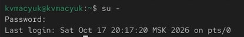{#fig-001 width=70%}

## Проверка состояния службы crond

Проверил состояние службы crond ([рис. @fig-002]).

```bash
systemctl status crond -l
```

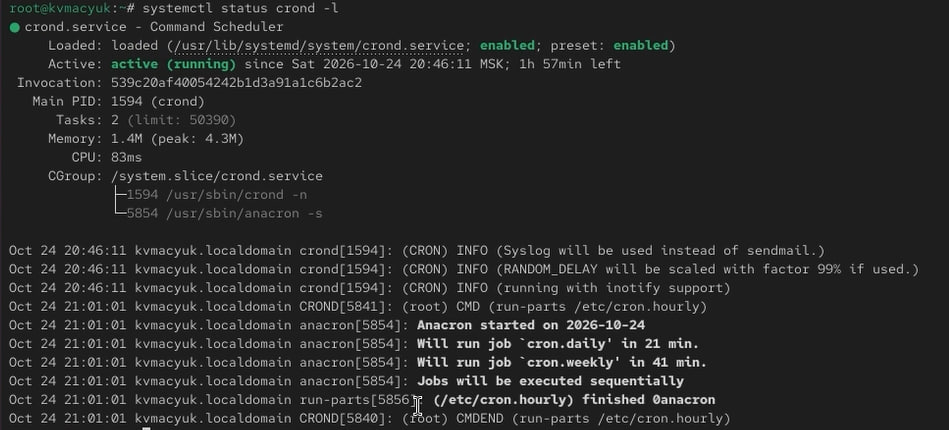{#fig-002 width=70%}

Убедился, что служба активна: в выводе указано `active (running)`. Значение `enabled` подтвердило включение автозапуска.

## Просмотр общесистемного файла расписания

Просмотрел общесистемный файл конфигурации расписания ([рис. @fig-003]).

```bash
cat /etc/crontab
```

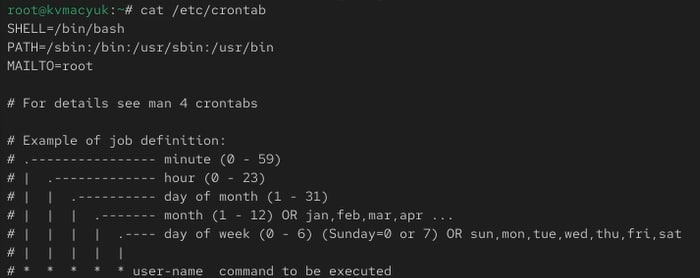{#fig-003 width=70%}

Рассмотрел переменные SHELL, PATH и MAILTO, а также описание полей расписания. В общесистемной записи после пяти полей времени указывается пользователь, от имени которого запускается команда.

## Проверка исходного расписания пользователя root

Проверил исходное расписание пользователя root ([рис. @fig-004]).

```bash
crontab -l
```

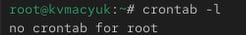{#fig-004 width=70%}

Получил сообщение `no crontab for root`: пользовательское расписание ещё не было создано.

## Создание пользовательского расписания

Открыл пользовательское расписание для редактирования ([рис. @fig-005]).

```bash
crontab -e
```

{#fig-005 width=70%}

При первом открытии использовал пустое расписание. После сохранения команда сообщила `crontab: installing new crontab`.

## Настройка ежеминутного задания

В редакторе добавил задание записи сообщения каждую минуту ([рис. @fig-006]).

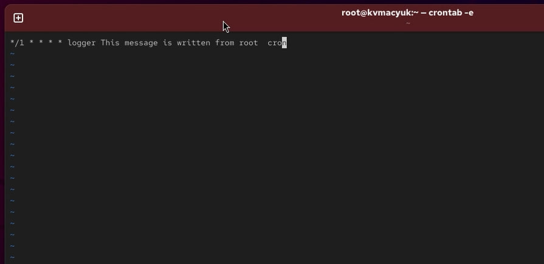{#fig-006 width=70%}

В расписание внёс строку:

```cron
*/1 * * * * logger This message is written from root cron
```

Поле `*/1` задаёт каждую минуту. Остальные звёздочки снимают ограничения по часу, дню месяца, месяцу и дню недели. Команда logger передаёт сообщение в журнал. Задание выполняется от имени владельца расписания root, поэтому отдельное поле пользователя здесь не требуется.

## Просмотр ежеминутного задания

После сохранения просмотрел установленное расписание ([рис. @fig-007]).

```bash
crontab -l
```

{#fig-007 width=70%}

Убедился, что добавленная строка присутствовала в списке заданий.

## Результат ежеминутных запусков

Через несколько минут проверил сообщения задания в системном журнале ([рис. @fig-008]).

```bash
grep written /var/log/messages
```

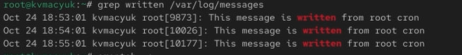{#fig-008 width=70%}

Обнаружил сообщения `This message is written from root cron` с отметками 18:53:01, 18:54:01 и 18:55:01. Интервал в одну минуту подтвердил выполнение задания по заданному расписанию.

## Изменение расписания на запуск по будням

Повторно открыл расписание и заменил ежеминутный запуск заданием по рабочим дням ([рис. @fig-009]).

```bash
crontab -e
```

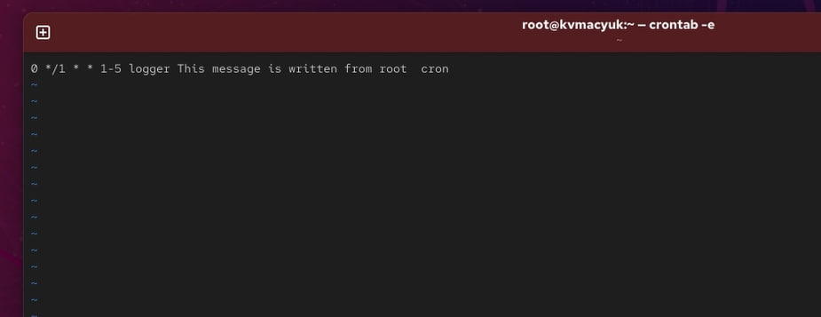{#fig-009 width=70%}

Сохранил строку:

```cron
0 */1 * * 1-5 logger This message is written from root cron
```

Значение `0` задаёт нулевую минуту часа, `*/1` — каждый час, а `1-5` — дни недели с понедельника по пятницу. Ограничения по дню месяца и месяцу отсутствуют.

## Просмотр задания по рабочим дням

Проверил изменённое расписание ([рис. @fig-010]).

```bash
crontab -l
```

{#fig-010 width=70%}

Работу выполнил в субботу, 24 октября 2026 года. Поэтому после изменения расписания запуск этой команды в начале каждого часа не происходил: суббота не входит в диапазон `1-5`.

## Создание ежечасного сценария

Перешёл в каталог ежечасных сценариев и создал файл eachhour ([рис. @fig-011]).

```bash
cd /etc/cron.hourly
touch eachhour
```

{#fig-011 width=70%}

## Содержимое сценария eachhour

Открыл файл eachhour в редакторе nano и записал сценарий отправки сообщения с текущей датой ([рис. @fig-012]).

```bash
nano eachhour
```

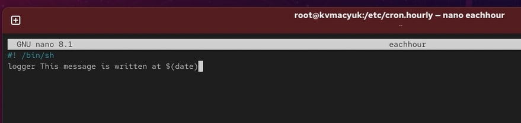{#fig-012 width=70%}

В файл поместил следующий текст:

```sh
#! /bin/sh
logger This message is written at $(date)
```

Первая строка задаёт интерпретатор `/bin/sh`. Подстановка `$(date)` добавляет в сообщение дату и время выполнения сценария.

## Назначение права выполнения сценарию

Назначил сценарию право выполнения ([рис. @fig-013]).

```bash
chmod +x eachhour
```

{#fig-013 width=70%}

## Создание файла расписания в /etc/cron.d

Перешёл в каталог общесистемных расписаний и создал файл eachhour ([рис. @fig-014]).

```bash
cd /etc/cron.d
touch eachhour
```

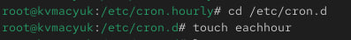{#fig-014 width=70%}

## Настройка задания в /etc/cron.d

Открыл файл расписания в nano и настроил запуск команды на 11-й минуте каждого часа ([рис. @fig-015]).

```bash
nano eachhour
```

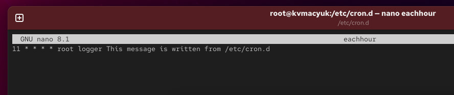{#fig-015 width=70%}

Сохранил строку:

```cron
11 * * * * root logger This message is written from /etc/cron.d
```

Поле `11` задаёт минуту запуска, четыре звёздочки разрешают выполнение в любой час и день, а `root` определяет пользователя. Эта запись непосредственно вызывает logger и является отдельным заданием: она не запускает сценарий `/etc/cron.hourly/eachhour`.

## Проверка результатов регулярных заданий

Просмотрел журнал после выполнения настроенных заданий ([рис. @fig-016]).

```bash
grep written /var/log/messages
```

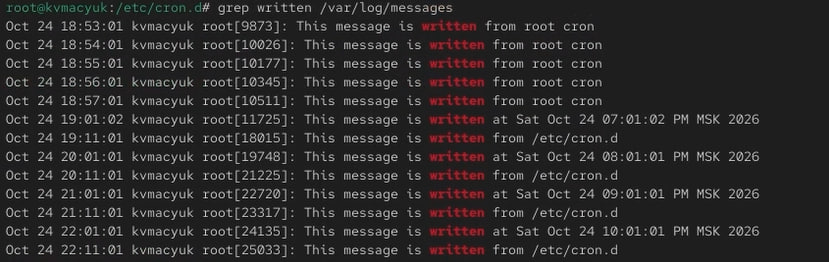{#fig-016 width=70%}

Сопоставил текст сообщений и временные отметки:

- сообщения `This message is written from root cron` в 18:53–18:57 относятся к первоначальному ежеминутному заданию;

- сообщения `This message is written at ...` появились в 19:01, 20:01, 21:01 и 22:01 и подтвердили запуск сценария из `/etc/cron.hourly` на первой минуте каждого часа;

- сообщения `This message is written from /etc/cron.d` появились в 19:11, 20:11, 21:11 и 22:11 и подтвердили выполнение общесистемного задания на 11-й минуте каждого часа.

Отдельно учёл, что сообщение времени внутри текста сценария использовало 12-часовой формат: например, `07:01:02 PM` соответствует 19:01:02. Отсутствие новых сообщений от задания по будням согласовалось с выполнением работы в субботу.

## Планирование заданий с помощью at

Проверил состояние службы atd ([рис. @fig-017]).

```bash
systemctl status atd
```

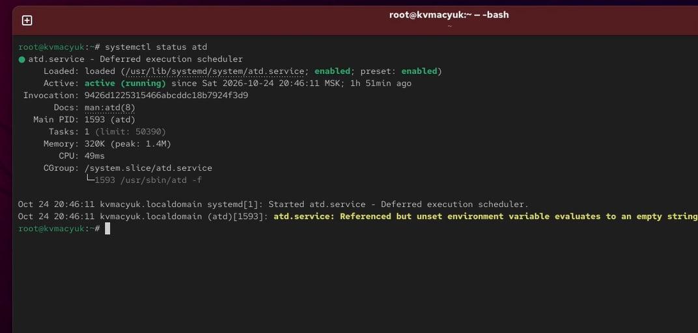{#fig-017 width=70%}

Убедился, что служба активна (`active (running)`) и включена в автозапуск (`enabled`).

## Создание однократного задания

Назначил однократное выполнение команды на 22:40 ([рис. @fig-018]).

```bash
at 22:40
```

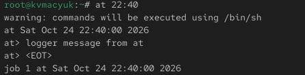{#fig-018 width=70%}

В приглашении at ввёл команду:

```bash
logger message from at
```

Завершил ввод сочетанием Ctrl+D, после чего получил подтверждение создания задания №1 на 24 октября 2026 года, 22:40. Сообщение о выполнении команд через `/bin/sh` обозначило используемый интерпретатор.

## Проверка очереди at

Просмотрел очередь запланированных заданий ([рис. @fig-019]).

```bash
atq
```

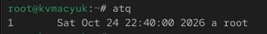{#fig-019 width=70%}

В очереди обнаружил задание №1, назначенное на 22:40, в очереди `a`, от имени пользователя root.

## Результат выполнения однократного задания

После назначенного времени проверил сообщение в системном журнале ([рис. @fig-020]).

```bash
grep 'from at' /var/log/messages
```

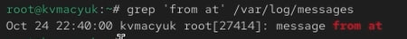{#fig-020 width=70%}

Обнаружил запись `message from at` с отметкой 22:40:00. Она подтвердила выполнение однократного задания в указанное время.

# Ответы на контрольные вопросы

## Вопрос 1

**Как настроить задание cron, чтобы оно выполнялось раз в 2 недели?**

В обычном расписании cron нет поля номера недели. Шаг `*/14` в поле дня месяца отсчитывается внутри каждого месяца. Запуск 1-го и 15-го числа также не обеспечивает постоянного интервала в 14 дней. Один из способов — ежедневная проверка числа календарных дней от опорной даты:

```cron
0 0 * * * [ $(( ($(date -u -d "$(date +\%F)" +\%s) - $(date -u -d 2026-01-05 +\%s)) / 86400 \% 14 )) -eq 0 ] && logger fortnightly-task
```

Пример использует 5 января 2026 года как опорную дату. Проверка выполняется в полночь по местному времени, а UTC используется для вычисления разности календарных дат без влияния переходов часов. Все знаки процента в строке crontab экранированы. Практически такую проверку удобно вынести в отдельный сценарий. Пропущенный при выключении компьютера запуск cron сам не восполнит.

## Вопрос 2

**Как настроить задание cron, чтобы оно выполнялось 1-го и 15-го числа каждого месяца в 2 часа ночи?**

```cron
0 2 1,15 * * logger twice-monthly-task
```

Поля `0 2` задают 02:00, список `1,15` — два дня месяца.

## Вопрос 3

**Как настроить задание cron, чтобы оно выполнялось каждые 2 минуты каждый день?**

```cron
*/2 * * * * logger every-two-minutes
```

Запуски происходят на минутах 0, 2, 4 и далее до 58 каждого часа.

## Вопрос 4

**Как настроить задание cron, чтобы оно выполнялось 19 сентября ежегодно?**

```cron
0 0 19 9 * logger september-19-task
```

Задание выполняется в 00:00 19 сентября каждого года.

## Вопрос 5

**Как настроить задание cron, чтобы оно выполнялось каждый четверг сентября ежегодно?**

```cron
0 0 * 9 4 logger september-thursday-task
```

Месяц `9` — сентябрь, день недели `4` — четверг. День месяца оставлен без ограничения.

## Вопрос 6

**Какая команда позволяет вам назначить задание cron для пользователя alice? Приведите подтверждающий пример.**

Администратор редактирует расписание существующего пользователя alice командой:

```bash
crontab -u alice -e
```

Пример строки в расписании:

```cron
*/2 * * * * logger -t alice-cron task-from-alice
```

Для подтверждения установки и выполнения задания используются команды:

```bash
crontab -u alice -l
grep task-from-alice /var/log/messages
```

<!-- Скриншот проверки alice пока не предоставлен. -->

## Вопрос 7

**Как указать, что пользователю bob никогда не разрешено назначать задания через cron? Приведите подтверждающий пример.**

Если существует `/etc/cron.allow`, bob должен отсутствовать в нём. Если этого файла нет, имя bob добавляется отдельной строкой в `/etc/cron.deny`.

Пример настройки администратором и проверки от имени существующего пользователя bob:

```bash
if [ -f /etc/cron.allow ]; then
    sed -i '/^bob$/d' /etc/cron.allow
else
    touch /etc/cron.deny
    grep -qxF bob /etc/cron.deny || echo bob >> /etc/cron.deny
fi
su - bob -c 'crontab -l'
```

Последняя команда должна получить отказ в использовании crontab. Запрет ограничивает создание и редактирование расписания пользователем, но не отменяет ранее установленные задания. При необходимости администратор удаляет их отдельно командой `crontab -u bob -r`.

<!-- Скриншот проверки bob пока не предоставлен. -->

## Вопрос 8

**Вам нужно убедиться, что задание выполняется каждый день, даже если сервер во время выполнения временно недоступен. Как это сделать?**

Для восполнения пропущенного ежедневного запуска используется anacron. Пример записи в `/etc/anacrontab`:

```text
1 5 daily-task /usr/bin/logger daily-task
```

Здесь `1` — период в днях, `5` — задержка в минутах, `daily-task` — идентификатор. Нужно обеспечить регулярный запуск самого anacron. Дополнительные ограничения и случайная задержка в конфигурации могут изменить фактическое время. Во время выключения сервера выполнение невозможно: просроченное задание запускается после возобновления работы. Отдельный запуск за каждый пропущенный день не создаётся. Формат описан в [руководстве anacrontab(5)](https://github.com/cronie-crond/cronie/blob/master/man/anacrontab.5).

## Вопрос 9

**Какая команда позволяет узнать, запланированы ли какие-либо задания на выполнение планировщиком atd?**

```bash
atq
```

Обычный пользователь видит собственные задания, root — задания всех пользователей. Проверку очереди выполнил на [рис. @fig-019].

# Выводы

## Выводы

- В ходе лабораторной работы изучил планирование регулярных и однократных задач в Linux.

- Рассмотрел формат пользовательских и общесистемных расписаний cron, настроил периодическую отправку сообщений в журнал и подготовил ежечасный сценарий.

- Освоил создание заданий с помощью at, просмотр очереди через atq и проверку запуска по журналу.

- Разобрал ограничение доступа к crontab и восполнение пропущенных заданий с помощью anacron.

# Список литературы{.unnumbered}

::: {#refs}
:::
