---
## Author

author:
  name: Мацюк Константин Владимирович
  degrees: BSc
  orcid: 0000-0002-0877-7063
  email: 1032253640@rudn.ru
  affiliation:
    - name: Российский университет дружбы народов
      country: Российская Федерация
      postal-code: 117198
      city: Москва
      address: ул. Миклухо-Маклая, д. 6

## Title

title: "Лабораторная работа №9. Управление SELinux"
subtitle: "Дисциплина: Основы администрирования операционных систем"
license: "CC BY"

## Fonts

mainfont: IBM Plex Serif
romanfont: IBM Plex Serif
sansfont: IBM Plex Sans
monofont: DejaVu Sans Mono
mathfont: STIX Two Math
mainfontoptions: Ligatures=Common,Ligatures=TeX,Scale=0.94
romanfontoptions: Ligatures=Common,Ligatures=TeX,Scale=0.94
sansfontoptions: Ligatures=Common,Ligatures=TeX,Scale=MatchLowercase,Scale=0.94
monofontoptions: Scale=MatchLowercase,Scale=0.94
incremental: false
slide-level: 2
lang: ru-RU

---

# Цель работы

## Цель работы

- Получить навыки работы с контекстом безопасности и политиками SELinux.

# Задание

## Задание

- Продемонстрировать навыки по управлению режимами SELinux.
- Продемонстрировать навыки по восстановлению контекста безопасности SELinux.
- Настроить контекст безопасности для нестандартного расположения файлов веб-службы.
- Продемонстрировать навыки работы с переключателями SELinux.

# Теоретическое введение

## Контекст безопасности SELinux

SELinux (Security-Enhanced Linux) — реализация мандатного управления доступом (MAC) в ядре Linux, дополняющая стандартное дискреционное управление доступом (DAC).

Субъектами являются процессы, объектами — файлы, каталоги, устройства и другие ресурсы.

Контекст имеет вид `user_u:role_r:type_t:level`: пользователь SELinux, роль, тип и уровень безопасности.

## Контекст безопасности SELinux (2)

Для процессов тип определяет домен, для файлов — категорию объекта, используемую в правилах Type Enforcement.

## Режимы SELinux

В режиме Enforcing действия, нарушающие политику, блокируются и регистрируются. В Permissive нарушения регистрируются, но SELinux не блокирует действия. В состоянии Disabled принудительный контроль SELinux не действует. Команда setenforce переключает только Enforcing и Permissive; состояние проверяется командами getenforce и sestatus.

## Правила контекстов и метки файлов

Контекст файлов просматривается командой `ls -Z`, процессов — `ps -eZ`. Команда restorecon восстанавливает метки согласно правилам для путей. Команда semanage fcontext изменяет эти правила, в том числе для нестандартных каталогов, но сама не меняет метки существующих файлов.

## Переключатели и журналирование

Переключатели SELinux (booleans) включают и отключают предусмотренные политикой разрешения.

Их значения показывает getsebool, описания — semanage boolean -l.

Команда setsebool изменяет значение, а ключ -P сохраняет настройку для следующих загрузок.

При работающей службе auditd сообщения об отказах обычно записываются в `/var/log/audit/audit.log`.

## Переключатели и журналирование (2)

Конфигурация режима находится в `/etc/selinux/config`; в рассматриваемой системе к ней обращался через `/etc/sysconfig/selinux`.

# Выполнение лабораторной работы

## Режим суперпользователя

Запустил терминал и получил полномочия администратора.

```bash
su -
```

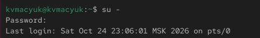{#fig-001 width=85%}

## Исходное состояние SELinux

Просмотрел текущую информацию о состоянии SELinux.

```bash
sestatus -v
```

## Исходное состояние SELinux — снимок экрана

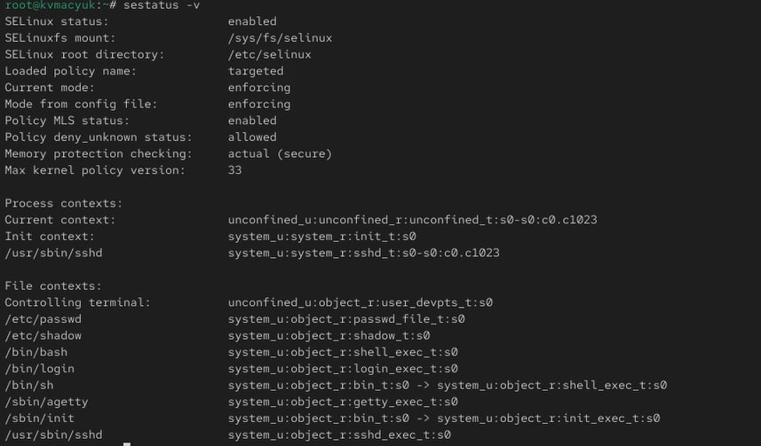{#fig-002 width=52%}

## Исходное состояние SELinux — пояснение

Пояснил выведенные параметры:

- `SELinux status: enabled` — SELinux включён;

- `SELinuxfs mount: /sys/fs/selinux` — точка монтирования интерфейса SELinux;

- `SELinux root directory: /etc/selinux` — каталог конфигурации;

- `Loaded policy name: targeted` — загружена политика targeted;

## Исходное состояние SELinux — пояснение (2)

- `Current mode: enforcing` — текущий режим принудительного исполнения;

- `Mode from config file: enforcing` — такой же режим указан в конфигурации;

- `Policy MLS status: enabled` — поддержка уровней и категорий MLS/MCS; эта строка не означает, что вместо targeted загружена политика mls;

## Исходное состояние SELinux — пояснение (3)

- `Policy deny_unknown status: allowed` — неизвестные загруженной политике классы объектов и разрешения обрабатываются как разрешённые; речь не о неизвестных типах файлов;

- `Memory protection checking: actual (secure)` — при проверке защиты памяти учитываются фактические права отображения;

- `Max kernel policy version: 33` — максимальная версия формата политики, поддерживаемая ядром.

В блоке Process contexts рассмотрел контексты процессов:

## Исходное состояние SELinux — пояснение (4)

- `Current context` — `unconfined_u:unconfined_r:unconfined_t:s0-s0:c0.c1023`, контекст процесса, из которого выполнена команда;
- `Init context` — `system_u:system_r:init_t:s0`, контекст процесса инициализации;
- `/usr/sbin/sshd` — `system_u:system_r:sshd_t:s0-s0:c0.c1023`, контекст процесса SSH-сервера.

В блоке File contexts рассмотрел типы объектов:

## Исходное состояние SELinux — пояснение (5)

- `Controlling terminal` — `user_devpts_t`, управляющий терминал;

- `/etc/passwd` — `passwd_file_t`;

- `/etc/shadow` — `shadow_t`;

- `/bin/bash` — `shell_exec_t`;

- `/bin/login` — `login_exec_t`;

- `/bin/sh` — для ссылки показан bin_t, для её цели — shell_exec_t;

## Исходное состояние SELinux — пояснение (6)

- `/sbin/agetty` — `getty_exec_t`;

- `/sbin/init` — для ссылки показан bin_t, для её цели — init_exec_t;

- `/usr/sbin/sshd` — `sshd_exec_t`.

Сопоставил домен процесса sshd_t и тип исполняемого файла sshd_exec_t. Доступ определяется правилами политики между доменами и типами объектов, а не простым совпадением их названий.

## Текущий режим SELinux

Проверил текущий режим и получил Enforcing.

```bash
getenforce
```

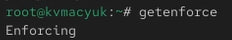{#fig-003 width=85%}

## Переключение в режим Permissive

Переключил SELinux в разрешающий режим и проверил результат: getenforce вывел Permissive.

```bash
setenforce 0
getenforce
```

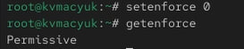{#fig-004 width=74%}

## Изменение режима в конфигурации

Открыл конфигурацию в nano и установил значение `SELINUX=disabled`.

```bash
nano /etc/sysconfig/selinux
```

## Изменение режима в конфигурации — снимок экрана

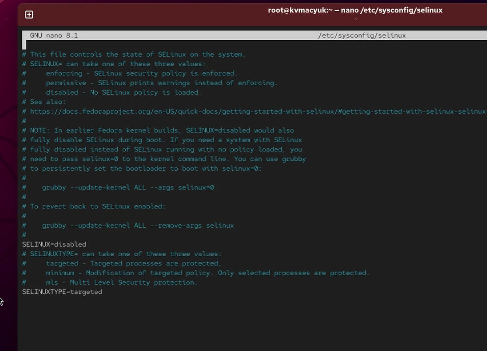{#fig-005 width=43%}

## Перезагрузка после изменения конфигурации

После сохранения конфигурации перезагрузил систему.

```bash
reboot
```

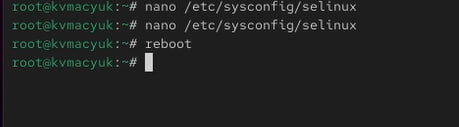{#fig-006 width=54%}

## Проверка состояния Disabled

После перезагрузки получил полномочия администратора и проверил режим. Команда getenforce вывела Disabled.

```bash
su -
getenforce
```

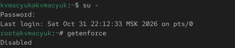{#fig-007 width=73%}

## Ошибка переключения из состояния Disabled

Попробовал включить принудительный режим без перезагрузки.

```bash
setenforce 1
```

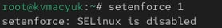{#fig-008 width=85%}

## Ошибка переключения из состояния Disabled — пояснение

Получил сообщение `setenforce: SELinux is disabled`. Команда setenforce не включает SELinux из состояния Disabled, а переключает работающий механизм между Enforcing и Permissive.

## Включение режима Enforcing в конфигурации

В редакторе nano установил в конфигурации значение `SELINUX=enforcing`.

```bash
nano /etc/sysconfig/selinux
```

## Включение режима Enforcing в конфигурации — снимок экрана

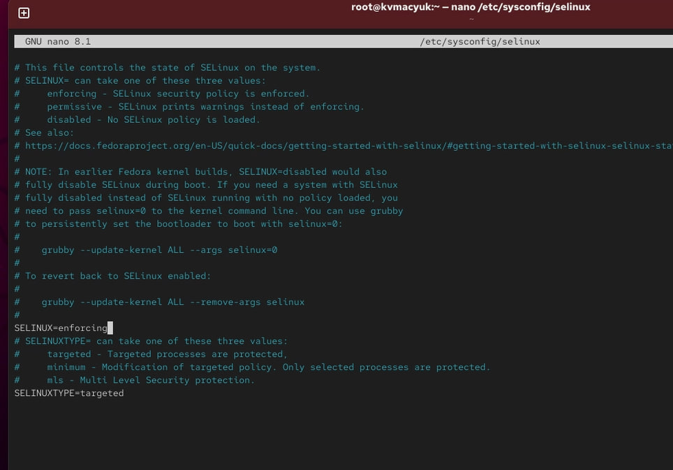{#fig-009 width=44%}

## Перезагрузка после включения SELinux

После изменения конфигурации снова перезагрузил систему.

```bash
reboot
```

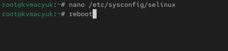{#fig-010 width=66%}

## Состояние SELinux после включения

После перезагрузки под своей учётной записью проверил состояние SELinux.

```bash
sestatus -v
```

## Состояние SELinux после включения — снимок экрана

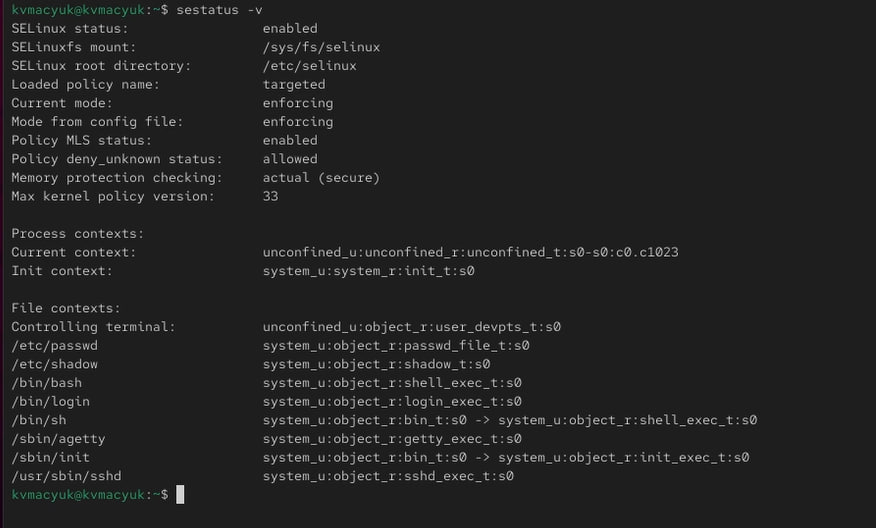{#fig-011 width=51%}

## Состояние SELinux после включения — пояснение

Убедился, что SELinux включён, загружена политика targeted, а текущий режим и режим из конфигурации имеют значение enforcing. Эту проверку выполнил без перехода к root, что видно по приглашению терминала.

## Полномочия администратора для работы с контекстами

Получил полномочия администратора.

```bash
su -
```

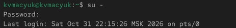{#fig-012 width=85%}

## Исходный контекст /etc/hosts

Посмотрел контекст безопасности файла `/etc/hosts`.

```bash
ls -Z /etc/hosts
```

{#fig-013 width=85%}

Получил контекст `system_u:object_r:net_conf_t:s0`. Тип net_conf_t соответствует сетевому конфигурационному файлу.

## Контекст копии в домашнем каталоге

Скопировал файл в домашний каталог root и проверил контекст созданной копии.

```bash
cp /etc/hosts ~/
ls -Z hosts
```

## Контекст копии в домашнем каталоге — снимок экрана

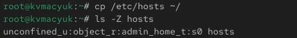{#fig-014 width=85%}

## Контекст копии в домашнем каталоге — пояснение

У копии появился контекст `unconfined_u:object_r:admin_home_t:s0`. При обычном копировании был создан новый файл с меткой, соответствующей домашнему каталогу администратора.

## Перезапись файла /etc/hosts

Переместил копию обратно в `/etc` и подтвердил перезапись ответом y.

```bash
mv hosts /etc
```

{#fig-015 width=85%}

## Контекст после перемещения

Проверил контекст после перемещения.

```bash
ls -Z /etc/hosts
```

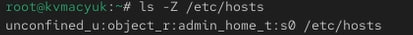{#fig-016 width=85%}

Тип остался admin_home_t: перемещение не заменило метку на ожидаемую для пути `/etc/hosts`.

## Восстановление контекста /etc/hosts

Восстановил контекст файла по правилам политики.

```bash
restorecon -v /etc/hosts
```

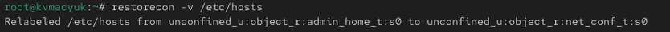{#fig-017 width=85%}

## Восстановление контекста /etc/hosts — пояснение

В выводе увидел замену `unconfined_u:object_r:admin_home_t:s0` на `unconfined_u:object_r:net_conf_t:s0`. Команда исправила тип; компонент пользователя SELinux остался unconfined_u.

## Контекст после восстановления

Повторно проверил метку файла.

```bash
ls -Z /etc/hosts
```

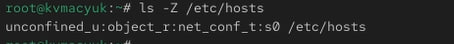{#fig-018 width=85%}

Убедился, что тип изменился на net_conf_t.

## Назначение автоматической перемаркировки

Для перемаркировки при следующей загрузке создал файл-маркер и перезагрузил систему.

```bash
touch /.autorelabel
reboot
```

## Назначение автоматической перемаркировки — снимок экрана

{#fig-019 width=85%}

## Назначение автоматической перемаркировки — пояснение

Файл `/.autorelabel` служит запросом на восстановление меток при загрузке. На снимке зафиксировал создание маркера и команду перезагрузки.

## Полномочия администратора для настройки httpd

Получил полномочия администратора для настройки веб-сервера.

```bash
su -
```

{#fig-020 width=85%}

## Запуск установки httpd

Запустил установку веб-сервера Apache.

```bash
dnf -y install httpd
```

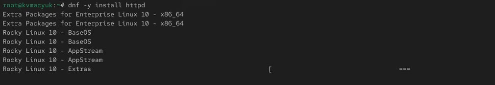{#fig-021 width=85%}

## Запуск установки httpd — пояснение

Для последующей проверки использовал текстовый браузер lynx. Его установка предусмотрена командой `dnf -y install lynx`; на данном снимке зафиксировано обращение к репозиториям при установке httpd, а работу lynx показал ниже.

## Создание каталога /web

Создал каталог для нестандартного размещения веб-контента.

```bash
mkdir /web
```

{#fig-022 width=85%}

## Создание содержимого index.html

Создал файл index.html и записал приветствие с помощью echo.

```bash
cd /web
touch index.html
echo "Welcome to my web-server" > index.html
```

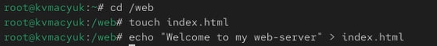{#fig-023 width=85%}

## Изменение DocumentRoot в Apache

Открыл конфигурацию Apache в nano, закомментировал прежнюю директиву DocumentRoot и указал каталог `/web`.

```bash
nano /etc/httpd/conf/httpd.conf
```

## Изменение DocumentRoot в Apache — снимок экрана

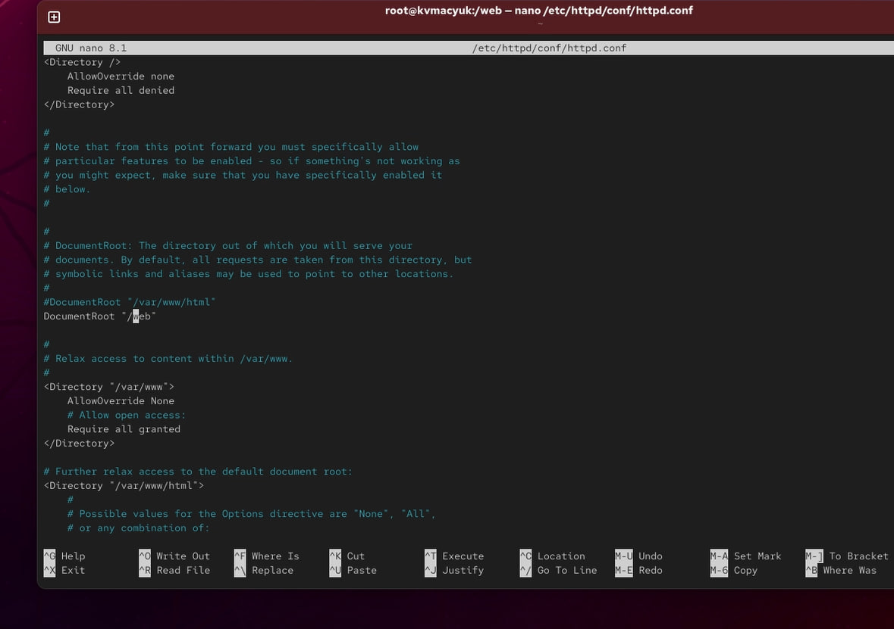{#fig-024 width=43%}

## Изменение DocumentRoot в Apache — пояснение

На снимке зафиксировал настройку:

```apache
#DocumentRoot "/var/www/html"
DocumentRoot "/web"
```

Для обслуживания нового каталога необходим также раздел доступа, предусмотренный заданием:

## Изменение DocumentRoot в Apache — пояснение (2)

```apache
<Directory "/web">
    AllowOverride None
    Require all granted
</Directory>
```

Параметры доступа Apache и метки SELinux выполняют разные проверки: разрешение в конфигурации веб-сервера не отменяет ограничений SELinux.

## Запуск и включение автозапуска httpd

Запустил службу httpd и включил её автоматический запуск.

```bash
systemctl start httpd
systemctl enable httpd
```

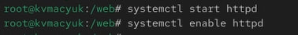{#fig-025 width=85%}

## Первая попытка открытия страницы

Под своей учётной записью обратился к веб-серверу через lynx. При первой попытке получил ошибку `403 Forbidden`, и содержимое страницы не загрузилось.

```bash
lynx http://localhost
```

## Первая попытка открытия страницы — снимок экрана

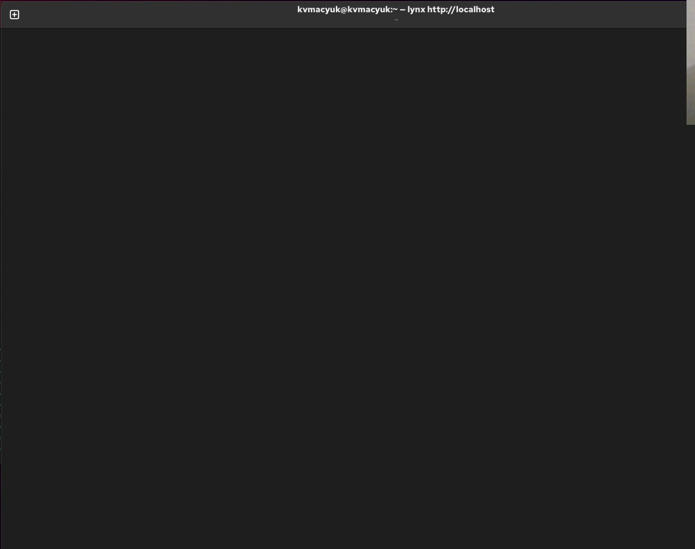{#fig-026 width=39%}

## Первая попытка открытия страницы — пояснение

На снимке зафиксировал пустое окно браузера после попытки обращения. Сообщение об ошибке находилось в нижней части терминала и в кадр не попало. Сам код 403 не определяет причину отказа однозначно, поэтому далее проверил настройку контекста веб-каталога.

## Добавление правила контекста для /web

С полномочиями администратора добавил постоянное правило контекста для `/web` и всего его содержимого.

```bash
semanage fcontext -a -t httpd_sys_content_t "/web(/.*)?"
```

{#fig-027 width=85%}

## Добавление правила контекста для /web — пояснение

Тип httpd_sys_content_t предназначен для содержимого, которое веб-серверу разрешено читать. Выражение `/web(/.*)?` охватывает каталог и вложенные пути. На этом этапе добавил правило; изменение меток выполнил следующей командой.

## Применение контекста к /web

Применил правило к каталогу и его содержимому.

```bash
restorecon -R -v /web
```

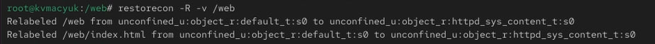{#fig-028 width=85%}

## Применение контекста к /web — пояснение

В выводе увидел замену типа default_t на httpd_sys_content_t для `/web` и `/web/index.html`. Ключ -R включил рекурсивную обработку, -v — вывод выполненных изменений.

## Успешное открытие веб-страницы

Повторно открыл веб-сервер под своей учётной записью.

```bash
lynx http://localhost
```

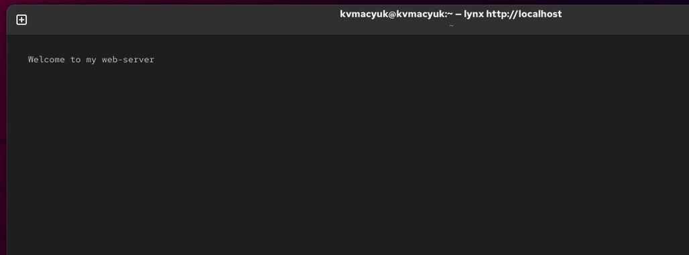{#fig-029 width=48%}

## Успешное открытие веб-страницы — пояснение

На странице отобразилось `Welcome to my web-server`. Результат подтвердил доступность файла после настройки веб-службы и контекста каталога.

## Полномочия администратора для изменения переключателей

Получил полномочия администратора.

```bash
su -
```

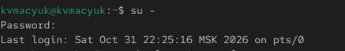{#fig-030 width=85%}

## Переключатели SELinux для FTP

Просмотрел переключатели SELinux, связанные с FTP.

```bash
getsebool -a | grep ftp
```

## Переключатели SELinux для FTP — снимок экрана

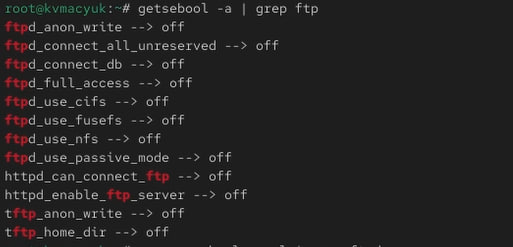{#fig-031 width=64%}

## Переключатели SELinux для FTP — пояснение

У переключателя ftpd_anon_write обнаружил значение off. Он управляет предусмотренным политикой разрешением анонимной записи FTP; его включение само по себе не настраивает FTP-сервер и обычные права файлов.

## Описание и исходное состояние переключателя

Просмотрел состояние и описание переключателя ftpd_anon_write.

```bash
semanage boolean -l | grep ftpd_anon
```

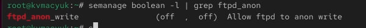{#fig-032 width=85%}

## Описание и исходное состояние переключателя — пояснение

Получил строку `ftpd_anon_write (off, off) Allow ftpd to anon write`: текущее и постоянное значения были выключены. ftpd_anon_write — имя переключателя политики, а не отдельной службы.

## Временное включение переключателя

Включил переключатель для текущей работы системы.

```bash
setsebool ftpd_anon_write on
```

{#fig-033 width=85%}

## Проверка текущего значения

Проверил текущее значение.

```bash
getsebool ftpd_anon_write
```

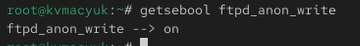{#fig-034 width=85%}

Получил вывод `ftpd_anon_write --> on`.

## Состояние после временного изменения

Сопоставил текущее и постоянное значения.

```bash
semanage boolean -l | grep ftpd_anon
```

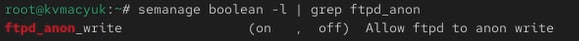{#fig-035 width=85%}

Получил `(on, off)`: текущее значение было включено, а постоянная настройка оставалась выключенной.

## Постоянное включение переключателя

Сохранил включённое значение для последующих загрузок.

```bash
setsebool -P ftpd_anon_write on
```

{#fig-036 width=85%}

## Итоговое состояние переключателя

Проверил итоговое состояние.

```bash
semanage boolean -l | grep ftpd_anon
```

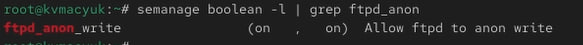{#fig-037 width=85%}

Получил `(on, on)`. Включённое значение применил к текущей работе системы и сохранил в постоянной настройке политики.

# Ответы на контрольные вопросы

## Вопрос 1

**Вы хотите временно поставить SELinux в разрешающем режиме. Какую команду вы используете?**

```bash
setenforce 0
```

Команда переключает работающий SELinux в Permissive. Изменение действует до следующего переключения или перезагрузки; конфигурационный файл не меняется. Проверку выполнил на [рис. @fig-004].

## Вопрос 2

**Вам нужен список всех доступных переключателей SELinux. Какую команду вы используете?**

```bash
getsebool -a
```

Команда выводит переключатели с текущими значениями. Описания и сведения о постоянной настройке показывает `semanage boolean -l`.

## Вопрос 3

**Каково имя пакета, который требуется установить для получения легко читаемых сообщений журнала SELinux в журнале аудита?**

Пакет `setroubleshoot-server` предоставляет средства анализа отказов и утилиту sealert. Например:

```bash
sealert -a /var/log/audit/audit.log
```

## Вопрос 3 (2)

Исходные записи остаются в журнале аудита, а sealert формирует понятное объяснение и рекомендации. Это не преобразование записей внутри самого audit.log.

## Вопрос 4

**Какие команды вам нужно выполнить, чтобы применить тип контекста httpd_sys_content_t к каталогу /web?**

```bash
semanage fcontext -a -t httpd_sys_content_t "/web(/.*)?"
restorecon -R -v /web
```

Первая команда добавляет правило для каталога и вложенных файлов, вторая применяет его к существующим объектам. Результат показал на [рис. @fig-027] и [рис. @fig-028].

## Вопрос 5

**Какой файл вам нужно изменить, если вы хотите полностью отключить SELinux?**

В рамках методики работы редактируется `/etc/selinux/config`, доступный также через `/etc/sysconfig/selinux`: задаётся `SELINUX=disabled`, затем выполняется перезагрузка. На [рис. @fig-005] показал изменение, на [рис. @fig-007] — вывод Disabled.

## Вопрос 5 (2)

В современных версиях RHEL и родственных систем нужно различать отсутствие загруженной политики и полное отключение механизма в ядре. Для полного отключения используется параметр ядра `selinux=0` с последующей перезагрузкой. Одного изменения конфигурационного файла недостаточно, чтобы гарантировать полное отключение на всех версиях. Это различие также отмечено в комментариях конфигурации на снимке и в [документации Red Hat](https://docs.redhat.com/en/documentation/red_hat_enterprise_linux/10/html-single/using_selinux/using_selinux).

## Вопрос 6

**Где SELinux регистрирует все свои сообщения?**

При работающем auditd сообщения об отказах SELinux по умолчанию сохраняются в `/var/log/audit/audit.log`. Для поиска событий используется, например, `ausearch -m AVC,USER_AVC -ts recent`. В зависимости от настройки журналирования сообщения ядра и диагностические сводки также доступны через journalctl или `/var/log/messages`; эти источники не обязательно содержат полную копию журнала аудита. Порядок регистрации описан в [руководстве Red Hat](https://docs.redhat.com/de/documentation/red_hat_enterprise_linux/7/html/selinux_users_and_administrators_guide/sect-security-enhanced_linux-working_with_selinux-which_log_file_is_used).

## Вопрос 7

**Вы не знаете, какие типы контекстов доступны для службы ftp. Какая команда позволяет получить более конкретную информацию?**

Описание политики FTP и типов контекстов можно получить в справочной странице:

```bash
man ftpd_selinux
```

## Вопрос 7 (2)

Она доступна при установленном пакете соответствующих справочных страниц политики. Правила файловых контекстов можно дополнительно просмотреть командой:

```bash
semanage fcontext -l | grep ftp
```

Фильтр показывает совпавшие строки, но не гарантирует полный перечень типов, применимых к FTP: некоторые общие типы не содержат ftp в имени. Переключатели показывает `semanage boolean -l | grep ftp`.

## Вопрос 8

**Ваш сервис работает не так, как ожидалось, и вы хотите узнать, связано ли это с SELinux или чем-то ещё. Какой самый простой способ узнать?**

Временно перевести работающий SELinux из Enforcing в Permissive командой `setenforce 0` и повторить проблемное действие.

Если при неизменных остальных настройках оно начинает выполняться, это указывает на влияние SELinux.

## Вопрос 8 (2)

Причину нужно уточнить по записям AVC в журнале аудита, например с помощью `sealert -a /var/log/audit/audit.log`.

После проверки вернуть исходный режим Enforcing командой `setenforce 1`.

Постоянное отключение защиты не устраняет причину отказа.

# Выводы

## Выводы

- В ходе лабораторной работы получил навыки управления режимами SELinux, изучил структуру контекстов процессов и файлов и восстановил тип net_conf_t для файла /etc/hosts командой restorecon.

- Подготовил автоматическую перемаркировку при загрузке, настроил правило контекста для нестандартного веб-каталога /web и применил к нему тип httpd_sys_content_t.

- Проверил открытие созданной страницы в lynx.

## Выводы (2)

- Освоил просмотр переключателей SELinux, временное изменение ftpd_anon_write и сохранение его включённого значения с ключом -P.

# Список литературы{.unnumbered}

## Список литературы

1. Кулябов Д. С., Королькова А. В. Основы администрирования операционных систем. Лабораторная работа №9. Управление SELinux. Методические указания, файл `010-selinux (1).pdf`.
2. Red Hat. [Using SELinux. Red Hat Enterprise Linux 10](https://docs.redhat.com/en/documentation/red_hat_enterprise_linux/10/html-single/using_selinux/using_selinux).
3. Red Hat. [Which Log File is Used](https://docs.redhat.com/de/documentation/red_hat_enterprise_linux/7/html/selinux_users_and_administrators_guide/sect-security-enhanced_linux-working_with_selinux-which_log_file_is_used).

::: {#refs}
:::
