---
## Author
author:
  name: Мацюк Константин Владимирович
  degrees: BSc
  orcid: 0000-0002-0877-7063
  email: 1032253640@rudn.ru
  affiliation:
    - name: Российский университет дружбы народов
      country: Российская Федерация
      postal-code: 117198
      city: Москва
      address: ул. Миклухо-Маклая, д. 6

## Title
title: "Лабораторная работа №9. Управление SELinux"
subtitle: "Дисциплина: Основы администрирования операционных систем"
license: "CC BY"

## Fonts
mainfont: IBM Plex Serif
romanfont: IBM Plex Serif
sansfont: IBM Plex Sans
monofont: DejaVu Sans Mono
mathfont: STIX Two Math
mainfontoptions: Ligatures=Common,Ligatures=TeX,Scale=0.94
romanfontoptions: Ligatures=Common,Ligatures=TeX,Scale=0.94
sansfontoptions: Ligatures=Common,Ligatures=TeX,Scale=MatchLowercase,Scale=0.94
monofontoptions: Scale=MatchLowercase,Scale=0.94
---

# Цель работы

Получить навыки работы с контекстом безопасности и политиками SELinux.

# Задание

1. Продемонстрировать навыки по управлению режимами SELinux.
2. Продемонстрировать навыки по восстановлению контекста безопасности SELinux.
3. Настроить контекст безопасности для нестандартного расположения файлов веб-службы.
4. Продемонстрировать навыки работы с переключателями SELinux.

# Теоретическое введение

SELinux (Security-Enhanced Linux) — реализация мандатного управления доступом (MAC) в ядре Linux, дополняющая стандартное дискреционное управление доступом (DAC). Субъектами являются процессы, объектами — файлы, каталоги, устройства и другие ресурсы. Контекст имеет вид `user_u:role_r:type_t:level`: пользователь SELinux, роль, тип и уровень безопасности. Для процессов тип определяет домен, для файлов — категорию объекта, используемую в правилах Type Enforcement.

В режиме Enforcing действия, нарушающие политику, блокируются и регистрируются. В Permissive нарушения регистрируются, но SELinux не блокирует действия. В состоянии Disabled принудительный контроль SELinux не действует. Команда setenforce переключает только Enforcing и Permissive; состояние проверяется командами getenforce и sestatus.

Контекст файлов просматривается командой `ls -Z`, процессов — `ps -eZ`. Команда restorecon восстанавливает метки согласно правилам для путей. Команда semanage fcontext изменяет эти правила, в том числе для нестандартных каталогов, но сама не меняет метки существующих файлов.

Переключатели SELinux (booleans) включают и отключают предусмотренные политикой разрешения. Их значения показывает getsebool, описания — semanage boolean -l. Команда setsebool изменяет значение, а ключ -P сохраняет настройку для следующих загрузок. При работающей службе auditd сообщения об отказах обычно записываются в `/var/log/audit/audit.log`. Конфигурация режима находится в `/etc/selinux/config`; в рассматриваемой системе к ней обращался через `/etc/sysconfig/selinux`.

# Выполнение лабораторной работы

## Управление режимами SELinux

Запустил терминал и получил полномочия администратора ([рис. @fig-001]).

```bash
su -
```

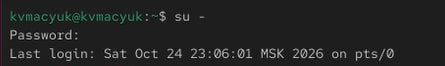{#fig-001 width=70%}


Просмотрел текущую информацию о состоянии SELinux ([рис. @fig-002]).

```bash
sestatus -v
```

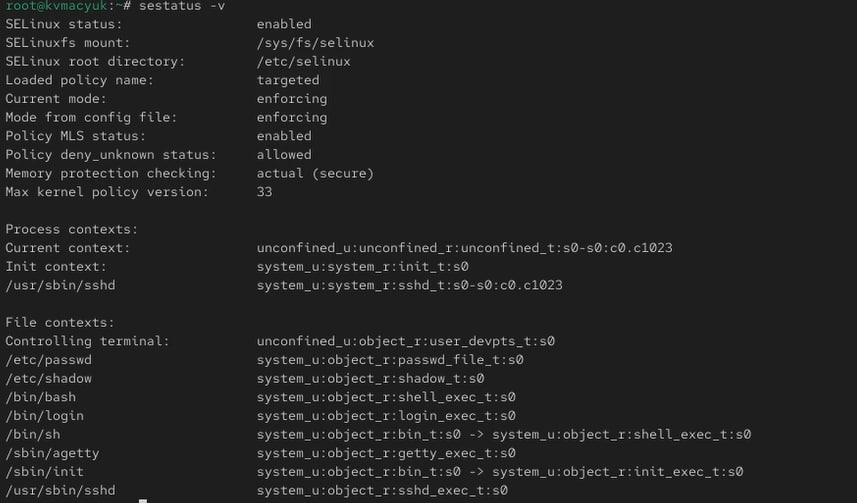{#fig-002 width=70%}

Пояснил выведенные параметры:

- `SELinux status: enabled` — SELinux включён;
- `SELinuxfs mount: /sys/fs/selinux` — точка монтирования интерфейса SELinux;
- `SELinux root directory: /etc/selinux` — каталог конфигурации;
- `Loaded policy name: targeted` — загружена политика targeted;
- `Current mode: enforcing` — текущий режим принудительного исполнения;
- `Mode from config file: enforcing` — такой же режим указан в конфигурации;
- `Policy MLS status: enabled` — поддержка уровней и категорий MLS/MCS; эта строка не означает, что вместо targeted загружена политика mls;
- `Policy deny_unknown status: allowed` — неизвестные загруженной политике классы объектов и разрешения обрабатываются как разрешённые; речь не о неизвестных типах файлов;
- `Memory protection checking: actual (secure)` — при проверке защиты памяти учитываются фактические права отображения;
- `Max kernel policy version: 33` — максимальная версия формата политики, поддерживаемая ядром.

В блоке Process contexts рассмотрел контексты процессов:

- `Current context` — `unconfined_u:unconfined_r:unconfined_t:s0-s0:c0.c1023`, контекст процесса, из которого выполнена команда;
- `Init context` — `system_u:system_r:init_t:s0`, контекст процесса инициализации;
- `/usr/sbin/sshd` — `system_u:system_r:sshd_t:s0-s0:c0.c1023`, контекст процесса SSH-сервера.

В блоке File contexts рассмотрел типы объектов:

- `Controlling terminal` — `user_devpts_t`, управляющий терминал;
- `/etc/passwd` — `passwd_file_t`;
- `/etc/shadow` — `shadow_t`;
- `/bin/bash` — `shell_exec_t`;
- `/bin/login` — `login_exec_t`;
- `/bin/sh` — для ссылки показан bin_t, для её цели — shell_exec_t;
- `/sbin/agetty` — `getty_exec_t`;
- `/sbin/init` — для ссылки показан bin_t, для её цели — init_exec_t;
- `/usr/sbin/sshd` — `sshd_exec_t`.

Сопоставил домен процесса sshd_t и тип исполняемого файла sshd_exec_t. Доступ определяется правилами политики между доменами и типами объектов, а не простым совпадением их названий.


Проверил текущий режим и получил Enforcing ([рис. @fig-003]).

```bash
getenforce
```

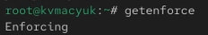{#fig-003 width=70%}


Переключил SELinux в разрешающий режим и проверил результат: getenforce вывел Permissive ([рис. @fig-004]).

```bash
setenforce 0
getenforce
```

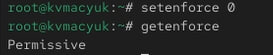{#fig-004 width=70%}


Открыл конфигурацию в nano и установил значение `SELINUX=disabled` ([рис. @fig-005]).

```bash
nano /etc/sysconfig/selinux
```

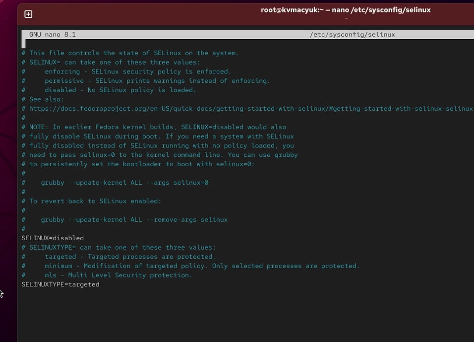{#fig-005 width=55%}


После сохранения конфигурации перезагрузил систему ([рис. @fig-006]).

```bash
reboot
```

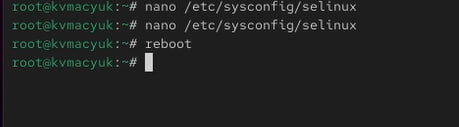{#fig-006 width=70%}


После перезагрузки получил полномочия администратора и проверил режим. Команда getenforce вывела Disabled ([рис. @fig-007]).

```bash
su -
getenforce
```

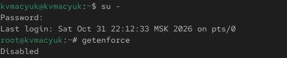{#fig-007 width=70%}


Попробовал включить принудительный режим без перезагрузки ([рис. @fig-008]).

```bash
setenforce 1
```

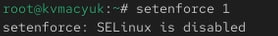{#fig-008 width=70%}

Получил сообщение `setenforce: SELinux is disabled`. Команда setenforce не включает SELinux из состояния Disabled, а переключает работающий механизм между Enforcing и Permissive.


В редакторе nano установил в конфигурации значение `SELINUX=enforcing` ([рис. @fig-009]).

```bash
nano /etc/sysconfig/selinux
```

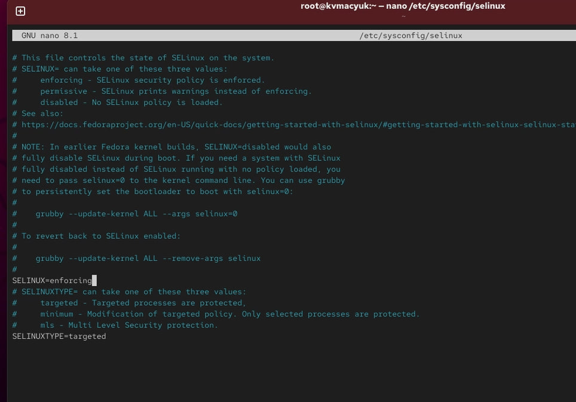{#fig-009 width=55%}


После изменения конфигурации снова перезагрузил систему ([рис. @fig-010]).

```bash
reboot
```

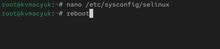{#fig-010 width=70%}


После перезагрузки под своей учётной записью проверил состояние SELinux ([рис. @fig-011]).

```bash
sestatus -v
```

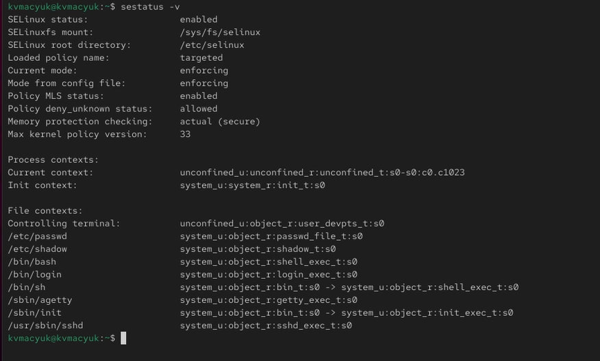{#fig-011 width=70%}

Убедился, что SELinux включён, загружена политика targeted, а текущий режим и режим из конфигурации имеют значение enforcing. Эту проверку выполнил без перехода к root, что видно по приглашению терминала.

## Использование restorecon для восстановления контекста безопасности


Получил полномочия администратора ([рис. @fig-012]).

```bash
su -
```

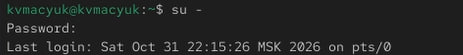{#fig-012 width=70%}


Посмотрел контекст безопасности файла `/etc/hosts` ([рис. @fig-013]).

```bash
ls -Z /etc/hosts
```

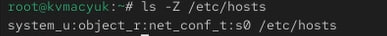{#fig-013 width=70%}

Получил контекст `system_u:object_r:net_conf_t:s0`. Тип net_conf_t соответствует сетевому конфигурационному файлу.


Скопировал файл в домашний каталог root и проверил контекст созданной копии ([рис. @fig-014]).

```bash
cp /etc/hosts ~/
ls -Z hosts
```

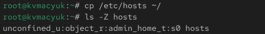{#fig-014 width=70%}

У копии появился контекст `unconfined_u:object_r:admin_home_t:s0`. При обычном копировании был создан новый файл с меткой, соответствующей домашнему каталогу администратора.


Переместил копию обратно в `/etc` и подтвердил перезапись ответом y ([рис. @fig-015]).

```bash
mv hosts /etc
```

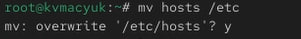{#fig-015 width=70%}


Проверил контекст после перемещения ([рис. @fig-016]).

```bash
ls -Z /etc/hosts
```

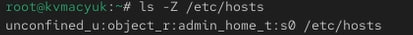{#fig-016 width=70%}

Тип остался admin_home_t: перемещение не заменило метку на ожидаемую для пути `/etc/hosts`.


Восстановил контекст файла по правилам политики ([рис. @fig-017]).

```bash
restorecon -v /etc/hosts
```

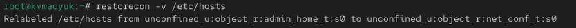{#fig-017 width=70%}

В выводе увидел замену `unconfined_u:object_r:admin_home_t:s0` на `unconfined_u:object_r:net_conf_t:s0`. Команда исправила тип; компонент пользователя SELinux остался unconfined_u.


Повторно проверил метку файла ([рис. @fig-018]).

```bash
ls -Z /etc/hosts
```

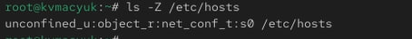{#fig-018 width=70%}

Убедился, что тип изменился на net_conf_t.


Для перемаркировки при следующей загрузке создал файл-маркер и перезагрузил систему ([рис. @fig-019]).

```bash
touch /.autorelabel
reboot
```

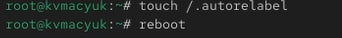{#fig-019 width=70%}

Файл `/.autorelabel` служит запросом на восстановление меток при загрузке. На снимке зафиксировал создание маркера и команду перезагрузки.

## Настройка контекста безопасности для нестандартного расположения файлов веб-сервера


Получил полномочия администратора для настройки веб-сервера ([рис. @fig-020]).

```bash
su -
```

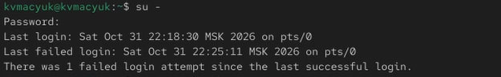{#fig-020 width=70%}


Запустил установку веб-сервера Apache ([рис. @fig-021]).

```bash
dnf -y install httpd
```

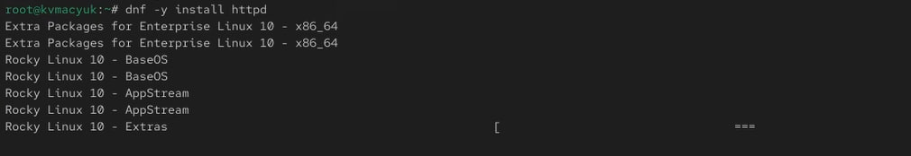{#fig-021 width=70%}

Для последующей проверки использовал текстовый браузер lynx. Его установка предусмотрена командой `dnf -y install lynx`; на данном снимке зафиксировано обращение к репозиториям при установке httpd, а работу lynx показал ниже.


Создал каталог для нестандартного размещения веб-контента ([рис. @fig-022]).

```bash
mkdir /web
```

{#fig-022 width=70%}


Создал файл index.html и записал приветствие с помощью echo ([рис. @fig-023]).

```bash
cd /web
touch index.html
echo "Welcome to my web-server" > index.html
```

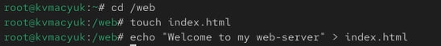{#fig-023 width=70%}


Открыл конфигурацию Apache в nano, закомментировал прежнюю директиву DocumentRoot и указал каталог `/web` ([рис. @fig-024]).

```bash
nano /etc/httpd/conf/httpd.conf
```

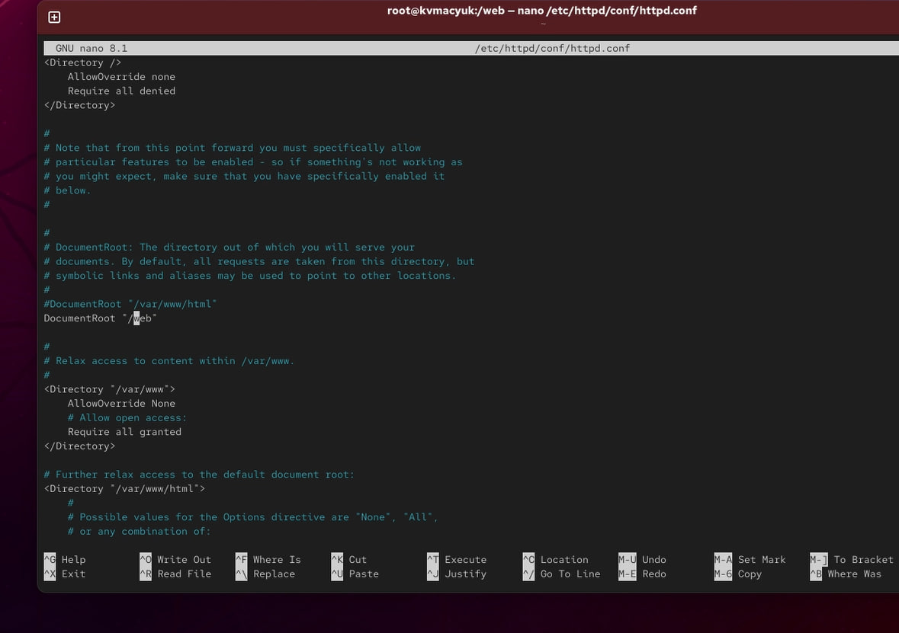{#fig-024 width=55%}

На снимке зафиксировал настройку:

```apache
#DocumentRoot "/var/www/html"
DocumentRoot "/web"
```

Для обслуживания нового каталога необходим также раздел доступа, предусмотренный заданием:

```apache
<Directory "/web">
    AllowOverride None
    Require all granted
</Directory>
```

Параметры доступа Apache и метки SELinux выполняют разные проверки: разрешение в конфигурации веб-сервера не отменяет ограничений SELinux.


Запустил службу httpd и включил её автоматический запуск ([рис. @fig-025]).

```bash
systemctl start httpd
systemctl enable httpd
```

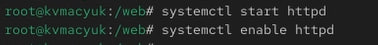{#fig-025 width=70%}


Под своей учётной записью обратился к веб-серверу через lynx. При первой попытке получил ошибку `403 Forbidden`, и содержимое страницы не загрузилось ([рис. @fig-026]).

```bash
lynx http://localhost
```

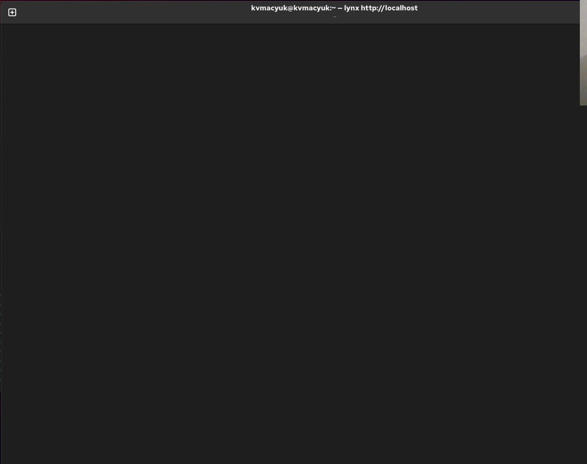{#fig-026 width=55%}

На снимке зафиксировал пустое окно браузера после попытки обращения. Сообщение об ошибке находилось в нижней части терминала и в кадр не попало. Сам код 403 не определяет причину отказа однозначно, поэтому далее проверил настройку контекста веб-каталога.


С полномочиями администратора добавил постоянное правило контекста для `/web` и всего его содержимого ([рис. @fig-027]).

```bash
semanage fcontext -a -t httpd_sys_content_t "/web(/.*)?"
```

{#fig-027 width=70%}

Тип httpd_sys_content_t предназначен для содержимого, которое веб-серверу разрешено читать. Выражение `/web(/.*)?` охватывает каталог и вложенные пути. На этом этапе добавил правило; изменение меток выполнил следующей командой.


Применил правило к каталогу и его содержимому ([рис. @fig-028]).

```bash
restorecon -R -v /web
```

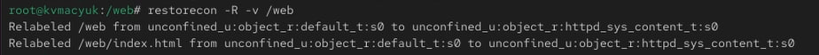{#fig-028 width=70%}

В выводе увидел замену типа default_t на httpd_sys_content_t для `/web` и `/web/index.html`. Ключ -R включил рекурсивную обработку, -v — вывод выполненных изменений.


Повторно открыл веб-сервер под своей учётной записью ([рис. @fig-029]).

```bash
lynx http://localhost
```

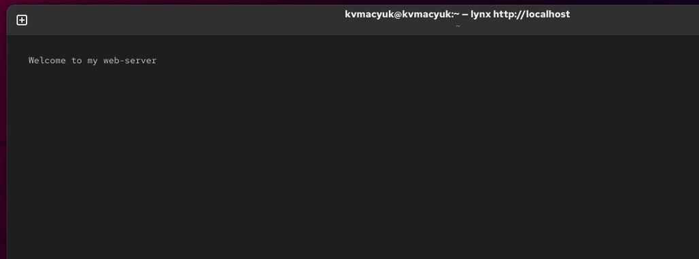{#fig-029 width=70%}

На странице отобразилось `Welcome to my web-server`. Результат подтвердил доступность файла после настройки веб-службы и контекста каталога.

## Работа с переключателями SELinux


Получил полномочия администратора ([рис. @fig-030]).

```bash
su -
```

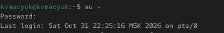{#fig-030 width=70%}


Просмотрел переключатели SELinux, связанные с FTP ([рис. @fig-031]).

```bash
getsebool -a | grep ftp
```

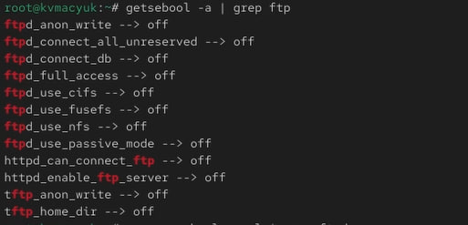{#fig-031 width=70%}

У переключателя ftpd_anon_write обнаружил значение off. Он управляет предусмотренным политикой разрешением анонимной записи FTP; его включение само по себе не настраивает FTP-сервер и обычные права файлов.


Просмотрел состояние и описание переключателя ftpd_anon_write ([рис. @fig-032]).

```bash
semanage boolean -l | grep ftpd_anon
```

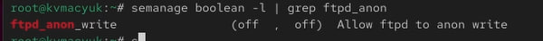{#fig-032 width=70%}

Получил строку `ftpd_anon_write (off, off) Allow ftpd to anon write`: текущее и постоянное значения были выключены. ftpd_anon_write — имя переключателя политики, а не отдельной службы.


Включил переключатель для текущей работы системы ([рис. @fig-033]).

```bash
setsebool ftpd_anon_write on
```

{#fig-033 width=70%}


Проверил текущее значение ([рис. @fig-034]).

```bash
getsebool ftpd_anon_write
```

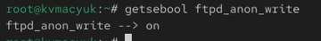{#fig-034 width=70%}

Получил вывод `ftpd_anon_write --> on`.


Сопоставил текущее и постоянное значения ([рис. @fig-035]).

```bash
semanage boolean -l | grep ftpd_anon
```

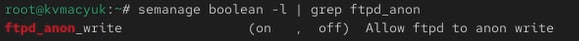{#fig-035 width=70%}

Получил `(on, off)`: текущее значение было включено, а постоянная настройка оставалась выключенной.


Сохранил включённое значение для последующих загрузок ([рис. @fig-036]).

```bash
setsebool -P ftpd_anon_write on
```

{#fig-036 width=70%}


Проверил итоговое состояние ([рис. @fig-037]).

```bash
semanage boolean -l | grep ftpd_anon
```

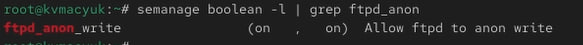{#fig-037 width=70%}

Получил `(on, on)`. Включённое значение применил к текущей работе системы и сохранил в постоянной настройке политики.

# Ответы на контрольные вопросы

**1. Вы хотите временно поставить SELinux в разрешающем режиме. Какую команду вы используете?**

```bash
setenforce 0
```

Команда переключает работающий SELinux в Permissive. Изменение действует до следующего переключения или перезагрузки; конфигурационный файл не меняется. Проверку выполнил на [рис. @fig-004].

**2. Вам нужен список всех доступных переключателей SELinux. Какую команду вы используете?**

```bash
getsebool -a
```

Команда выводит переключатели с текущими значениями. Описания и сведения о постоянной настройке показывает `semanage boolean -l`.

**3. Каково имя пакета, который требуется установить для получения легко читаемых сообщений журнала SELinux в журнале аудита?**

Пакет `setroubleshoot-server` предоставляет средства анализа отказов и утилиту sealert. Например:

```bash
sealert -a /var/log/audit/audit.log
```

Исходные записи остаются в журнале аудита, а sealert формирует понятное объяснение и рекомендации. Это не преобразование записей внутри самого audit.log.

**4. Какие команды вам нужно выполнить, чтобы применить тип контекста httpd_sys_content_t к каталогу /web?**

```bash
semanage fcontext -a -t httpd_sys_content_t "/web(/.*)?"
restorecon -R -v /web
```

Первая команда добавляет правило для каталога и вложенных файлов, вторая применяет его к существующим объектам. Результат показал на [рис. @fig-027] и [рис. @fig-028].

**5. Какой файл вам нужно изменить, если вы хотите полностью отключить SELinux?**

В рамках методики работы редактируется `/etc/selinux/config`, доступный также через `/etc/sysconfig/selinux`: задаётся `SELINUX=disabled`, затем выполняется перезагрузка. На [рис. @fig-005] показал изменение, на [рис. @fig-007] — вывод Disabled.

В современных версиях RHEL и родственных систем нужно различать отсутствие загруженной политики и полное отключение механизма в ядре. Для полного отключения используется параметр ядра `selinux=0` с последующей перезагрузкой. Одного изменения конфигурационного файла недостаточно, чтобы гарантировать полное отключение на всех версиях. Это различие также отмечено в комментариях конфигурации на снимке и в [документации Red Hat](https://docs.redhat.com/en/documentation/red_hat_enterprise_linux/10/html-single/using_selinux/using_selinux).

**6. Где SELinux регистрирует все свои сообщения?**

При работающем auditd сообщения об отказах SELinux по умолчанию сохраняются в `/var/log/audit/audit.log`. Для поиска событий используется, например, `ausearch -m AVC,USER_AVC -ts recent`. В зависимости от настройки журналирования сообщения ядра и диагностические сводки также доступны через journalctl или `/var/log/messages`; эти источники не обязательно содержат полную копию журнала аудита. Порядок регистрации описан в [руководстве Red Hat](https://docs.redhat.com/de/documentation/red_hat_enterprise_linux/7/html/selinux_users_and_administrators_guide/sect-security-enhanced_linux-working_with_selinux-which_log_file_is_used).

**7. Вы не знаете, какие типы контекстов доступны для службы ftp. Какая команда позволяет получить более конкретную информацию?**

Описание политики FTP и типов контекстов можно получить в справочной странице:

```bash
man ftpd_selinux
```

Она доступна при установленном пакете соответствующих справочных страниц политики. Правила файловых контекстов можно дополнительно просмотреть командой:

```bash
semanage fcontext -l | grep ftp
```

Фильтр показывает совпавшие строки, но не гарантирует полный перечень типов, применимых к FTP: некоторые общие типы не содержат ftp в имени. Переключатели показывает `semanage boolean -l | grep ftp`.

**8. Ваш сервис работает не так, как ожидалось, и вы хотите узнать, связано ли это с SELinux или чем-то ещё. Какой самый простой способ узнать?**

Временно перевести работающий SELinux из Enforcing в Permissive командой `setenforce 0` и повторить проблемное действие. Если при неизменных остальных настройках оно начинает выполняться, это указывает на влияние SELinux. Причину нужно уточнить по записям AVC в журнале аудита, например с помощью `sealert -a /var/log/audit/audit.log`. После проверки вернуть исходный режим Enforcing командой `setenforce 1`. Постоянное отключение защиты не устраняет причину отказа.

# Выводы

В ходе лабораторной работы получил навыки управления режимами SELinux, изучил структуру контекстов процессов и файлов и восстановил тип net_conf_t для файла /etc/hosts командой restorecon. Подготовил автоматическую перемаркировку при загрузке, настроил правило контекста для нестандартного веб-каталога /web и применил к нему тип httpd_sys_content_t. Проверил открытие созданной страницы в lynx. Освоил просмотр переключателей SELinux, временное изменение ftpd_anon_write и сохранение его включённого значения с ключом -P.

# Список литературы{.unnumbered}

1. Кулябов Д. С., Королькова А. В. Основы администрирования операционных систем. Лабораторная работа №9. Управление SELinux. Методические указания, файл `010-selinux (1).pdf`.
2. Red Hat. [Using SELinux. Red Hat Enterprise Linux 10](https://docs.redhat.com/en/documentation/red_hat_enterprise_linux/10/html-single/using_selinux/using_selinux).
3. Red Hat. [Which Log File is Used](https://docs.redhat.com/de/documentation/red_hat_enterprise_linux/7/html/selinux_users_and_administrators_guide/sect-security-enhanced_linux-working_with_selinux-which_log_file_is_used).

::: {#refs}
:::
