---
## Author
author:
  name: Мацюк Константин Владимирович
  degrees: BSc
  orcid: 0000-0002-0877-7063
  email: 1032253640@rudn.ru
  affiliation:
    - name: Российский университет дружбы народов
      country: Российская Федерация
      postal-code: 117198
      city: Москва
      address: ул. Миклухо-Маклая, д. 6

## Title
title: "Лабораторная работа №10. Основы работы с модулями ядра операционной системы"
subtitle: "Дисциплина: Основы администрирования операционных систем"
license: "CC BY"

## Fonts
mainfont: IBM Plex Serif
romanfont: IBM Plex Serif
sansfont: IBM Plex Sans
monofont: DejaVu Sans Mono
mathfont: STIX Two Math
mainfontoptions: Ligatures=Common,Ligatures=TeX,Scale=0.94
romanfontoptions: Ligatures=Common,Ligatures=TeX,Scale=0.94
sansfontoptions: Ligatures=Common,Ligatures=TeX,Scale=MatchLowercase,Scale=0.94
monofontoptions: Scale=MatchLowercase,Scale=0.94
---

# Цель работы

Получить навыки работы с утилитами управления модулями ядра операционной системы.

# Задание

1. Продемонстрировать навыки работы по управлению модулями ядра.
2. Продемонстрировать навыки работы по загрузке модулей ядра с параметрами.

В практической части также выполнить проверку и обновление ядра согласно разделу 10.4.3 методических указаний.

# Теоретическое введение

Ядро Linux управляет процессами, памятью, устройствами и файловыми системами. Часть его функциональности реализована в виде загружаемых модулей. Модуль можно подключить к работающему ядру без перезагрузки всей системы. Встроенные в ядро компоненты не являются отдельно загруженными модулями и не отображаются в lsmod.

Команда `lspci -k` показывает устройства PCI, используемые драйверы и подходящие модули. Строка `Kernel driver in use` обозначает действующий драйвер устройства, а `Kernel modules` — модули, способные обслуживать его. Наличие имени во второй строке само по себе не подтверждает загрузку.

Команда lsmod выводит загруженные модули, modinfo — сведения о файле модуля, зависимостях и параметрах. Утилита modprobe загружает модуль с учётом зависимостей; ключ -r запрашивает выгрузку. Занятый модуль обычно невозможно выгрузить, пока не освобождены использующие его ресурсы. Файлы модулей установлены для конкретных версий ядра в `/lib/modules/`.

Параметры передаются при загрузке в форме `modprobe имя_модуля параметр=значение`. Параметры, доступные через sysfs, можно прочитать в `/sys/module/имя_модуля/parameters/`. Постоянные настройки modprobe размещаются в файлах `/etc/modprobe.d/*.conf`. Синтаксис описан в [руководстве modprobe](https://man7.org/linux/man-pages/man8/modprobe.8.html).

Команда `uname -r` показывает версию работающего ядра, а пакетный менеджер — установленные и доступные пакеты. Установка новой версии ядра не заменяет уже работающее ядро: для её использования нужна загрузка этой версии после перезагрузки. В DNF команда update является псевдонимом upgrade, а --refresh принудительно обновляет метаданные репозиториев. Поэтому несколько последовательных команд обновления могут сообщать, что выполнять больше нечего. См. [справочник DNF](https://dnf.readthedocs.io/en/stable/command_ref.html).

# Выполнение лабораторной работы

## Управление модулями ядра из командной строки

Запустил терминал и получил полномочия администратора ([рис. @fig-001]).

```bash
su -
```

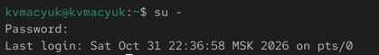{#fig-001 width=70%}


Просмотрел устройства PCI и связанные с ними драйверы ([рис. @fig-002]).

```bash
lspci -k
```

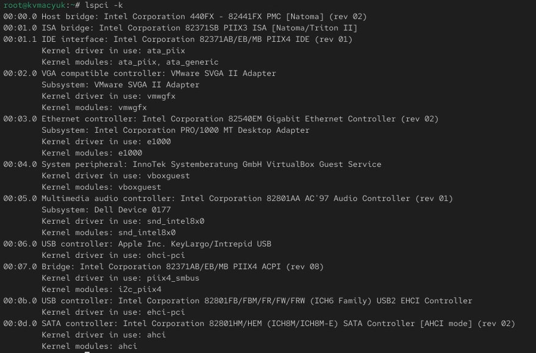{#fig-002 width=70%}

В системе обнаружены IDE-контроллер с драйвером `ata_piix`, графический адаптер VMware SVGA II с `vmwgfx`, сетевой адаптер Intel 82540EM с `e1000`, устройство VirtualBox Guest Service с `vboxguest`, звуковой контроллер с `snd_intel8x0` и SATA-контроллер с `ahci`. Для USB-контроллеров используются `ohci-pci` и `ehci-pci`.

Строка `Kernel driver in use` показывает действующий драйвер, а `Kernel modules` — подходящие модули. Для моста PIIX4 ACPI указан драйвер `piix4_smbus` и модуль `i2c_piix4`: имя драйвера не обязательно совпадает с именем модуля.

Просмотрел загруженные модули ядра и отсортировал вывод ([рис. @fig-003]).

```bash
lsmod | sort
```

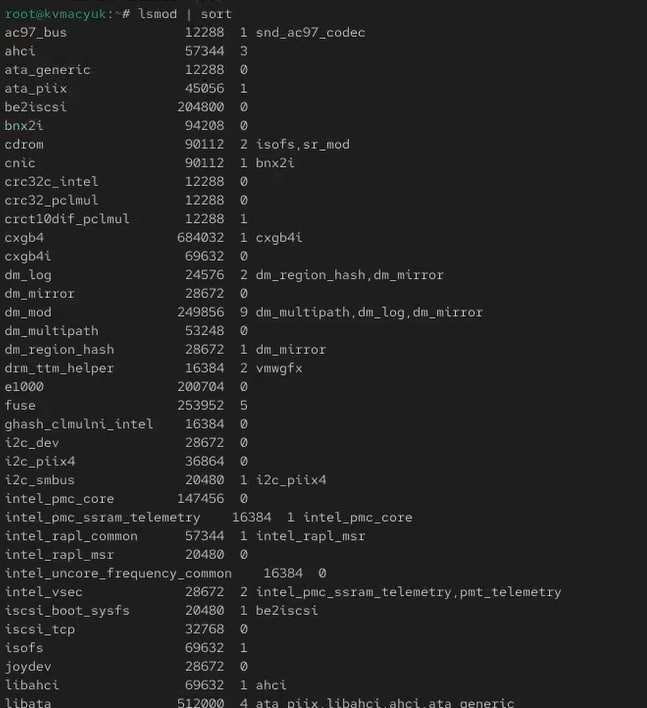{#fig-003 width=55%}

В представленном фрагменте видны, в частности, `ahci`, `ata_piix`, `e1000`, `fuse` и модули подсистемы device mapper. Столбцы вывода содержат имя модуля, размер, счётчик использования и имена зависимых модулей. Например, `drm_ttm_helper` используется модулем `vmwgfx`. На снимке показана часть отсортированного списка.

Проверил наличие ext4, загрузил модуль и повторил проверку ([рис. @fig-004]).

```bash
lsmod | grep ext4
modprobe ext4
lsmod | grep ext4
```

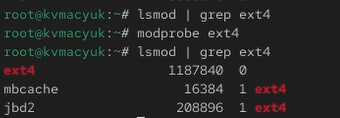{#fig-004 width=70%}

До загрузки фильтр не вывел строк. После `modprobe ext4` в списке появился `ext4` размером 1187840 байт со счётчиком использования 0. Также показаны зависимости `mbcache` и `jbd2`, используемые модулем ext4.

Просмотрел информацию о модуле ext4 ([рис. @fig-005]).

```bash
modinfo ext4
```

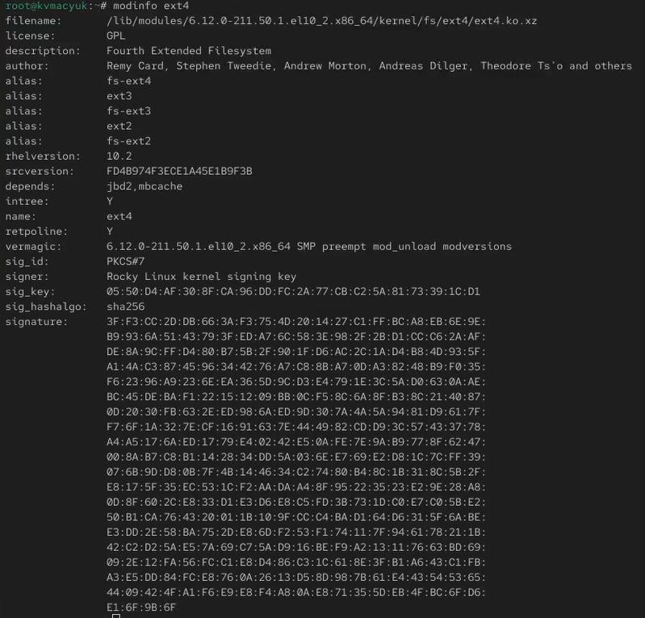{#fig-005 width=55%}

Файл модуля расположен в `/lib/modules/6.12.0-211.50.1.el10_2.x86_64/kernel/fs/ext4/ext4.ko.xz`. Поле `license` содержит GPL, а `description` — Fourth Extended Filesystem. Поля `author` перечисляют авторов; `alias` содержит альтернативные имена, связанные с файловыми системами ext2, ext3 и ext4.

Поле `depends` указывает зависимости `jbd2,mbcache`, `intree: Y` — принадлежность исходному дереву ядра. Строка `vermagic` содержит сведения о совместимости с ядром `6.12.0-211.50.1.el10_2.x86_64`. Поля `sig_id`, `signer`, `sig_key`, `sig_hashalgo` и `signature` описывают подпись модуля: указан ключ Rocky Linux kernel signing key и алгоритм sha256. В представленном выводе строки `parm` отсутствуют: параметры модуля не перечислены.

Выгрузил ext4 и проверил список модулей ([рис. @fig-006]).

```bash
modprobe -r ext4
lsmod | grep ext4
```

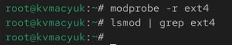{#fig-006 width=70%}

Команда завершилась без сообщения об ошибке, а повторная проверка не вывела строк. Модуль ext4 успешно выгружен; повторять команду не потребовалось.

Попробовал выгрузить модуль xfs ([рис. @fig-007]).

```bash
modprobe -r xfs
```

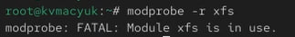{#fig-007 width=70%}

Получил сообщение `modprobe: FATAL: Module xfs is in use.` Модуль используется системой, поэтому выгрузка отклонена. Принудительную выгрузку не выполнял.

## Загрузка модулей ядра с параметрами

Проверил наличие bluetooth, загрузил модуль и повторил просмотр списка ([рис. @fig-008]).

```bash
lsmod | grep bluetooth
modprobe bluetooth
lsmod | grep bluetooth
```

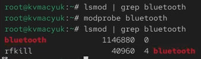{#fig-008 width=70%}

Первоначально фильтр не вывел строк. После загрузки появился `bluetooth` размером 1146880 байт со счётчиком использования 0. В выводе также показан модуль `rfkill`, используемый bluetooth.

Просмотрел сведения о bluetooth и поддерживаемых параметрах ([рис. @fig-009]).

```bash
modinfo bluetooth
```

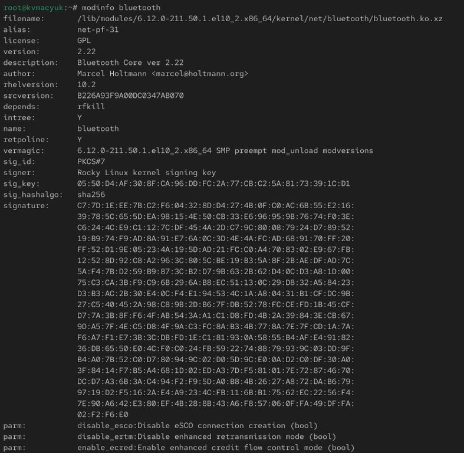{#fig-009 width=55%}

В выводе указаны версия 2.22, описание Bluetooth Core ver 2.22, лицензия GPL и зависимость `rfkill`. Модуль находится в каталоге `kernel/net/bluetooth/` для ядра `6.12.0-211.50.1.el10_2.x86_64` и подписан ключом Rocky Linux.

В строках `parm` перечислены три логических параметра:

- `disable_esco` — отключение создания eSCO-соединений;
- `disable_ertm` — отключение режима Enhanced Retransmission Mode;
- `enable_ecred` — включение режима Enhanced Credit Based Flow Control.

Параметры допускают настройку поведения модуля при загрузке. В соответствии с последовательностью методических указаний в этом опыте рассмотрел их назначение без изменения значений.

Выгрузил bluetooth и проверил результат ([рис. @fig-010]).

```bash
modprobe -r bluetooth
lsmod | grep bluetooth
```

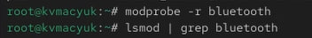{#fig-010 width=70%}

Повторная проверка не вывела строк; модуль bluetooth успешно выгружен.

## Обновление ядра системы

Определил версию работающего ядра перед обновлением ([рис. @fig-011]).

```bash
uname -r
```

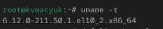{#fig-011 width=70%}

До обновления использовалось ядро `6.12.0-211.50.1.el10_2.x86_64`.

Просмотрел установленные и доступные пакеты kernel ([рис. @fig-012]).

```bash
dnf list kernel
```

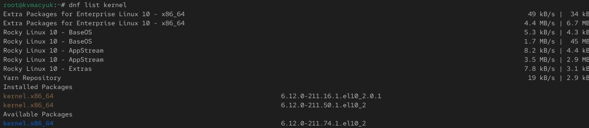{#fig-012 width=70%}

В разделе установленных пакетов указаны версии `6.12.0-211.16.1.el10_2.0.1` и `6.12.0-211.50.1.el10_2`. В разделе доступных пакетов предложена новая версия `6.12.0-211.74.1.el10_2` для архитектуры x86_64.

Запустил обновление системы с обновлением метаданных репозиториев ([рис. @fig-013]).

```bash
dnf upgrade --refresh
```

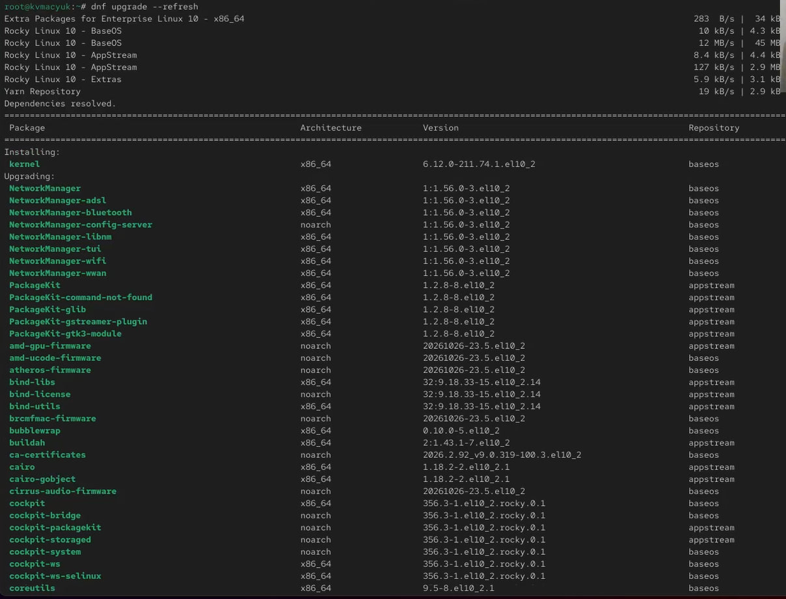{#fig-013 width=70%}

В списке транзакции предложена установка `kernel` версии `6.12.0-211.74.1.el10_2`, а также обновление NetworkManager, PackageKit и других пакетов. На снимке показан перечень изменений. Результат установки нового ядра подтвердил после перезагрузки.

После общего обновления отдельно проверил обновление пакета kernel ([рис. @fig-014]).

```bash
dnf update kernel
```

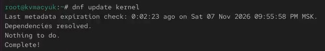{#fig-014 width=70%}

DNF вывел `Nothing to do` и `Complete!`: дополнительных обновлений ядра на этом этапе не потребовалось. Новая версия уже была установлена при общем обновлении системы.

Перезагрузил систему для перехода на установленное ядро ([рис. @fig-015]).

```bash
reboot
```

{#fig-015 width=70%}


После перезагрузки проверил версию работающего ядра ([рис. @fig-016]).

```bash
uname -r
```

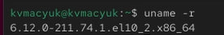{#fig-016 width=70%}

Команда вывела `6.12.0-211.74.1.el10_2.x86_64`. По сравнению с исходной версией `6.12.0-211.50.1.el10_2.x86_64` версия изменилась. Таким образом, установка и загрузка нового ядра подтверждены.

Дополнительно проверил наличие обновлений всех пакетов системы ([рис. @fig-017]).

```bash
dnf update
```

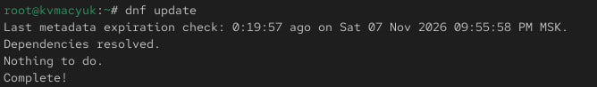{#fig-017 width=70%}

Команда завершилась сообщениями `Nothing to do` и `Complete!`: при текущих настройках репозиториев дополнительных обновлений не потребовалось.

Просмотрел подробные сведения о системе командой `hostnamectl` ([рис. @fig-018]).

```bash
hostnamectl
```

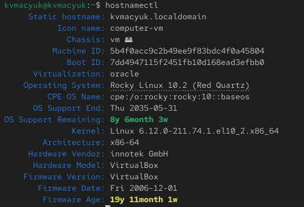{#fig-018 width=70%}

В выводе указаны имя узла `kvmacyuk.localdomain`, операционная система Rocky Linux 10.2 (Red Quartz), архитектура x86-64 и ядро `6.12.0-211.74.1.el10_2.x86_64`. Значения `Chassis: vm`, `Virtualization: oracle` и `Hardware Model: VirtualBox` подтверждают выполнение работы в виртуальной машине. Версия ядра совпадает с результатом `uname -r` после перезагрузки.

# Ответы на контрольные вопросы

**1. Какая команда показывает текущую версию ядра, которая используется на вашей системе?**

```bash
uname -r
```

Она показывает версию работающего ядра, а не список установленных пакетов.

**2. Как можно посмотреть более подробную информацию о текущей версии ядра операционной системы?**

```bash
uname -a
cat /proc/version
hostnamectl
```

uname -a выводит расширенные сведения о ядре и системе, /proc/version содержит строку версии и сведения о сборке, hostnamectl — общие сведения об ОС, ядре и машине.

**3. Какая команда показывает список загруженных модулей ядра?**

Команда `lsmod`. Встроенные в ядро компоненты в этом списке не отображаются.

**4. Какая команда позволяет вам определять параметры модуля ядра?**

Для задания значений при загрузке применяется modprobe, например:

```bash
modprobe bluetooth disable_ertm=1
```

Для просмотра доступных параметров используется `modinfo -p bluetooth`. Уже загруженный модуль обычный вызов modprobe с новыми аргументами не перенастраивает; для такого способа изменения параметра сначала требуется безопасно выгрузить модуль.

**5. Как выгрузить модуль ядра?**

```bash
modprobe -r имя_модуля
```

Альтернатива — rmmod, но modprobe учитывает зависимости и может удалить также неиспользуемые зависимости модуля.

**6. Что вы можете сделать, если получите сообщение об ошибке при попытке выгрузить модуль ядра?**

Сначала прочитать конкретную ошибку: модуль может быть занят, отсутствовать, быть встроенным или выгрузка может быть запрещена. Для занятого модуля проверить зависимости через lsmod и использование соответствующих устройств или файловых систем. После освобождения ресурсов повторить попытку. Завершения произвольных процессов недостаточно для освобождения смонтированной файловой системы. Если модуль нужен корневой файловой системе, оставить его загруженным; обычная перезагрузка в ту же систему не делает его ненужным. Принудительную выгрузку не использовать.

**7. Как определить, какие параметры модуля ядра поддерживаются?**

```bash
modinfo -p имя_модуля
```

В полном выводе modinfo они также перечисляются в строках parm. Текущие значения параметров, экспортированных в sysfs, находятся в `/sys/module/имя_модуля/parameters/`. Файлы `/etc/modprobe.d/` задают настройки, но не являются полным перечнем поддерживаемых параметров.

**8. Как установить новую версию ядра?**

При наличии обновления в настроенных репозиториях выполнить:

```bash
dnf upgrade --refresh kernel
```

Для обновления всей системы применяется `dnf upgrade --refresh`. После успешной установки перезагрузить систему, загрузить нужную версию и проверить её через `uname -r`. Если новое ядро недоступно, команда не сможет создать обновление и сообщит об отсутствии действий.

# Выводы

В ходе работы изучил связь устройств PCI с драйверами, просмотрел загруженные модули и их метаданные. Отработал загрузку и проверку выгрузки ext4 и bluetooth, рассмотрел ограничения на удаление занятого модуля и назначение поддерживаемых параметров bluetooth. Обновил ядро с версии `6.12.0-211.50.1.el10_2.x86_64` до `6.12.0-211.74.1.el10_2.x86_64` и после перезагрузки подтвердил работу новой версии.

# Список литературы{.unnumbered}

::: {#refs}
:::
