---
## Author
author:
  name: Мацюк Константин Владимирович
  degrees: BSc
  orcid: 0000-0002-0877-7063
  email: 1032253640@rudn.ru
  affiliation:
    - name: Российский университет дружбы народов
      country: Российская Федерация
      postal-code: 117198
      city: Москва
      address: ул. Миклухо-Маклая, д. 6

## Title
title: "Лабораторная работа №11. Управление загрузкой системы"
subtitle: "Дисциплина: Основы администрирования операционных систем"
license: "CC BY"

## Fonts
mainfont: IBM Plex Serif
romanfont: IBM Plex Serif
sansfont: IBM Plex Sans
monofont: DejaVu Sans Mono
mathfont: STIX Two Math
mainfontoptions: Ligatures=Common,Ligatures=TeX,Scale=0.94
romanfontoptions: Ligatures=Common,Ligatures=TeX,Scale=0.94
sansfontoptions: Ligatures=Common,Ligatures=TeX,Scale=MatchLowercase,Scale=0.94
monofontoptions: Scale=MatchLowercase,Scale=0.94
---

# Цель работы

Получить навыки работы с загрузчиком системы GRUB2.

# Задание

1. Продемонстрировать навыки изменения параметров GRUB и записи изменений в файл конфигурации.
2. Продемонстрировать навыки устранения неполадок при работе с GRUB.
3. Изучить процедуру сброса пароля root через среду восстановления.

# Теоретическое введение

GRUB2 — загрузчик, позволяющий выбрать ядро операционной системы, загрузить ядро и initramfs и передать параметры запуска. Общие настройки хранятся в `/etc/default/grub`. Итоговая конфигурация `/boot/grub2/grub.cfg` формируется командой `grub2-mkconfig` на основе этих настроек и сценариев каталога `/etc/grub.d`.

Параметр `GRUB_TIMEOUT` задаёт время ожидания перед автоматической загрузкой выбранного пункта при отображении меню. Параметры ядра `rhgb` и `quiet` управляют графическим оформлением и подробностью сообщений загрузки.

Клавиша `e` в меню GRUB открывает редактор выбранного пункта. Изменения в этом редакторе действуют на одну загрузку, которая запускается сочетанием `Ctrl+X`. Параметр `systemd.unit=rescue.target` выбирает базовую среду восстановления, а `systemd.unit=emergency.target` — минимальную аварийную среду.

Команда `systemctl list-units` показывает юниты systemd, их состояние и описание. Команда `systemctl show-environment` выводит окружение менеджера systemd. Параметр `rd.break` останавливает загрузку в initramfs перед переходом к установленной системе; её корневая файловая система доступна через `/sysroot`. Команда `chroot` позволяет использовать этот каталог в качестве корня для последующих команд, в том числе `passwd`.

# Выполнение лабораторной работы

## Модификация параметров GRUB2

Запустил терминал и получил полномочия администратора ([рис. @fig-001]).

```bash
su -
```

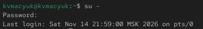{#fig-001 width=70%}

В редакторе nano открыл `/etc/default/grub` и установил `GRUB_TIMEOUT=10` ([рис. @fig-002]).

```bash
nano /etc/default/grub
```

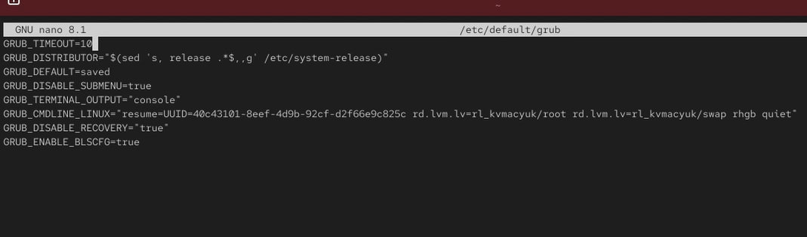{#fig-002 width=70%}

Сохранил значение времени ожидания меню 10 секунд. В исходной строке `GRUB_CMDLINE_LINUX` присутствовали параметры `rhgb quiet`.

Сформировал конфигурацию загрузчика с учётом сохранённых настроек ([рис. @fig-003]).

```bash
grub2-mkconfig -o /boot/grub2/grub.cfg
```

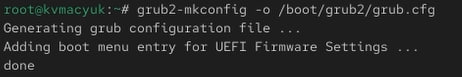{#fig-003 width=70%}

В выводе отображены генерация конфигурации, добавление пункта UEFI Firmware Settings и сообщение `done`.

Повторно открыл `/etc/default/grub` и удалил `rhgb` и `quiet` из строки `GRUB_CMDLINE_LINUX` ([рис. @fig-004]).

```bash
nano /etc/default/grub
```

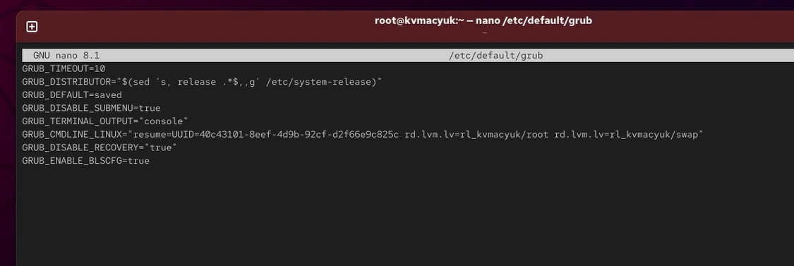{#fig-004 width=70%}

Остальные параметры сохранил: идентификатор раздела для возобновления работы и параметры логических томов root и swap. Значение `GRUB_TIMEOUT=10` осталось неизменным.

Повторно сформировал конфигурацию GRUB2 ([рис. @fig-005]).

```bash
grub2-mkconfig -o /boot/grub2/grub.cfg
```

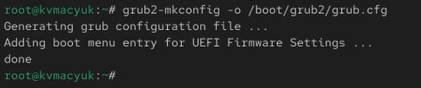{#fig-005 width=70%}

Генерация завершилась сообщением `done`.

Перезапустил систему и наблюдал запуск загрузчика ([рис. @fig-006]).

{#fig-006 width=55%}

На экране отобразились сообщения `GRUB loading.` и `Welcome to GRUB!`.


## Загрузка в режиме восстановления

В меню GRUB выбрал ядро, нажал `e` и добавил в строку `linux` параметр `systemd.unit=rescue.target` ([рис. @fig-007]).

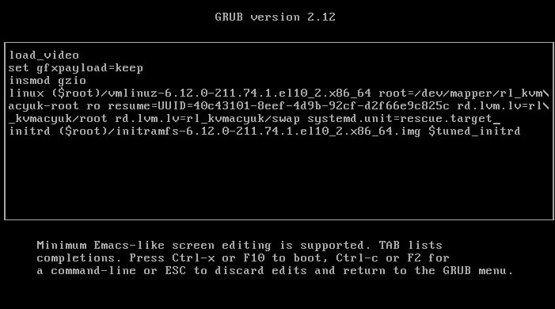{#fig-007 width=70%}

На снимке указан GRUB 2.12 и ядро `6.12.0-211.74.1.el10_2.x86_64`. Продолжил загрузку сочетанием `Ctrl+X`.

В режиме восстановления просмотрел юниты systemd ([рис. @fig-008]).

```bash
systemctl list-units
```

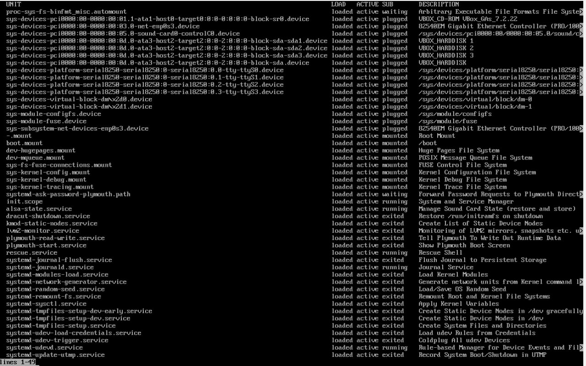{#fig-008 width=70%}

В представленном фрагменте видны точки монтирования `/` и `/boot`, службы `systemd-journald`, `systemd-udevd`, `lvm2-monitor` и активная `rescue.service` с описанием Rescue Shell. Столбцы `LOAD`, `ACTIVE` и `SUB` отражают состояние юнитов. Внизу указан диапазон показанных строк `1–49`, а не общее число юнитов.

Просмотрел переменные окружения менеджера systemd ([рис. @fig-009]).

```bash
systemctl show-environment
```

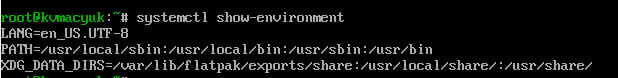{#fig-009 width=70%}

Выведены `LANG=en_US.UTF-8`, `PATH` и `XDG_DATA_DIRS`. Они задают локаль, пути поиска исполняемых программ и каталоги данных соответственно.

Выполнил перезагрузку после проверки режима восстановления ([рис. @fig-010]).

```bash
systemctl reboot
```

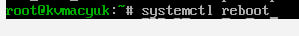{#fig-010 width=70%}


## Загрузка в аварийном режиме

Снова открыл редактор пункта GRUB и добавил в строку ядра `systemd.unit=emergency.target` ([рис. @fig-011]).

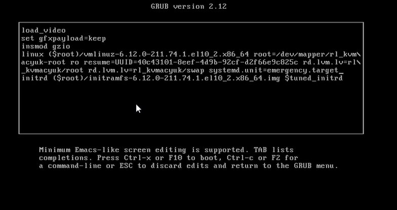{#fig-011 width=70%}

Продолжил загрузку сочетанием `Ctrl+X`.

Дождался перехода в аварийный режим и приглашения для ввода пароля root ([рис. @fig-012]).

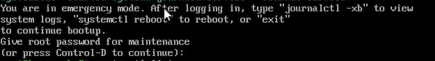{#fig-012 width=70%}

На экране отображено сообщение `You are in emergency mode` и запрос `Give root password for maintenance`.

После входа просмотрел юниты systemd в аварийном режиме ([рис. @fig-013]).

```bash
systemctl list-units
```

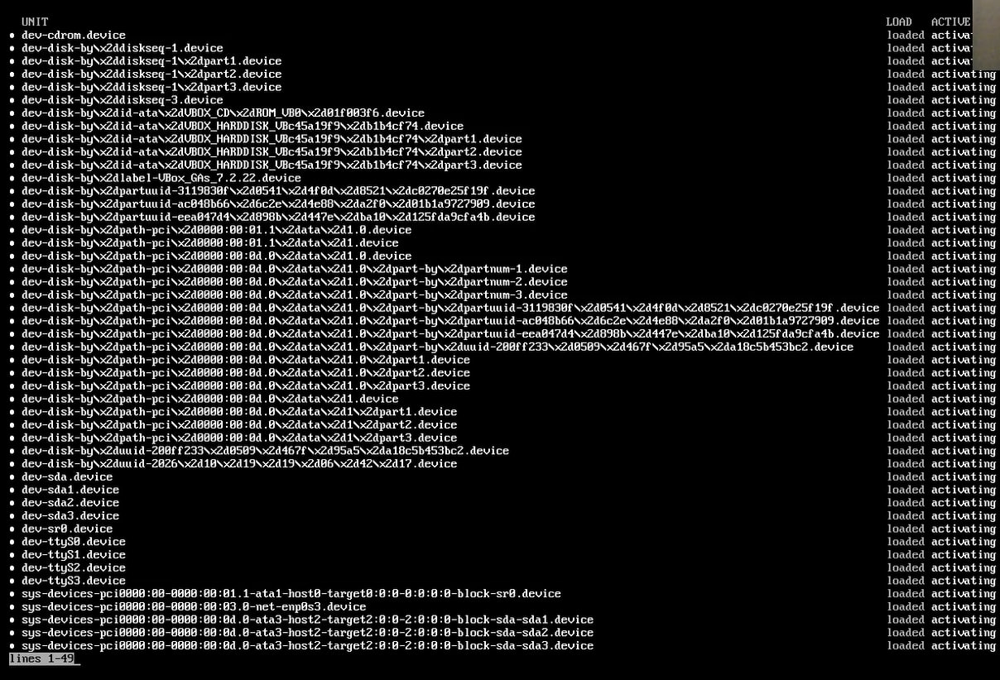{#fig-013 width=55%}

На снимке показан фрагмент списка, преимущественно содержащий юниты устройств: диски, разделы, консоли и сетевой адаптер. Часть устройств имеет состояние `active`, часть — `activating`. Показан диапазон строк `1–49`; по этому фрагменту нельзя определить полное число юнитов для численного сравнения с rescue.

Перезагрузил систему после проверки аварийного режима ([рис. @fig-014]).

```bash
systemctl reboot
```

{#fig-014 width=70%}


## Изменение пароля root

В редакторе пункта GRUB добавил в конец строки ядра параметр `rd.break` ([рис. @fig-015]).

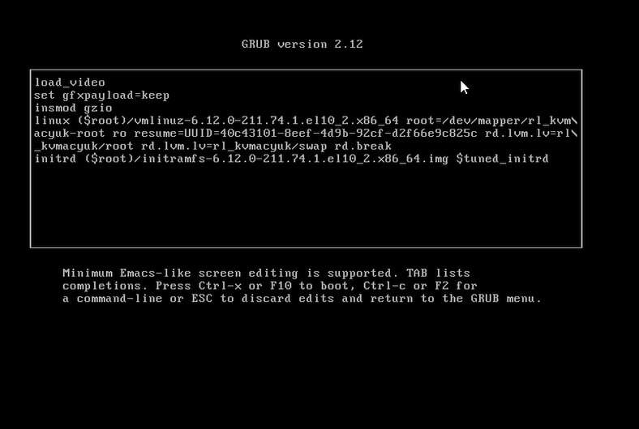{#fig-015 width=55%}

Продолжил загрузку сочетанием `Ctrl+X` для перехода к этапу работы в initramfs.

В оболочке выполнил команду перемонтирования `/sysroot` в режим чтения и записи ([рис. @fig-016]).

```bash
mount -o remount,rw /sysroot
```

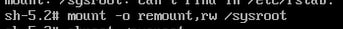{#fig-016 width=70%}

Опция `remount,rw` задаёт повторное монтирование с разрешением записи.

Сделал `/sysroot` корневым каталогом для последующих команд ([рис. @fig-017]).

```bash
chroot /sysroot
```

{#fig-017 width=70%}

Задал новый пароль root с помощью команды `passwd` ([рис. @fig-018]).

```bash
passwd
```

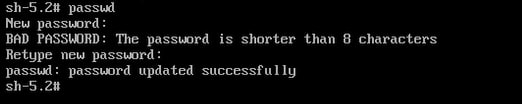{#fig-018 width=70%}

После повторного ввода пароля команда сообщила `passwd: password updated successfully`.

Загрузил политику SELinux ([рис. @fig-019]).

```bash
load_policy -i
```

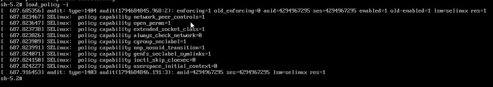{#fig-019 width=70%}

В выводе отображены сведения о возможностях политики и запись `enforcing=1 old_enforcing=0`.

Ввёл предусмотренную методическими указаниями команду `chcon` ([рис. @fig-020]).

```bash
chcon -t shadow_t /etc/shadow
```

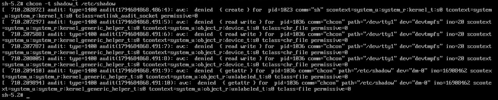{#fig-020 width=70%}

В оболочке ввёл команду перезагрузки ([рис. @fig-021]).

```bash
reboot -f
```

{#fig-021 width=70%}

После последующей загрузки системы выполнил вход в учётную запись root из терминала обычного пользователя ([рис. @fig-022]).

```bash
su -
```

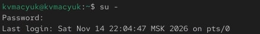{#fig-022 width=70%}

На снимке после запроса пароля отображена строка последнего входа `Last login`.

# Ответы на контрольные вопросы

**1. Какой файл конфигурации следует изменить для применения общих изменений в GRUB2?**

Файл `/etc/default/grub`. В нём задаются общие параметры, в частности `GRUB_TIMEOUT` и `GRUB_CMDLINE_LINUX`.

**2. Как называется конфигурационный файл GRUB2, в котором применяются изменения для GRUB2?**

В рассматриваемой системе итоговая конфигурация находится в `/boot/grub2/grub.cfg`. Она генерируется автоматически; постоянные общие настройки следует задавать в исходных файлах, а не исправлять вручную сгенерированный результат.

**3. После внесения изменений в конфигурацию GRUB2 какую команду следует выполнить, чтобы изменения сохранились и воспринимались при загрузке системы?**

```bash
grub2-mkconfig -o /boot/grub2/grub.cfg
```

В системах с BLS при изменении параметров ядра для существующих записей может потребоваться вариант:

```bash
grub2-mkconfig -o /boot/grub2/grub.cfg --update-bls-cmdline
```

Применение настроек проверяется при последующей загрузке.

# Выводы

В ходе работы настроил время ожидания меню GRUB2, изменил параметры ядра и сформировал конфигурацию загрузчика. Изучил загрузку с `rescue.target` и `emergency.target`, просмотрел юниты systemd и окружение менеджера. Выполнил изменение пароля root с использованием `/sysroot`, `chroot` и `passwd`, а после последующей загрузки выполнил вход через `su -`.

# Список литературы{.unnumbered}

1. Кулябов Д. С., Королькова А. В. Основы администрирования операционных систем. Лабораторная работа №11 «Управление загрузкой системы»

::: {#refs}
:::
