---
## Author
author:
  name: Мацюк Константин Владимирович
  degrees: BSc
  orcid: 0000-0002-0877-7063
  email: 1032253640@rudn.ru
  affiliation:
    - name: Российский университет дружбы народов
      country: Российская Федерация
      postal-code: 117198
      city: Москва
      address: ул. Миклухо-Маклая, д. 6

## Title
title: "Презентация по прохождению 1 этапа онлайн-курса"
subtitle: "Системный администратор Linux с нуля"
license: "CC BY"

## Fonts
mainfont: IBM Plex Serif
romanfont: IBM Plex Serif
sansfont: IBM Plex Sans
monofont: DejaVu Sans Mono
mathfont: STIX Two Math
mainfontoptions: Ligatures=Common,Ligatures=TeX,Scale=0.94
romanfontoptions: Ligatures=Common,Ligatures=TeX,Scale=0.94
sansfontoptions: Ligatures=Common,Ligatures=TeX,Scale=MatchLowercase,Scale=0.94
monofontoptions: Scale=MatchLowercase,Scale=0.94
incremental: false
slide-level: 2
lang: ru-RU

---

# Цель работы

## Цель работы

Получить базовые навыки работы в командной строке Linux, изучить файловую структуру и принцип «всё есть файл», освоить управление файлами и каталогами, работу с архивами, команды передачи данных, написание Bash-скриптов и настройку расписания cron.

# Задание

## Задание

Выполнить практические упражнения и тестовые задания первого этапа онлайн-курса «Системный администратор Linux с нуля», зафиксировать команды, выбранные ответы и результаты на скриншотах.

# Выполнение работы

## Организация работы

Практические упражнения выполнил в среде Rocky Linux под учётной записью `kvmacyuk`. Для административных действий использовал `sudo` или оболочку root. Теоретические вопросы и практические действия сгруппировал по темам курса.

# Роль системного администратора Linux

## Обязанности администратора

В тестовом задании выбрал ответ «Мониторинг состояния серверов». Контроль доступности и состояния серверов относится к задачам системного администратора.

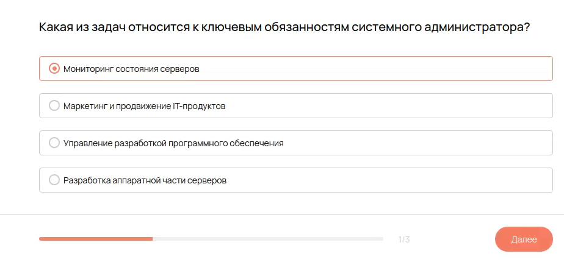{#fig-001 width=36%}

## Обязанности администратора — дополнительный снимок

Дополнительно зафиксировал тот же выбранный ответ на снимке из записи прохождения теста.

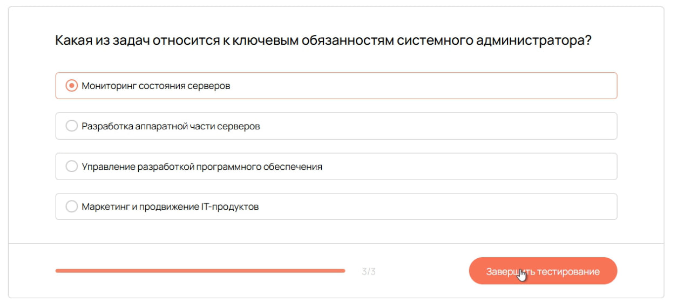{#fig-002 width=38%}

## Инструмент мониторинга

В тестовом задании выбрал ответ «Zabbix». Этот вариант соответствует специализированному инструменту мониторинга; Puppet относится к управлению конфигурациями, Exim — к почтовым службам.

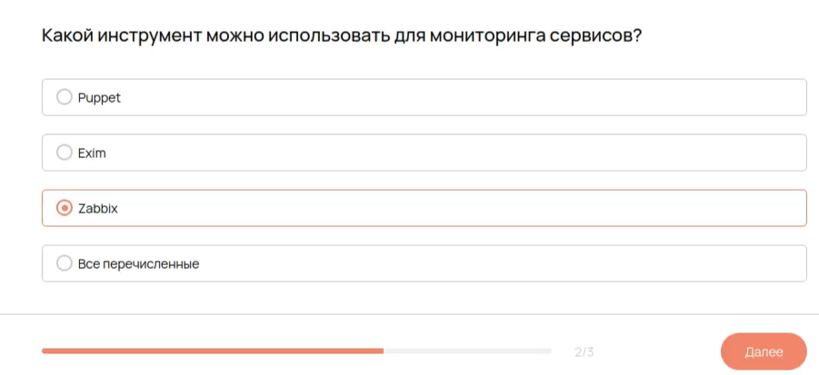{#fig-003 width=37%}

## Инструмент мониторинга — дополнительный снимок

Дополнительно зафиксировал тот же выбранный ответ на снимке из записи прохождения теста.

## Инструмент мониторинга — дополнительный снимок — снимок экрана

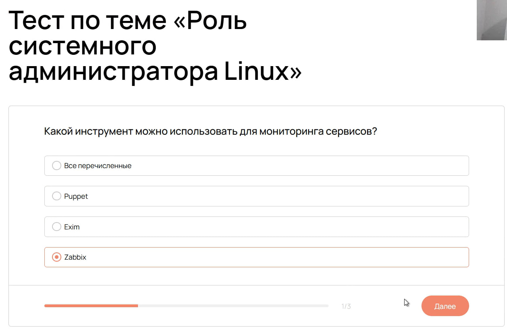{#fig-004 width=47%}

## Философия свободного ПО

В тестовом задании выбрал ответ «Возможность модификации программы под свои задачи без нарушения авторских прав». Свобода изменения программы определяется условиями лицензии и не равнозначна только отсутствию платы.

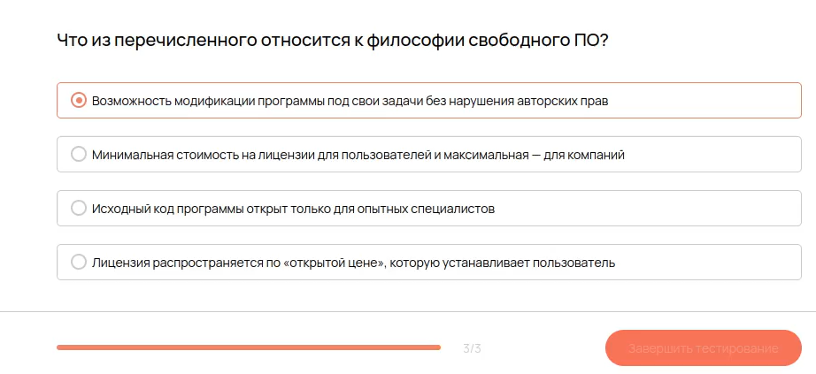{#fig-005 width=37%}

## Философия свободного ПО — дополнительный снимок

Дополнительно зафиксировал тот же выбранный ответ на снимке из записи прохождения теста.

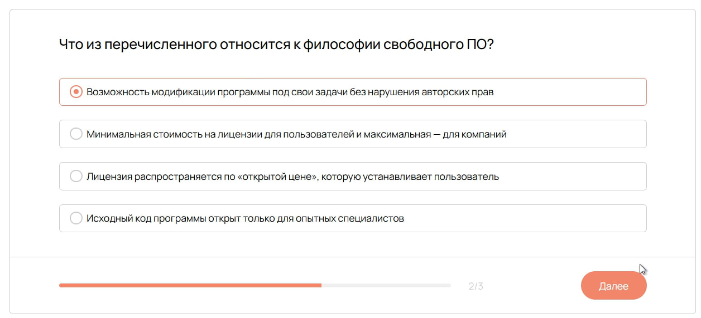{#fig-006 width=37%}

# Вводный урок

## Установка htop

Установил утилиту `htop` командой `sudo dnf install htop`. В транзакцию вошли `htop`, `hwloc-libs` и `ocl-icd`. Использовал пакетный менеджер DNF, соответствующий Rocky Linux. Работоспособность утилиты проверил её запуском.

## Установка htop — снимок экрана

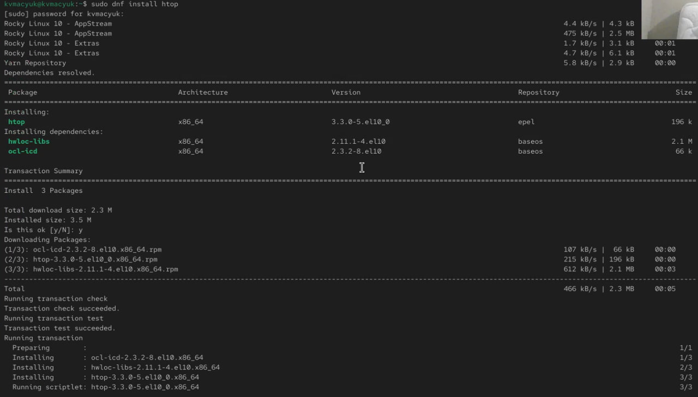{#fig-007 width=54%}

## Просмотр процессов в htop

Запустил `htop` и рассмотрел таблицу процессов с колонками PID, USER, CPU%, MEM% и Command. На снимке выделена колонка MEM%; для `gnome-shell` показано потребление памяти 4,3%. Несколько строк относятся к потокам процесса: их значения памяти нельзя просто суммировать.

## Просмотр процессов в htop — снимок экрана

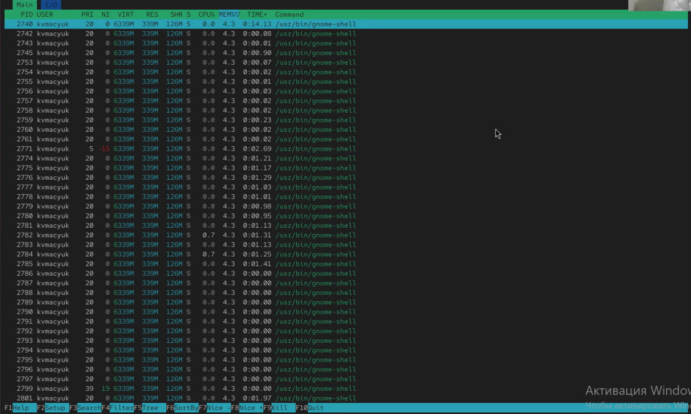{#fig-008 width=51%}

## Использование дискового пространства

Выполнил `df -h` для просмотра размеров файловых систем в удобном формате. Корневая файловая система имеет размер 16G, занято 9.4G, доступно 6.6G, использование — 59%. Для `/boot` указаны размер 2.0G и использование 28%.

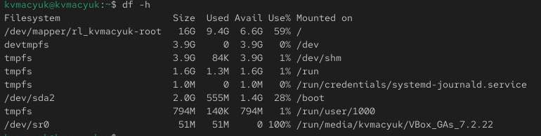{#fig-009 width=67%}

## Размеры каталогов в /var

Выполнил `du -sh /var/*`. Ключ `-s` выводит суммарный размер каждого каталога, `-h` — удобные единицы измерения. Среди показанных значений наибольшие у `/var/cache` — 851M, `/var/log` — 617M и `/var/lib` — 209M.

## Размеры каталогов в /var — снимок экрана

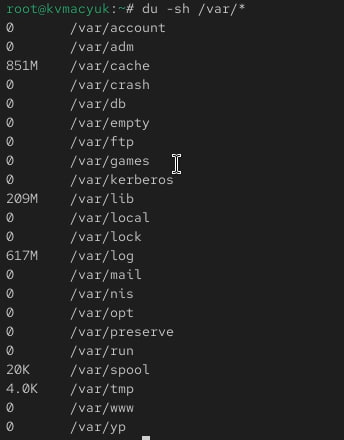{#fig-010 width=24%}

## Справочная информация

В тестовом задании выбрал ответ «man». Команда открывает страницы руководства; apropos предназначен для поиска по кратким описаниям, а help — прежде всего для встроенных команд оболочки.

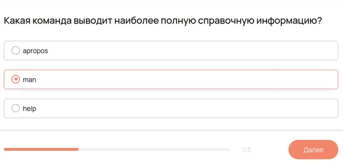{#fig-011 width=35%}

## Повышенные привилегии

В тестовом задании выбрал ответ «Для выполнения административной задачи». Повышенные права необходимы, например, при установке пакетов или изменении системных настроек.

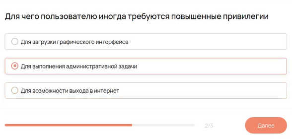{#fig-012 width=35%}

## Командная оболочка

В тестовом задании выбрал ответ «Bash». Bash является командной оболочкой и интерпретирует введённые команды и сценарии.

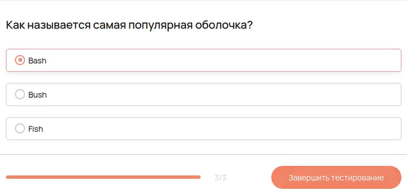{#fig-013 width=35%}

# Роль командной строки в серверной среде

## Сообщения ядра в журнале

Просмотрел сообщения ядра при загрузке. В показанном фрагменте видны версия Linux `6.12.0-211.74.1.el10_2.x86_64`, сведения о памяти, ACPI и оборудовании VirtualBox. Снимок фиксирует содержимое журнала; строка вызова команды в кадр не вошла.

## Сообщения ядра в журнале — снимок экрана

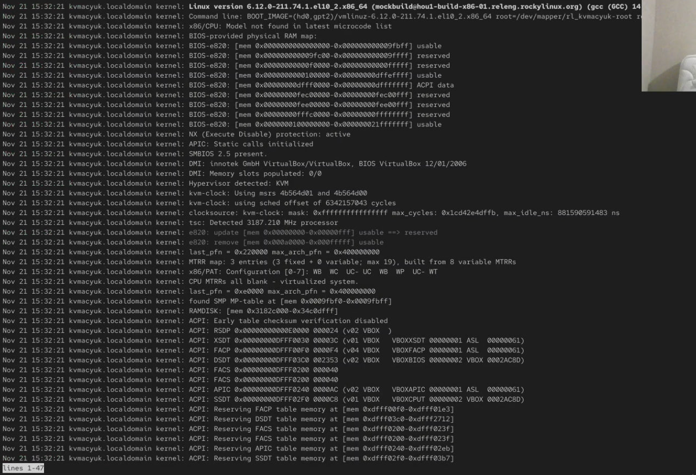{#fig-014 width=45%}

## Состояние службы SSH

Проверил службу командой `systemctl status sshd`. Служба находится в состоянии `active (running)`, автозапуск включён (`enabled`). В журнале указано прослушивание порта 22 на IPv4 и IPv6.

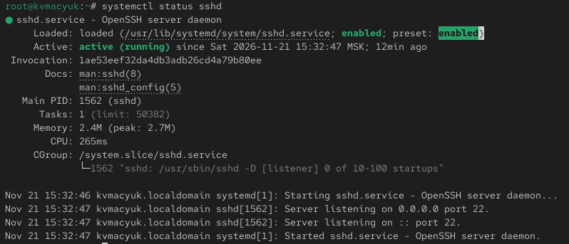{#fig-015 width=39%}

## Активные службы systemd

Выполнил `systemctl list-units --type=service --state=active`. В списке видны `sshd`, `crond`, `httpd`, `firewalld`, `NetworkManager` и другие службы. Состояние `active` включает как работающие процессы (`running`), так и юниты с состоянием `exited`, поэтому эти обозначения различаются.

## Активные службы systemd — снимок экрана

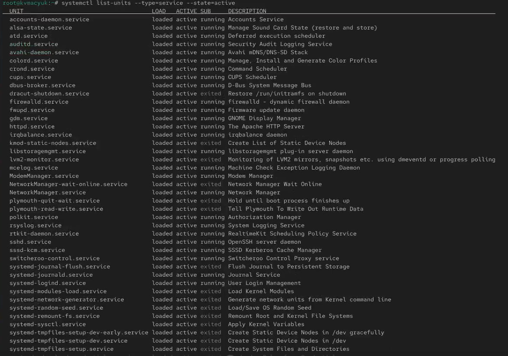{#fig-016 width=44%}

## Удалённое администрирование

В тестовом задании выбрал ответ «Дает безопасный канал для удаленной работы». SSH обеспечивает защищённое соединение для удалённой работы.

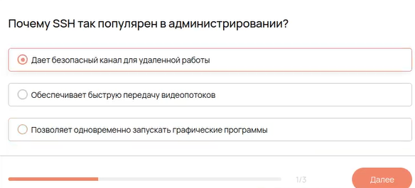{#fig-017 width=37%}

## Терминал и оболочка

В тестовом задании выбрал ответ «Терминал — это место ввода/вывода команд, оболочка — программа, которая их интерпретирует». Различил интерфейс взаимодействия с командной строкой и программу обработки команд.

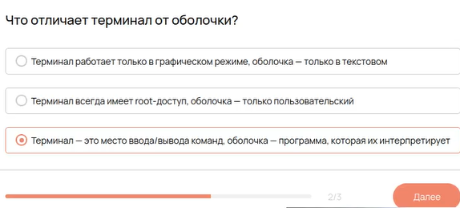{#fig-018 width=37%}

## Сервер без графического интерфейса

В тестовом задании выбрал ответ «Экономия ресурсов и повышение стабильности». Отсутствие необязательной графической среды сокращает потребление ресурсов и число обслуживаемых компонентов.

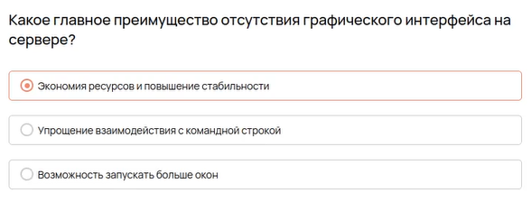{#fig-019 width=44%}

# Файловая структура и ключевые каталоги

## Поиск конфигурации SSH

Выполнил `ls /etc/*ssh*`. Маска выбрала каталоги `/etc/libssh` и `/etc/ssh`; в выводе видны `ssh_config`, `sshd_config`, каталоги дополнительных настроек и файлы ключей хоста.

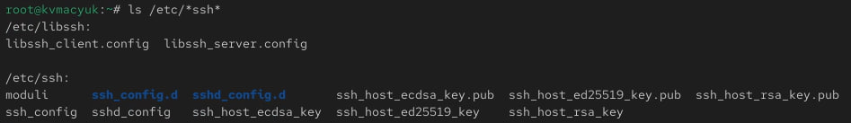{#fig-020 width=85%}

## Просмотр настроек клиента SSH

Открыл `/etc/ssh/ssh_config` в редакторе nano. Это общесистемная конфигурация клиента SSH. На снимке показаны комментарии о приоритете настроек и примеры параметров `Host`, `ForwardAgent`, `IdentityFile` и `Port`; строки с `#` являются комментариями.

## Просмотр настроек клиента SSH — снимок экрана

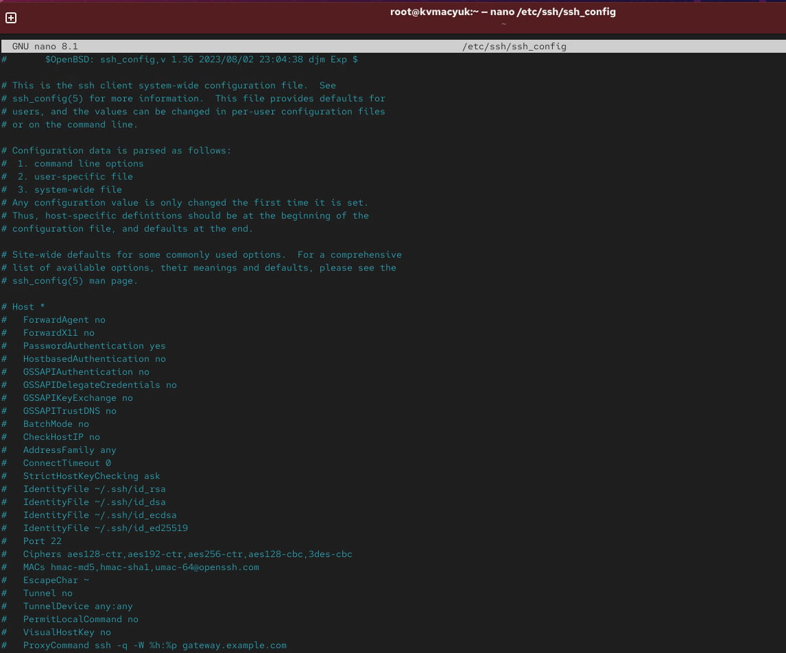{#fig-021 width=37%}

## Содержимое /var/log

Просмотрел каталог командой `ls /var/log`. В нём находятся `messages`, `secure`, `cron`, журналы DNF, каталоги `audit`, `journal`, `httpd` и другие файлы. Список соответствует используемой системе Rocky Linux.

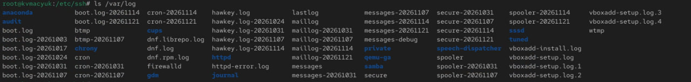{#fig-022 width=85%}

## Последние записи системного журнала

Выполнил `journalctl -n 20`. В выводе показаны записи ядра и `systemd-coredump`, связанные с `VBoxClient`. Многострочная запись может содержать сведения о модулях и трассировку стека, поэтому 20 записей журнала могут занимать значительно больше 20 строк экрана.

## Последние записи системного журнала — снимок экрана

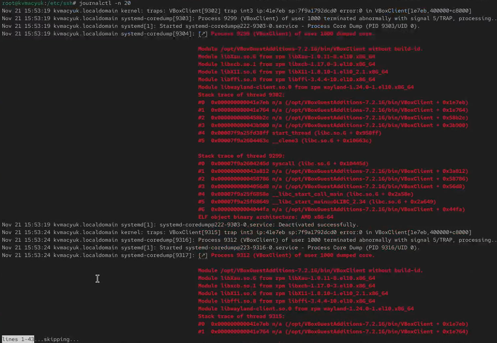{#fig-023 width=44%}

## Дополнительное ПО в /opt

Выполнил `ls /opt`. В каталоге обнаружен `VBoxGuestAdditions-7.2.16`, содержащий дополнительные компоненты гостевой системы VirtualBox.

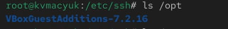{#fig-024 width=85%}

## Работа с конфигурацией Nginx

Перешёл в `/etc/nginx` и просмотрел содержимое с помощью `ls -l`. В списке присутствуют `nginx.conf`, `nginx.conf.backup` и дополнительные конфигурационные файлы. Открыл `nginx.conf` командой `sudo nano nginx.conf`, затем вызвал `systemctl reload nginx` для перечитывания конфигурации службой.

## Работа с конфигурацией Nginx — снимок экрана

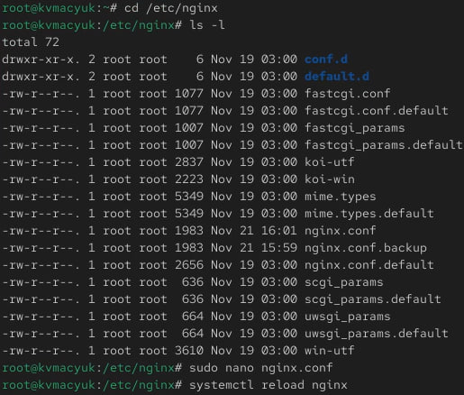{#fig-025 width=36%}

## Расположение конфигурации

В тестовом задании выбрал ответ «/etc». В этом каталоге обычно находятся общесистемные настройки служб.

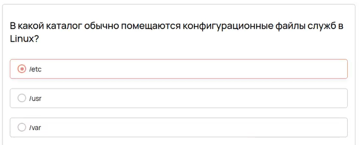{#fig-026 width=42%}

## Расположение журналов

В тестовом задании выбрал ответ «/var/log». Этот каталог используется для журналов системы и приложений.

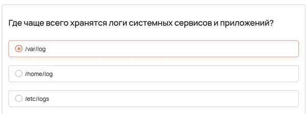{#fig-027 width=45%}

## Назначение /opt

В тестовом задании выбрал ответ «Дополнительное ПО, которое не входит в стандартные репозитории». В формулировке теста выбран этот вариант. Точнее, /opt предназначен для дополнительных программных пакетов; принадлежность репозиторию сама по себе не определяет путь установки.

## Назначение /opt — снимок экрана

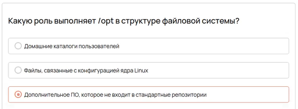{#fig-028 width=84%}

# Принцип «Всё есть файл»

## Сведения о процессоре из /proc

Выполнил `cat /proc/cpuinfo | head -n 10`. Вывод содержит сведения о процессоре GenuineIntel, модель `13th Gen Intel(R) Core(TM) i5-13500H`, частоту около 3187 МГц и размер кэша 18432 KB. Конвейер ограничивает вывод первыми десятью строками.

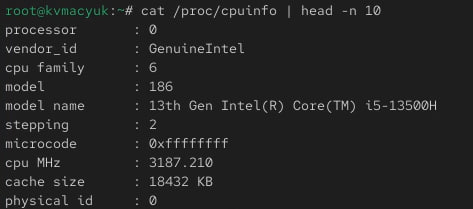{#fig-029 width=38%}

## Сведения об оперативной памяти

Прочитал `/proc/meminfo` командой `cat`. В момент снимка `MemTotal` составляет 8123036 kB, `MemFree` — 5029532 kB, `MemAvailable` — 6472920 kB. Доступная память учитывает возможность освобождения части кэшей, поэтому она отличается от полностью свободной. `SwapTotal` и `SwapFree` равны 2097148 kB.

## Сведения об оперативной памяти — снимок экрана

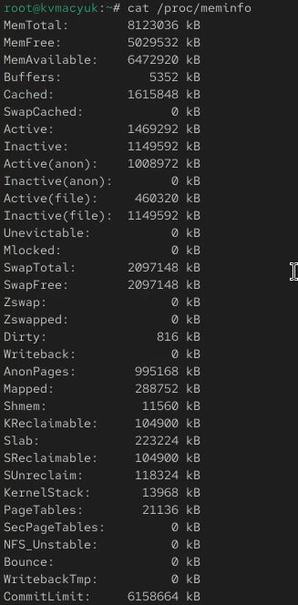{#fig-030 width=15%}

## Файлы устройств в /dev

Выполнил `ls -l /dev`. В выводе видны символьные устройства, например `console` и `full`, блочные устройства `dm-0` и `dm-1`, а также ссылки `cdrom -> sr0` и `core -> /proc/kcore`. Первый символ прав доступа `c` или `b` обозначает тип специального файла.

## Файлы устройств в /dev — снимок экрана

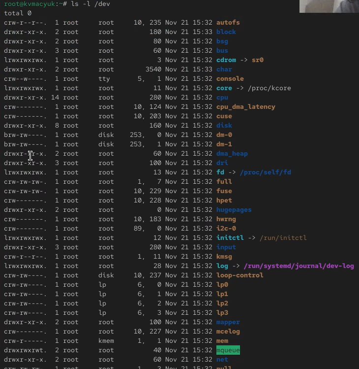{#fig-031 width=30%}

## Назначение /dev

В тестовом задании выбрал ответ «Для представления устройств в виде файлов». Специальные файлы устройств предоставляют интерфейс взаимодействия с ними.

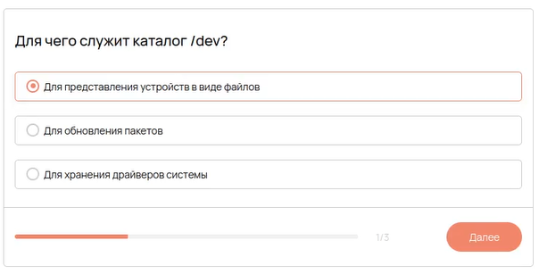{#fig-032 width=33%}

## Назначение /proc

В тестовом задании выбрал ответ «Состояние оперативной памяти и процессов «на лету»». Псевдофайловая система предоставляет динамические сведения о процессах и системе.

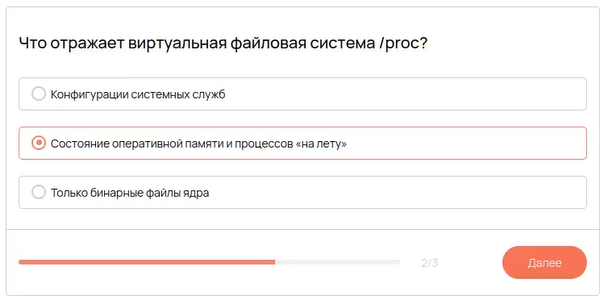{#fig-033 width=33%}

## Чтение данных

В тестовом задании выбрал ответ «cat». Команда подходит для чтения текстовых псевдофайлов, например /proc/cpuinfo; не все устройства в /dev содержат текстовые данные.

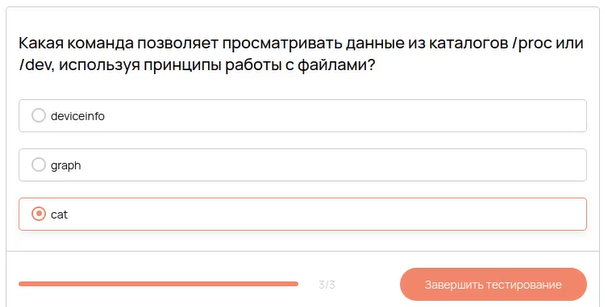{#fig-034 width=33%}

# Работа с базовыми командами в реальных условиях

## Текущий рабочий каталог

Выполнил `pwd` и получил путь `/home/kvmacyuk`. Команда показывает текущий рабочий каталог оболочки.

{#fig-035 width=85%}

## Отображение скрытых файлов

Выполнил `ls -a` в домашнем каталоге. Вместе с обычными каталогами отображены скрытые элементы `.bashrc`, `.bash_profile`, `.config`, `.ssh` и другие имена, начинающиеся с точки.

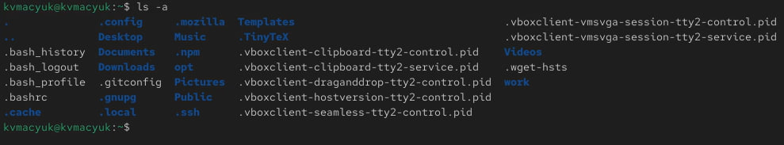{#fig-036 width=85%}

## Фильтрация системного журнала

Выполнил `sudo journalctl --no-pager | grep systemd | tail -n 10`. Команда `journalctl` выводит журнал без постраничного просмотра, `grep` оставляет строки с `systemd`, а `tail` показывает последние десять отфильтрованных строк. В результате видны сообщения о запуске пользовательских сеансов и работе `systemd-coredump`.

## Фильтрация системного журнала — снимок экрана

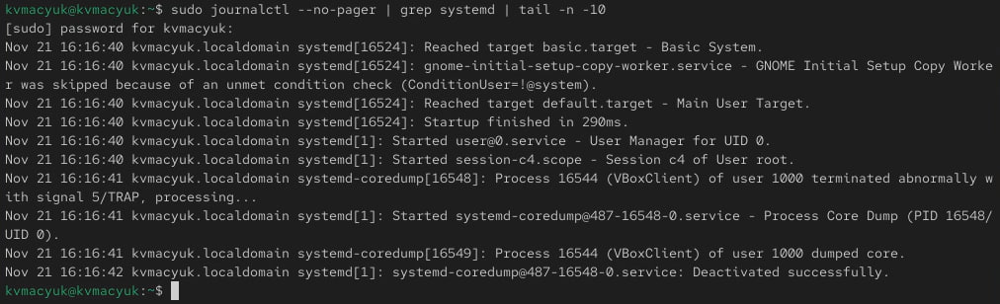{#fig-037 width=85%}

## Команда pwd

В тестовом задании выбрал ответ «pwd». Команда выводит текущий рабочий каталог.

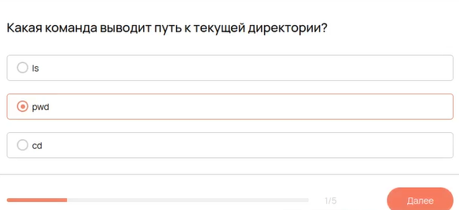{#fig-038 width=37%}

## Скрытые элементы

В тестовом задании выбрал ответ «ls -a». Опция -a включает имена, начинающиеся с точки.

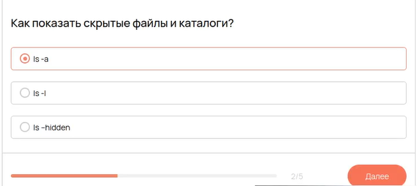{#fig-039 width=38%}

## Относительный путь

В тестовом задании выбрал ответ «cd apache2». Из /etc можно обратиться к его подкаталогу по относительному пути apache2.

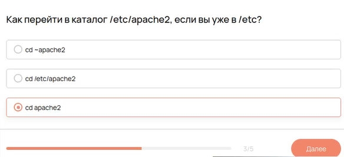{#fig-040 width=37%}

## Домашний каталог

В тестовом задании выбрал ответ «Домашнюю директорию текущего пользователя». В команде cd ~ тильда раскрывается в путь домашнего каталога.

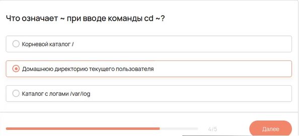{#fig-041 width=37%}

## Фильтрация конвейером

В тестовом задании выбрал ответ «Для фильтрации строк с упоминанием ssh из списка файлов». В ls -l | grep ssh вывод ls передаётся на стандартный ввод grep.

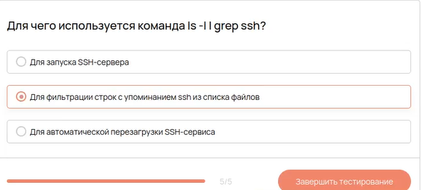{#fig-042 width=37%}

# Базовые команды для управления файлами и каталогами

## Создание структуры project

Создал каталоги командой `mkdir -p project/{logs,data,backup}`. Подстановка фигурных скобок формирует три пути; `-p` позволяет создавать необходимые родительские каталоги.

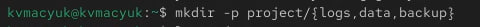{#fig-043 width=85%}

## Создание и проверка файлов

Выполнил `touch project/logs/error.log project/data/info.txt`, затем проверил оба пути командой `ls project/logs/error.log project/data/info.txt`. В выводе присутствуют оба файла.

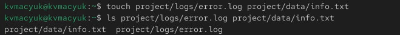{#fig-044 width=85%}

## Копирование файла

Скопировал `info.txt` из каталога `project/data` в `project/backup` командой `cp project/data/info.txt project/backup/`. Исходный файл при копировании сохраняется.

{#fig-045 width=85%}

## Перемещение файла

Переместил `error.log` из `project/logs` в `project/data` командой `mv project/logs/error.log project/data/`.

{#fig-046 width=85%}

## Удаление учебного каталога

Удалил учебный каталог вместе с содержимым командой `rm -r project/`. Ключ `-r` задаёт рекурсивное удаление.

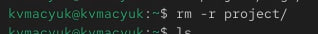{#fig-047 width=85%}

# Работа с архивами и передача данных между серверами

## Создание сжатого архива

Создал каталог и три файла, затем упаковал их в архив:

```bash
mkdir archive_test/
touch archive_test/file{1..3}.txt
tar -czf archive_test.tar.gz -C ~/ archive_test
```

## Создание сжатого архива (2)

Ключи `-c`, `-z`, `-f` задают создание архива, сжатие gzip и имя выходного файла. Ключ `-C` устанавливает каталог, относительно которого выбираются архивируемые пути.

## Создание сжатого архива — снимок экрана

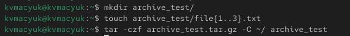{#fig-048 width=85%}

## Извлечение архива

Создал каталог `extracted/` и извлёк архив:

```bash
mkdir extracted/
tar -xzf archive_test.tar.gz -C extracted/
```

Ключ `-x` задаёт извлечение, а `-C` — каталог назначения.

## Извлечение архива — снимок экрана

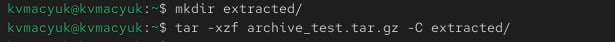{#fig-049 width=85%}

## Команда передачи архива

Запустил команду `scp archive_test.tar.gz user@192.168.1.10:/backups`. В ней указаны локальный файл, пользователь удалённого узла, адрес сервера и каталог назначения. Снимок показывает запуск команды; подтверждение завершения передачи на нём не отображено.

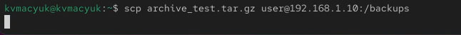{#fig-050 width=85%}

## Создание архива

В тестовом задании выбрал ответ «tar -czf». Комбинация ключей задаёт создание tar-архива со сжатием gzip и записью в файл.

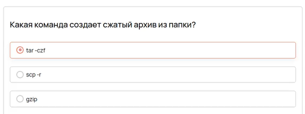{#fig-051 width=45%}

## Извлечение архива

В тестовом задании выбрал ответ «tar -xzf». Ключ -x отвечает за извлечение содержимого.

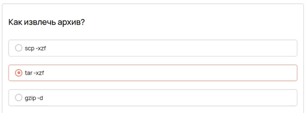{#fig-052 width=46%}

## Копирование каталога на сервер

В тестовом задании выбрал ответ «scp -r folder user@server:/backup». Ключ -r задаёт рекурсивное копирование каталога.

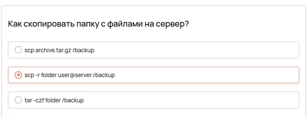{#fig-053 width=44%}

# Основы автоматизации с помощью Bash-скриптов

## Подготовка файла Bash-скрипта

Создал каталог `bin` и файл `bin/clean_logs.sh` командами `mkdir bin` и `touch bin/clean_logs.sh`. В нижней строке снимка набрана команда `nano clean_logs.sh`; на следующем снимке редактора указан путь `bin/clean_logs.sh`.

{#fig-054 width=85%}

## Содержание скрипта архивирования

Рассмотрел показанный фрагмент `bin/clean_logs.sh`.

В нём заданы `LOG_DIR="/var/log"` и `ARCHIVE_DIR="/var/archive"`, дата формируется командой `date +%Y%m%d`.

Из даты собираются имя `backup_${DATE}.log` и полный путь архива.

Условие `[ -e "$ARCHIVE_PATH" ]` проверяет наличие файла и завершает скрипт, если архив уже существует.

## Содержание скрипта архивирования (2)

Команда `tar -czf "$ARCHIVE_PATH" "$LOG_DIR"` создаёт gzip-сжатый tar-архив; расширение `.log` не меняет его формат.

На снимке показана архивация, а удаление исходных журналов не показано.

## Содержание скрипта архивирования — снимок экрана

{#fig-055 width=49%}

## Назначение прав и запуск скрипта

Открыл `bin/clean_logs.sh`, добавил право исполнения командой `chmod +x bin/clean_logs.sh` и запустил скрипт через `sudo bash ~/bin/clean_logs.sh`. В выводе `tar` сообщает об удалении начального `/` из имён и изменении некоторых журналов во время чтения. Снимок подтверждает запуск архивации; отдельной проверки содержимого готового архива в нём нет.

## Назначение прав и запуск скрипта — снимок экрана

{#fig-056 width=85%}

## Открытие пользовательского crontab

Открыл расписание текущего пользователя командой `crontab -e`.

{#fig-057 width=85%}

## Расписание запуска скрипта

В редакторе crontab ввёл строку:

```cron
30 3 1 * * ./bin/clean_logs.sh
```

## Расписание запуска скрипта (2)

Она задаёт запуск в 03:30 первого числа каждого месяца. Снимок показывает запись в редакторе, а не факт наступления планового запуска. Задание относится к пользователю `kvmacyuk`; ручной запуск с `sudo` и запуск из пользовательского cron имеют разные права. Для доступа к `/var/log` и записи в `/var/archive` при автоматическом выполнении требуются соответствующие разрешения.

## Расписание запуска скрипта — снимок экрана

{#fig-058 width=35%}

## Право исполнения

В тестовом задании выбрал ответ «При помощи chmod +x». Операция +x добавляет право исполнения файла.

{#fig-059 width=44%}

## Комментарий в скрипте

В тестовом задании выбрал ответ «Использовать #». Неэкранированный символ # в позиции начала комментария позволяет добавить пояснение в Bash-сценарии.

{#fig-060 width=46%}

## Поиск и удаление старых файлов

В тестовом задании выбрал ответ «Находит и удаляет файлы старше 7 дней». В вопросе рассматривается find /var/log -type f -mtime +7 -exec rm -f {} \;. Опция -type f выбирает обычные файлы, -exec запускает удаление. Возраст для -mtime измеряется полными 24-часовыми периодами: +7 соответствует более чем семи полным периодам, то есть как минимум восьми.

## Поиск и удаление старых файлов — снимок экрана

{#fig-061 width=81%}

# Выводы

## Выводы

В ходе первого этапа онлайн-курса «Системный администратор Linux с нуля» изучил обязанности администратора, назначение командной оболочки и способы получения справки. Выполнил упражнения по мониторингу процессов и дискового пространства, проверке служб systemd и просмотру журналов в Rocky Linux.

Рассмотрел назначение каталогов `/etc`, `/var/log`, `/opt`, `/proc` и `/dev`.

## Выводы (2)

Отработал создание, копирование, перемещение и удаление учебных файлов, создание и извлечение архивов, а также синтаксис передачи данных через `scp`.

Изучил структуру Bash-скрипта с переменными и условием, выполнил его запуск и подготовил запись расписания cron.

Выбранные ответы на тестовые вопросы и практические действия зафиксировал на снимках экрана.

# Список литературы {.unnumbered}

## Список литературы

1. [Онлайн-курс «Системный администратор Linux с нуля»](https://study.selectel.ru/members/courses/course756726784647).

