---
## Author
author:
  name: Мацюк Константин Владимирович
  degrees: BSc
  orcid: 0000-0002-0877-7063
  email: 1032253640@rudn.ru
  affiliation:
    - name: Российский университет дружбы народов
      country: Российская Федерация
      postal-code: 117198
      city: Москва
      address: ул. Миклухо-Маклая, д. 6

## Title
title: "Презентация по прохождению 2 этапа онлайн-курса"
subtitle: "Системный администратор Linux с нуля"
license: "CC BY"

## Fonts
mainfont: IBM Plex Serif
romanfont: IBM Plex Serif
sansfont: IBM Plex Sans
monofont: DejaVu Sans Mono
mathfont: STIX Two Math
mainfontoptions: Ligatures=Common,Ligatures=TeX,Scale=0.94
romanfontoptions: Ligatures=Common,Ligatures=TeX,Scale=0.94
sansfontoptions: Ligatures=Common,Ligatures=TeX,Scale=MatchLowercase,Scale=0.94
monofontoptions: Scale=MatchLowercase,Scale=0.94
incremental: false
slide-level: 2
lang: ru-RU

---

# Цель работы

## Цель работы

Освоить приёмы повседневного администрирования Linux: поиск документации, обработку текста и журналов, настройку учётных записей и разрешений, управление процессами и службами. Проверить изученные команды на собственной виртуальной машине.

# Задание

## Задание

Выполнить упражнения второго этапа курса «Системный администратор Linux с нуля», разобрать вопросы тематических тестов и оформить наблюдаемые результаты. Дополнить материалы практикой по управлению процессами, сервисами systemd и собственным фоновым процессом.

# Выполнение работы

## Организация работы

Практическую часть выполнял в Rocky Linux 10.2 под учётной записью `kvmacyuk`. Для операций с системными файлами и службами применял sudo. Далее объединил практику и тесты по темам курса; пояснения относятся к результатам на моих снимках. Внутри каждого теста изменил порядок разбора вопросов, сохранив принадлежность к соответствующей теме.

# Поиск справочной информации в Linux

## Руководство по grep

Открыл руководство командой `man grep`. На странице рассмотрел синтаксис вызова, описание поиска по шаблону и перечень ключей. Такой способ позволяет уточнять параметры непосредственно в терминале

## Руководство по grep — снимок экрана

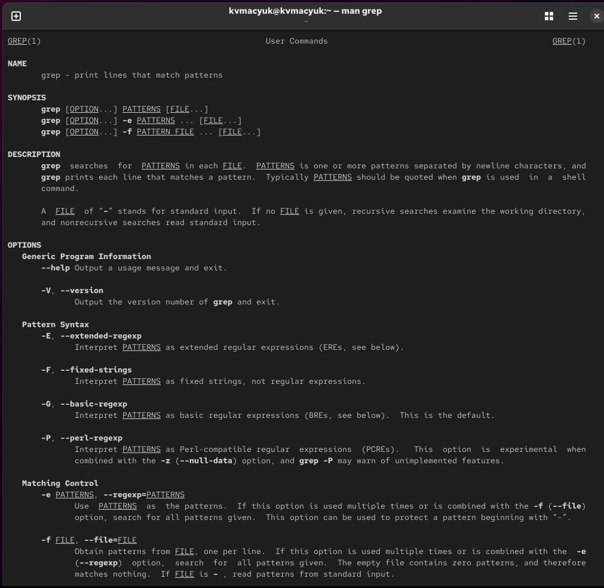{#fig-001 width=31%}

## Проверка наличия Info

Выполнил `sudo dnf install info`. DNF подготовил пакет, однако на проверке транзакции сообщил, что эта версия уже установлена. Поэтому снимок подтверждает наличие сообщения об установленном пакете, а не завершение новой установки

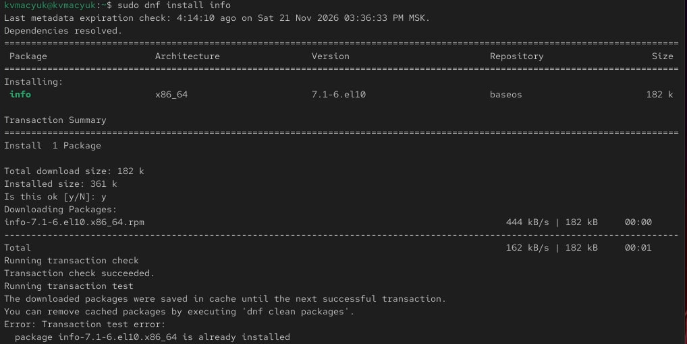{#fig-002 width=33%}

## Документация systemctl через Info

Запустил `info systemctl` и просмотрел описание управления systemd. Внизу окна указан источник `(*manpages*)systemctl`: в данном случае Info открыл страницу man, поскольку отдельный пункт systemctl в каталоге Info не найден

## Документация systemctl через Info — снимок экрана

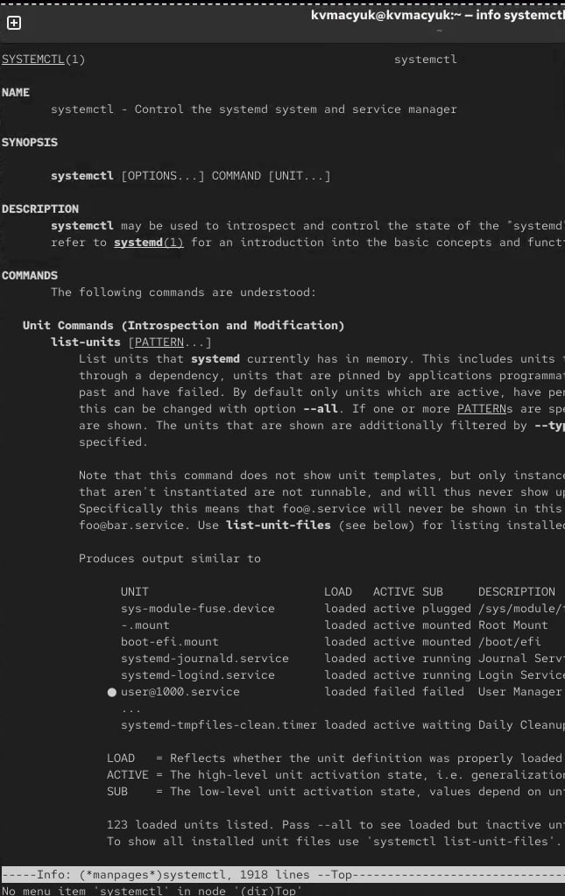{#fig-003 width=19%}

## Обращение к каталогу документации

Попробовал вывести содержимое `usr/share/doc/info`. Введённый путь не начинается с `/` и рассматривается относительно текущего каталога; команда сообщила, что такого пути нет. Общесистемная документация пакетов располагается в `/usr/share/doc/`

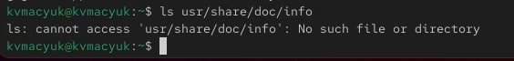{#fig-004 width=85%}

## Каталог документации пакетов

Указал `/usr/share/doc`. В подкаталогах этого пути обычно размещаются README, сведения о лицензиях и другие сопровождающие документы пакетов

## Каталог документации пакетов — снимок экрана

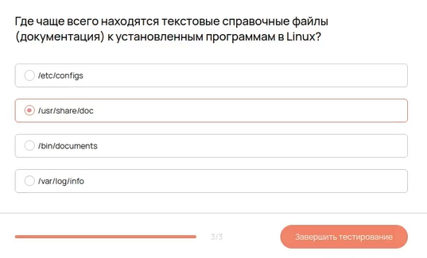{#fig-005 width=51%}

## Получение справки grep

Для знакомства с параметрами grep выбрал `man grep`. Имя программы после man определяет, какую страницу руководства нужно открыть

## Получение справки grep — снимок экрана

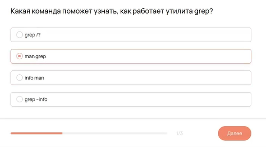{#fig-006 width=55%}

## Назначение Info

Выбрал вариант об открытии документации в формате Info. Такая справка организована по узлам и поддерживает переходы между связанными темами

## Назначение Info — снимок экрана

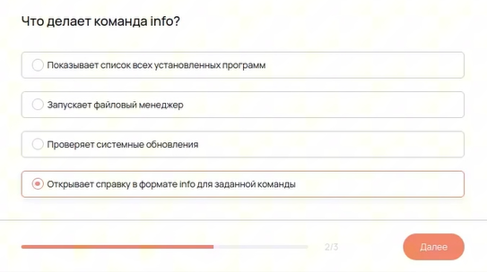{#fig-007 width=55%}

# Работа с текстовыми файлами в Linux

## Сведения о дистрибутиве

Просмотрел `/etc/os-release` в less. Значения `NAME`, `VERSION` и `PRETTY_NAME` показывают Rocky Linux 10.2 (Red Quartz). Эти сведения учитывал при выборе пакетного менеджера и имён служб

## Сведения о дистрибутиве — снимок экрана

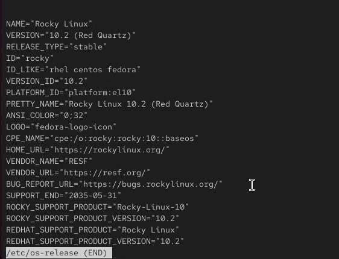{#fig-008 width=40%}

## Выборка строк из messages

С помощью `sudo grep 'error' /var/log/messages` отобрал строки с указанным словом. В выводе присутствуют сообщения о процессах VBoxClient. Использовал журнал `messages`, доступный в моей системе

## Выборка строк из messages — снимок экрана

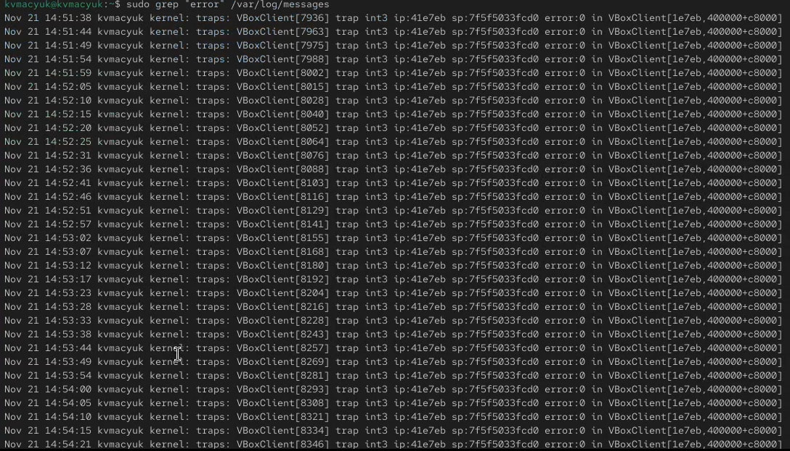{#fig-009 width=54%}

## Открытие конфигурации SSH-сервера

Для редактирования настроек сервера вызвал `sudo nano /etc/ssh/sshd_config`. Повышенные права позволяют изменять системный конфигурационный файл

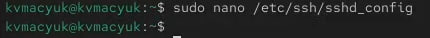{#fig-010 width=85%}

## Параметр PermitRootLogin

В конфигурации указал `PermitRootLogin no`. Строка не закомментирована и задаёт запрет прямого входа root по SSH при применении этой конфигурации службой

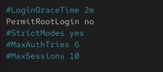{#fig-011 width=38%}

## Подготовка текстового файла

Перешёл к следующему упражнению и открыл файл `matrix.txt` командой `nano matrix.txt`. В нём подготовил числовые данные для последующей обработки

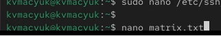{#fig-012 width=85%}

## Числовые данные в matrix.txt

В редакторе сформировал пять строк по четыре числа. Во второй строке записаны `1 6 7 5`, в четвёртой — `12 5 1 6`. Именно эти строки использовал для проверки вычислений

## Числовые данные в matrix.txt — снимок экрана

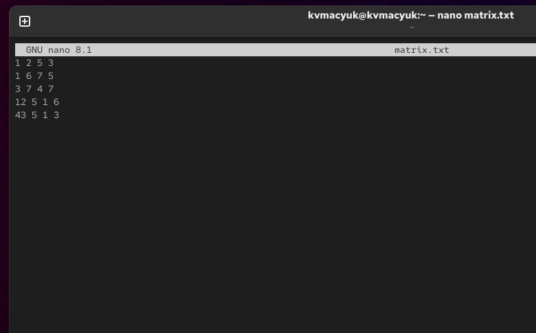{#fig-013 width=49%}

## Суммирование чётных строк

Обработал файл выражением `awk 'NR % 2 == 0 {sum=0; for(i=1;i<=NF;i++) sum+=$i; print sum}' matrix.txt`. Условие оставляет чётные строки, а цикл складывает их поля. Получил суммы **19** и **24**, соответствующие исходным данным

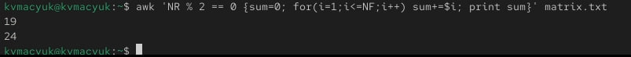{#fig-014 width=85%}

## Постраничный просмотр

В качестве особенности less отметил навигацию по страницам и поиск. Это удобно для изучения длинного файла без непрерывного вывода всего текста в терминал

## Постраничный просмотр — снимок экрана

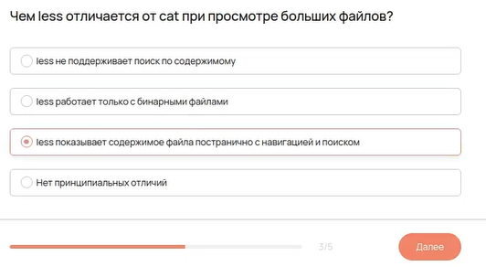{#fig-015 width=56%}

## Командная строка Vim

Для перехода из Normal mode к вводу Ex-команды выбрал `:`. После двоеточия можно вводить команды сохранения, выхода и других операций редактора

## Командная строка Vim — снимок экрана

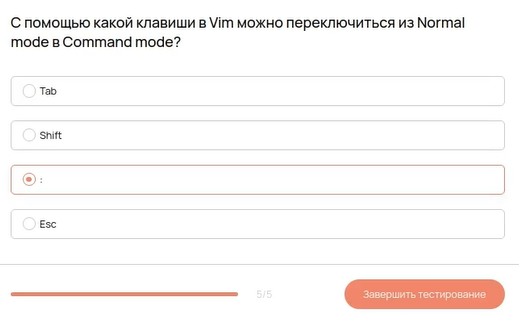{#fig-016 width=50%}

## Перенаправление вывода cat

Для `cat > файл.txt` выбрал создание файла и запись в него. При наличии файла оператор `>` очищает его прежнее содержимое, после чего туда поступает ввод cat

## Перенаправление вывода cat — снимок экрана

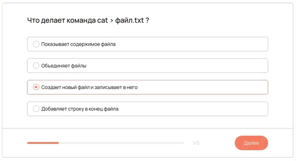{#fig-017 width=56%}

## Выход из less

Выбрал клавишу `q`. Она завершает просмотр и возвращает управление командной оболочке

## Выход из less — снимок экрана

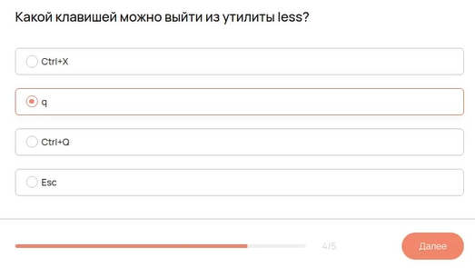{#fig-018 width=54%}

## Перезапись и добавление

Различил операторы: `>>` дополняет существующий файл, а `>` начинает запись заново. Это позволяет выбирать между накоплением данных и заменой содержимого

## Перезапись и добавление — снимок экрана

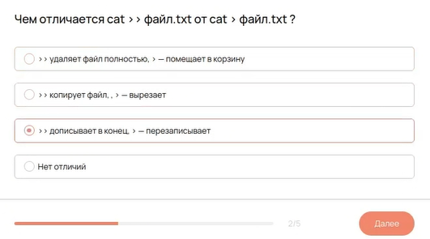{#fig-019 width=55%}

# Анализ системных логов

## Поиск ошибок в журнале systemd

Выполнил `journalctl --since 'yesterday' --grep error`. В выборку вошли сообщения начиная со вчерашнего дня, содержащие совпадение с шаблоном. На экране видны записи графической подсистемы и пользовательского сеанса

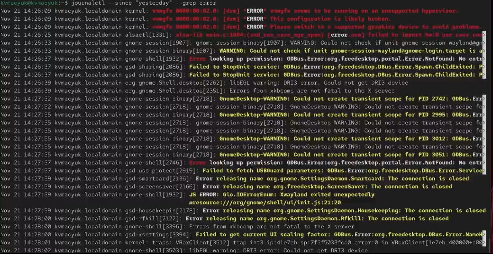{#fig-020 width=32%}

## Поиск неудачных входов SSH

Проверил журнал sshd командой `sudo journalctl -u sshd --grep 'Failed password'`. В показанном фрагменте отображаются разделители загрузок; строки с неудачными попытками входа на этом снимке не видны

## Поиск неудачных входов SSH — снимок экрана

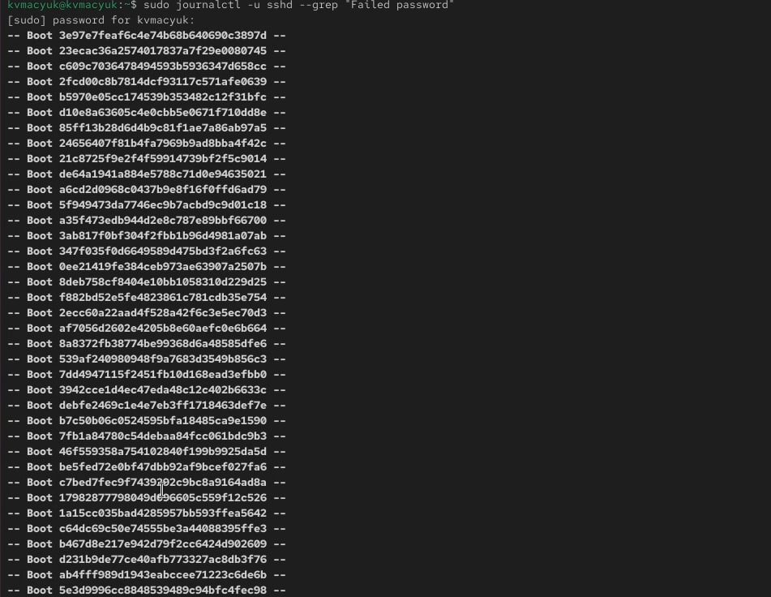{#fig-021 width=40%}

## Ограничение количества записей

Для последних двадцати сообщений выбрал `-n 20`. Значение после ключа задаёт количество записей в конце выборки journalctl

## Ограничение количества записей — снимок экрана

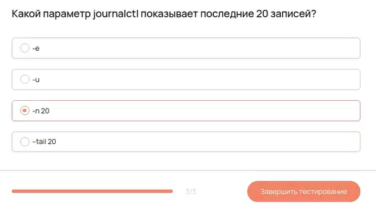{#fig-022 width=56%}

## Расположение лог-файлов

Указал `/var/log/` как основной каталог журналов. Конкретные имена файлов зависят от службы и принятой в дистрибутиве схемы журналирования

## Расположение лог-файлов — снимок экрана

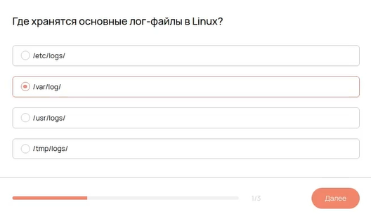{#fig-023 width=53%}

## Временной фильтр journalctl

На снимке для `journalctl -u sshd --since today` отмечен вариант «Показывает все логи sshd до сегодняшнего дня». Параметр `--since today` фактически задаёт нижнюю границу — начало сегодняшнего дня, поэтому команда выводит записи sshd за сегодня

## Временной фильтр journalctl — снимок экрана

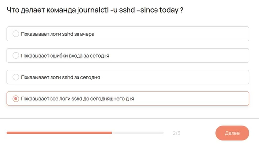{#fig-024 width=55%}

# Автоматизация анализа логов и работы с текстом

## Создание сценария анализа журналов

Открыл `/usr/local/bin/daily_errors.sh` в nano с правами администратора. Этот файл подготовил для автоматической выборки сообщений за последние сутки

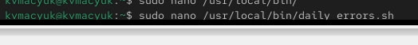{#fig-025 width=85%}

## Содержимое daily_errors.sh

В сценарии указал интерпретатор Bash и конвейер с `journalctl --since "24 hours ago" --no-pager` и `grep -i "error"`. Результат перенаправляется в файл внутри `/var/log/`; полное имя выходного файла обрезано границей снимка

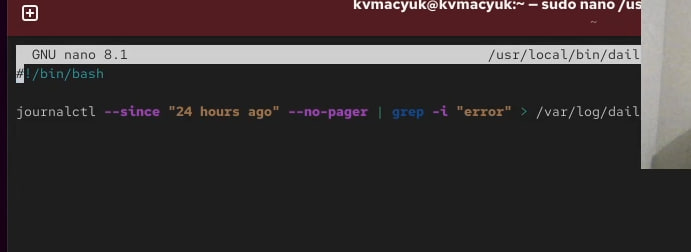{#fig-026 width=46%}

## Право выполнения сценария

После редактирования выполнил `chmod +x /usr/local/bin/daily_errors.sh`. Команда добавляет разрешение на запуск файла как программы

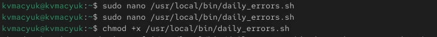{#fig-027 width=85%}

## Ежедневный запуск анализа

В таблице cron добавил запись `0 2 * * * /usr/local/bin/daily_errors.sh`. Она задаёт запуск сценария каждый день в 02:00. Ранее существовавшая строка с `logger` также присутствует в таблице

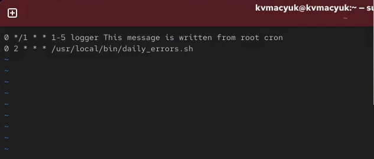{#fig-028 width=39%}

## Сохранение таблицы cron

Открыл таблицу root командой `sudo crontab -e`. После выхода из редактора crontab сообщил об установке новой таблицы и сохранении резервной копии предыдущего варианта

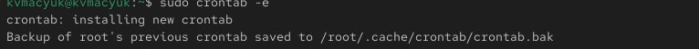{#fig-029 width=85%}

## Подсчёт записей Failed password

Выбрал сообщения sshd за последние 24 часа и передал их в awk для подсчёта строк с `Failed password`. Выражение `END {print count+0}` выводит число даже при отсутствии совпадений. На экране получен результат **0**

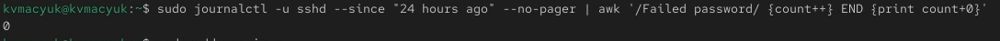{#fig-030 width=85%}

## Наблюдение за дополнением журнала

Указал `tail -f /var/log/nginx.log`. Ключ `-f` оставляет команду работающей и показывает появляющиеся в файле строки

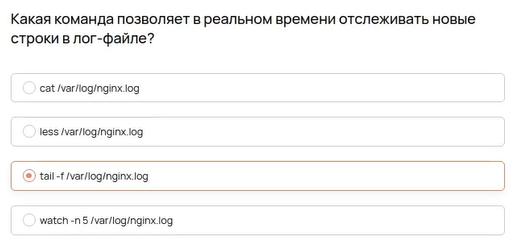{#fig-031 width=36%}

## Любое значение поля cron

Отметил символ `*`. В соответствующем поле расписания он означает все допустимые значения

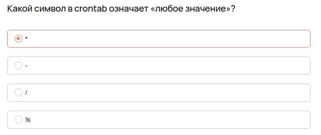{#fig-032 width=40%}

## Удаление пользовательской таблицы cron

Выбрал `crontab -r`. Этот вызов удаляет всю таблицу расписания текущего пользователя, а не отдельную строку задания

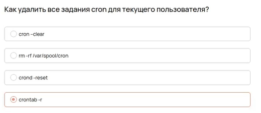{#fig-033 width=39%}

## Хранение пользовательских crontab

Выбрал `/var/spool/cron/`. Это область хранения пользовательских таблиц cron; конкретная структура подкаталогов различается между реализациями

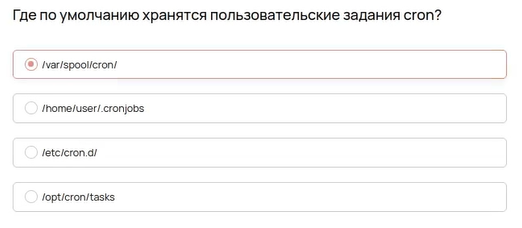{#fig-034 width=38%}

# Основы управления пользователями и группами

## Создание учётной записи ivan

Создал пользователя `ivan`, проверил запись через `id ivan` и задал пароль командой `sudo passwd ivan`. Вывод показывает UID 1004, основную группу `users` и сообщение об успешном изменении пароля

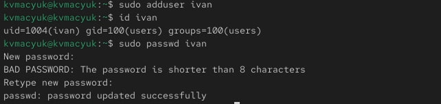{#fig-035 width=71%}

## Включение в группу developers

Создал группу `developers` и добавил в неё пользователя через `sudo usermod -aG developers ivan`. Проверка `groups ivan` показывает сохранение группы `users` и появление дополнительной группы `developers`

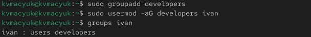{#fig-036 width=85%}

## Изменение дополнительных групп

Создал группу `testers`, включил в неё ivan и удалил его из developers командой `sudo gpasswd -d ivan developers`. Итоговый список содержит `users testers`

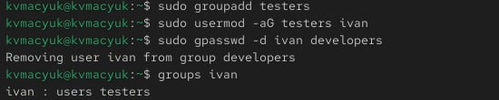{#fig-037 width=84%}

## Удаление пользователя

Выполнил `sudo userdel -r ivan`, чтобы удалить учётную запись вместе с домашним каталогом и почтовым файлом. Последующий `id ivan` вернул сообщение об отсутствии такого пользователя

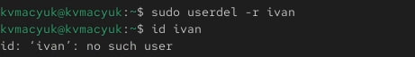{#fig-038 width=85%}

## Создание домашнего каталога

В вопросе о useradd указал `-m`. Этот параметр явно включает создание домашнего каталога пользователя

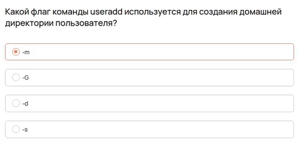{#fig-039 width=35%}

## Добавление дополнительной группы

Для `usermod -aG sudo admin` выбрал добавление admin в sudo с сохранением остальных дополнительных групп. Параметр `-a` означает добавление к существующему списку

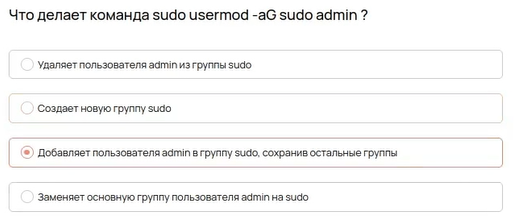{#fig-040 width=39%}

## Редактирование базы пользователей

Для безопасного редактирования `/etc/passwd` выбрал `vipw`. Утилита использует блокировку, уменьшая риск одновременного изменения базы несколькими процессами

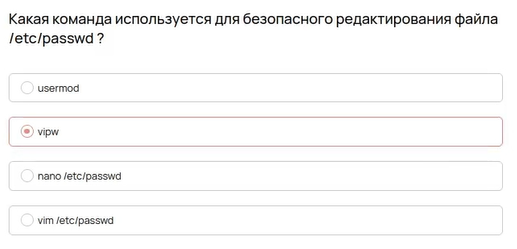{#fig-041 width=35%}

## Удаление учётной записи с каталогом

Выбрал `sudo userdel -r admin`. Флаг `-r` запрашивает удаление домашнего каталога и почтового файла вместе с учётной записью

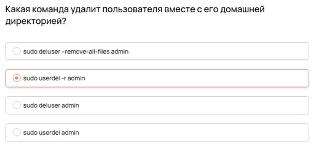{#fig-042 width=36%}

# Основы управления доступом и разрешениями

## Исходные права sample.txt

Создал `sample.txt` и проверил его через `ls -l`. Файл получил права `rw-r--r--`; текущая маска, показанная командой `umask`, равна `0022`

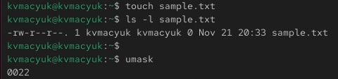{#fig-043 width=72%}

## Изменение прав в символьной форме

Применил `chmod g-w,o-r sample.txt`. У группы снял право записи, у остальных — чтения. Последующая проверка показывает `rw-r-----`

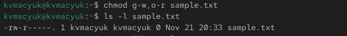{#fig-044 width=85%}

## Изменение прав в числовой форме

Задал режим `662` командой `chmod 662 sample.txt`. В выводе `ls -l` получил `rw-rw--w-`: владелец и группа имеют чтение и запись, остальные — только запись

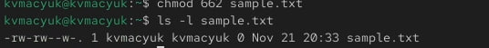{#fig-045 width=85%}

## Передача файла root

Командой `sudo chown root sample.txt` изменил владельца файла. Проверка показывает владельца root при сохранении прежней группы `kvmacyuk` и режима доступа

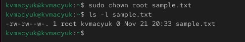{#fig-046 width=85%}

## Возврат владельца файла

Вернул владение файлом своей учётной записи с помощью `sudo chown kvmacyuk sample.txt`. Изменение группы в этой команде не задавалось

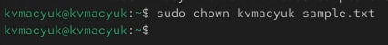{#fig-047 width=85%}

## Тип объекта в ls

Для первого символа `d` выбрал каталог. В длинном выводе ls этот символ обозначает тип объекта, а следующие девять позиций описывают разрешения

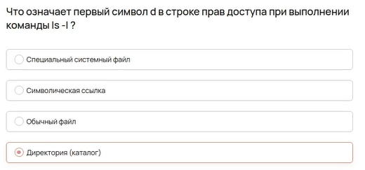{#fig-048 width=36%}

## Расшифровка режима 754

Отметил `rwxr-xr--`. Значение 7 даёт владельцу все три права, 5 оставляет группе чтение и выполнение, а 4 предоставляет остальным чтение

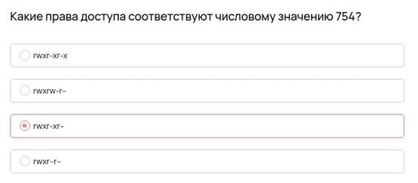{#fig-049 width=38%}

## Одновременная смена владельца и группы

Выбрал `chown ivan:friends /home/ivan/file.txt`. До двоеточия указан новый владелец, после него — новая группа файла

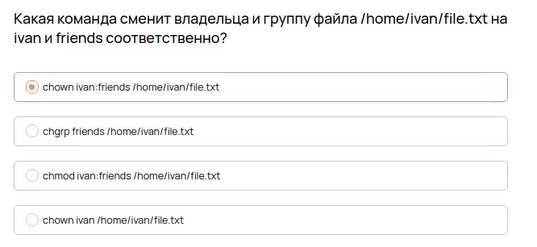{#fig-050 width=36%}

# Повышение безопасности работы с учётными записями

## Административные команды и аудит sudo

С повышенными правами просмотрел `/root`, попытался обновить пакеты и проверил `sshd`. Обновление остановилось из-за зависимостей Vim, тогда как SSH отображается как `active (running)`. Затем открыл журнал по полю `_COMM=sudo`; записи содержат пользователя, терминал и выполнявшуюся команду

## Административные команды и аудит sudo — снимок экрана

{#fig-051 width=54%}

## Повторное создание ivan

Для следующего упражнения вновь создал учётную запись `ivan` командой `sudo useradd ivan`. Она используется далее при настройке административного доступа и политики пароля

{#fig-052 width=85%}

## Назначение пароля ivan

Задал пароль для ivan через `sudo passwd ivan`. Несмотря на предупреждение проверки качества, итоговая строка сообщает `password updated successfully`

{#fig-053 width=85%}

## Добавление в административную группу

Добавил ivan в группу `wheel` командой `sudo usermod -aG wheel ivan`. Вывод `groups ivan` содержит `users wheel`. В Rocky Linux именно wheel обычно используется в правилах sudo для администраторов

{#fig-054 width=85%}

## Журналирование sudo

Отметил фиксацию того, кто и когда выполнил административную команду. Такая информация используется при разборе действий пользователей с повышенными правами

{#fig-055 width=44%}

## Разрешение нестандартного SSH-порта

Для TCP-порта 47022 указал `sudo ufw allow 47022/tcp`. Правило разрешает входящие подключения к указанному порту по TCP

{#fig-056 width=40%}

## Использование sudo

Выбрал ответ о выполнении административных команд без передачи пользователю пароля root и с журналированием действий. Конкретные способы проверки пароля и записи событий определяются настройками sudo

{#fig-057 width=37%}

## Смена порта и правила firewall

Выбрал вариант, при котором SSH слушает новый порт, но firewall не пропускает соединения. В предполагаемой задаче с запрещающей политикой смену порта необходимо согласовать с разрешающими правилами

{#fig-058 width=43%}

# Политика паролей и учётных записей

## Поиск префикса SHA-512

Запустил awk с разделителем `:` для поиска записей `/etc/shadow`, у которых поле пароля начинается с `$6$`. Этот префикс обозначает SHA-512 crypt. Снимок фиксирует ввод команды и запрос пароля sudo; результата выборки в кадре нет

{#fig-059 width=85%}

## Сроки действия пароля

Командой `sudo chage -M 60 -m 5 -W 10 ivan` задал максимальный срок 60 дней, минимальный интервал 5 дней и предупреждение за 10 дней. Затем вызвал `chage -l`; в видимой части вывода есть дата окончания действия пароля и минимальный интервал 5 дней

{#fig-060 width=77%}

## Блокировка парольного входа

Выполнил `sudo usermod -L ivan`, затем проверил вход через `su - ivan`. Получил `Authentication failure`. Ключ `-L` блокирует пароль, но сам по себе не запрещает все альтернативные способы аутентификации

{#fig-061 width=85%}

## Снятие блокировки пароля

Для разблокировки выполнил `sudo usermod -U ivan`. На снимке зафиксирована команда; повторная проверка входа здесь не показана

{#fig-062 width=85%}

## Префикс хеша пароля

В строке `/etc/shadow` префикс вида `$y$` связал с используемым алгоритмом хеширования. Это обозначение формата хранения, а не уровень прав пользователя

{#fig-063 width=36%}

## Просмотр политики пароля

Для проверки сроков действия пароля выбрал `chage -l ivan`. Этот режим показывает действующие ограничения и даты для указанного пользователя

{#fig-064 width=35%}

## Смысл хеширования

Отметил преобразование пароля в отпечаток без операции обратной расшифровки. Проверка входа выполняется сравнением вычисленного результата; возможность подбора пароля при этом не исключается

{#fig-065 width=36%}

## Блокировка через usermod

На снимке выбрал ответ о блокировке учётной записи командой `usermod -L`. Точнее, ключ блокирует пароль; для полного запрета доступа нужно учитывать и другие способы входа, например SSH-ключи

{#fig-066 width=36%}

## Роль соли

Выбрал ответ о различии хешей и защите от заранее подготовленных таблиц. Соль добавляется при вычислении хеша, поэтому одинаковые пароли с разной солью дают разные результаты

{#fig-067 width=41%}

# Что такое права доступа в Linux

## Права системных файлов и каталогов

Сопоставил вывод для `/etc/passwd`, домашних каталогов и `/var/log`. У passwd указан режим `644`, домашние каталоги в показанном списке имеют `700`, а `/var/log` — `755` с владельцем и группой root

{#fig-068 width=54%}

## Файл при маске 0022

Создал `file1` и проверил текущую маску. При значении `0022` обычный файл получил права `rw-r--r--`, то есть `644`

{#fig-069 width=82%}

## Файл после изменения umask

Установил `umask 006`, создал `file2` и просмотрел его атрибуты. Новый файл получил режим `660`: права для категории «остальные» отсутствуют

{#fig-070 width=75%}

## Просмотр разрешений

Для отображения прав доступа указал `ls -l`. Команда выводит режим файла вместе с владельцем, группой, размером и временем изменения

{#fig-071 width=35%}

## Числовое значение rw-

Для сочетания чтения и записи выбрал `6`: числовые веса `r` и `w` равны 4 и 2, а выполнение отсутствует

{#fig-072 width=40%}

## Права скрытых файлов

Выбрал `ls -la`. Здесь `-l` включает подробные атрибуты, а `-a` добавляет в список имена, начинающиеся с точки

{#fig-073 width=35%}

# Изменение прав доступа: chmod, chown, chgrp

## Установка режима 644

Для `file1` явно задал `chmod 644 file1`. Вывод подтверждает чтение и запись у владельца и только чтение у группы и остальных пользователей

{#fig-074 width=85%}

## Назначение группы admins

Создал группу admins, передал ей файл через `chgrp` и добавил группе запись командой `chmod g+w file1`. В результате у файла указана группа admins и режим `664`

{#fig-075 width=85%}

## Операторы chmod

Указал набор `+`, `-`, `=`. Эти операторы позволяют добавить разрешения, снять их или присвоить выбранной категории точный набор прав

{#fig-076 width=49%}

## Рекурсивное изменение

Выбрал ключ `-R`. Он распространяет операцию на содержимое каталога и вложенные подкаталоги

{#fig-077 width=35%}

## Утилита изменения прав

Для изменения разрешений файлов выбрал `chmod`. Её аргументы задают новый режим доступа; владельца и группу меняют другими командами

{#fig-078 width=35%}

# Расширенные списки доступа (ACL) для управления доступом

## Индивидуальное правило ACL

Добавил правило `sudo setfacl -m u:ivan:w file1`. В выводе `getfacl` появилась запись `user:ivan:-w-`, предоставляющая ivan запись отдельно от базовых прав владельца, группы и остальных

{#fig-079 width=41%}

## Групповое правило ACL

Выполнил `sudo setfacl -m g:admins:x file1`. Проверка показывает именованную запись `group:admins:--x` и маску `rwx`. При определении итогового доступа учитываются все применимые групповые записи, а не только добавленная строка

{#fig-080 width=47%}

## Удаление расширенных ACL

Сначала просмотрел полный список разрешений, затем применил `sudo setfacl -b file1`. Повторный вывод содержит только базовые записи `user::`, `group::` и `other::`

## Удаление расширенных ACL — снимок экрана

{#fig-081 width=45%}

# Специальные разрешения: SUID, SGID, Sticky Bit

## Установка бита SUID

Добавил владельцу право выполнения и установил SUID командами `chmod u+x file1` и `chmod u+s file1`. В упражнении показана настройка атрибутов; выполнение программы с изменённым эффективным UID на снимке не демонстрируется

{#fig-082 width=85%}

## Установка SGID для каталога

Создал `directory1`, добавил группе право прохода через каталог и установил SGID. При создании новых объектов в таком каталоге группа наследуется от каталога, что удобно для совместной работы

{#fig-083 width=85%}

## Каталог со Sticky Bit

Создал `public_folder`, задал права для остальных через `chmod o=wx` и установил Sticky Bit командой `chmod +t`. В выводе `ls -ld` видна буква `t`. Этот бит ограничивает удаление и переименование чужих файлов в общем каталоге

{#fig-084 width=83%}

## Назначение SUID

Выбрал SUID. Для подходящего исполняемого файла этот бит позволяет запускать процесс с эффективным идентификатором владельца файла; право выполнения при этом должно быть предоставлено

{#fig-085 width=33%}

## Специальные биты без права выполнения

В условии без разрешения на выполнение выбрал «Нет правильного ответа». Само наличие SUID или SGID не заменяет необходимый бит `x`

## Специальные биты без права выполнения — снимок экрана

{#fig-086 width=57%}

## Назначение Sticky Bit

Отметил Sticky Bit как механизм ограничения удаления чужих файлов в общем каталоге. Право на удаление сохраняется у владельца файла, владельца каталога и привилегированного процесса

## Назначение Sticky Bit — снимок экрана

{#fig-087 width=56%}

# Основы управления процессами в Linux

## Условия упражнений по процессам

Перед практикой ознакомился с тремя заданиями: найти процесс по потреблению памяти, отработать управление фоновым заданием и воспользоваться htop. Этот снимок содержит условия упражнений, а результаты выполнения приведены далее

{#fig-088 width=33%}

## Выбор процесса по памяти в top

В top рассмотрел процессы, упорядоченные по потреблению памяти. Первую строку занимает `gnome-shell` с PID 2961 и долей памяти 4,1%. Открыл запрос `PID to signal/kill`; отправка конкретного сигнала в этом кадре ещё не показана

## Выбор процесса по памяти в top — снимок экрана

{#fig-089 width=33%}

## Экран следующей загрузки

Зафиксировал экран загрузки виртуальной машины. На нём видны запуск компонентов системы и диагностические сообщения ядра. Сам по себе этот снимок не подтверждает, какой именно сигнал был отправлен выбранному ранее процессу

## Экран следующей загрузки — снимок экрана

{#fig-090 width=47%}

## Запуск ping в фоне

Выполнил `ping google.com > ping.log &`. Оболочка создала задание №1 с PID 11626; вывод команды перенаправлен в файл, а терминал снова доступен для ввода

{#fig-091 width=76%}

## Передний план, остановка и фон

Вернул задание командой `fg 1`, приостановил его сочетанием Ctrl+Z и возобновил в фоне через `bg 1`. Строки `Stopped` и последующий вывод задания с `&` показывают смену его состояний

{#fig-092 width=73%}

## Просмотр процессов через htop

Открыл htop и рассмотрел список процессов с полями PID, USER, PRI, NI, CPU% и MEM%. На снимке видна сортировка по MEM% и строки потоков gnome-shell. Настройка PPID, ввод фильтра и отправка сигнала через F9 этим изображением не зафиксированы

## Просмотр процессов через htop — снимок экрана

{#fig-093 width=33%}

## Сигнал принудительного завершения

В вопросе о `kill -9` отметил SIGKILL с номером 9. Процесс не может обработать или проигнорировать этот сигнал

{#fig-094 width=49%}

## Возобновление задания в фоне

Выбрал последовательность Ctrl+Z, затем `bg %1`. Сочетание клавиш приостанавливает задание переднего плана, а bg продолжает его работу в фоне

{#fig-095 width=43%}

## Список процессов с нагрузкой

Для просмотра процессов и сведений о расходе CPU и памяти указал `ps aux`. В отличие от интерактивного монитора, такой вызов выводит снимок состояния на момент запуска

{#fig-096 width=44%}

# Управление приоритетами процессов: nice и renice

## Запуск dd с nice 15

Запустил фоновую нагрузку командой `nice -n 15 dd if=/dev/urandom of=/dev/null &`. Оболочка сообщила номер задания 3 и PID 13219. Положительное значение nice уменьшает относительный приоритет процесса

{#fig-097 width=85%}

## Определение PID нагрузки

Выполнил `pgrep -a dd` и нашёл нужную строку по полной команде `dd if=/dev/urandom of=/dev/null`. Поиск также выдал другие совпадения по имени, поэтому для следующего действия выбрал PID 13219

{#fig-098 width=70%}

## Повышение приоритета dd

Применил `sudo renice -n -5 -p 13219`. Сообщение команды подтверждает изменение nice с 15 на −5

{#fig-099 width=59%}

## Поиск процесса с nice 19

Вывел PID, NI и команду через `ps -eo pid,ni,cmd` и отобрал awk строки с NI=19. В результате найден `khugepaged` с PID 125

{#fig-100 width=85%}

## Изменение найденного приоритета

Для процесса 125 выполнил `sudo renice -n 0 -p 125`. Вывод сообщает, что прежнее значение 19 заменено на 0

{#fig-101 width=85%}

## Приоритет службы в unit-файле

Отметил `Nice=10`. Этот параметр в настройках службы задаёт nice для запускаемых ею процессов

{#fig-102 width=34%}

## Наивысший приоритет nice

Из предложенных значений выбрал `-20`. В шкале nice меньшие значения соответствуют более высокому относительному приоритету планирования

{#fig-103 width=49%}

## Изменение nice запущенного процесса

Для PID 1234 выбрал `renice -n 10 -p 1234`. Команда применяется к уже существующему процессу и задаёт ему новое значение nice

{#fig-104 width=35%}

# Контроль системных сервисов: systemd и systemctl

## Фильтрация работающих сервисов

Выполнил `systemctl list-units --type=service --state=running` с фильтром `grep -i network`. В выборке показан `NetworkManager.service` в состоянии `active running`; ключ `-i` позволяет не учитывать регистр

{#fig-105 width=85%}

## Определение работающего веб-сервера

Сравнил `systemctl status nginx httpd`. Nginx установлен, но не запущен и не включён в автозагрузку. Apache представлен службой `httpd`, которая находится в состоянии `active (running)` и имеет автозапуск `enabled`

{#fig-106 width=33%}

## Просмотр журнала Apache

Открыл последние записи командой `sudo journalctl -u httpd -n 50 --no-pager`. В кадре присутствуют события запуска и остановки, предупреждения об OPTIONS и имени сервера. Команда перезапуска в присланных снимках не показана; видимый журнал включает записи прежних загрузок

## Просмотр журнала Apache — снимок экрана

{#fig-107 width=62%}

## Службы с включённым автозапуском

Рассмотрел список unit-файлов со значением `enabled` в колонке STATE. Для последующего упражнения выбрал `atd.service`. Значения PRESET отражают предустановленную политику и могут отличаться от текущего состояния

## Службы с включённым автозапуском — снимок экрана

{#fig-108 width=17%}

## Исходное состояние atd

Перед отключением проверил `systemctl status atd`. Служба планировщика отложенных заданий работала (`active running`), а её автозапуск был включён (`enabled`)

{#fig-109 width=58%}

## Остановка atd и отключение автозапуска

Выполнил `sudo systemctl disable --now atd`. Параметр `--now` одновременно останавливает службу, а disable удаляет связь автозапуска. В выводе указано удаление ссылки из `multi-user.target.wants`

{#fig-110 width=85%}

## Проверка настройки автозапуска

Вызвал `systemctl is-enabled atd` и получил `disabled`. Это подтверждает отключение обычного автозапуска службы

{#fig-111 width=85%}

## Повторная проверка atd

Дополнительно проверил оба состояния: `is-enabled` вернул `disabled`, а `is-active` — `inactive`. На этом этапе служба остановлена и автозапуск выключен; факт перезагрузки отдельной командой в данном кадре не отражён

{#fig-112 width=57%}

## Разбор ответов: управление сервисами

После тестирования разобрал ответы по материалам курса. Для включения автозапуска используется `systemctl enable servicename`; эта операция отличается от немедленного запуска через start. Состояние nginx проверяют командой `systemctl status nginx`. В календарном таймере запись `OnCalendar=daily` задаёт ежедневное срабатывание в полночь. На снимке приведена страница с готовыми ответами

## Разбор ответов: управление сервисами — снимок экрана

{#fig-113 width=32%}

## Результат теста по systemd и systemctl

Завершил тест по контролю системных сервисов с результатом **3 из 3**. Страница итогов подтверждает успешное прохождение всех трёх вопросов

## Результат теста по systemd и systemctl — снимок экрана

{#fig-114 width=43%}

# Управление фоновыми процессами (демонами) в Linux

## Python-сценарий фоновой работы

Подготовил Python-сценарий с бесконечным циклом: он дописывает `Working...` в `/tmp/mydaemon.log` и делает паузу 10 секунд. В редакторе указан путь `/usr/local/bin/mydaemon.py`; в последующих снимках unit использует имя `myscript.py`

{#fig-115 width=46%}

## Описание mydaemon.service

Создал `/etc/systemd/system/mydaemon.service`. В `ExecStart` задан запуск `/usr/bin/python3 /usr/local/bin/myscript.py`, тип службы — `simple`, политика — `Restart=always` с задержкой `RestartSec=10`. Для включения в обычную многопользовательскую загрузку указан `WantedBy=multi-user.target`

## Описание mydaemon.service — снимок экрана

{#fig-116 width=53%}

## Запуск и включение mydaemon

Перечитал конфигурацию через `daemon-reload`, запустил mydaemon и включил автозапуск. Проверка статуса показывает `enabled` и `active (running)`; основной процесс Python имеет PID 15247

{#fig-117 width=46%}

## Завершение процесса и автоматический перезапуск

Отправил SIGKILL процессу, найденному по команде запуска Python-сценария. В статусе mydaemon появились `code=killed, signal=KILL` и `activating (auto-restart)`. Systemd ожидает повторный запуск согласно политике unit; затем в терминале введена команда `reboot`

{#fig-118 width=59%}

## Проверка mydaemon после загрузки

После перезагрузки вновь вызвал `systemctl status mydaemon`. Служба имеет состояния `enabled` и `active (running)`, основной PID теперь 1483. В журнале отображается запуск mydaemon в новой сессии загрузки

{#fig-119 width=44%}

## Разбор ответов: фоновые процессы

При разборе теста сначала рассмотрел проверку unit-файла: для неё применяется `systemd-analyze verify mydaemon.service`.

Затем уточнил наблюдение за журналом службы в реальном времени с помощью `journalctl -u servicename -f`.

Параметр `Restart=always` задаёт повторный запуск после нормального или аварийного завершения процесса; явная остановка службы через systemctl stop не вызывает такой перезапуск.

## Разбор ответов: фоновые процессы (2)

Иллюстрация содержит готовые ответы из курса

## Разбор ответов: фоновые процессы — снимок экрана

{#fig-120 width=26%}

## Результат теста по управлению демонами

Прошёл тест по управлению фоновыми процессами с результатом **3 из 3**. На итоговой странице отображается сообщение «Тест пройден»

## Результат теста по управлению демонами — снимок экрана

{#fig-121 width=39%}

# Выводы

## Выводы

Во втором этапе отработал поиск справки и обработку текстовых данных, настроил расписание анализа журналов и выполнил операции с пользователями, группами и правами файлов.

Проверил расширенные ACL и специальные биты доступа, переключение заданий между фоном и передним планом и изменение nice.

## Выводы (2)

Дополнительно отключил автозапуск atd и настроил собственную службу mydaemon: после принудительного завершения её процесса systemd перешёл к автоматическому перезапуску, а после перезагрузки служба снова работала.

Результаты упражнений и выбранные ответы тестов зафиксировал в отчёте.

# Список литературы {.unnumbered}

## Список литературы

1. [Онлайн-курс «Системный администратор Linux с нуля»](https://study.selectel.ru/members/courses/course756726784647).

