---
## Author
author:
  name: Мацюк Константин Владимирович
  degrees: BSc
  orcid: 0000-0002-0877-7063
  email: 1032253640@rudn.ru
  affiliation:
    - name: Российский университет дружбы народов
      country: Российская Федерация
      postal-code: 117198
      city: Москва
      address: ул. Миклухо-Маклая, д. 6

## Title
title: "Отчёт по прохождению 2 этапа онлайн-курса"
subtitle: "Системный администратор Linux с нуля"
license: "CC BY"

## Fonts
mainfont: IBM Plex Serif
romanfont: IBM Plex Serif
sansfont: IBM Plex Sans
monofont: DejaVu Sans Mono
mathfont: STIX Two Math
mainfontoptions: Ligatures=Common,Ligatures=TeX,Scale=0.94
romanfontoptions: Ligatures=Common,Ligatures=TeX,Scale=0.94
sansfontoptions: Ligatures=Common,Ligatures=TeX,Scale=MatchLowercase,Scale=0.94
monofontoptions: Scale=MatchLowercase,Scale=0.94
---

# Цель работы

Освоить приёмы повседневного администрирования Linux: поиск документации, обработку текста и журналов, настройку учётных записей и разрешений, управление процессами и службами. Проверить изученные команды на собственной виртуальной машине.

# Задание

Выполнить упражнения второго этапа курса «Системный администратор Linux с нуля», разобрать вопросы тематических тестов и оформить наблюдаемые результаты. Дополнить материалы практикой по управлению процессами, сервисами systemd и собственным фоновым процессом.

# Выполнение работы

Практическую часть выполнял в Rocky Linux 10.2 под учётной записью `kvmacyuk`. Для операций с системными файлами и службами применял sudo. Далее объединил практику и тесты по темам курса; пояснения относятся к результатам на моих снимках. Внутри каждого теста изменил порядок разбора вопросов, сохранив принадлежность к соответствующей теме.

## Поиск справочной информации в Linux

Открыл руководство командой `man grep`. На странице рассмотрел синтаксис вызова, описание поиска по шаблону и перечень ключей. Такой способ позволяет уточнять параметры непосредственно в терминале ([рис. @fig-001]).

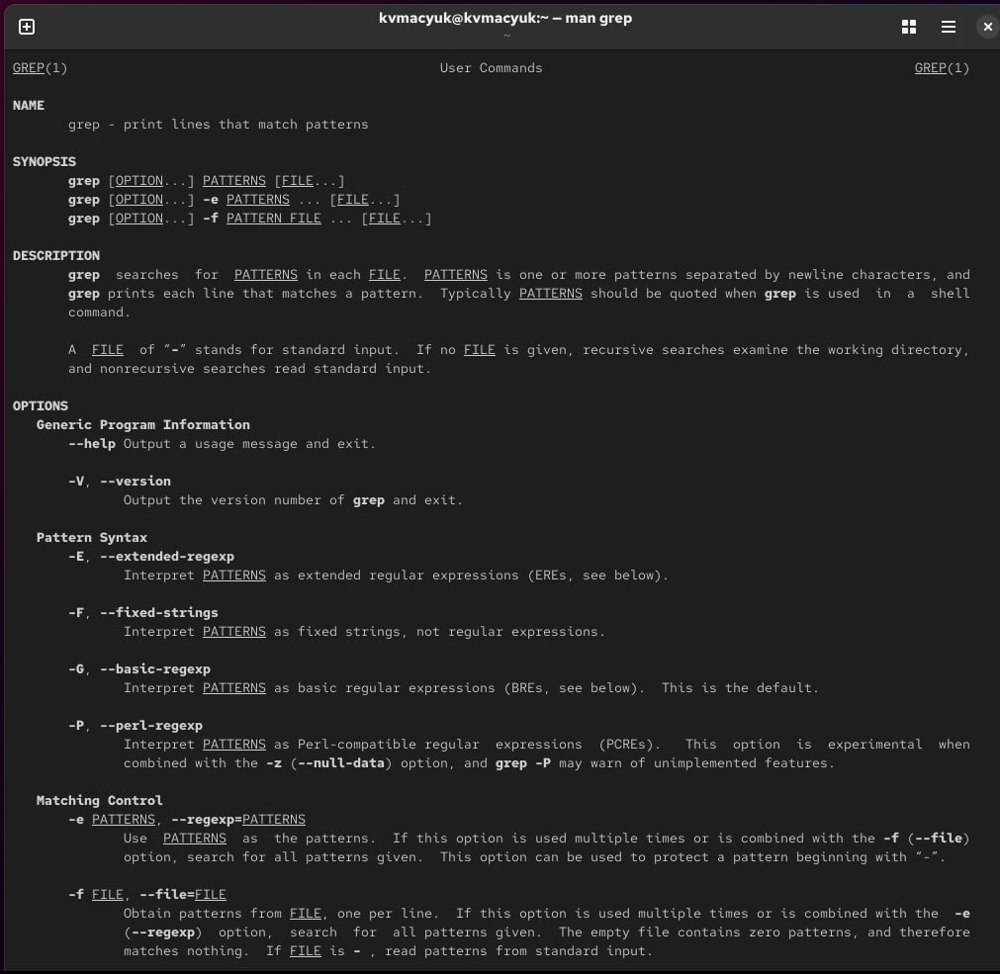{#fig-001 width=55%}

Выполнил `sudo dnf install info`. DNF подготовил пакет, однако на проверке транзакции сообщил, что эта версия уже установлена. Поэтому снимок подтверждает наличие сообщения об установленном пакете, а не завершение новой установки ([рис. @fig-002]).

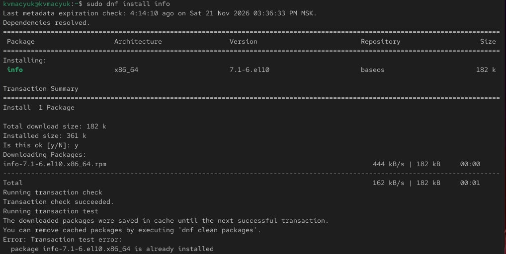{#fig-002 width=70%}

Запустил `info systemctl` и просмотрел описание управления systemd. Внизу окна указан источник `(*manpages*)systemctl`: в данном случае Info открыл страницу man, поскольку отдельный пункт systemctl в каталоге Info не найден ([рис. @fig-003]).

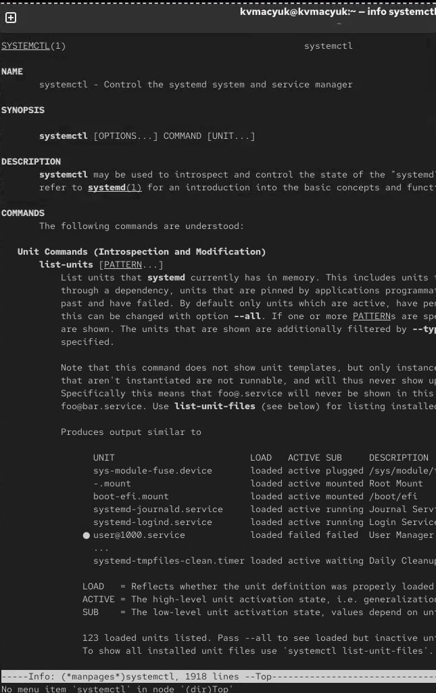{#fig-003 width=45%}

Попробовал вывести содержимое `usr/share/doc/info`. Введённый путь не начинается с `/` и рассматривается относительно текущего каталога; команда сообщила, что такого пути нет. Общесистемная документация пакетов располагается в `/usr/share/doc/` ([рис. @fig-004]).

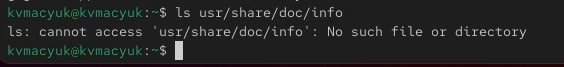{#fig-004 width=70%}

Указал `/usr/share/doc`. В подкаталогах этого пути обычно размещаются README, сведения о лицензиях и другие сопровождающие документы пакетов ([рис. @fig-005]).

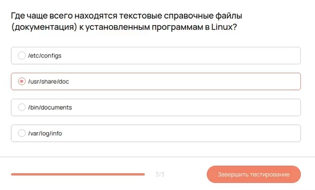{#fig-005 width=70%}

Для знакомства с параметрами grep выбрал `man grep`. Имя программы после man определяет, какую страницу руководства нужно открыть ([рис. @fig-006]).

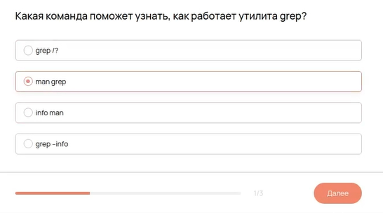{#fig-006 width=70%}

Выбрал вариант об открытии документации в формате Info. Такая справка организована по узлам и поддерживает переходы между связанными темами ([рис. @fig-007]).

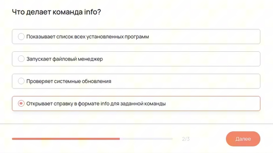{#fig-007 width=70%}

## Работа с текстовыми файлами в Linux

Просмотрел `/etc/os-release` в less. Значения `NAME`, `VERSION` и `PRETTY_NAME` показывают Rocky Linux 10.2 (Red Quartz). Эти сведения учитывал при выборе пакетного менеджера и имён служб ([рис. @fig-008]).

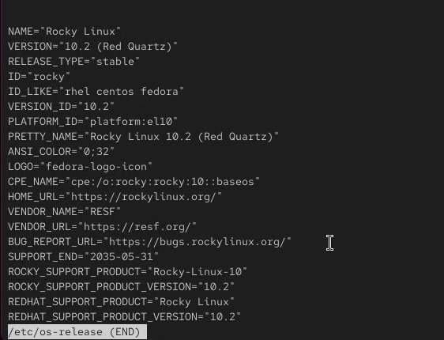{#fig-008 width=70%}

С помощью `sudo grep 'error' /var/log/messages` отобрал строки с указанным словом. В выводе присутствуют сообщения о процессах VBoxClient. Использовал журнал `messages`, доступный в моей системе ([рис. @fig-009]).

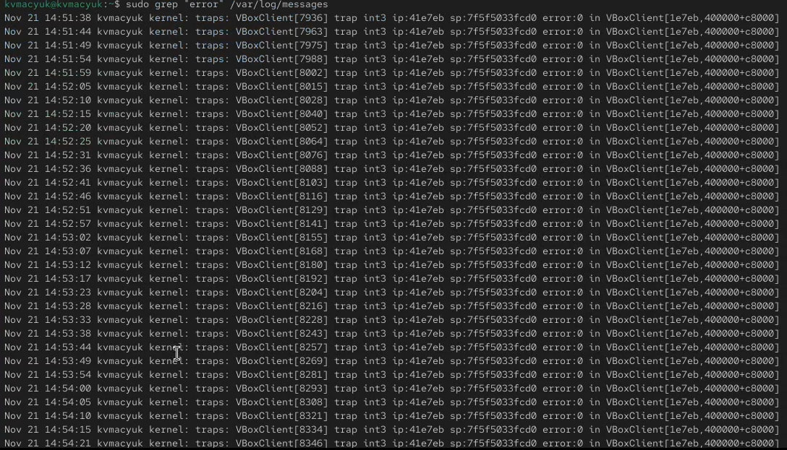{#fig-009 width=70%}

Для редактирования настроек сервера вызвал `sudo nano /etc/ssh/sshd_config`. Повышенные права позволяют изменять системный конфигурационный файл ([рис. @fig-010]).

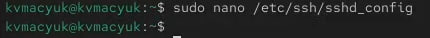{#fig-010 width=70%}

В конфигурации указал `PermitRootLogin no`. Строка не закомментирована и задаёт запрет прямого входа root по SSH при применении этой конфигурации службой ([рис. @fig-011]).

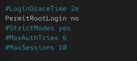{#fig-011 width=70%}

Перешёл к следующему упражнению и открыл файл `matrix.txt` командой `nano matrix.txt`. В нём подготовил числовые данные для последующей обработки ([рис. @fig-012]).

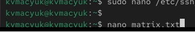{#fig-012 width=70%}

В редакторе сформировал пять строк по четыре числа. Во второй строке записаны `1 6 7 5`, в четвёртой — `12 5 1 6`. Именно эти строки использовал для проверки вычислений ([рис. @fig-013]).

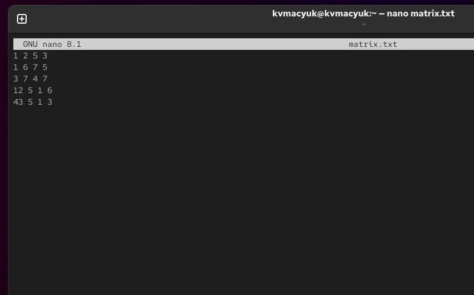{#fig-013 width=70%}

Обработал файл выражением `awk 'NR % 2 == 0 {sum=0; for(i=1;i<=NF;i++) sum+=$i; print sum}' matrix.txt`. Условие оставляет чётные строки, а цикл складывает их поля. Получил суммы **19** и **24**, соответствующие исходным данным ([рис. @fig-014]).

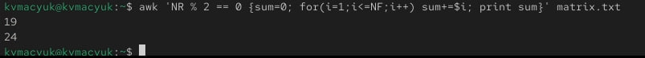{#fig-014 width=70%}

В качестве особенности less отметил навигацию по страницам и поиск. Это удобно для изучения длинного файла без непрерывного вывода всего текста в терминал ([рис. @fig-015]).

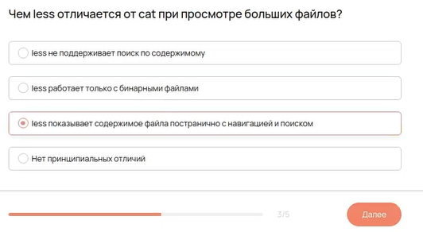{#fig-015 width=70%}

Для перехода из Normal mode к вводу Ex-команды выбрал `:`. После двоеточия можно вводить команды сохранения, выхода и других операций редактора ([рис. @fig-016]).

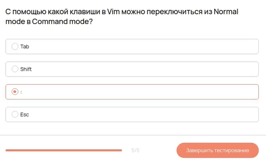{#fig-016 width=70%}

Для `cat > файл.txt` выбрал создание файла и запись в него. При наличии файла оператор `>` очищает его прежнее содержимое, после чего туда поступает ввод cat ([рис. @fig-017]).

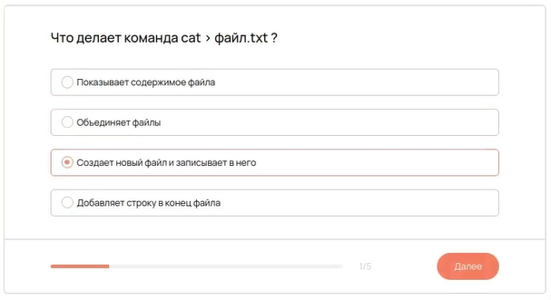{#fig-017 width=70%}

Выбрал клавишу `q`. Она завершает просмотр и возвращает управление командной оболочке ([рис. @fig-018]).

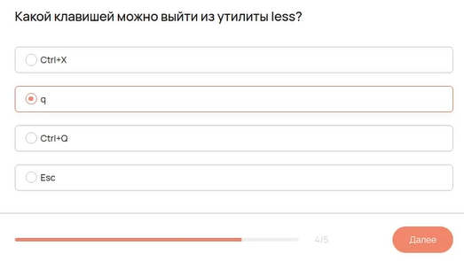{#fig-018 width=70%}

Различил операторы: `>>` дополняет существующий файл, а `>` начинает запись заново. Это позволяет выбирать между накоплением данных и заменой содержимого ([рис. @fig-019]).

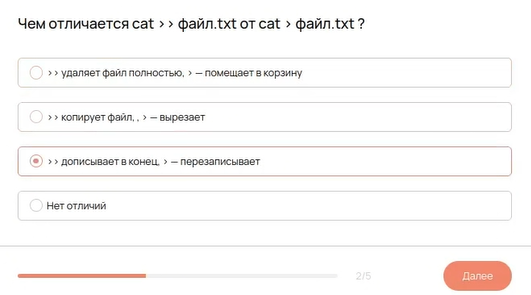{#fig-019 width=70%}

## Анализ системных логов

Выполнил `journalctl --since 'yesterday' --grep error`. В выборку вошли сообщения начиная со вчерашнего дня, содержащие совпадение с шаблоном. На экране видны записи графической подсистемы и пользовательского сеанса ([рис. @fig-020]).

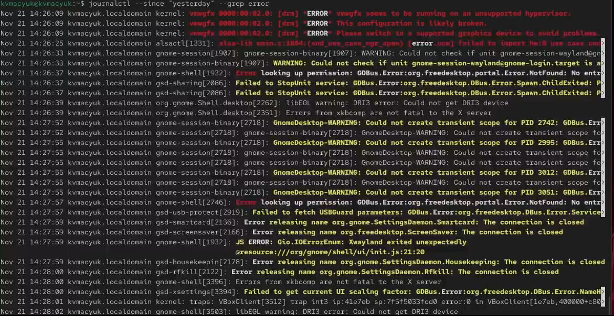{#fig-020 width=70%}

Проверил журнал sshd командой `sudo journalctl -u sshd --grep 'Failed password'`. В показанном фрагменте отображаются разделители загрузок; строки с неудачными попытками входа на этом снимке не видны ([рис. @fig-021]).

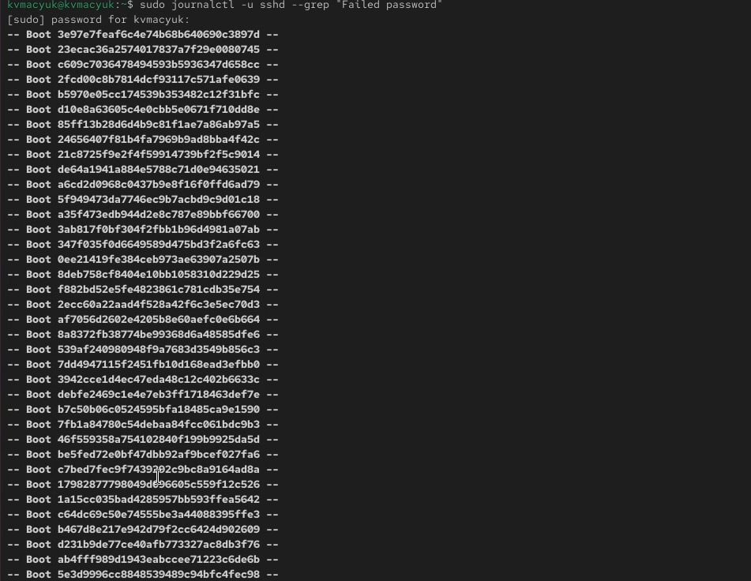{#fig-021 width=70%}

Для последних двадцати сообщений выбрал `-n 20`. Значение после ключа задаёт количество записей в конце выборки journalctl ([рис. @fig-022]).

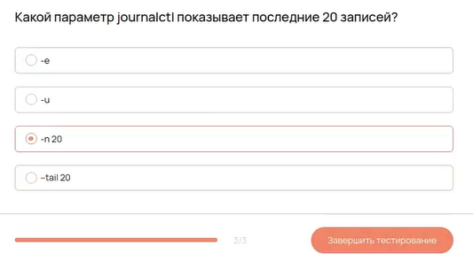{#fig-022 width=70%}

Указал `/var/log/` как основной каталог журналов. Конкретные имена файлов зависят от службы и принятой в дистрибутиве схемы журналирования ([рис. @fig-023]).

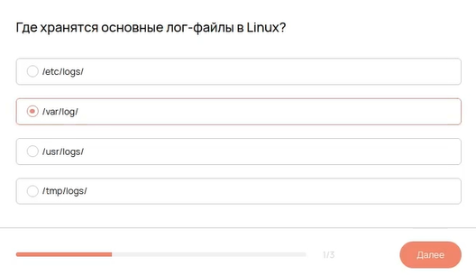{#fig-023 width=70%}

На снимке для `journalctl -u sshd --since today` отмечен вариант «Показывает все логи sshd до сегодняшнего дня». Параметр `--since today` фактически задаёт нижнюю границу — начало сегодняшнего дня, поэтому команда выводит записи sshd за сегодня ([рис. @fig-024]).

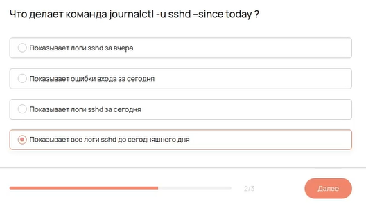{#fig-024 width=70%}

## Автоматизация анализа логов и работы с текстом

Открыл `/usr/local/bin/daily_errors.sh` в nano с правами администратора. Этот файл подготовил для автоматической выборки сообщений за последние сутки ([рис. @fig-025]).

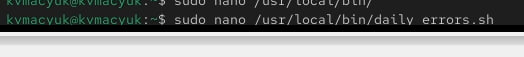{#fig-025 width=70%}

В сценарии указал интерпретатор Bash и конвейер с `journalctl --since "24 hours ago" --no-pager` и `grep -i "error"`. Результат перенаправляется в файл внутри `/var/log/`; полное имя выходного файла обрезано границей снимка ([рис. @fig-026]).

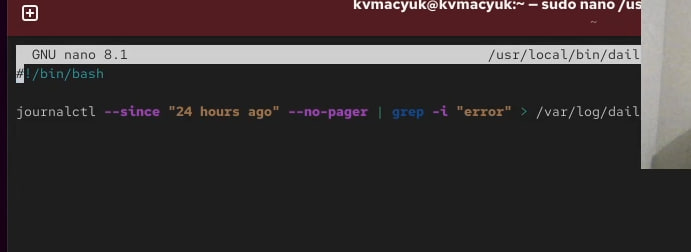{#fig-026 width=70%}

После редактирования выполнил `chmod +x /usr/local/bin/daily_errors.sh`. Команда добавляет разрешение на запуск файла как программы ([рис. @fig-027]).

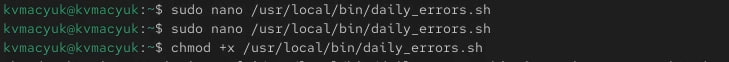{#fig-027 width=70%}

В таблице cron добавил запись `0 2 * * * /usr/local/bin/daily_errors.sh`. Она задаёт запуск сценария каждый день в 02:00. Ранее существовавшая строка с `logger` также присутствует в таблице ([рис. @fig-028]).

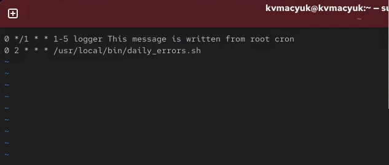{#fig-028 width=70%}

Открыл таблицу root командой `sudo crontab -e`. После выхода из редактора crontab сообщил об установке новой таблицы и сохранении резервной копии предыдущего варианта ([рис. @fig-029]).

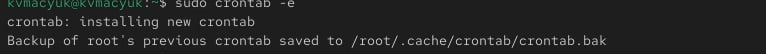{#fig-029 width=70%}

Выбрал сообщения sshd за последние 24 часа и передал их в awk для подсчёта строк с `Failed password`. Выражение `END {print count+0}` выводит число даже при отсутствии совпадений. На экране получен результат **0** ([рис. @fig-030]).

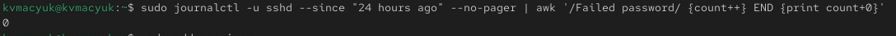{#fig-030 width=70%}

Указал `tail -f /var/log/nginx.log`. Ключ `-f` оставляет команду работающей и показывает появляющиеся в файле строки ([рис. @fig-031]).

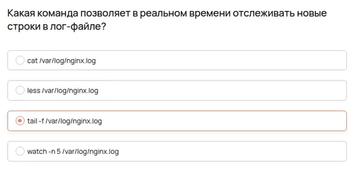{#fig-031 width=70%}

Отметил символ `*`. В соответствующем поле расписания он означает все допустимые значения ([рис. @fig-032]).

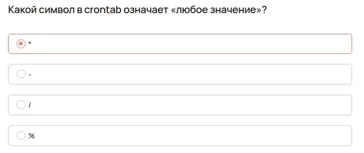{#fig-032 width=70%}

Выбрал `crontab -r`. Этот вызов удаляет всю таблицу расписания текущего пользователя, а не отдельную строку задания ([рис. @fig-033]).

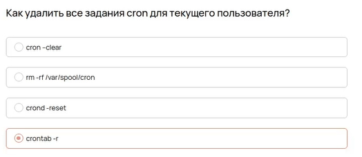{#fig-033 width=70%}

Выбрал `/var/spool/cron/`. Это область хранения пользовательских таблиц cron; конкретная структура подкаталогов различается между реализациями ([рис. @fig-034]).

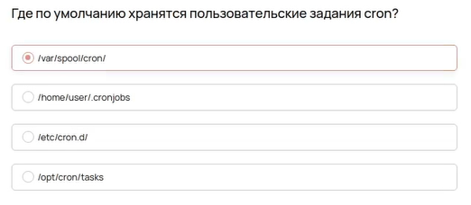{#fig-034 width=70%}

## Основы управления пользователями и группами

Создал пользователя `ivan`, проверил запись через `id ivan` и задал пароль командой `sudo passwd ivan`. Вывод показывает UID 1004, основную группу `users` и сообщение об успешном изменении пароля ([рис. @fig-035]).

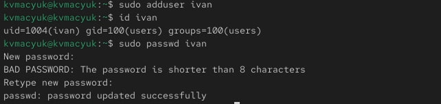{#fig-035 width=70%}

Создал группу `developers` и добавил в неё пользователя через `sudo usermod -aG developers ivan`. Проверка `groups ivan` показывает сохранение группы `users` и появление дополнительной группы `developers` ([рис. @fig-036]).

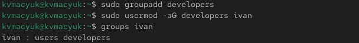{#fig-036 width=70%}

Создал группу `testers`, включил в неё ivan и удалил его из developers командой `sudo gpasswd -d ivan developers`. Итоговый список содержит `users testers` ([рис. @fig-037]).

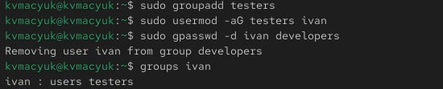{#fig-037 width=70%}

Выполнил `sudo userdel -r ivan`, чтобы удалить учётную запись вместе с домашним каталогом и почтовым файлом. Последующий `id ivan` вернул сообщение об отсутствии такого пользователя ([рис. @fig-038]).

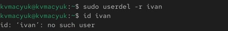{#fig-038 width=70%}

В вопросе о useradd указал `-m`. Этот параметр явно включает создание домашнего каталога пользователя ([рис. @fig-039]).

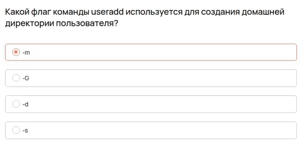{#fig-039 width=70%}

Для `usermod -aG sudo admin` выбрал добавление admin в sudo с сохранением остальных дополнительных групп. Параметр `-a` означает добавление к существующему списку ([рис. @fig-040]).

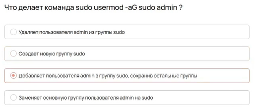{#fig-040 width=70%}

Для безопасного редактирования `/etc/passwd` выбрал `vipw`. Утилита использует блокировку, уменьшая риск одновременного изменения базы несколькими процессами ([рис. @fig-041]).

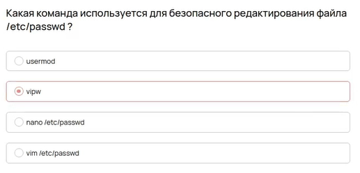{#fig-041 width=70%}

Выбрал `sudo userdel -r admin`. Флаг `-r` запрашивает удаление домашнего каталога и почтового файла вместе с учётной записью ([рис. @fig-042]).

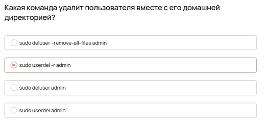{#fig-042 width=70%}

## Основы управления доступом и разрешениями

Создал `sample.txt` и проверил его через `ls -l`. Файл получил права `rw-r--r--`; текущая маска, показанная командой `umask`, равна `0022` ([рис. @fig-043]).

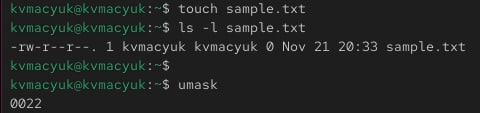{#fig-043 width=70%}

Применил `chmod g-w,o-r sample.txt`. У группы снял право записи, у остальных — чтения. Последующая проверка показывает `rw-r-----` ([рис. @fig-044]).

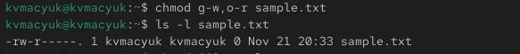{#fig-044 width=70%}

Задал режим `662` командой `chmod 662 sample.txt`. В выводе `ls -l` получил `rw-rw--w-`: владелец и группа имеют чтение и запись, остальные — только запись ([рис. @fig-045]).

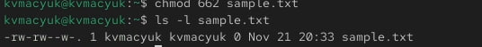{#fig-045 width=70%}

Командой `sudo chown root sample.txt` изменил владельца файла. Проверка показывает владельца root при сохранении прежней группы `kvmacyuk` и режима доступа ([рис. @fig-046]).

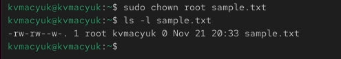{#fig-046 width=70%}

Вернул владение файлом своей учётной записи с помощью `sudo chown kvmacyuk sample.txt`. Изменение группы в этой команде не задавалось ([рис. @fig-047]).

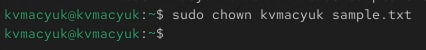{#fig-047 width=70%}

Для первого символа `d` выбрал каталог. В длинном выводе ls этот символ обозначает тип объекта, а следующие девять позиций описывают разрешения ([рис. @fig-048]).

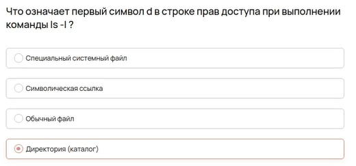{#fig-048 width=70%}

Отметил `rwxr-xr--`. Значение 7 даёт владельцу все три права, 5 оставляет группе чтение и выполнение, а 4 предоставляет остальным чтение ([рис. @fig-049]).

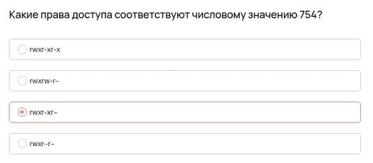{#fig-049 width=70%}

Выбрал `chown ivan:friends /home/ivan/file.txt`. До двоеточия указан новый владелец, после него — новая группа файла ([рис. @fig-050]).

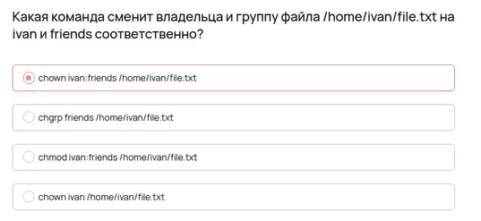{#fig-050 width=70%}

## Повышение безопасности работы с учётными записями

С повышенными правами просмотрел `/root`, попытался обновить пакеты и проверил `sshd`. Обновление остановилось из-за зависимостей Vim, тогда как SSH отображается как `active (running)`. Затем открыл журнал по полю `_COMM=sudo`; записи содержат пользователя, терминал и выполнявшуюся команду ([рис. @fig-051]).

{#fig-051 width=70%}

Для следующего упражнения вновь создал учётную запись `ivan` командой `sudo useradd ivan`. Она используется далее при настройке административного доступа и политики пароля ([рис. @fig-052]).

{#fig-052 width=70%}

Задал пароль для ivan через `sudo passwd ivan`. Несмотря на предупреждение проверки качества, итоговая строка сообщает `password updated successfully` ([рис. @fig-053]).

{#fig-053 width=70%}

Добавил ivan в группу `wheel` командой `sudo usermod -aG wheel ivan`. Вывод `groups ivan` содержит `users wheel`. В Rocky Linux именно wheel обычно используется в правилах sudo для администраторов ([рис. @fig-054]).

{#fig-054 width=70%}

Отметил фиксацию того, кто и когда выполнил административную команду. Такая информация используется при разборе действий пользователей с повышенными правами ([рис. @fig-055]).

{#fig-055 width=70%}

Для TCP-порта 47022 указал `sudo ufw allow 47022/tcp`. Правило разрешает входящие подключения к указанному порту по TCP ([рис. @fig-056]).

{#fig-056 width=70%}

Выбрал ответ о выполнении административных команд без передачи пользователю пароля root и с журналированием действий. Конкретные способы проверки пароля и записи событий определяются настройками sudo ([рис. @fig-057]).

{#fig-057 width=70%}

Выбрал вариант, при котором SSH слушает новый порт, но firewall не пропускает соединения. В предполагаемой задаче с запрещающей политикой смену порта необходимо согласовать с разрешающими правилами ([рис. @fig-058]).

{#fig-058 width=70%}

## Политика паролей и учётных записей

Запустил awk с разделителем `:` для поиска записей `/etc/shadow`, у которых поле пароля начинается с `$6$`. Этот префикс обозначает SHA-512 crypt. Снимок фиксирует ввод команды и запрос пароля sudo; результата выборки в кадре нет ([рис. @fig-059]).

{#fig-059 width=70%}

Командой `sudo chage -M 60 -m 5 -W 10 ivan` задал максимальный срок 60 дней, минимальный интервал 5 дней и предупреждение за 10 дней. Затем вызвал `chage -l`; в видимой части вывода есть дата окончания действия пароля и минимальный интервал 5 дней ([рис. @fig-060]).

{#fig-060 width=70%}

Выполнил `sudo usermod -L ivan`, затем проверил вход через `su - ivan`. Получил `Authentication failure`. Ключ `-L` блокирует пароль, но сам по себе не запрещает все альтернативные способы аутентификации ([рис. @fig-061]).

{#fig-061 width=70%}

Для разблокировки выполнил `sudo usermod -U ivan`. На снимке зафиксирована команда; повторная проверка входа здесь не показана ([рис. @fig-062]).

{#fig-062 width=70%}

В строке `/etc/shadow` префикс вида `$y$` связал с используемым алгоритмом хеширования. Это обозначение формата хранения, а не уровень прав пользователя ([рис. @fig-063]).

{#fig-063 width=70%}

Для проверки сроков действия пароля выбрал `chage -l ivan`. Этот режим показывает действующие ограничения и даты для указанного пользователя ([рис. @fig-064]).

{#fig-064 width=70%}

Отметил преобразование пароля в отпечаток без операции обратной расшифровки. Проверка входа выполняется сравнением вычисленного результата; возможность подбора пароля при этом не исключается ([рис. @fig-065]).

{#fig-065 width=70%}

На снимке выбрал ответ о блокировке учётной записи командой `usermod -L`. Точнее, ключ блокирует пароль; для полного запрета доступа нужно учитывать и другие способы входа, например SSH-ключи ([рис. @fig-066]).

{#fig-066 width=70%}

Выбрал ответ о различии хешей и защите от заранее подготовленных таблиц. Соль добавляется при вычислении хеша, поэтому одинаковые пароли с разной солью дают разные результаты ([рис. @fig-067]).

{#fig-067 width=70%}

## Что такое права доступа в Linux

Сопоставил вывод для `/etc/passwd`, домашних каталогов и `/var/log`. У passwd указан режим `644`, домашние каталоги в показанном списке имеют `700`, а `/var/log` — `755` с владельцем и группой root ([рис. @fig-068]).

{#fig-068 width=70%}

Создал `file1` и проверил текущую маску. При значении `0022` обычный файл получил права `rw-r--r--`, то есть `644` ([рис. @fig-069]).

{#fig-069 width=70%}

Установил `umask 006`, создал `file2` и просмотрел его атрибуты. Новый файл получил режим `660`: права для категории «остальные» отсутствуют ([рис. @fig-070]).

{#fig-070 width=70%}

Для отображения прав доступа указал `ls -l`. Команда выводит режим файла вместе с владельцем, группой, размером и временем изменения ([рис. @fig-071]).

{#fig-071 width=70%}

Для сочетания чтения и записи выбрал `6`: числовые веса `r` и `w` равны 4 и 2, а выполнение отсутствует ([рис. @fig-072]).

{#fig-072 width=70%}

Выбрал `ls -la`. Здесь `-l` включает подробные атрибуты, а `-a` добавляет в список имена, начинающиеся с точки ([рис. @fig-073]).

{#fig-073 width=70%}

## Изменение прав доступа: chmod, chown, chgrp

Для `file1` явно задал `chmod 644 file1`. Вывод подтверждает чтение и запись у владельца и только чтение у группы и остальных пользователей ([рис. @fig-074]).

{#fig-074 width=70%}

Создал группу admins, передал ей файл через `chgrp` и добавил группе запись командой `chmod g+w file1`. В результате у файла указана группа admins и режим `664` ([рис. @fig-075]).

{#fig-075 width=70%}

Указал набор `+`, `-`, `=`. Эти операторы позволяют добавить разрешения, снять их или присвоить выбранной категории точный набор прав ([рис. @fig-076]).

{#fig-076 width=70%}

Выбрал ключ `-R`. Он распространяет операцию на содержимое каталога и вложенные подкаталоги ([рис. @fig-077]).

{#fig-077 width=70%}

Для изменения разрешений файлов выбрал `chmod`. Её аргументы задают новый режим доступа; владельца и группу меняют другими командами ([рис. @fig-078]).

{#fig-078 width=70%}

## Расширенные списки доступа (ACL) для управления доступом

Добавил правило `sudo setfacl -m u:ivan:w file1`. В выводе `getfacl` появилась запись `user:ivan:-w-`, предоставляющая ivan запись отдельно от базовых прав владельца, группы и остальных ([рис. @fig-079]).

{#fig-079 width=70%}

Выполнил `sudo setfacl -m g:admins:x file1`. Проверка показывает именованную запись `group:admins:--x` и маску `rwx`. При определении итогового доступа учитываются все применимые групповые записи, а не только добавленная строка ([рис. @fig-080]).

{#fig-080 width=70%}

Сначала просмотрел полный список разрешений, затем применил `sudo setfacl -b file1`. Повторный вывод содержит только базовые записи `user::`, `group::` и `other::` ([рис. @fig-081]).

{#fig-081 width=70%}

## Специальные разрешения: SUID, SGID, Sticky Bit

Добавил владельцу право выполнения и установил SUID командами `chmod u+x file1` и `chmod u+s file1`. В упражнении показана настройка атрибутов; выполнение программы с изменённым эффективным UID на снимке не демонстрируется ([рис. @fig-082]).

{#fig-082 width=70%}

Создал `directory1`, добавил группе право прохода через каталог и установил SGID. При создании новых объектов в таком каталоге группа наследуется от каталога, что удобно для совместной работы ([рис. @fig-083]).

{#fig-083 width=70%}

Создал `public_folder`, задал права для остальных через `chmod o=wx` и установил Sticky Bit командой `chmod +t`. В выводе `ls -ld` видна буква `t`. Этот бит ограничивает удаление и переименование чужих файлов в общем каталоге ([рис. @fig-084]).

{#fig-084 width=70%}

Выбрал SUID. Для подходящего исполняемого файла этот бит позволяет запускать процесс с эффективным идентификатором владельца файла; право выполнения при этом должно быть предоставлено ([рис. @fig-085]).

{#fig-085 width=70%}

В условии без разрешения на выполнение выбрал «Нет правильного ответа». Само наличие SUID или SGID не заменяет необходимый бит `x` ([рис. @fig-086]).

{#fig-086 width=70%}

Отметил Sticky Bit как механизм ограничения удаления чужих файлов в общем каталоге. Право на удаление сохраняется у владельца файла, владельца каталога и привилегированного процесса ([рис. @fig-087]).

{#fig-087 width=70%}

## Основы управления процессами в Linux

Перед практикой ознакомился с тремя заданиями: найти процесс по потреблению памяти, отработать управление фоновым заданием и воспользоваться htop. Этот снимок содержит условия упражнений, а результаты выполнения приведены далее ([рис. @fig-088]).

{#fig-088 width=70%}

В top рассмотрел процессы, упорядоченные по потреблению памяти. Первую строку занимает `gnome-shell` с PID 2961 и долей памяти 4,1%. Открыл запрос `PID to signal/kill`; отправка конкретного сигнала в этом кадре ещё не показана ([рис. @fig-089]).

{#fig-089 width=55%}

Зафиксировал экран загрузки виртуальной машины. На нём видны запуск компонентов системы и диагностические сообщения ядра. Сам по себе этот снимок не подтверждает, какой именно сигнал был отправлен выбранному ранее процессу ([рис. @fig-090]).

{#fig-090 width=70%}

Выполнил `ping google.com > ping.log &`. Оболочка создала задание №1 с PID 11626; вывод команды перенаправлен в файл, а терминал снова доступен для ввода ([рис. @fig-091]).

{#fig-091 width=70%}

Вернул задание командой `fg 1`, приостановил его сочетанием Ctrl+Z и возобновил в фоне через `bg 1`. Строки `Stopped` и последующий вывод задания с `&` показывают смену его состояний ([рис. @fig-092]).

{#fig-092 width=70%}

Открыл htop и рассмотрел список процессов с полями PID, USER, PRI, NI, CPU% и MEM%. На снимке видна сортировка по MEM% и строки потоков gnome-shell. Настройка PPID, ввод фильтра и отправка сигнала через F9 этим изображением не зафиксированы ([рис. @fig-093]).

{#fig-093 width=55%}

В вопросе о `kill -9` отметил SIGKILL с номером 9. Процесс не может обработать или проигнорировать этот сигнал ([рис. @fig-094]).

{#fig-094 width=70%}

Выбрал последовательность Ctrl+Z, затем `bg %1`. Сочетание клавиш приостанавливает задание переднего плана, а bg продолжает его работу в фоне ([рис. @fig-095]).

{#fig-095 width=70%}

Для просмотра процессов и сведений о расходе CPU и памяти указал `ps aux`. В отличие от интерактивного монитора, такой вызов выводит снимок состояния на момент запуска ([рис. @fig-096]).

{#fig-096 width=70%}

## Управление приоритетами процессов: nice и renice

Запустил фоновую нагрузку командой `nice -n 15 dd if=/dev/urandom of=/dev/null &`. Оболочка сообщила номер задания 3 и PID 13219. Положительное значение nice уменьшает относительный приоритет процесса ([рис. @fig-097]).

{#fig-097 width=70%}

Выполнил `pgrep -a dd` и нашёл нужную строку по полной команде `dd if=/dev/urandom of=/dev/null`. Поиск также выдал другие совпадения по имени, поэтому для следующего действия выбрал PID 13219 ([рис. @fig-098]).

{#fig-098 width=70%}

Применил `sudo renice -n -5 -p 13219`. Сообщение команды подтверждает изменение nice с 15 на −5 ([рис. @fig-099]).

{#fig-099 width=70%}

Вывел PID, NI и команду через `ps -eo pid,ni,cmd` и отобрал awk строки с NI=19. В результате найден `khugepaged` с PID 125 ([рис. @fig-100]).

{#fig-100 width=70%}

Для процесса 125 выполнил `sudo renice -n 0 -p 125`. Вывод сообщает, что прежнее значение 19 заменено на 0 ([рис. @fig-101]).

{#fig-101 width=70%}

Отметил `Nice=10`. Этот параметр в настройках службы задаёт nice для запускаемых ею процессов ([рис. @fig-102]).

{#fig-102 width=70%}

Из предложенных значений выбрал `-20`. В шкале nice меньшие значения соответствуют более высокому относительному приоритету планирования ([рис. @fig-103]).

{#fig-103 width=70%}

Для PID 1234 выбрал `renice -n 10 -p 1234`. Команда применяется к уже существующему процессу и задаёт ему новое значение nice ([рис. @fig-104]).

{#fig-104 width=70%}

## Контроль системных сервисов: systemd и systemctl

Выполнил `systemctl list-units --type=service --state=running` с фильтром `grep -i network`. В выборке показан `NetworkManager.service` в состоянии `active running`; ключ `-i` позволяет не учитывать регистр ([рис. @fig-105]).

{#fig-105 width=70%}

Сравнил `systemctl status nginx httpd`. Nginx установлен, но не запущен и не включён в автозагрузку. Apache представлен службой `httpd`, которая находится в состоянии `active (running)` и имеет автозапуск `enabled` ([рис. @fig-106]).

{#fig-106 width=70%}

Открыл последние записи командой `sudo journalctl -u httpd -n 50 --no-pager`. В кадре присутствуют события запуска и остановки, предупреждения об OPTIONS и имени сервера. Команда перезапуска в присланных снимках не показана; видимый журнал включает записи прежних загрузок ([рис. @fig-107]).

{#fig-107 width=70%}

Рассмотрел список unit-файлов со значением `enabled` в колонке STATE. Для последующего упражнения выбрал `atd.service`. Значения PRESET отражают предустановленную политику и могут отличаться от текущего состояния ([рис. @fig-108]).

{#fig-108 width=45%}

Перед отключением проверил `systemctl status atd`. Служба планировщика отложенных заданий работала (`active running`), а её автозапуск был включён (`enabled`) ([рис. @fig-109]).

{#fig-109 width=70%}

Выполнил `sudo systemctl disable --now atd`. Параметр `--now` одновременно останавливает службу, а disable удаляет связь автозапуска. В выводе указано удаление ссылки из `multi-user.target.wants` ([рис. @fig-110]).

{#fig-110 width=70%}

Вызвал `systemctl is-enabled atd` и получил `disabled`. Это подтверждает отключение обычного автозапуска службы ([рис. @fig-111]).

{#fig-111 width=70%}

Дополнительно проверил оба состояния: `is-enabled` вернул `disabled`, а `is-active` — `inactive`. На этом этапе служба остановлена и автозапуск выключен; факт перезагрузки отдельной командой в данном кадре не отражён ([рис. @fig-112]).

{#fig-112 width=70%}

После тестирования разобрал ответы по материалам курса. Для включения автозапуска используется `systemctl enable servicename`; эта операция отличается от немедленного запуска через start. Состояние nginx проверяют командой `systemctl status nginx`. В календарном таймере запись `OnCalendar=daily` задаёт ежедневное срабатывание в полночь. На снимке приведена страница с готовыми ответами ([рис. @fig-113]).

{#fig-113 width=55%}

Завершил тест по контролю системных сервисов с результатом **3 из 3**. Страница итогов подтверждает успешное прохождение всех трёх вопросов ([рис. @fig-114]).

{#fig-114 width=70%}

## Управление фоновыми процессами (демонами) в Linux

Подготовил Python-сценарий с бесконечным циклом: он дописывает `Working...` в `/tmp/mydaemon.log` и делает паузу 10 секунд. В редакторе указан путь `/usr/local/bin/mydaemon.py`; в последующих снимках unit использует имя `myscript.py` ([рис. @fig-115]).

{#fig-115 width=70%}

Создал `/etc/systemd/system/mydaemon.service`. В `ExecStart` задан запуск `/usr/bin/python3 /usr/local/bin/myscript.py`, тип службы — `simple`, политика — `Restart=always` с задержкой `RestartSec=10`. Для включения в обычную многопользовательскую загрузку указан `WantedBy=multi-user.target` ([рис. @fig-116]).

{#fig-116 width=70%}

Перечитал конфигурацию через `daemon-reload`, запустил mydaemon и включил автозапуск. Проверка статуса показывает `enabled` и `active (running)`; основной процесс Python имеет PID 15247 ([рис. @fig-117]).

{#fig-117 width=70%}

Отправил SIGKILL процессу, найденному по команде запуска Python-сценария. В статусе mydaemon появились `code=killed, signal=KILL` и `activating (auto-restart)`. Systemd ожидает повторный запуск согласно политике unit; затем в терминале введена команда `reboot` ([рис. @fig-118]).

{#fig-118 width=70%}

После перезагрузки вновь вызвал `systemctl status mydaemon`. Служба имеет состояния `enabled` и `active (running)`, основной PID теперь 1483. В журнале отображается запуск mydaemon в новой сессии загрузки ([рис. @fig-119]).

{#fig-119 width=70%}

При разборе теста сначала рассмотрел проверку unit-файла: для неё применяется `systemd-analyze verify mydaemon.service`. Затем уточнил наблюдение за журналом службы в реальном времени с помощью `journalctl -u servicename -f`. Параметр `Restart=always` задаёт повторный запуск после нормального или аварийного завершения процесса; явная остановка службы через systemctl stop не вызывает такой перезапуск. Иллюстрация содержит готовые ответы из курса ([рис. @fig-120]).

{#fig-120 width=55%}

Прошёл тест по управлению фоновыми процессами с результатом **3 из 3**. На итоговой странице отображается сообщение «Тест пройден» ([рис. @fig-121]).

{#fig-121 width=70%}

# Выводы

Во втором этапе отработал поиск справки и обработку текстовых данных, настроил расписание анализа журналов и выполнил операции с пользователями, группами и правами файлов. Проверил расширенные ACL и специальные биты доступа, переключение заданий между фоном и передним планом и изменение nice. Дополнительно отключил автозапуск atd и настроил собственную службу mydaemon: после принудительного завершения её процесса systemd перешёл к автоматическому перезапуску, а после перезагрузки служба снова работала. Результаты упражнений и выбранные ответы тестов зафиксировал в отчёте.

# Список литературы {.unnumbered}

1. [Онлайн-курс «Системный администратор Linux с нуля»](https://study.selectel.ru/members/courses/course756726784647).
