---
## Author
author:
  name: Мацюк Константин Владимирович
  degrees: BSc
  orcid: 0000-0002-0877-7063
  email: 1032253640@rudn.ru
  affiliation:
    - name: Российский университет дружбы народов
      country: Российская Федерация
      postal-code: 117198
      city: Москва
      address: ул. Миклухо-Маклая, д. 6

## Title
title: "Презентация по прохождению 3 этапа онлайн-курса"
subtitle: "Системный администратор Linux с нуля"
license: "CC BY"

## Fonts
mainfont: IBM Plex Serif
romanfont: IBM Plex Serif
sansfont: IBM Plex Sans
monofont: DejaVu Sans Mono
mathfont: STIX Two Math
mainfontoptions: Ligatures=Common,Ligatures=TeX,Scale=0.94
romanfontoptions: Ligatures=Common,Ligatures=TeX,Scale=0.94
sansfontoptions: Ligatures=Common,Ligatures=TeX,Scale=MatchLowercase,Scale=0.94
monofontoptions: Scale=MatchLowercase,Scale=0.94
incremental: false
slide-level: 2
lang: ru-RU

---

# Цель работы

## Цель работы

Изучить настройку и диагностику сети в Linux, средства защиты SSH-доступа, управление пакетами, анализ системных журналов и основные операции с контейнерами Podman. Закрепить материал третьего этапа курса при выполнении тематических и итогового тестов.

# Задание

## Задание

Выполнить тестовые задания третьего этапа онлайн-курса «Системный администратор Linux с нуля», пояснить выбранные ответы и оформить результаты с иллюстрациями. Пройти финальный тест.

# Выполнение работы

## Организация работы

В отчёте представил прохождение тематических тестов третьего этапа и финального тестирования. Вопросы сгруппировал по разделам курса. Для каждого задания привёл выбранный вариант и пояснение; результаты зафиксировал на скриншотах.

# Основы сетевой конфигурации в Linux

## Директива auto

На вопрос «Что делает директива auto eth0 в /etc/network/interfaces?» выбрал вариант «Поднимает интерфейс автоматически при загрузке системы». Директива `auto` указывает системе инициализировать сетевой интерфейс при старте ОС

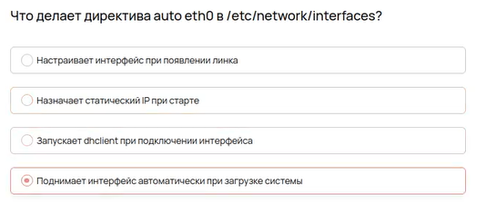{#fig-001 width=38%}

## Назначение IP-адреса

На вопрос «Какой командой можно назначить IP-адрес вручную?» выбрал вариант `ip a add 192.168.122.2/24 dev eth0`. Утилита `ip` является современным стандартом управления сетью в Linux, и синтаксис `ip a add` (или `ip addr add`) позволяет добавить IP-адрес на указанный интерфейс

## Назначение IP-адреса — снимок экрана

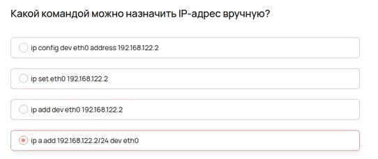{#fig-002 width=73%}

## Удаление IP

На вопрос «Какая команда используется для удаления IP с интерфейса?» выбрал вариант `ip a del 192.168.122.2/24 dev eth0`. Команда `ip a del` (delete) удаляет ранее назначенный адрес с конкретного интерфейса

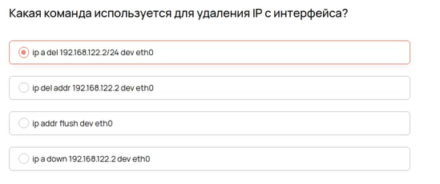{#fig-003 width=40%}

## Временные настройки

На вопрос «Что произойдет при перезагрузке, если IP-адрес был задан только через ip?» выбрал вариант «IP-адрес исчезнет». Команды утилиты `ip` вносят изменения только в оперативную память (runtime), они не сохраняются в конфигурационные файлы, поэтому после перезагрузки настройки сбрасываются

## Временные настройки — снимок экрана

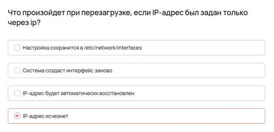{#fig-004 width=64%}

## Шлюз по умолчанию

На вопрос о шлюзе по умолчанию выбрал вариант «В поле gateway в /etc/network/interfaces». В рассматриваемой конфигурации ifupdown параметр `gateway` задаёт адрес шлюза для интерфейса

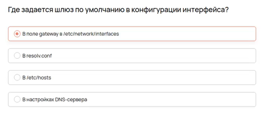{#fig-005 width=40%}

# Базовая диагностика сети

## Открытые порты

На вопрос «Какая команда показывает открытые TCP-порты и процессы, которые их слушают?» выбрал вариант `ss -tulnp`. Утилита `ss` заменяет устаревший `netstat`, а флаги `-t` (TCP), `-u` (UDP), `-l` (listening), `-n` (числовые порты) и `-p` (процессы) дают полную картину

## Открытые порты — снимок экрана

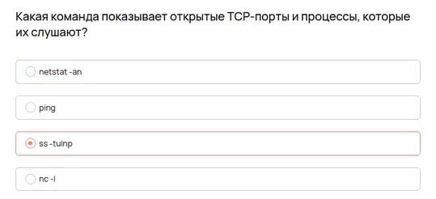{#fig-006 width=67%}

## Флаг -p

В вопросе о флаге `ss` выбрал `-p`. Этот флаг показывает процессы и их PID. Числовое отображение портов задаётся отдельным флагом `-n`, поэтому для обеих возможностей нужны `-np`

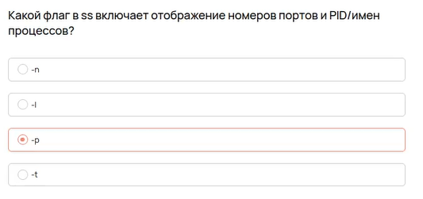{#fig-007 width=36%}

## Утилита dig

На вопрос «Что делает команда dig?» выбрал вариант «Выполняет DNS-запрос и отображает IP-адреса». `dig` (Domain Information Groper) — мощная утилита для диагностики DNS, позволяющая запрашивать различные типы записей (A, MX, TXT и др.)

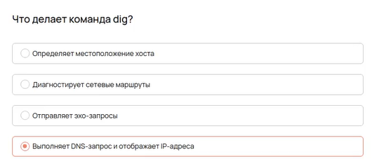{#fig-008 width=38%}

## Проверка порта

На вопрос «Какая команда может использоваться для проверки подключения к удаленному TCP-порту без передачи данных?» выбрал вариант `nc -vz`. Утилита `nc` (netcat) с флагами `-v` (verbose) и `-z` (zero-I/O mode) позволяет проверить доступность порта без отправки данных

## Проверка порта — снимок экрана

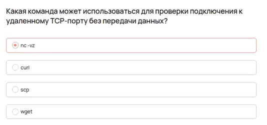{#fig-009 width=66%}

# Настройка SSH-доступа и его защита

## Публичный ключ

На вопрос «Какой файл публичного ключа нужно добавить на сервер для авторизации по ключу?» выбрал вариант `id_rsa.pub`. Это публичный ключ, который копируется на сервер и добавляется в файл `~/.ssh/authorized_keys`

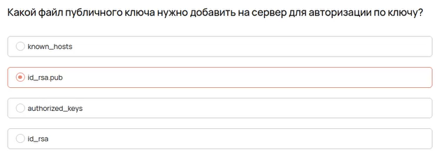{#fig-010 width=47%}

## Запрет root

Для запрета прямого входа root по SSH выбрал `PermitRootLogin no`. Эта настройка запрещает аутентификацию root через SSH. Административные действия можно выполнять после входа под разрешённой обычной учётной записью

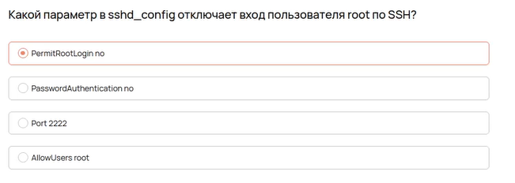{#fig-011 width=47%}

## Остановка службы

Для временной остановки SSH выбрал `systemctl stop ssh`. Команда останавливает службу, но не отключает её автозапуск. В вопросе используется имя службы `ssh`; в других дистрибутивах оно может быть `sshd`

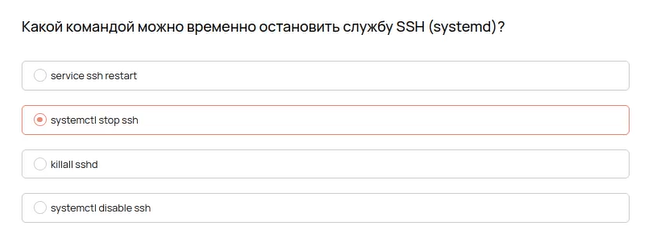{#fig-012 width=46%}

## Конфиг SSH

На вопрос «Где находится основной конфигурационный файл демона SSH-сервера?» выбрал вариант `/etc/ssh/sshd_config`. Именно этот файл (с буквой `d` на конце — daemon) отвечает за настройки серверной части SSH

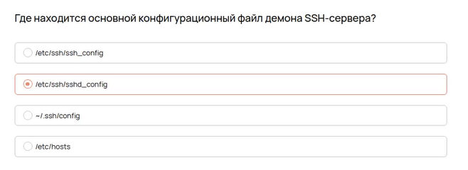{#fig-013 width=46%}

## Порт SSH

На вопрос «Какой порт использует SSH по умолчанию?» выбрал вариант «22». Порт 22 зарезервирован IANA для протокола SSH

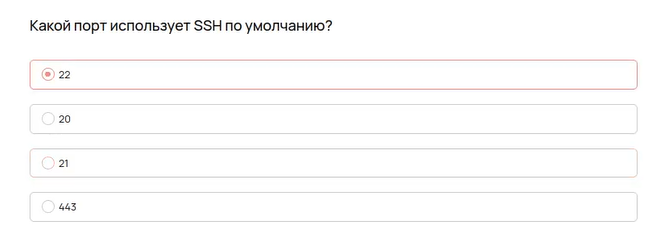{#fig-014 width=48%}

# Повышение безопасности сетевого взаимодействия

## Запуск UFW

В вопросе о включении UFW на скриншоте выбрал `ufw start`. Для активации UFW используется команда `ufw enable`; выбранный вариант не соответствует её синтаксису

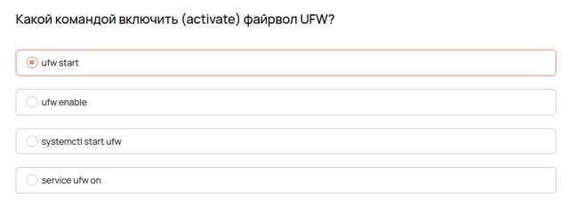{#fig-015 width=47%}

## Конфиг fail2ban

На вопрос «В каком файле fail2ban хранит свои jail-конфигурации по умолчанию?» выбрал вариант `/etc/fail2ban/jail.conf`. Этот файл содержит настройки по умолчанию, но для локальных изменений рекомендуется использовать `jail.local`

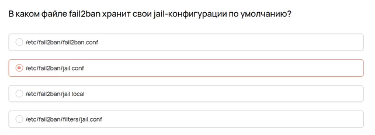{#fig-016 width=47%}

## Удаление правил

На вопрос «Какой флаг UFW позволяет указать конкретный номер правила для удаления?» выбрал вариант «нет правильного ответа». На самом деле в UFW для удаления правила по номеру используется команда `ufw delete <номер>`, и конкретный флаг `--num` не применяется

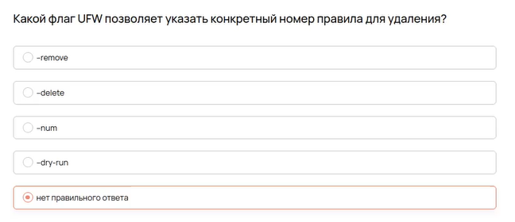{#fig-017 width=39%}

## Время блокировки

На вопрос «Какой параметр в jail-файле fail2ban задает время блокировки IP в секундах?» выбрал вариант `bantime`. Параметр `bantime` определяет, на сколько секунд (или с суффиксом, например `10m`) будет заблокирован нарушитель

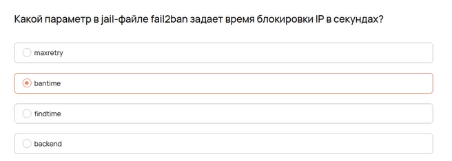{#fig-018 width=47%}

## Правило UFW

На вопрос «Какая команда добавит в UFW разрешение на SSH (порт 22) только с подсети 192.168.1.0/24?» выбрал вариант `ufw allow from 192.168.1.0/24 to any port 22`. Синтаксис `from ... to any port ...` позволяет гибко ограничивать доступ по IP-источникам

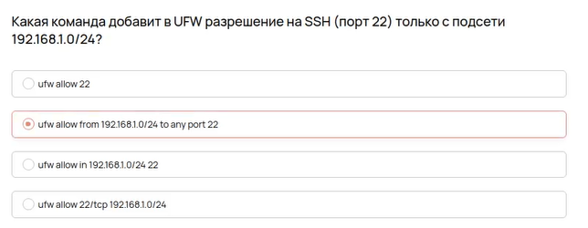{#fig-019 width=43%}

# Что такое пакеты и как они устроены

## Команда purge

Для удаления пакета вместе с его конфигурацией выбрал `purge`. Команда `apt purge` удаляет пакет и управляемые им системные конфигурационные файлы. Личные файлы пользователя при этом могут сохраняться; автоматическое удаление ненужных зависимостей является отдельной операцией

## Команда purge — снимок экрана

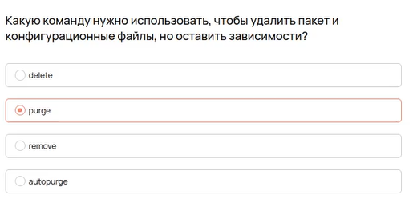{#fig-020 width=61%}

## apt update

На вопрос «Какую команду нужно выполнять регулярно?» выбрал вариант `apt update`. Эта команда обновляет локальный индекс доступных пакетов из репозиториев, не устанавливая их. Ее следует выполнять перед установкой или обновлением

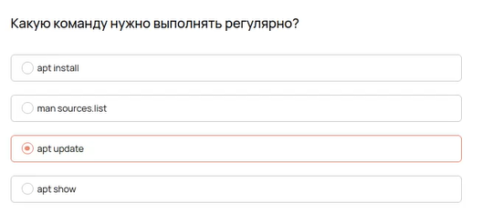{#fig-021 width=38%}

## autoremove

В вопросе об удалении зависимостей выбрал `autoremove`. Команда удаляет автоматически установленные пакеты, которые больше не нужны. Она не означает безусловное удаление всех зависимостей; без `--purge` конфигурационные файлы удаляемых пакетов могут сохраняться

## autoremove — снимок экрана

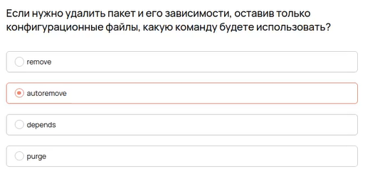{#fig-022 width=64%}

# Обновление системы и безопасность

## full-upgrade

На вопрос «С помощью какой команды можно выполнить полное обновление системы с моментальным удалением ненужных пакетов?» выбрал вариант `full-upgrade`. В отличие от обычного `upgrade`, `full-upgrade` может удалять пакеты, если это необходимо для разрешения конфликтов зависимостей при обновлении

## full-upgrade — снимок экрана

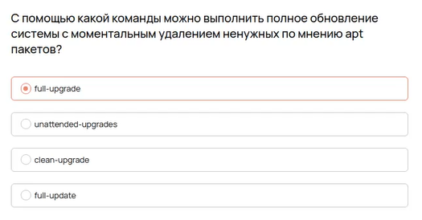{#fig-023 width=59%}

## Команда upgrade

На вопрос «Какую команду нужно использовать для установки новых версий пакетов?» выбрал вариант `upgrade`. Команда `apt upgrade` устанавливает более новые версии уже установленных пакетов

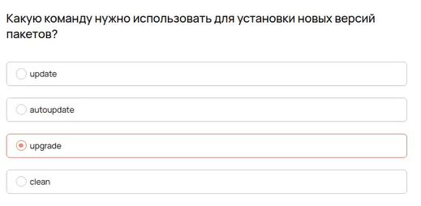{#fig-024 width=34%}

## Автообновления

На вопрос «С помощью какого пакета можно настроить автоматическое обновление системы?» выбрал вариант `unattended-upgrades`. Этот пакет позволяет автоматически загружать и устанавливать обновления безопасности

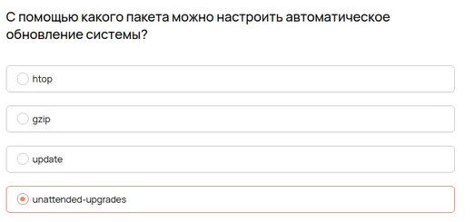{#fig-025 width=36%}

# Работа с зависимостями и решение конфликтов

## Исправление зависимостей

На вопрос «Какую команду нужно использовать, чтобы система попробовала установить недостающие зависимости?» выбрал вариант `--fix-broken install`. Этот флаг заставляет `apt` попытаться исправить сломанные зависимости

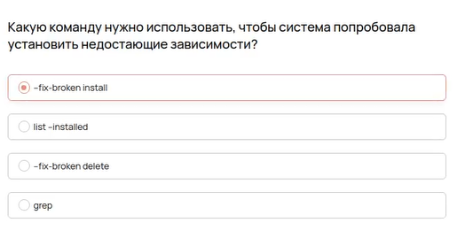{#fig-026 width=33%}

## Фильтрация через grep

На вопрос «Что нужно применить в выводе, чтобы найти информацию по конкретному пакету?» выбрал вариант `grep`. Утилита `grep` используется для фильтрации текста (например, при поиске в выводе `apt list` или файлах логов)

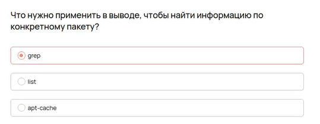{#fig-027 width=43%}

## Разрыв зависимостей

В вопросе об удалении пакета, от которого зависят другие, выбрал «Разрыв зависимостей». Такая ситуация возможна при принудительном удалении компонента. Обычно APT проверяет зависимости и предлагает согласованные изменения либо отказывается выполнять несовместимую операцию

## Разрыв зависимостей — снимок экрана

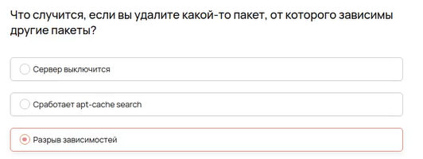{#fig-028 width=82%}

# Работа с локальными .deb-пакетами и сторонними источниками

## Действия при отсутствии пакета

Если нужного пакета нет в репозитории SelectOS, выбрал ответ «Создать тикет через панель управления». В рамках вопроса курса это означает обращение в поддержку для уточнения возможности добавления или установки пакета

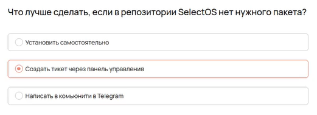{#fig-029 width=46%}

## GPG-подпись

Для проверки подлинности выбрал «GPG-подпись». В APT проверяется подпись метаданных репозитория, а целостность пакетов контролируется по указанным в этих метаданных контрольным суммам

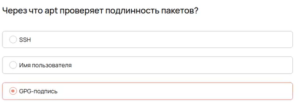{#fig-030 width=48%}

## Установка .deb

На вопрос «Какой вариант установки .deb-файлов рекомендован?» выбрал вариант `apt`. Использование `apt install ./package.deb` предпочтительнее, чем `dpkg -i`, так как `apt` автоматически подтянет необходимые зависимости

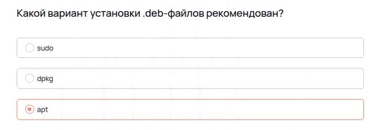{#fig-031 width=48%}

# Знакомство с логами

## Диагностика 502

При диагностике ответа «502 Bad Gateway» выбрал изучение журнала ошибок веб-сервера, например `/var/log/nginx/error.log`. Записи помогают установить, что произошло при обращении к серверу приложения, и определить дальнейшие проверки

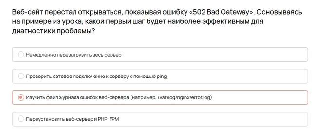{#fig-032 width=40%}

## Хранение логов

Для расположения системных журналов выбрал текстовые файлы в `/var/log/` и бинарный журнал systemd, доступный через `journalctl`. Использование обоих способов зависит от состава и настроек системы логирования

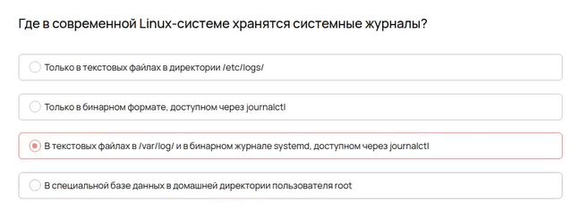{#fig-033 width=45%}

## Задачи логов

На вопрос «Какие три ключевые задачи системного администратора решаются с помощью анализа логов?» выбрал вариант «Диагностика сбоев, расследование инцидентов безопасности, аудит производительности». Логи — это основной источник информации для этих трех направлений

## Задачи логов — снимок экрана

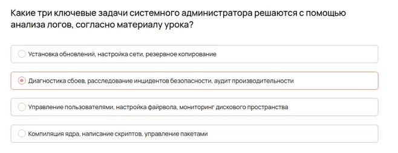{#fig-034 width=80%}

# Система логирования в Linux

## Категория facility

На вопрос «Каково назначение «категории» (facility) в сообщениях syslog?» выбрал вариант «Указывать на источник сообщения (например, ядро, служба аутентификации, планировщик cron) для маршрутизации». `Facility` определяет тип программы, сгенерировавшей сообщение

## Категория facility — снимок экрана

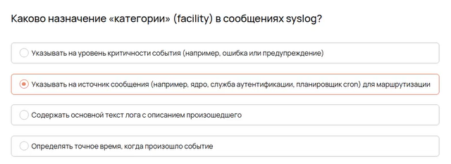{#fig-035 width=85%}

## Уровень error

На вопрос «Служба не смогла запуститься при старте системы. Какой уровень важности будет присвоен этому событию?» выбрал вариант `error`. Уровень `error` используется для некритичных, но серьезных ошибок, которые не позволяют конкретному компоненту выполнить свою функцию

## Уровень error — снимок экрана

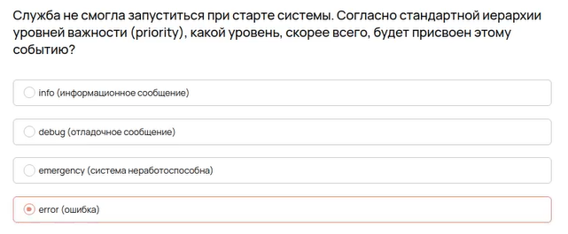{#fig-036 width=74%}

## systemd и rsyslog

На вопрос «Каково типичное взаимодействие между systemd-journald и rsyslog?» выбрал вариант «systemd-journald собирает все системные сообщения и может перенаправлять их в rsyslog для записи в текстовые файлы». Журнал systemd собирает данные, а rsyslog может забирать их и писать в `/var/log/syslog` или `messages`

## systemd и rsyslog — снимок экрана

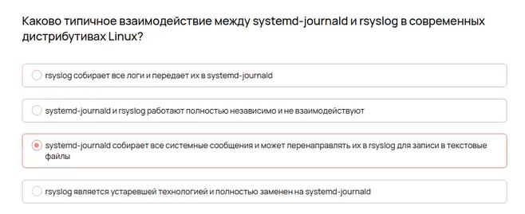{#fig-037 width=75%}

# Поиск и фильтрация логов под конкретные задачи

## awk $3

В задании о `awk` выбрал вывод третьего поля каждой строки. В выражении `awk '{print $3}'` обозначение `$3` относится к третьему полю; при стандартном разбиении поля разделяются последовательностями пробелов и табуляций

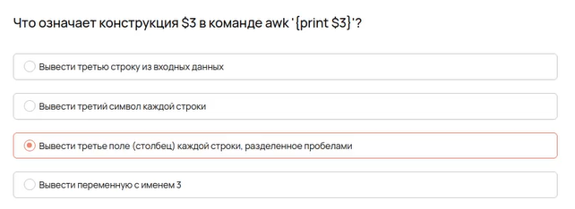{#fig-038 width=46%}

## Подсчет уникальных

На вопрос «Какой конвейер команд правильно подсчитает количество вхождений каждого уникального IP-адреса?» выбрал вариант `sort ip_list.txt | uniq -c`. Сначала `sort` сортирует строки, чтобы одинаковые IP шли подряд, а затем `uniq -c` подсчитывает их количество

## Подсчет уникальных — снимок экрана

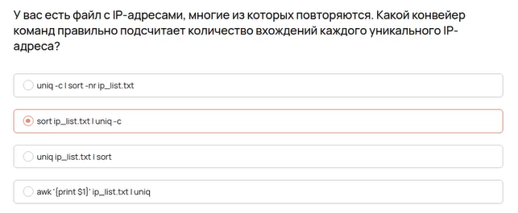{#fig-039 width=75%}

## Исключение через grep -v

Для поиска сообщений об ошибках без упоминания healthcheck на снимке выбрал `grep -v "error" /var/log/syslog | grep "healthcheck"`. Этот конвейер исключает строки с error и оставляет строки с healthcheck. Условию задания соответствует обратная комбинация: `grep "error" /var/log/syslog | grep -v "healthcheck"`

## Исключение через grep -v — снимок экрана

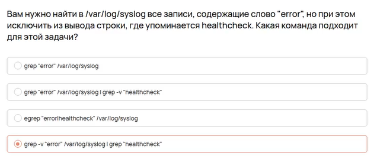{#fig-040 width=73%}

# Расследование инцидентов по логам

## Поиск по sudo

Для поиска действий с повышенными привилегиями выбрал записи с `sudo:` в `/var/log/auth.log` или syslog. При настроенном журналировании sudo эти записи помогают установить пользователя, время и выполнявшуюся команду

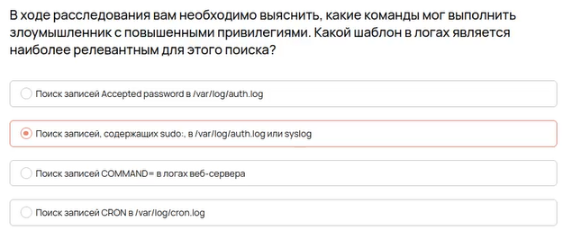{#fig-041 width=40%}

## Целостность доказательств

Для контроля целостности собранных журналов выбрал вычисление и сохранение криптографического хеша, например SHA256. Последующее сравнение с надёжно сохранённым исходным хешем позволяет обнаружить изменение файла

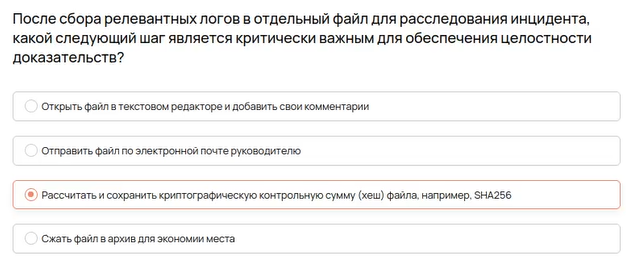{#fig-042 width=40%}

## Брутфорс

На вопрос «Вы наблюдаете в логах сотни попыток входа за короткое время для пользователей admin, root, test, user с одного IP. Какой тип активности это означает?» выбрал вариант «Автоматизированная атака по подбору пароля (brute-force) и перебору имен пользователей». Такое поведение характерно для ботов, пытающихся взломать сервер

## Брутфорс — снимок экрана

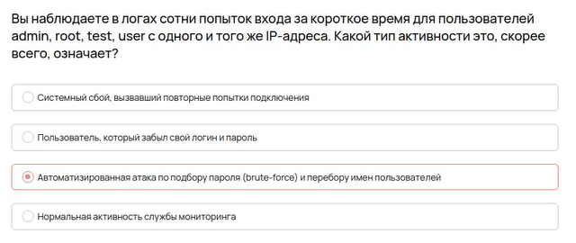{#fig-043 width=73%}

# Управление жизненным циклом логов и ротация

## Удаленный сервер

В качестве преимущества удалённого сбора логов выбрал сохранение следов событий при удалении локальных журналов. Отдельный защищённый сервер журналирования усложняет уничтожение записей при компрометации исходного узла

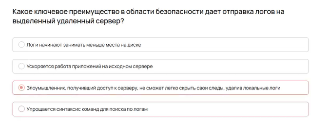{#fig-044 width=44%}

## Grafana Loki

Для сценария Kubernetes с поиском по меткам выбрал Grafana Loki. В рассматриваемой модели Loki индексирует метки, а тексты журналов хранит в сжатом виде; это соответствует условию задачи, где полнотекстовый поиск не является приоритетом

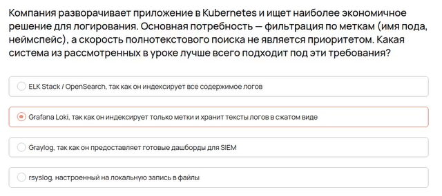{#fig-045 width=38%}

## logrotate

На вопрос «Какую основную и наиболее насущную проблему решает утилита logrotate?» выбрал вариант «Предотвращение исчерпания свободного места на диске из-за неконтролируемого роста лог-файлов». `logrotate` автоматически архивирует, сжимает и удаляет старые логи

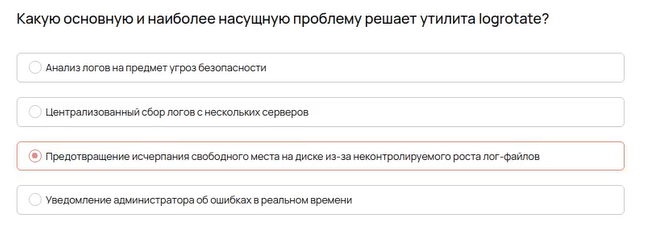{#fig-046 width=48%}

# Контейнеризация как подход

## podman info

На вопрос «Какая команда позволяет проверить конфигурацию Podman?» выбрал вариант `podman info`. Эта команда выводит подробную информацию о системе, хранилище и текущей конфигурации Podman

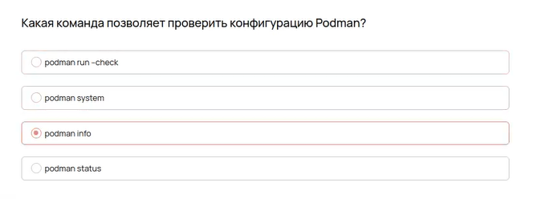{#fig-047 width=45%}

## Отличие Podman

На вопрос «Чем Podman отличается от Docker?» выбрал вариант «Не требует фонового демона». Podman работает в архитектуре без демона (daemonless), запуская контейнеры как дочерние процессы

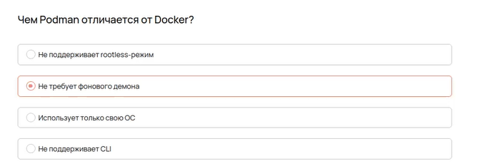{#fig-048 width=49%}

## Флаг --rm

В вопросе о ключе удаления выбрал «Удаляет контейнер после завершения». Корректное написание параметра — `--rm`: после завершения удаляется контейнер, а базовый образ сохраняется

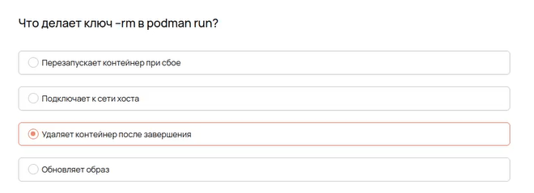{#fig-049 width=46%}

## Безопасность Podman

На вопрос «Почему Podman безопаснее для многопользовательских систем?» выбрал вариант «Поддерживает запуск без root и демона». Rootless-режим позволяет обычным пользователям запускать контейнеры, снижая риск компрометации всей системы

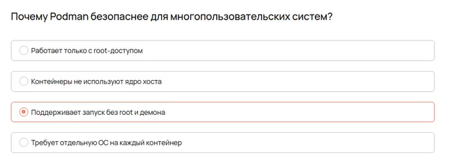{#fig-050 width=46%}

## Без демона

На вопрос «Какой компонент не нужен при работе с Podman?» выбрал вариант «Системный демон». Как уже упоминалось, Podman является daemonless-решением

{#fig-051 width=46%}

# Работа с контейнерами в Podman

## Монтирование

На вопрос «Что делает флаг -v при запуске контейнера?» выбрал вариант «Монтирует директорию с хоста внутрь контейнера». Флаг `-v` (volume) используется для сохранения данных и обмена файлами между хостом и контейнером

{#fig-052 width=47%}

## Проброс портов

На вопрос «Какая команда запускает контейнер с пробросом порта 8080 на 80?» выбрал вариант `podman run -p 8080:80 nginx`. Флаг `-p` (publish) связывает порт хоста с портом внутри контейнера

{#fig-053 width=48%}

## Интерактивный режим

Для флагов `-it` выбрал вариант «Откроется shell внутри контейнера». Точнее, `-i` сохраняет открытый стандартный ввод, а `-t` выделяет псевдотерминал. Оболочка открывается, если именно она задана запускаемой командой

{#fig-054 width=46%}

## Удаление контейнера

В вопросе о `--rm` на скриншоте выбрал «Удаляет образ после использования». Фактическое назначение `--rm` — автоматическое удаление контейнера после завершения; образ этим параметром не удаляется

{#fig-055 width=47%}

## Все контейнеры

На вопрос «Как просмотреть все (включая остановленные) контейнеры?» выбрал вариант `podman ps -a`. Флаг `-a` (all) отображает все контейнеры, а не только запущенные

{#fig-056 width=47%}

# Управление ресурсами контейнеров

## podman stats

На вопрос «Какая команда позволяет отслеживать использование ресурсов контейнера в реальном времени?» выбрал вариант `podman stats`. Аналог команды `top` для контейнеров

{#fig-057 width=42%}

## Фоновый режим

На вопрос «Что делает флаг -d при запуске контейнера?» выбрал вариант «Запускает контейнер в фоновом режиме». Флаг `-d` (detach) отсоединяет терминал от контейнера

{#fig-058 width=46%}

## daemon-reload

В вопросе о `systemctl daemon-reload` на снимке выбрал «Запускает автозагрузку сервиса». Команда в действительности перечитывает unit-файлы и обновляет зависимости systemd. Для включения автозапуска службы используется `systemctl enable`

{#fig-059 width=45%}

## Логи контейнера

На вопрос «Как просмотреть логи контейнера?» выбрал вариант `journalctl -u имя.service`. Если контейнер запущен как служба systemd, его логи можно читать через `journalctl` с флагом `-u` (unit)

{#fig-060 width=46%}

## Ограничение памяти

Для `--memory=512m` выбрал установку жёсткого ограничения памяти контейнера. Параметр задаёт лимит, а не резервирует и не гарантирует наличие 512 МБ свободной оперативной памяти

{#fig-061 width=44%}

# Финальный тест

## Комментарий в скрипте

После тематических разделов выполнил итоговый тест из 17 вопросов. Далее привёл ответы в порядке прохождения и итоговый результат.

Для добавления комментария в скрипт выбрал символ `#`. В Bash он обозначает начало комментария в соответствующем контексте

## Комментарий в скрипте — снимок экрана

{#fig-062 width=56%}

## Терминал и оболочка

Выбрал ответ, что терминал обеспечивает ввод и вывод, а оболочка интерпретирует команды. Эти компоненты выполняют разные функции при работе с командной строкой

## Терминал и оболочка — снимок экрана

{#fig-063 width=59%}

## Справочная система Info

Для команды `info` выбрал открытие справки в формате Info для заданной команды. Такой формат позволяет переходить между связанными разделами документации

{#fig-064 width=45%}

## Обновление индекса пакетов

Выбрал `apt update`. Эта команда обновляет сведения о пакетах из подключённых репозиториев; установку новых версий выполняют отдельно

{#fig-065 width=44%}

## Свободное программное обеспечение

Выбрал возможность модификации программы под свои задачи без нарушения авторских прав. Такая возможность предоставляется условиями свободной лицензии

{#fig-066 width=46%}

## Справочные страницы man

Для получения подробной справочной информации выбрал `man`. Страницы руководства описывают назначение, синтаксис и параметры команд

{#fig-067 width=44%}

## Обязанности администратора

К основным обязанностям системного администратора отнёс мониторинг состояния серверов. Он помогает контролировать доступность служб и использование ресурсов

{#fig-068 width=44%}

## Назначение каталога /opt

Выбрал размещение дополнительного программного обеспечения в `/opt`. Этот каталог предназначен для дополнительных программных пакетов; способ их распространения может различаться

{#fig-069 width=46%}

## Чтение данных через cat

Для просмотра содержимого файлов выбрал `cat`. Команда подходит, например, для текстовых интерфейсов `/proc`; возможность её использования с файлами устройств зависит от конкретного устройства

{#fig-070 width=40%}

## Права доступа 754

Для значения `754` выбрал права `rwxr-xr--`: владельцу доступны чтение, запись и выполнение, группе — чтение и выполнение, остальным — чтение

{#fig-071 width=44%}

## DNS-запросы

Для `dig` выбрал выполнение DNS-запроса и отображение IP-адресов. Команда также позволяет запрашивать другие типы DNS-записей

{#fig-072 width=46%}

## Обновление пакетов

Для установки новых версий пакетов выбрал `upgrade`. В APT эта операция выполняется командой `apt upgrade`

{#fig-073 width=44%}

## Просмотр прав файлов

Выбрал `ls -l`. Подробный вывод содержит тип объекта, права доступа, владельца, группу и другие сведения о файле

{#fig-074 width=44%}

## Признаки перебора паролей

Сотни попыток входа под разными именами с одного IP-адреса отнёс к признакам автоматизированного перебора паролей и имён пользователей

{#fig-075 width=38%}

## Каталог журналов

Для основных лог-файлов Linux выбрал `/var/log/`. В нём размещаются журналы системы и приложений согласно их настройкам

{#fig-076 width=44%}

## Операторы изменения прав

Для изменения прав выбрал операторы `+`, `-` и `=`. В символьной записи chmod они добавляют, снимают или задают права соответственно

{#fig-077 width=44%}

## Учёт административных действий

В вопросе о sudo выбрал фиксацию пользователя и времени выполнения команды с повышенными правами. Такое журналирование позволяет прослеживать административные действия

{#fig-078 width=45%}

## Результат финального теста

Завершил финальное тестирование с результатом **17 из 17**. На странице результата отображается сообщение «Тест пройден»

## Результат финального теста — снимок экрана

{#fig-079 width=52%}

# Выводы

## Выводы

В ходе третьего этапа изучил настройку сетевых интерфейсов, диагностику соединений, защиту SSH и управление пакетами. Закрепил знания о сборе, фильтрации и ротации журналов, а также о запуске и ограничении ресурсов контейнеров Podman. Выполнил тематические тесты и завершил финальное тестирование с результатом 17 из 17.

# Список литературы {.unnumbered}

## Список литературы

1. [Онлайн-курс «Системный администратор Linux с нуля»](https://study.selectel.ru/members/courses/course756726784647).

